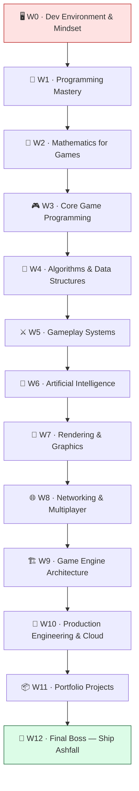

# 🗺️ Ashfall Bootcamp — Master Curriculum Bible

> The single source of truth for every world author. **Flagship project: Ashfall** — a 2D top-down action-roguelite in Unity/C#, one codebase that grows across all 13 worlds at **Pixel Forge Studios**. Each world solves an in-world teammate ticket and ends in a boss battle. Read [phases/AUTHORING_SPEC.md](phases/AUTHORING_SPEC.md) for format; read this for scope. Lesson scopes are intentionally **non-overlapping** — do not bleed one lesson's topic into another.

---

## 🖥️ World 0 — Dev Environment & Mindset
**Ticket (IT Support):** "Welcome to Pixel Forge! Your dev box is bare. Install Unity + an editor, clone our repo conventions, and prove you can build & run an empty project — before Maya hands you real work."
**Boss Battle — "First Build, First Commit":** create the Ashfall repo, produce a runnable empty Unity build, and push a clean first commit with `.gitignore` working.

1. **01-meet-the-studio-and-the-loop** — First principles of what a game *is*: the **game loop** (input → update → render at a fixed cadence) that every engine on earth runs. Builds nothing in Ashfall yet but frames the whole job and the engine-agnostic mindset. Sets up why we need a real engine next.
2. **02-install-unity-and-editor** — Install Unity Hub + Unity (Personal, free) and a C# editor (VS Code/Rider), and tour the Editor as a *tool over a runtime*. Creates the empty **Ashfall** Unity project on disk. Sets up the need to version-control it.
3. **03-version-control-with-git** — Git from first principles (commits as snapshots, branches, the Unity `.gitignore`). Turns `~/projects/ashfall` into a git repo with a sane ignore file and first commit. Sets up branching discipline used in every future Project Mission.
4. **04-engineer-mindset-and-debugging** — How pros think: read errors, isolate, use the debugger/`Debug.Log`, search docs not memorize. Adds a tiny `Hello Ashfall` script logging on `Start()` to prove the toolchain. Sets up writing real architecture in W1.

---

## 🧠 World 1 — Programming Mastery (Advanced C#)
**Ticket (Kenji):** "Before you write gameplay, write code we can live with for two years. Our last prototype was 3000-line spaghetti. Let's set up clean architecture, events, and SOLID from day one."
**Boss Battle — "Refactor the Spaghetti":** take a deliberately messy single-class prototype and refactor it into managers + events + interfaces with zero behavior change.

1. **01-csharp-types-and-memory** — First principles of value vs reference types, the stack/heap, structs vs classes, and garbage collection (why allocations cause frame hitches in games). Builds Ashfall's core data types (a `Stats` struct, a `Health` class). Sets up the OOP modeling next.
2. **02-oop-and-composition** — Encapsulation, inheritance vs **composition**, and "favor composition" via Unity's component model. Builds an `Entity` made of composed components (Health, Mover) instead of a deep hierarchy. Sets up interfaces/SOLID.
3. **03-interfaces-and-solid** — Abstraction via `interface`, and the **SOLID** principles (esp. SRP, DIP) as the cure for spaghetti. Introduces `IDamageable`, `IInteractable` used by all later combat/interaction. Sets up decoupling via events.
4. **04-events-and-the-observer-pattern** — Delegates, `Action`/`event`, and the **observer pattern**/event bus for decoupled communication. Builds a central `GameEvents` bus (e.g. `OnPlayerDamaged`). Sets up the managers that publish/subscribe.
5. **05-managers-and-game-state** — The **singleton/service** pattern done safely, a `GameManager` and a finite game-state model (Menu/Playing/Paused). Builds Ashfall's bootstrap and state machine for app flow. Sets up movement math in W2 with a clean home for systems.

---

## 📐 World 2 — Mathematics for Games
**Ticket (Maya):** "The player needs to *move* and *aim* and it has to feel right. That's all math. Give me vectors, smoothing, and angles I can tune."
**Boss Battle — "The Aiming Reticle":** implement a turret/reticle that smoothly rotates to face the mouse using trig + lerp, framerate-independent.

1. **01-vectors-and-coordinate-spaces** — First principles of `Vector2`/`Vector3`, world vs local space, magnitude, and normalization (why you normalize a direction). Builds Ashfall's movement direction vector from input. Sets up dot/cross products.
2. **02-dot-and-cross-products** — The **dot product** (angle/facing/projection) and **cross product** (sidedness/perpendicular), from first principles. Builds a field-of-view check ("is the player in front of me?") reused by AI later. Sets up rotation/trig.
3. **03-trigonometry-and-rotation** — Sin/cos/atan2, radians vs degrees, rotating vectors and aiming. Builds aim-angle-to-mouse and a circular spread for projectiles. Sets up interpolation for smoothing.
4. **04-interpolation-and-easing** — **Lerp/Slerp**, easing curves, and `Time.deltaTime` for **framerate independence**. Builds smooth camera follow and smoothed aim rotation. Sets up applying all of it as transforms.
5. **05-transforms-and-delta-time** — Matrices/transforms intuition, position/rotation/scale, and frame-rate-independent motion. Builds a reusable `Mover` that converts input+math into actual movement. Sets up the full player controller in W3.

---

## 🎮 World 3 — Core Game Programming
**Ticket (Kenji):** "Time to make Ashfall playable. A character you can drive with a camera that follows, collisions that stop you, and a save file that survives a restart."
**Boss Battle — "The Playable Slice":** a top-down player you can move, that collides with walls, is followed by the camera, and whose position/HP saves & loads.

1. **01-the-input-system** — Input as an abstraction layer (devices → actions), polling vs events, rebinding. Builds Ashfall's input layer (`Move`, `Aim`, `Fire`) decoupled from devices. Sets up feeding input into the controller.
2. **02-player-controller-and-physics** — Rigidbody2D vs transform movement, fixed timestep, forces vs velocity. Builds the top-down `PlayerController` driving the W2 `Mover`. Sets up collision.
3. **03-collision-and-triggers** — Colliders, layers, collision vs **trigger**, the collision matrix, raycasts. Builds walls that stop the player and pickup triggers. Sets up the camera that frames it all.
4. **04-camera-systems** — Camera follow, deadzones, clamping to bounds, screen-to-world. Builds a smoothed top-down follow camera (using W2 lerp). Sets up persisting the state we now have.
5. **05-saving-and-loading** — Serialization basics, JSON save files, `Application.persistentDataPath`, save/load lifecycle. Builds a `SaveSystem` persisting player position + HP. Sets up procedural worlds in W4 that will also need saving.

---

## 🧮 World 4 — Algorithms & Data Structures
**Ticket (Maya):** "Every run must feel new. Generate a dungeon, and make enemies actually path to the player instead of walking into walls."
**Boss Battle — "The Infinite Dungeon":** generate a connected random dungeon and have an agent A*-path from entrance to the player across it.

1. **01-big-o-and-data-structures** — Complexity from first principles and choosing arrays vs `List`/`Dictionary`/`HashSet`/`Queue`/`Stack` by access pattern. Builds Ashfall's tile-map data model. Sets up graph thinking.
2. **02-graphs-grids-and-traversal** — Grids as graphs, neighbors, **BFS/DFS**, flood fill. Builds connectivity checks + BFS reachability over the dungeon grid. Sets up weighted shortest paths.
3. **03-a-star-pathfinding** — **A\*** = Dijkstra + heuristic, open/closed sets, admissible heuristics (Manhattan). Builds a reusable `Pathfinder` returning a path of tiles. Sets up making pathfinding fast spatially.
4. **04-procedural-generation-and-spatial-grids** — PRNG + seeds, room/corridor generation, and a **spatial hash grid** for fast neighbor queries. Builds Ashfall's dungeon generator and a spatial grid feeding the pathfinder/queries. Sets up populating dungeons with systems in W5.

---

## ⚔️ World 5 — Gameplay Systems
**Ticket (Maya):** "Now the *game* part: items, abilities, hits that hurt, poison that ticks, and loot worth grabbing. Make it data-driven so I can tune it without you."
**Boss Battle — "The Loot Run":** clear a room — use an ability, take damage, get poisoned, kill an enemy, and have it drop loot you can pick up and equip.

1. **01-data-driven-design-with-scriptableobjects** — Data vs code separation via **ScriptableObjects** so designers tune without recompiling. Builds `ItemSO`/`AbilitySO` data assets. Sets up systems that consume that data.
2. **02-inventory-and-equipment** — Inventory data structures, stacking, equip slots, item events. Builds Ashfall's `Inventory` + equipment affecting `Stats`. Sets up using items as abilities.
3. **03-abilities-and-cooldowns** — Ability pattern (command objects), cooldown timers, costs, casting. Builds a dash + a projectile ability driven by `AbilitySO`. Sets up resolving what abilities hit.
4. **04-combat-and-damage** — Damage pipeline (`IDamageable` from W1), hit detection, i-frames, knockback. Builds Ashfall's combat resolver applying damage. Sets up effects layered on top.
5. **05-status-effects-loot-and-economy** — A modular **status-effect** system (DoT/buffs), loot tables + drop rates, currency/economy. Builds poison/burn, loot drops, and gold. Sets up enemies smart enough to use combat in W6.

---

## 🤖 World 6 — Artificial Intelligence
**Ticket (Kenji):** "Enemies are dumb. Make them patrol, notice the player, chase, attack, flee when hurt — and give me one real boss with phases."
**Boss Battle — "The Ashen Warden":** a multi-phase boss combining FSM + behavior tree that patrols, pursues, attacks in patterns, and changes behavior at low HP.

1. **01-finite-state-machines** — **FSM** from first principles: states, transitions, a clean state pattern (vs `if`-soup). Builds an enemy FSM (Patrol/Chase/Attack). Sets up perception driving transitions.
2. **02-perception-and-sensing** — Vision cones (reusing W2 dot product), line-of-sight raycasts, hearing/aggro. Builds enemy detection feeding the FSM. Sets up moving intelligently once detected.
3. **03-steering-and-navigation** — Steering behaviors (seek/flee/arrive/avoid) layered on W4 A* paths. Builds enemy movement that follows paths and dodges obstacles. Sets up scaling AI complexity.
4. **04-behavior-trees** — **Behavior trees** (selectors/sequences/decorators) for composable, designer-readable AI vs sprawling FSMs. Builds a BT-driven elite enemy. Sets up the boss combining both paradigms.
5. **05-boss-design-and-utility-ai** — Phases, attack patterns/telegraphs, and **utility AI** (scoring actions). Builds the Ashen Warden's phase logic and decision scoring. Sets up making it all *look* great in W7.

---

## 🎨 World 7 — Rendering & Graphics
**Ticket (Lena):** "Ashfall plays well but looks flat. Give me dynamic 2D lighting, a couple of shaders, particles, and post-processing so it reads as a real game."
**Boss Battle — "Atmosphere Pass":** light a dungeon room with shadows, add a dissolve/hit-flash shader, particles on impact, and a post-processing stack — at stable framerate.

1. **01-the-rendering-pipeline** — First principles of the GPU pipeline (vertices → fragments), sprites, draw calls, batching, the URP. Builds Ashfall on URP and audits draw calls. Sets up writing shaders that run in that pipeline.
2. **02-shaders-and-materials** — Vertex/fragment shaders, UVs, properties; a hit-flash + dissolve shader (Shader Graph and a hand-written `hlsl` example). Builds Ashfall's damage flash + enemy death dissolve. Sets up lighting that interacts with materials.
3. **03-2d-lighting-and-shadows** — 2D lights, normal maps, shadow casters, emissive glow. Builds dynamic torch/player lighting in dungeons. Sets up motion/particles on top of the lit scene.
4. **04-particles-postprocessing-and-juice** — Particle systems, post-processing (bloom/vignette/chromatic aberration), screen shake, "game feel"/juice. Builds impact VFX + a post stack + camera shake. Sets up sharing this polished game online in W8.

---

## 🌐 World 8 — Networking & Multiplayer  *(folds in cloud/DevOps)*
**Ticket (Priya):** "Players want co-op. Sync two players over the network authoritatively, then containerize a dedicated server so we can run it anywhere — starting with Docker."
**Boss Battle — "Co-op in a Container":** two clients play one Ashfall dungeon together via a server-authoritative model, and the server runs as a **Docker** container.

1. **01-networking-fundamentals** — First principles: TCP vs UDP, latency, packets, client-server vs peer-to-peer, why games use UDP. Builds a mental + diagram model of Ashfall's net topology. Sets up choosing an authority model.
2. **02-state-sync-and-authority** — **Server authority**, client prediction + reconciliation, interpolation, anti-cheat basics. Builds replicated player movement (Netcode for GameObjects). Sets up syncing gameplay, not just transforms.
3. **03-co-op-gameplay-and-rpcs** — RPCs, network variables, ownership; spawning, shared dungeon seed, synced combat/loot. Builds true 2-player co-op in one dungeon. Sets up running a headless server somewhere.
4. **04-dedicated-server-and-docker** — Headless server builds, **Docker** (images, containers, Dockerfile), why containers = reproducible servers. Builds a Dockerized Ashfall dedicated server image run locally. Sets up the architecture refactor in W9 (and cloud deploy in W10).

---

## 🏗️ World 9 — Game Engine Architecture
**Ticket (Kenji):** "We're hitting GC spikes with hundreds of entities. Refactor the hot paths toward data-oriented design and lock down our serialization & asset pipeline so this scales."
**Boss Battle — "1000 Entities at 60 FPS":** simulate 1000+ entities (bullets/enemies) at 60 FPS via an ECS-lite, pooled, data-oriented refactor with robust save/load.

1. **01-data-oriented-design** — DOD first principles: cache lines, AoS vs SoA, why OOP-heavy loops thrash cache. Builds a profiled, struct-of-arrays hot path for projectiles. Sets up a real ECS-lite structure.
2. **02-ecs-lite-and-object-pooling** — Entities/components/systems pattern + **object pooling** to kill runtime allocations. Builds Ashfall's ECS-lite bullet/enemy system with pools. Sets up persisting that data cleanly.
3. **03-serialization-and-asset-pipeline** — Robust serialization (versioned saves, binary vs JSON), addressables/asset references, content pipeline. Builds versioned Ashfall saves + an asset-loading layer. Sets up modular subsystems.
4. **04-subsystems-and-engine-layering** — Engine layering (core/platform/gameplay), service locator vs DI, the bootstrap order — what "engine architecture" means generically. Refactors Ashfall into clean layered subsystems. Sets up automating builds/deploys in W10.

---

## 🚀 World 10 — Production Engineering & Cloud  *(folds in cloud/DevOps)*
**Ticket (Priya):** "Manual builds and a laptop server won't ship. Set up CI/CD, automate builds, profile performance, and deploy the dedicated server to AWS on Kubernetes via Terraform."
**Boss Battle — "Ship the Server":** a green CI/CD pipeline that builds Ashfall on push, plus the Dockerized server deployed to a Kubernetes cluster on AWS via Terraform, reachable by a client.

1. **01-profiling-and-optimization** — Measuring before optimizing: the profiler, CPU/GPU/memory, frame budget, finding hotspots. Builds a profiling pass + fixes on Ashfall. Sets up automating the build that we now trust.
2. **02-automated-builds-and-ci-cd** — CI/CD first principles, **GitHub Actions**, automated Unity builds + tests on push. Builds Ashfall's CI pipeline producing artifacts. Sets up shipping containers, not just artifacts.
3. **03-containers-and-the-cloud** — Cloud model, AWS free-tier basics, registries, pushing the W8 server image, **Kubernetes** concepts (pods/services/deployments). Builds the Ashfall server pushed to a registry + run on a local k8s. Sets up codifying that infra.
4. **04-infrastructure-as-code-with-terraform** — IaC + **Terraform** (providers, state, plan/apply), provisioning an AWS Kubernetes (EKS) cluster reproducibly. Builds the Terraform that stands up Ashfall's server infra. Sets up the deploy that ties CI → image → cluster.
5. **05-deploy-monitor-and-operate** — Deploying to the cluster, rolling updates, logs/metrics/alerts, cost control + teardown. Builds the live deployed Ashfall dedicated server with monitoring. Sets up branching into portfolio breadth in W11.

---

## 📦 World 11 — Portfolio Projects
**Ticket (Theo):** "To get hired you need *range*. Build six small, sharp prototypes in other genres — proof you can apply Ashfall's skills anywhere."
**Boss Battle — "Portfolio Review":** present all six prototypes as a polished, documented portfolio (READMEs, GIFs, a one-page case study each) ready to show a hiring manager.
*(These six "lessons" are standalone project **briefs**, not Ashfall additions.)*

1. **01-brief-2d-platformer** — A precise 2D platformer (coyote time, jump buffering, variable jump height): applies W2 math + W3 controllers/collision in a new movement feel. Sets up contrasting genres.
2. **02-brief-tower-defense** — A tower-defense level: applies W4 pathfinding/grids + W5 economy/wave systems + W6 simple AI. Sets up systems-heavy design.
3. **03-brief-puzzle-game** — A grid/logic puzzle (e.g. Sokoban/match): applies W4 data structures + W1 clean state/undo. Sets up turn-based logic.
4. **04-brief-turn-based-roguelike** — A turn-based roguelike: applies W4 procedural gen + W6 AI + W5 items in a turn loop (vs Ashfall's real-time). Sets up shooter feel.
5. **05-brief-top-down-shooter** — A bullet-heavy top-down shooter: applies W9 pooling/DOD + W7 juice for performance under load. Sets up multiplayer breadth.
6. **06-brief-multiplayer-mini-engine** — A tiny multiplayer prototype / mini-engine slice: applies W8 networking + W9 architecture from scratch to prove engine-agnostic depth. Sets up the final capstone.

---

## 👑 World 12 — Final Boss — Ship Ashfall
**Ticket (Theo):** "This is it. Take Ashfall from prototype to a polished, optimized, deployed vertical slice with docs — and ship it. Studio's watching."
**Boss Battle — "Launch Day":** release the Ashfall vertical slice — playable, performant, deployed, documented, and tagged `v1.0`.
*(These three "lessons" are capstone **milestones**.)*

1. **01-milestone-systems-and-architecture** — Integration milestone: assemble all systems (architecture, math, gameplay, AI, rendering, net) into one cohesive vertical slice. Locks Ashfall's feature set and clean architecture. Sets up the polish pass.
2. **02-milestone-optimization-and-polish** — Polish + performance milestone: profile to a stable frame budget, add game feel/UX/audio, fix bugs. Brings Ashfall to shippable quality. Sets up the release.
3. **03-milestone-build-deploy-and-document** — Release milestone: final builds via CI/CD, server deployed (W10), README/trailer/case study, tag `v1.0`. Ships Ashfall and closes the bootcamp.

---

[↑ Home](README.md) · [🗺️ Roadmap](ROADMAP.md) · [📊 Progress](PROGRESS.md) · [🛠️ Authoring Spec](phases/AUTHORING_SPEC.md)
