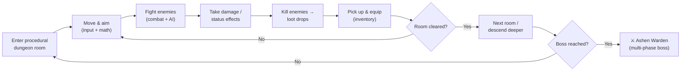
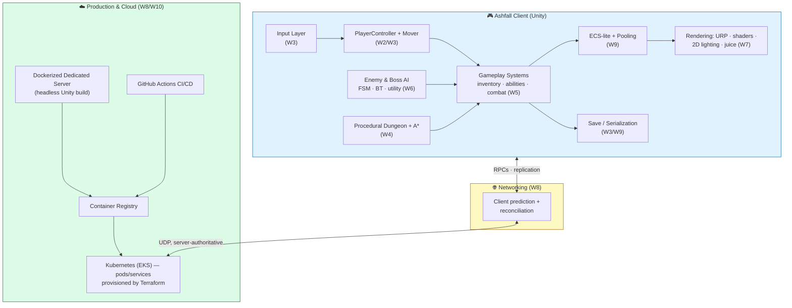

# 🎮 Ashfall — Game Design & Technical Overview

> The flagship project of **The Combined Bootcamp**. One Unity/C# codebase, built lesson by lesson across all 13 worlds at **Pixel Forge Studios**, until it ships as a polished vertical slice tagged `v1.0`.

[↑ Back to README](README.md)  ·  [🗺️ Curriculum](CURRICULUM.md)  ·  [⚔️ Quest Log](QUEST_LOG.md)  ·  [📖 Glossary](GLOSSARY.md)

> ⚠️ **Where the game lives:** the Unity project is created on *your* machine at `~/projects/ashfall` and is **not** committed to this teaching repo. This repo holds the *curriculum* (lessons, exercises, docs). Ashfall grows in your folder; the lessons tell you exactly what to add each step.

---

## 🔥 The Pitch

**Ashfall** is a **2D top-down action-roguelite**. You play an ember-touched survivor descending through the ruins of a city buried in volcanic ash. Every run generates a fresh dungeon. You fight, loot, grow stronger, and push deeper toward the **Ashen Warden** — the boss guarding the heart of the ruin. Die, and you start a new run; the world is different, but your skill carries over.

It is deliberately **small in genre, deep in engineering**: a tight, satisfying core that lets the bootcamp build *real* systems — movement that feels good, smart enemies, dynamic lighting, online co-op, and a dedicated server deployed to the cloud — without drowning in content.

**Design pillars**
- **Feel first** — movement, aiming, and hits must feel crisp and framerate-independent before anything else.
- **Every run is new** — procedural dungeons + loot keep it fresh.
- **Readable, tunable, data-driven** — designers tune items, abilities, and enemies without touching code.
- **Built to scale** — from one entity to 1000, from a laptop to a Kubernetes cluster.

---

## 🔁 The Core Gameplay Loop

The minute-to-minute loop — **move → fight → loot → grow → descend** — is the same one every world makes better: World 2 makes movement feel right, World 5 adds the loot and abilities, World 6 makes the enemies smart, World 7 makes it look like a real game.

---

## 🧱 Systems, Built World by World

Each world resolves a teammate's ticket and ends in a boss battle. Together they assemble the whole game.

| World | Layer added to Ashfall | What you build |
|------|------------------------|----------------|
| **W0 · Dev Environment** | Foundations | The `~/projects/ashfall` Unity project, git repo, `.gitignore`, first runnable build. |
| **W1 · Programming Mastery** | Clean architecture | Core data types (`Stats`, `Health`), composed `Entity`, `IDamageable`/`IInteractable`, a `GameEvents` bus, `GameManager` + game-state machine. |
| **W2 · Math for Games** | Movement & aiming math | Direction vectors, dot/cross FOV checks, `atan2` aiming, lerp/slerp smoothing, a reusable `Mover` — all framerate-independent. |
| **W3 · Core Game Programming** | A playable slice | Input layer (`Move`/`Aim`/`Fire`), `PlayerController` + physics, colliders & triggers, a smoothed follow camera, JSON `SaveSystem`. |
| **W4 · Algorithms & Data Structures** | Procedural worlds & pathing | Tile-map data model, BFS/DFS reachability, an **A\*** `Pathfinder`, a seeded dungeon generator + spatial hash grid. |
| **W5 · Gameplay Systems** | The *game* | `ItemSO`/`AbilitySO` data assets, `Inventory` + equipment, abilities + cooldowns (dash, projectile), a combat/damage pipeline, status effects + loot tables + economy. |
| **W6 · Artificial Intelligence** | Smart enemies & a boss | Enemy FSM (patrol/chase/attack), vision cones + line-of-sight, steering over A\* paths, behavior-tree elites, and the **Ashen Warden** (phases + utility AI). |
| **W7 · Rendering & Graphics** | Atmosphere | URP setup + draw-call audit, hit-flash & dissolve shaders, dynamic 2D lighting + shadows, particles, post-processing, and screen-shake "juice". |
| **W8 · Networking & Multiplayer** | Online co-op + a server | Net topology model, server-authoritative movement (prediction/reconciliation), RPCs + shared-seed 2-player co-op, and a **Dockerized** headless dedicated server. |
| **W9 · Engine Architecture** | Scale & performance | Data-oriented (SoA) hot paths, an **ECS-lite** with object pooling for bullets/enemies, versioned serialization + asset pipeline, layered subsystems. |
| **W10 · Production & Cloud** | Ship the infra | Profiling pass, **GitHub Actions** CI/CD, container registry + **Kubernetes**, **Terraform** (EKS) for the server infra, live deploy + monitoring + teardown. |
| **W11 · Portfolio Projects** | Breadth | Six standalone prototypes (platformer, tower-defense, puzzle, roguelike, top-down shooter, multiplayer mini-engine) reusing Ashfall's skills. |
| **W12 · Final Boss** | Launch | Integrate every system, polish to a stable frame budget, final CI/CD build + cloud deploy + docs, tag **`v1.0`**. |

> Worlds **8** and **10** are where the production/cloud track folds in: networking, containers, CI/CD, IaC, and Kubernetes are taught *in service of running Ashfall's dedicated server in the cloud*.

---

## 🛠️ Tech Stack

| Area | Tools |
|------|-------|
| **Engine & language** | Unity (Personal, free) · C# |
| **Gameplay data** | ScriptableObjects (data-driven items/abilities/enemies) |
| **Networking** | Unity Netcode for GameObjects (Mirror as an alternative) · server-authoritative model |
| **Server** | Headless Unity dedicated-server build, containerized with **Docker** |
| **CI/CD** | **GitHub Actions** (automated builds, tests, artifacts) |
| **Cloud & infra** | **AWS** (free-tier first) · **Kubernetes** (EKS) · **Terraform** (IaC) · a container registry |
| **Tooling** | VS Code / Rider · Git · Unity Profiler |

---

## 🏛️ Architecture at a Glance

The **client** is the full single-player game. **Networking** (W8) layers a server-authoritative model on top of the same systems. **Production & Cloud** (W8/W10) takes the headless server, containerizes it, and runs it on Kubernetes in AWS — built by Terraform and shipped by GitHub Actions.

---

## 🎯 What "Done" Looks Like (W12)

A playable Ashfall vertical slice: drive a character through a procedurally generated dungeon, fight smart enemies, loot and equip, beat the Ashen Warden, all at a stable frame budget — playable in co-op against a dedicated server deployed to the cloud, built and shipped by an automated pipeline, documented, and tagged `v1.0`.

---

[↑ Back to README](README.md)  ·  [🗺️ Curriculum](CURRICULUM.md)  ·  [⚔️ Quest Log](QUEST_LOG.md)  ·  [📖 Glossary](GLOSSARY.md)  ·  [📚 Resources](RESOURCES.md)
