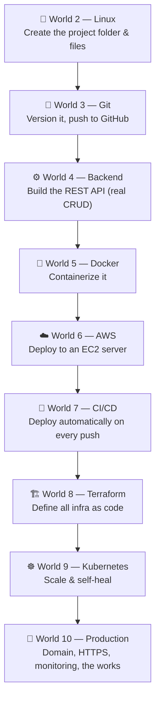
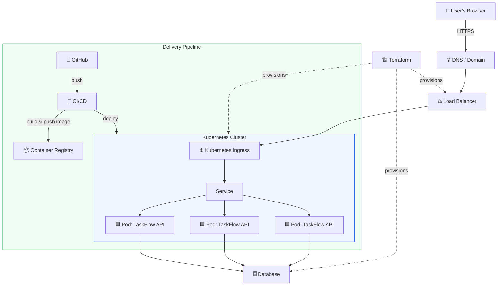

# 📦 Project Overview — The Task Manager Platform

Everything you build in this bootcamp feeds **one** real application. You don't make throwaway demos — you grow a single product from a folder on your laptop into a production-grade, auto-scaling cloud platform.

This is your **golden thread**. Keep it. Don't delete it between phases.

[↑ Back to README](README.md)

---

## 🎬 The story

**CloudForge Inc.** has too many sticky notes. Engineers lose track of work, managers can't see what's in progress, and the CEO keeps asking "where are we on the launch?" Your team has been asked to build the company's own internal tool: **TaskFlow**, a Task Manager Platform.

You're the engineer who builds it — and the one who keeps it running.

---

## 🧱 What it actually is

At its core, TaskFlow lets a user:

- Create a task (title, description, status, due date)
- List all tasks
- Update a task (e.g. mark it "done")
- Delete a task

That's it. A deliberately **simple feature set** — because the *hard* part of being a Cloud Engineer isn't the app, it's everything around it: running it reliably, securely, automatically, and at scale.

> 🎯 The app stays small on purpose. The **infrastructure** is where you grow.

---

## 📈 How it evolves, world by world

| World | What changes about TaskFlow |
|------:|------------------------------|
| 1 · Internet | You learn what an HTTP request *is* — the thing your API will answer |
| 2 · Linux | The project is born: a folder, files, a backup script |
| 3 · Git | It becomes a real repo with history, branches, and a home on GitHub |
| 4 · Backend | It becomes a working **REST API** with real endpoints and data |
| 5 · Docker | It runs the same everywhere, packaged in a container |
| 6 · AWS | It goes **live** on a real server with a public IP |
| 7 · CI/CD | It deploys **itself** every time you push code |
| 8 · Terraform | Its entire server + network is reproducible from code |
| 9 · Kubernetes | It runs as multiple replicas that heal and scale on demand |
| 10 · Production | It gets a domain, HTTPS, health checks, and monitoring |

---

## 🏗️ Where you're headed (the final architecture)

You don't need to understand this yet — but here's the system you'll have built by Launch Day. Come back and re-read this after each world; more of it will make sense each time.

---

## 🛠️ The tech stack (and why)

We keep choices boring and beginner-friendly. Each tool earns its place by solving a problem you'll *feel* before you adopt it.

| Layer | Tool | Why this one |
|-------|------|--------------|
| Language | **Node.js + Express** | Tiny, readable, huge ecosystem, runs anywhere |
| Data | **SQLite → PostgreSQL** | Start with a file, graduate to a real database |
| Container | **Docker** | The industry default for packaging apps |
| Cloud | **AWS** | The market leader; skills transfer everywhere |
| CI/CD | **GitHub Actions** | Lives next to your code, free to start |
| IaC | **Terraform** | Cloud-agnostic, the most in-demand IaC tool |
| Orchestration | **Kubernetes** | The standard for running containers at scale |

> 🔄 If you already know another language, you can adapt the backend — but follow along in Node first so the instructions match.

---

## 📂 Where the project lives in this repo

The **instructions** for building TaskFlow live inside each world's lessons (especially the **Project Mission** section of every lesson). The **code you write** lives in your *own* project folder, which you'll create in World 2 (Linux) — typically `~/projects/taskflow` inside WSL2.

> 📌 Rule of thumb: this bootcamp repo holds the *teaching*. Your `~/projects/taskflow` repo holds the *product*.

---

## 🎓 What "done" looks like

When you finish, you'll be able to point a friend, a recruiter, or an interviewer at:

- A **GitHub repo** with clean history and a real README
- A **live URL** serving your API over HTTPS
- A **pipeline** that ships changes automatically
- **Terraform** that recreates the whole stack from scratch
- A **Kubernetes** deployment that survives a pod dying and scales under load

That's not a tutorial project. That's a portfolio.

---

[↑ Back to README](README.md)  ·  [📜 Rules →](RULES.md)  ·  [🚀 Start World 0 →](phases/phase-00-environment-setup/)
