# ☁️ The Cloud Engineer Bootcamp

> Become a Cloud Engineer by building **one real application** from a line of code to a production-grade, auto-scaling system on AWS.

Welcome, recruit. You've just been hired at **CloudForge Inc.** as a Junior Software Engineer. You don't know much yet — but by the time you finish your onboarding, you'll have shipped a real product, survived traffic spikes, automated your own job, and earned the title **Cloud Engineer**.

This is not a course you *watch*. It's a job you *do*.

---

## 🎮 What makes this different

This bootcamp is built like an RPG. You don't "study topics" — you take **tickets** from your teammates, solve **real problems**, earn **XP**, and defeat **Boss Battles** that test everything you've learned.

| | |
|---|---|
| 🏰 **11 Worlds** | Each is a phase of your journey, from setup to production |
| ⚔️ **60+ Quests** | Hands-on labs that always end in something built |
| 👹 **11 Boss Battles** | No instructions — just a problem and your skills |
| 🏆 **Achievements & XP** | Track your growth from Level 1 to Cloud Engineer |
| 📦 **One Evolving Project** | The **Task Manager Platform**, built piece by piece |

```mermaid
flowchart LR
    A["🖥️ Setup"] --> B["🌐 Internet"]
    B --> C["🐧 Linux"]
    C --> D["🌿 Git"]
    D --> E["⚙️ Backend"]
    E --> F["🐳 Docker"]
    F --> G["☁️ AWS"]
    G --> H["🔁 CI/CD"]
    H --> I["🏗️ Terraform"]
    I --> J["☸️ Kubernetes"]
    J --> K["🚀 Production"]
    style A fill:#e0f2fe,stroke:#0369a1
    style K fill:#dcfce7,stroke:#166534
```



---

## 🧭 Who this is for

You'll feel right at home if you:

- 🪟 Are on **Windows** and willing to use **WSL2 + Ubuntu** (we set this up together in Phase 0)
- 💻 Have **basic programming** knowledge (you've written a function before)
- ☁️ Have **zero cloud experience** — that's the whole point
- 🛠️ Learn best by **building**, not memorizing

No prior knowledge of Linux, networking, the cloud, or any tool in this bootcamp is assumed.

---

## 🗺️ The journey

| World | Phase | What you'll build | Boss Battle |
|------:|-------|-------------------|-------------|
| 0 | [Environment Setup](phases/phase-00-environment-setup/) | A working dev machine (WSL2) | The Broken Workstation |
| 1 | [Internet Fundamentals](phases/phase-01-internet-fundamentals/) | Your first HTTP request | Trace the Request |
| 2 | [Linux](phases/phase-02-linux/) | The project scaffold + a backup script | The Locked Server |
| 3 | [Git](phases/phase-03-git/) | A versioned project on GitHub | The Merge Conflict from Hell |
| 4 | [Backend Development](phases/phase-04-backend/) | The Task Manager REST API | The Flaky API |
| 5 | [Docker](phases/phase-05-docker/) | A containerized app | The "Works on My Machine" Incident |
| 6 | [AWS](phases/phase-06-aws/) | The app live on EC2 | The Empty Cloud |
| 7 | [CI/CD](phases/phase-07-cicd/) | Automatic deployments | The 2 AM Deploy |
| 8 | [Terraform](phases/phase-08-terraform/) | Infrastructure as Code | Rebuild From Nothing |
| 9 | [Kubernetes](phases/phase-09-kubernetes/) | A self-healing, scaling app | The Traffic Surge |
| 10 | [Final Production Deployment](phases/phase-10-final-production/) | A production-grade platform | Launch Day |

See the full **[🗺️ Roadmap](ROADMAP.md)** for details.

---

## 🚀 Start here

1. **Read the [Rules of the Game](RULES.md)** — how XP, quests, and boss battles work (5 min).
2. **Open your [Progress Tracker](PROGRESS.md)** — this is your character sheet. Keep it updated.
3. **Skim the [Project Overview](PROJECT_OVERVIEW.md)** — meet the Task Manager Platform you're about to build.
4. **Begin [World 0: Environment Setup](phases/phase-00-environment-setup/)** — get your tools ready.

> 💡 You only need to do **one thing right now**: open [World 0](phases/phase-00-environment-setup/). Everything else unlocks as you go.

---

## 📚 Repository map

```
cloud-engineer-bootcamp/
├── README.md            ← you are here
├── ROADMAP.md           ← the full path, phase by phase
├── RULES.md             ← how the game works (XP, quests, bosses)
├── PROGRESS.md          ← your character sheet — track completion here
├── PROJECT_OVERVIEW.md  ← the Task Manager Platform, explained
├── QUEST_LOG.md         ← every quest & side quest in one place
├── RESOURCES.md         ← curated links (one per topic, no spam)
├── GLOSSARY.md          ← plain-English definitions of every term
└── phases/
    ├── phase-00-environment-setup/
    │   ├── README.md        ← world intro + level map
    │   ├── lessons/         ← the levels (15–25 min each)
    │   ├── exercises.md     ← extra practice
    │   ├── checklist.md     ← "am I ready to move on?"
    │   └── boss-battle.md   ← the phase finale
    └── ... (phases 01–10)
```

---

## 🏆 The end goal

By the time you reach Launch Day, you will be able to confidently:

- Navigate and automate **Linux**
- Explain how the **internet** moves a request from a browser to a server and back
- Version code with **Git** and collaborate on **GitHub**
- Build and test a **REST API** (the Task Manager backend)
- Containerize apps with **Docker**
- Deploy and operate infrastructure on **AWS**
- Automate delivery with **CI/CD**
- Define infrastructure with **Terraform**
- Scale and self-heal applications with **Kubernetes**

You'll finish with a **portfolio-quality project** and the skills to back it up.

---

<div align="center">

**Ready?** → **[Begin World 0: Environment Setup](phases/phase-00-environment-setup/)**

*Built as an open-source learning project. Fork it, learn from it, share it.*

</div>
