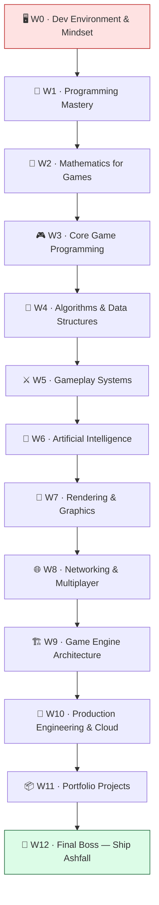

# 🎮 The Combined Bootcamp

        

> Become a game developer by building **one real game** — from the game loop on a blank canvas to a polished, networked, cloud-deployed vertical slice you can ship.

Welcome, recruit. You've just been hired at **Pixel Forge Studios** as a 🐣 **Junior Gameplay Programmer**. You don't know much yet — but by the time you finish onboarding, you'll have shipped **Ashfall**, a 2D top-down action-roguelite, and earned the title 🏆 **Master Game Developer**.

This is not a course you *watch*. It's a job you *do*.

---

## ✨ What makes this different

This is **not a Unity course**. It's a game-development bootcamp built on **first principles** — the game loop, vectors, pathfinding, ECS, networking, rendering — taught in a way that **transfers to Unreal, Godot, or a custom engine**. We happen to build in Unity/C# because you need *one* concrete tool to ship something real, but the ideas are the deal.

- 🧱 **First principles, engine-agnostic** — learn *why* a thing works, not which button to click. Your skills move with you.
- ⚡ **Theory → immediately built** — every concept is applied to Ashfall the moment you learn it. Nothing is abstract for long.
- 🛠️ **20% read / 80% build** — you take **tickets** from teammates, solve **real problems**, earn **XP**, and beat **Boss Battles**.
- 📦 **One evolving project** — **Ashfall** grows across all 13 worlds in a single codebase, the way real games are made.
- 🚀 **Real production track** — Worlds 8 & 10 fold a full **production/cloud-engineering** track (Docker, CI/CD, AWS, Terraform, Kubernetes) into shipping the game for real.

---

## 🗺️ The 13 Worlds



---

## ⚔️ The journey

| World | What you build | 👹 Boss Battle |
|------:|----------------|----------------|
| 0 · [🖥️ Dev Environment & Mindset](phases/phase-00-dev-environment/README.md) | The game loop + a runnable empty Ashfall project | First Build, First Commit |
| 1 · [🧠 Programming Mastery](phases/phase-01-programming-mastery/README.md) | Clean architecture: managers, events, SOLID | Refactor the Spaghetti |
| 2 · [📐 Mathematics for Games](phases/phase-02-math-for-games/README.md) | Movement, aiming & smoothing that feels right | The Aiming Reticle |
| 3 · [🎮 Core Game Programming](phases/phase-03-core-game-programming/README.md) | A playable slice: move, collide, follow, save | The Playable Slice |
| 4 · [🧮 Algorithms & Data Structures](phases/phase-04-algorithms-data-structures/README.md) | Procedural dungeons + A\* pathfinding | The Infinite Dungeon |
| 5 · [⚔️ Gameplay Systems](phases/phase-05-gameplay-systems/README.md) | Items, abilities, combat, status effects, loot | The Loot Run |
| 6 · [🤖 Artificial Intelligence](phases/phase-06-artificial-intelligence/README.md) | Enemy FSMs, perception, behavior trees, a boss | The Ashen Warden |
| 7 · [🎨 Rendering & Graphics](phases/phase-07-rendering-graphics/README.md) | 2D lighting, shaders, particles, post-processing | Atmosphere Pass |
| 8 · [🌐 Networking & Multiplayer](phases/phase-08-networking-multiplayer/README.md) | Authoritative co-op + a Dockerized server | Co-op in a Container |
| 9 · [🏗️ Game Engine Architecture](phases/phase-09-engine-architecture/README.md) | ECS-lite, pooling, DOD — 1000 entities at 60 FPS | 1000 Entities at 60 FPS |
| 10 · [🚀 Production Engineering & Cloud](phases/phase-10-production-and-cloud/README.md) | CI/CD + server on AWS Kubernetes via Terraform | Ship the Server |
| 11 · [📦 Portfolio Projects](phases/phase-11-portfolio-projects/README.md) | Six sharp prototypes across genres | Portfolio Review |
| 12 · [👑 Final Boss — Ship Ashfall](phases/phase-12-final-boss/README.md) | The polished, deployed, documented vertical slice | Launch Day |

See the full **[🗺️ Roadmap](ROADMAP.md)** for every lesson, theme, and milestone.

---

## 🚀 Start here

1. **Read the [📜 Rules of the Game](RULES.md)** — how XP, ranks, quests, and boss battles work (5 min).
2. **Open your [📊 Progress Tracker](PROGRESS.md)** — this is your character sheet. Keep it updated.
3. **Skim the [📖 Game Overview](GAME_OVERVIEW.md)** — meet **Ashfall**, the game you're about to build.
4. **Begin [World 0: Dev Environment & Mindset](phases/phase-00-dev-environment/README.md)** — get your tools and your mindset ready.

> 💡 You only need to do **one thing right now**: open [World 0](phases/phase-00-dev-environment/README.md). Everything else unlocks as you beat each Boss Battle.

---

## 📚 Repository map

```
combined-bootcamp/
├── README.md            ← you are here
├── CURRICULUM.md        ← the authoritative 13-world / 59-lesson bible
├── ROADMAP.md           ← the full path, world by world
├── RULES.md             ← how the game works (XP, ranks, bosses)
├── PROGRESS.md          ← your character sheet — auto-rendered
├── GAME_OVERVIEW.md  ← Ashfall, the game, explained
├── QUEST_LOG.md         ← every quest & side quest in one place
├── RESOURCES.md         ← curated links (one per topic, no spam)
├── GLOSSARY.md          ← plain-English definitions of every term
├── profile.html         ← your shareable player profile (auto-rendered)
└── phases/
    ├── phase-00-dev-environment/
    │   ├── README.md        ← world intro + level map
    │   ├── lessons/         ← the levels
    │   ├── exercises.md     ← extra practice
    │   ├── checklist.md     ← "am I ready to move on?"
    │   └── boss-battle.md   ← the world finale
    ├── phase-01-programming-mastery/
    ├── phase-02-math-for-games/
    ├── phase-03-core-game-programming/
    ├── phase-04-algorithms-data-structures/
    ├── phase-05-gameplay-systems/
    ├── phase-06-artificial-intelligence/
    ├── phase-07-rendering-graphics/
    ├── phase-08-networking-multiplayer/
    ├── phase-09-engine-architecture/
    ├── phase-10-production-and-cloud/
    ├── phase-11-portfolio-projects/
    └── phase-12-final-boss/
```

---

## 🏆 The end goal

By Launch Day, you will be able to confidently apply:

- 🧠 **Advanced C#** — clean architecture, SOLID, events, memory
- 📐 **Mathematics for Games** — vectors, trig, interpolation, transforms
- 🎮 **Gameplay Programming** — input, controllers, collision, cameras, saves
- 🤖 **Artificial Intelligence** — FSMs, perception, steering, behavior trees, utility AI
- 🧮 **Algorithms & Data Structures** — Big-O, graphs, A\*, procedural generation
- 🎨 **Rendering** — pipelines, shaders, 2D lighting, particles, post-processing
- 🧲 **Physics** — rigidbodies, collisions, triggers, raycasts
- 🌐 **Networking** — authority, prediction, RPCs, dedicated servers
- ⚡ **Optimization** — profiling, pooling, data-oriented design
- 🏗️ **Software & Engine Architecture** — subsystems, layering, serialization, pipelines
- 🚀 **Production & Cloud** — CI/CD, Docker, AWS, Terraform, Kubernetes

You'll finish with a **portfolio-quality game** and the skills to back it up.

---

<div align="center">

**Ready?** → **[Begin World 0: Dev Environment & Mindset](phases/phase-00-dev-environment/README.md)**

*Built as an open-source learning resource. Fork it, learn from it, share it.*

</div>
