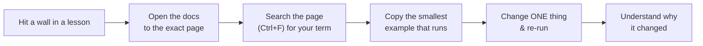

# 📚 Resources — 100% Free, With Steps to Use Them

> **Everything here is free.** No paid courses, no subscriptions, no credit card required to *learn*. Where a cloud account is involved (AWS), we stick strictly to the **free tier** and show you how to stay inside it.

Each topic gives you exactly **four things** — no endless link dumps:

- 📖 **Official docs** (free, authoritative)
- ▶️ **One YouTube video** (free, high quality)
- 🧪 **One practice site** (free to use)
- 🧠 **One optional deep dive** (free)

…plus **how to use each one** so a link never leaves you guessing.

[↑ Back to README](README.md)

---

## 🧭 How to use *any* resource well

Before the lists, learn the technique. It applies to all of them:

- 📖 **Docs** → Don't read top-to-bottom. Use them like a dictionary: jump to the page, `Ctrl+F` your term, copy the smallest working example.
- ▶️ **Videos** → Watch **once at 1x to understand**, then **rewatch while building**, pausing to type each command yourself. Never watch passively.
- 🧪 **Practice sites** → Do them *after* the lesson's Quest, as reps. They're for muscle memory, not first exposure.
- 🧠 **Deep dives** → Optional. Open them only when you're curious *why*, never to "get ahead."

> 💡 Golden rule: if a resource isn't helping you finish the current Quest, close it. You can always come back.

---

## 🖥️ World 0 — Environment Setup (WSL2)
- 📖 **Docs:** [Microsoft WSL Install Guide](https://learn.microsoft.com/windows/wsl/install) — *Use it for the exact `wsl --install` steps; follow it in order, top to bottom, once.*
- ▶️ **Video:** Search YouTube for **"Install WSL2 Ubuntu on Windows"** (NetworkChuck / Microsoft official) — *Watch once, then redo each step yourself.*
- 🧪 **Practice:** Your own terminal — *open Ubuntu and run `uname -a`, `whoami`, `pwd` until they feel normal.*
- 🧠 **Deep dive:** [What is WSL2?](https://learn.microsoft.com/windows/wsl/about) — *Read only if you're curious how Windows runs Linux.*

## 🌐 World 1 — Internet Fundamentals
- 📖 **Docs:** [MDN — Overview of HTTP](https://developer.mozilla.org/docs/Web/HTTP/Overview) — *`Ctrl+F` "request" and "status" to find the parts you need.*
- ▶️ **Video:** Search **"How the Internet Works" (freeCodeCamp / Computerphile)** — *Watch once for the mental model.*
- 🧪 **Practice:** [httpbin.org](https://httpbin.org) — *A free server that echoes your requests back; perfect for `curl` experiments.*
- 🧠 **Deep dive:** [MDN — DNS explained](https://developer.mozilla.org/docs/Glossary/DNS) — *Open when you want to know how names become IPs.*

## 🐧 World 2 — Linux
- 📖 **Docs:** [Ubuntu Command Line Tutorial](https://ubuntu.com/tutorials/command-line-for-beginners) — *Free, step-by-step; do it alongside the lessons.*
- ▶️ **Video:** Search **"Linux Command Line Full Course freeCodeCamp"** — *Use as a reference; jump to the chapter you need.*
- 🧪 **Practice:** [linuxjourney.com](https://linuxjourney.com) — *Free interactive lessons; do one module after each Linux lesson.*
- 🧠 **Deep dive:** [The Linux `man` pages](https://man7.org/linux/man-pages/) — *Run `man <command>` in your own terminal for any command you meet.*

## 🌿 World 3 — Git
- 📖 **Docs:** [Pro Git Book](https://git-scm.com/book) — *Free, full book online; read chapters 1–3 only for now.*
- ▶️ **Video:** Search **"Git and GitHub for Beginners freeCodeCamp"** — *Watch once, build along.*
- 🧪 **Practice:** [learngitbranching.js.org](https://learngitbranching.js.org) — *Free visual Git game — the best way to truly feel how branching works.*
- 🧠 **Deep dive:** [GitHub Docs](https://docs.github.com) — *Free; use for pull requests and collaboration features.*

## ⚙️ World 4 — Backend Development
- 📖 **Docs:** [Express.js Guide](https://expressjs.com/en/guide/routing.html) — *`Ctrl+F` "route" and "middleware" while building.*
- ▶️ **Video:** Search **"Node.js and Express REST API freeCodeCamp"** — *Follow along building endpoints.*
- 🧪 **Practice:** [Node.js + Express on your machine](https://nodejs.org) — *Free runtime; the lessons are your practice.*
- 🧠 **Deep dive:** [MDN — REST](https://developer.mozilla.org/docs/Glossary/REST) — *Read to solidify what makes an API "RESTful".*

## 🐳 World 5 — Docker
- 📖 **Docs:** [Docker Get Started](https://docs.docker.com/get-started/) — *Free; follow the "containerize an application" section.*
- ▶️ **Video:** Search **"Docker Tutorial for Beginners freeCodeCamp / TechWorld with Nana"** — *Watch once, then write your Dockerfile.*
- 🧪 **Practice:** [Play with Docker](https://labs.play-with-docker.com) — *Free in-browser Docker; no install needed, great for experiments.*
- 🧠 **Deep dive:** [Docker — best practices for Dockerfiles](https://docs.docker.com/develop/develop-images/dockerfile_best-practices/) — *Read when your images feel too big.*

## ☁️ World 6 — AWS  *(free tier only!)*
- 📖 **Docs:** [AWS Free Tier](https://aws.amazon.com/free/) — *Read FIRST. Know exactly which services are free and the limits before you click anything.*
- ▶️ **Video:** Search **"AWS EC2 Tutorial for Beginners"** — *Watch once; we use only free-tier `t2.micro`/`t3.micro` instances.*
- 🧪 **Practice:** [AWS Free Tier account](https://aws.amazon.com/free/) — *Sign up; set a **billing alarm at $1** immediately (we show you how in World 6).*
- 🧠 **Deep dive:** [AWS Well-Architected Framework](https://aws.amazon.com/architecture/well-architected/) — *Free; skim the "Cost Optimization" pillar.*

> ⚠️ **Stay free:** always stop/terminate instances when done, use only `t2.micro`/`t3.micro`, and keep that billing alarm on. World 6 has a full "don't get charged" guide.

## 🔁 World 7 — CI/CD
- 📖 **Docs:** [GitHub Actions Docs](https://docs.github.com/actions) — *Free for public repos; `Ctrl+F` "workflow" and "secrets".*
- ▶️ **Video:** Search **"GitHub Actions Tutorial TechWorld with Nana"** — *Build your first pipeline along with it.*
- 🧪 **Practice:** Your own GitHub repo — *Actions are free on public repos; every push is practice.*
- 🧠 **Deep dive:** [GitHub Actions — security hardening](https://docs.github.com/actions/security-guides) — *Read before putting secrets in a pipeline.*

## 🏗️ World 8 — Terraform
- 📖 **Docs:** [Terraform Docs](https://developer.hashicorp.com/terraform/docs) — *Free; use the AWS provider reference like a dictionary.*
- ▶️ **Video:** Search **"Terraform Course freeCodeCamp / TechWorld with Nana"** — *Watch once, then write your `.tf` files.*
- 🧪 **Practice:** [HashiCorp Learn — Terraform](https://developer.hashicorp.com/terraform/tutorials) — *Free official tutorials; do the AWS track.*
- 🧠 **Deep dive:** [Terraform — state explained](https://developer.hashicorp.com/terraform/language/state) — *Read when state confuses you (it will at first).*

## ☸️ World 9 — Kubernetes
- 📖 **Docs:** [Kubernetes Docs](https://kubernetes.io/docs/home/) — *Free; start with "Concepts → Workloads".*
- ▶️ **Video:** Search **"Kubernetes Tutorial for Beginners TechWorld with Nana"** — *The clearest free K8s intro; watch once fully.*
- 🧪 **Practice:** [killercoda.com Kubernetes playgrounds](https://killercoda.com/kubernetes) — *Free in-browser clusters; or run `minikube`/`kind` locally (also free).*
- 🧠 **Deep dive:** [Kubernetes — the Hard Way (read-only)](https://github.com/kelseyhightower/kubernetes-the-hard-way) — *Don't *do* it yet; skim to appreciate what managed K8s saves you.*

## 🚀 World 10 — Production
- 📖 **Docs:** [Let's Encrypt](https://letsencrypt.org/getting-started/) — *Free HTTPS certificates; this is how you get TLS for $0.*
- ▶️ **Video:** Search **"Free domain + HTTPS setup tutorial"** — *Use a free domain option (e.g. a free subdomain provider) for the project.*
- 🧪 **Practice:** [Uptime monitoring free tier](https://uptimerobot.com) — *Free plan monitors your live app and alerts you.*
- 🧠 **Deep dive:** [Google SRE Book](https://sre.google/books/) — *Free online; read the chapters on monitoring and SLOs.*

---

## 🆓 Free things to keep handy throughout

| Need | Free tool | How to use it |
|------|-----------|---------------|
| Code editor | [VS Code](https://code.visualstudio.com) | Install the **WSL** extension; edit Linux files from Windows |
| Test HTTP requests | `curl` (built in) + [httpbin.org](https://httpbin.org) | Run `curl` against your API and httpbin to compare |
| Diagrams | [Mermaid Live Editor](https://mermaid.live) | Paste any diagram from these lessons to edit/learn it |
| Markdown preview | VS Code (`Ctrl+Shift+V`) | Read these `.md` files with diagrams rendered |
| Cheatsheets | [devhints.io](https://devhints.io) | Free one-page references for git, bash, docker, etc. |

---

[↑ Back to README](README.md)  ·  [📖 Glossary →](GLOSSARY.md)  ·  [📊 Progress →](PROGRESS.md)
