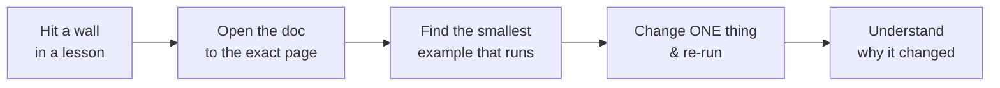

# 📚 Resources — 100% Free, Curated by Area

> **Everything here is free.** No paid courses, no subscriptions, no credit card required to *learn*. Where a cloud account is involved (AWS), we stay strictly inside the **free tier** and show you how to not get charged.

Each area gives you **3–5 hand-picked resources** — official docs, the best free videos, and a deep dive — with **one line on how/when to use each**. No link dumps.

[↑ Back to README](README.md)  ·  [📖 Glossary](GLOSSARY.md)  ·  [🎮 Game Overview](GAME_OVERVIEW.md)  ·  [⚔️ Quest Log](QUEST_LOG.md)

---

## 🧭 How to use *any* resource well

- 📖 **Docs** → Use like a dictionary: jump to the page, `Ctrl+F` your term, copy the smallest working example.
- ▶️ **Videos** → Watch once to understand, then rebuild while pausing to type it yourself. Never watch passively.
- 🧠 **Deep dives** → Open only when you're curious *why*, never to "get ahead."

> 💡 Golden rule: if a resource isn't helping you finish the current Quest, close it. You can always come back.

---

## 🧠 C# (World 1)
- 📖 **[Microsoft C# docs](https://learn.microsoft.com/dotnet/csharp/)** — The authoritative reference; `Ctrl+F` any keyword (`struct`, `event`, `interface`) for the canonical explanation + example.
- 🎓 **[Microsoft C# Tutorials (interactive)](https://learn.microsoft.com/dotnet/csharp/tour-of-csharp/)** — Run C# in the browser; do these for the language basics before writing gameplay.
- 📘 **[C# Programming Guide — Classes & Structs](https://learn.microsoft.com/dotnet/csharp/programming-guide/classes-and-structs/)** — Read when value-vs-reference and stack-vs-heap (W1 L1) feel fuzzy.
- 🧠 **[Game Programming Patterns (free online book)](https://gameprogrammingpatterns.com/)** by Bob Nystrom — The chapters on Observer, Component, and State map directly onto W1's events/composition/SOLID lessons.

## 📐 Math for Games (World 2)
- ▶️ **[Freya Holmer — "Math for Game Devs" / vector & dot-product videos](https://www.youtube.com/@Acegikmo)** — The clearest visual intuition for vectors, dot/cross, and lerp anywhere. Watch before W2.
- 🧠 **[Red Blob Games](https://www.redblobgames.com/)** by Amit Patel — Interactive, hands-on explanations of vectors, angles, and (later) pathfinding. Play with the diagrams.
- 📖 **[Unity Scripting API — Vector2 / Vector3 / Mathf](https://docs.unity3d.com/ScriptReference/Vector2.html)** — Look up `Dot`, `Lerp`, `Slerp`, `Atan2` for the exact signatures while building the `Mover`.
- 🧠 **[Game Programming Patterns — Game Loop chapter](https://gameprogrammingpatterns.com/game-loop.html)** — Read for *why* you multiply by delta time (framerate independence, W2 L4–L5).

## 🎮 Unity Core (Worlds 0, 3, 5)
- 🎓 **[Unity Learn](https://learn.unity.com/)** — Free official courses/tutorials; do the "Junior Programmer" path alongside W0–W3 for editor + scripting fluency.
- 📖 **[Unity Manual](https://docs.unity3d.com/Manual/)** & **[Scripting API](https://docs.unity3d.com/ScriptReference/)** — Your two daily references; Manual for concepts, ScriptReference for exact API.
- 🧠 **[Catlike Coding](https://catlikecoding.com/unity/tutorials/)** by Jasper Flick — Deep, rigorous Unity C# tutorials; excellent for ScriptableObjects, object pooling, and meshes.
- ▶️ **[Sebastian Lague — YouTube](https://www.youtube.com/@SebastianLague)** — Beautifully explained Unity projects; his series double as W3–W6 inspiration.

## 🧮 Algorithms & Data Structures (World 4)
- 🧠 **[Red Blob Games — Introduction to A\*](https://www.redblobgames.com/pathfinding/a-star/introduction.html)** — The single best A\* explainer; interactive, builds straight to W4 L3. Read it twice.
- ▶️ **[Sebastian Lague — A\* Pathfinding series](https://www.youtube.com/playlist?list=PLFt_AvWsXl0cq5Umv3pMC9SPnKjfp9eGW)** — Watch to see A\* implemented in Unity step by step.
- 📖 **[Microsoft .NET Collections docs](https://learn.microsoft.com/dotnet/standard/collections/)** — Reference for choosing `List`/`Dictionary`/`HashSet`/`Queue`/`Stack` by access pattern (W4 L1).
- 🧠 **[VisuAlgo](https://visualgo.net/)** — Animates BFS/DFS, graphs, and sorting; use to *see* the traversals from W4 L2.

## 🤖 AI (World 6)
- 🧠 **[Game Programming Patterns — State chapter](https://gameprogrammingpatterns.com/state.html)** — The clean FSM pattern behind W6 L1, with game examples.
- ▶️ **[Sebastian Lague — Field of View / steering visualizations](https://www.youtube.com/@SebastianLague)** — Great visual grounding for perception cones (W6 L2) and steering (W6 L3).
- 🧠 **[Red Blob Games — pathfinding & movement notes](https://www.redblobgames.com/pathfinding/)** — Steering and grid movement tie A\* into smooth enemy navigation.
- 📖 **[Behavior Trees in Robotics and AI (free intro chapters)](https://btirai.github.io/)** — Read the first chapters for the formal model behind W6 L4 behavior trees.

## 🎨 Rendering & Shaders (World 7)
- 🧠 **[The Book of Shaders](https://thebookofshaders.com/)** by Patricio Gonzalez Vivo — The gentlest hands-on intro to fragment shaders; do it before writing the W7 dissolve/hit-flash shader.
- 🧠 **[Catlike Coding — Rendering & shader tutorials](https://catlikecoding.com/unity/tutorials/)** — Rigorous Unity-specific shader and rendering deep dives.
- 📖 **[Unity URP (Universal Render Pipeline) docs](https://docs.unity3d.com/Manual/urp/urp-introduction.html)** — Reference for setting up URP, 2D lighting, and post-processing (W7 L1, L3, L4).
- ▶️ **[Freya Holmer — "Shaders for Game Devs" talks](https://www.youtube.com/@Acegikmo)** — Build the mental model of vertex/fragment stages and UVs.

## 🌐 Networking (World 8)
- 🧠 **[Gaffer On Games](https://gafferongames.com/)** by Glenn Fiedler — The canonical free articles on UDP, networked physics, and client prediction/reconciliation. Read "What Every Programmer Needs To Know About Game Networking."
- 📖 **[Unity Netcode for GameObjects docs](https://docs-multiplayer.unity3d.com/)** — Reference for RPCs, network variables, and server-authoritative setup (W8 L2–L3).
- 🧠 **[Valve — Source Multiplayer Networking](https://developer.valvesoftware.com/wiki/Source_Multiplayer_Networking)** — Classic explainer on prediction, interpolation, and lag compensation.
- 📖 **[Mirror Networking docs](https://mirror-networking.gitbook.io/docs/)** — Free, open-source alternative to Netcode; good reference if you use Mirror.

## 🏗️ Engine Architecture (World 9)
- 🧠 **[Game Programming Patterns — Optimization Patterns](https://gameprogrammingpatterns.com/optimization-patterns.html)** by Bob Nystrom — The Object Pool, Data Locality, and Dirty Flag chapters are W9's backbone (read these for free).
- 🧠 **[Mike Acton — "Data-Oriented Design" talk (CppCon, free on YouTube)](https://www.youtube.com/watch?v=rX0ItVEVjHc)** — The talk that defines DOD thinking behind W9 L1 (AoS vs SoA, cache).
- 📖 **[Unity DOTS / ECS docs](https://docs.unity3d.com/Packages/com.unity.entities@latest)** — Reference for Unity's real ECS; read after building the ECS-lite to see the production version.
- 🧠 **[Game Engine Architecture (Jason Gregory) — companion site](https://www.gameenginebook.com/)** — Use the free chapter list/figures as a map of engine layering (W9 L4).

## 🚀 Production & Cloud (Worlds 8 & 10)
- 📖 **[Docker — Get Started](https://docs.docker.com/get-started/)** — Free; follow the "containerize an application" section to Dockerize the dedicated server (W8 L4). Practice in-browser at [Play with Docker](https://labs.play-with-docker.com).
- 📖 **[GitHub Actions docs](https://docs.github.com/actions)** — **Free for public repos**; `Ctrl+F` "workflow" and "secrets" while building Ashfall's CI/CD (W10 L2).
- 📖 **[Kubernetes docs — Concepts](https://kubernetes.io/docs/concepts/)** — Free; start with Workloads. Run a free local cluster with [minikube](https://minikube.sigs.k8s.io/) or [kind](https://kind.sigs.k8s.io/), or [killercoda](https://killercoda.com/kubernetes) in-browser (W10 L3).
- 📖 **[Terraform docs + HashiCorp Learn](https://developer.hashicorp.com/terraform/tutorials)** — Free official tutorials; do the AWS track to provision EKS (W10 L4).
- 📖 **[AWS Free Tier](https://aws.amazon.com/free/)** — Read **FIRST**. Know exactly which services are free and the limits before you click anything.

> ⚠️ **AWS cost safety — read before touching AWS (W10):**
> - **Set a billing alarm at \$1** the moment your account exists (AWS Budgets → CloudWatch alarm). Don't skip this.
> - **Note:** managed Kubernetes (**EKS**) and load balancers are **NOT free** — the EKS control plane bills per hour. For learning, prefer **local k8s (minikube/kind)** and only spin up EKS briefly if at all.
> - Use only free-tier-eligible instance types (`t2.micro`/`t3.micro`) and **stop/terminate everything** the moment you finish.
> - **`terraform destroy`** when done — IaC makes teardown one command, so there's no excuse for a forgotten running cluster.
> - Check the **AWS Billing dashboard** before you log off, every session. W10 L5 includes a full cost-control + teardown guide.

---

## 🆓 Free tools to keep handy throughout

| Need | Free tool | How to use it |
|------|-----------|---------------|
| Engine | [Unity (Personal)](https://unity.com/download) | Free for the bootcamp; install via Unity Hub |
| Code editor | [VS Code](https://code.visualstudio.com) (+ C# Dev Kit) or [Rider (free non-commercial)](https://www.jetbrains.com/rider/) | Edit and debug your C# |
| Diagrams | [Mermaid Live Editor](https://mermaid.live) | Paste any diagram from these docs to edit/learn it |
| Markdown preview | VS Code (`Ctrl+Shift+V`) | Read these `.md` files with diagrams rendered |
| Cheatsheets | [devhints.io](https://devhints.io) | One-page references for git, bash, docker, etc. |
| Version control | [Git](https://git-scm.com) + [GitHub](https://github.com) | Free repos; Actions are free on public repos |

---

[↑ Back to README](README.md)  ·  [📖 Glossary →](GLOSSARY.md)  ·  [🎮 Game Overview](GAME_OVERVIEW.md)  ·  [⚔️ Quest Log](QUEST_LOG.md)  ·  [📊 Progress](PROGRESS.md)
