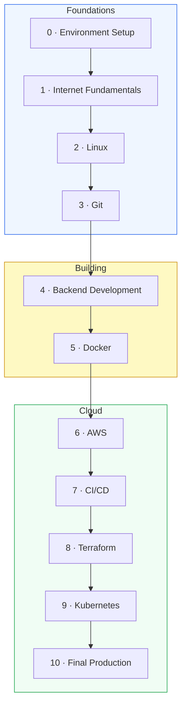

# 🗺️ The Roadmap

The full path from `Intern` to `Cloud Engineer`. Each **World** is a phase; each builds on the last. Don't skip — later worlds assume the skills (and the project state) from earlier ones.

[↑ Back to README](README.md)  ·  [📜 Rules](RULES.md)  ·  [📊 Progress](PROGRESS.md)

---

## 🌍 The big picture

---

## 📚 World-by-world breakdown

### 🖥️ World 0 — Environment Setup
**Ticket:** *"Your laptop just arrived. Get it ready to do real work."*
You install WSL2 + Ubuntu, a terminal, an editor, and Node.js — a real engineer's workstation on Windows.
- **You build:** a working dev environment you can prove works.
- **Boss Battle:** *The Broken Workstation* — fix a deliberately misconfigured setup.
- 👉 [Enter World 0](phases/phase-00-environment-setup/)

### 🌐 World 1 — Internet Fundamentals
**Ticket:** *"Before you build an API, understand what an API answers."*
How a request travels: DNS, IP, TCP, HTTP, status codes, clients & servers.
- **You build:** your first real HTTP requests with `curl`, and a request you trace end-to-end.
- **Boss Battle:** *Trace the Request* — explain every hop from URL to response.
- 👉 [Enter World 1](phases/phase-01-internet-fundamentals/)

### 🐧 World 2 — Linux
**Ticket:** *"Servers run Linux. Learn to live in the terminal."*
Filesystem, navigation, files, permissions, processes, package managers, shell scripts.
- **You build:** the **TaskFlow** project scaffold + a backup script.
- **Boss Battle:** *The Locked Server* — fix permissions and recover access.
- 👉 [Enter World 2](phases/phase-02-linux/)

### 🌿 World 3 — Git
**Ticket:** *"Stop emailing zip files. Use version control."*
Commits, branches, merges, conflicts, remotes, GitHub, pull requests.
- **You build:** TaskFlow as a real Git repo, pushed to GitHub.
- **Boss Battle:** *The Merge Conflict from Hell* — untangle a broken history.
- 👉 [Enter World 3](phases/phase-03-git/)

### ⚙️ World 4 — Backend Development
**Ticket:** *"Build our first API."*
HTTP servers, routes, REST, JSON, CRUD, status codes, a database, basic tests.
- **You build:** the **TaskFlow REST API** — real, working endpoints.
- **Boss Battle:** *The Flaky API* — debug and harden a broken backend.
- 👉 [Enter World 4](phases/phase-04-backend/)

### 🐳 World 5 — Docker
**Ticket:** *"It works on your machine. Make it work everywhere."*
Images, containers, Dockerfiles, volumes, networks, Docker Compose.
- **You build:** a containerized TaskFlow that runs identically anywhere.
- **Boss Battle:** *The "Works on My Machine" Incident*.
- 👉 [Enter World 5](phases/phase-05-docker/)

### ☁️ World 6 — AWS
**Ticket:** *"Deploy the app to a real server."*
Cloud concepts, regions, EC2, security groups, SSH, IAM, S3 — and the free tier.
- **You build:** TaskFlow live on EC2 with a public IP.
- **Boss Battle:** *The Empty Cloud* — go from blank AWS account to live app.
- 👉 [Enter World 6](phases/phase-06-aws/)

### 🔁 World 7 — CI/CD
**Ticket:** *"Our deployment process is manual. Automate it."*
Pipelines, GitHub Actions, build/test/deploy stages, secrets, automatic deploys.
- **You build:** a pipeline that ships TaskFlow on every push.
- **Boss Battle:** *The 2 AM Deploy* — make deploys safe and hands-off.
- 👉 [Enter World 7](phases/phase-07-cicd/)

### 🏗️ World 8 — Terraform
**Ticket:** *"We need Infrastructure as Code."*
Declarative infra, providers, resources, state, variables, plan/apply/destroy.
- **You build:** all of TaskFlow's infrastructure, defined in code.
- **Boss Battle:** *Rebuild From Nothing* — destroy and recreate the stack from code.
- 👉 [Enter World 8](phases/phase-08-terraform/)

### ☸️ World 9 — Kubernetes
**Ticket:** *"Traffic doubled. Scale the application."*
Pods, deployments, services, scaling, self-healing, config & secrets, ingress.
- **You build:** TaskFlow running as a resilient, scalable deployment.
- **Boss Battle:** *The Traffic Surge* — survive a load spike with auto-scaling.
- 👉 [Enter World 9](phases/phase-09-kubernetes/)

### 🚀 World 10 — Final Production Deployment
**Ticket:** *"Launch day. Make it real."*
Domains, HTTPS/TLS, health checks, monitoring, logging, the production checklist.
- **You build:** a production-grade TaskFlow — and your portfolio piece.
- **Boss Battle:** *Launch Day* — ship it for real, end to end.
- 👉 [Enter World 10](phases/phase-10-final-production/)

---

## ⏱️ How long will this take?

There's no clock. But as a rough guide, at a sustainable pace of a few lessons per week:

| Worlds | Theme | Rough pace |
|--------|-------|-----------|
| 0–3 | Foundations | The first few weeks |
| 4–5 | Building the app | A couple of weeks |
| 6–10 | Cloud & scale | The bulk of the journey |

> 🐢 Slow is smooth, smooth is fast. Mastery beats speed. The boss battles will tell you honestly whether you're ready to move on.

---

[↑ Back to README](README.md)  ·  [🚀 Start World 0 →](phases/phase-00-environment-setup/)
