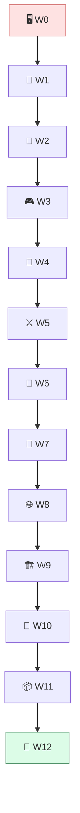

# 🗺️ The Roadmap — Building Ashfall

[↑ Back to README](README.md) · [📜 Rules](RULES.md) · [📊 Progress](PROGRESS.md)

> **13 Worlds · 59 lessons · 13 Boss Battles.** One codebase — **Ashfall**, a 2D top-down action-roguelite — grows from an empty project into a shipped, networked, cloud-deployed game. Each world solves a real teammate ticket at **Pixel Forge Studios** and ends in a Boss Battle. You don't advance until you beat the boss.

---

## 🖥️ World 0 — Dev Environment & Mindset

**Theme:** From a bare dev box to a runnable project and an engineer's mindset.
**Teammate ticket (IT Support):** "Your dev box is bare. Install Unity + an editor, learn our repo conventions, and prove you can build & run an empty project — before Maya hands you real work."
**Ashfall milestone:** The empty **Ashfall** project exists on disk, version-controlled, with a working `.gitignore` and a first build that runs.
**Lessons (4):** the game loop · install Unity & editor · version control with Git · engineer mindset & debugging.
**👹 Boss — "First Build, First Commit":** create the Ashfall repo, produce a runnable empty build, push a clean first commit.

---

## 🧠 World 1 — Programming Mastery (Advanced C#)

**Theme:** Write code the studio can live with for two years.
**Teammate ticket (Kenji):** "Our last prototype was 3000-line spaghetti. Set up clean architecture, events, and SOLID from day one."
**Ashfall milestone:** Ashfall's foundations — core data types, composed entities, interfaces, a `GameEvents` bus, and a `GameManager` state machine.
**Lessons (5):** types & memory · OOP & composition · interfaces & SOLID · events & observer · managers & game state.
**👹 Boss — "Refactor the Spaghetti":** refactor a messy single-class prototype into managers + events + interfaces with zero behavior change.

---

## 📐 World 2 — Mathematics for Games

**Theme:** Movement and aiming that *feel* right — all of it is math.
**Teammate ticket (Maya):** "The player needs to move and aim and it has to feel right. Give me vectors, smoothing, and angles I can tune."
**Ashfall milestone:** A reusable `Mover` plus smoothed aim and camera follow built on vectors, dot/cross products, trig, and interpolation.
**Lessons (5):** vectors & coordinate spaces · dot & cross products · trigonometry & rotation · interpolation & easing · transforms & delta time.
**👹 Boss — "The Aiming Reticle":** a reticle that smoothly rotates to face the mouse using trig + lerp, framerate-independent.

---

## 🎮 World 3 — Core Game Programming

**Theme:** Make Ashfall actually playable.
**Teammate ticket (Kenji):** "A character you can drive, a camera that follows, collisions that stop you, and a save file that survives a restart."
**Ashfall milestone:** A top-down player you can move, that collides with walls, is followed by the camera, and whose position/HP saves & loads.
**Lessons (5):** the input system · player controller & physics · collision & triggers · camera systems · saving & loading.
**👹 Boss — "The Playable Slice":** the full move-collide-follow-save loop, working end to end.

---

## 🧮 World 4 — Algorithms & Data Structures

**Theme:** Every run feels new, and enemies actually navigate.
**Teammate ticket (Maya):** "Generate a dungeon, and make enemies path to the player instead of walking into walls."
**Ashfall milestone:** A procedural dungeon generator, a spatial grid, and a reusable `Pathfinder` that A\*-paths across it.
**Lessons (4):** Big-O & data structures · graphs, grids & traversal · A\* pathfinding · procedural generation & spatial grids.
**👹 Boss — "The Infinite Dungeon":** generate a connected random dungeon and A\*-path an agent from entrance to player.

---

## ⚔️ World 5 — Gameplay Systems

**Theme:** The actual *game* — items, abilities, combat, loot, all data-driven.
**Teammate ticket (Maya):** "Items, abilities, hits that hurt, poison that ticks, loot worth grabbing — data-driven so I can tune it without you."
**Ashfall milestone:** ScriptableObject-driven items/abilities, inventory & equipment, a combat/damage pipeline, status effects, loot tables, and gold.
**Lessons (5):** data-driven design with ScriptableObjects · inventory & equipment · abilities & cooldowns · combat & damage · status effects, loot & economy.
**👹 Boss — "The Loot Run":** clear a room — use an ability, take damage, get poisoned, kill an enemy, pick up and equip its loot.

---

## 🤖 World 6 — Artificial Intelligence

**Theme:** Enemies that think — and one real boss.
**Teammate ticket (Kenji):** "Make them patrol, notice the player, chase, attack, flee when hurt — and give me one real boss with phases."
**Ashfall milestone:** Enemy FSMs with perception and steering, a behavior-tree elite, and the multi-phase Ashen Warden with utility-driven decisions.
**Lessons (5):** finite state machines · perception & sensing · steering & navigation · behavior trees · boss design & utility AI.
**👹 Boss — "The Ashen Warden":** a multi-phase boss combining FSM + behavior tree that patrols, pursues, attacks in patterns, and shifts behavior at low HP.

---

## 🎨 World 7 — Rendering & Graphics

**Theme:** Make Ashfall *read* as a real game.
**Teammate ticket (Lena):** "It looks flat. Give me dynamic 2D lighting, shaders, particles, and post-processing."
**Ashfall milestone:** Ashfall on URP with dynamic 2D lighting/shadows, hit-flash + dissolve shaders, impact particles, and a post-processing stack at stable framerate.
**Lessons (4):** the rendering pipeline · shaders & materials · 2D lighting & shadows · particles, post-processing & juice.
**👹 Boss — "Atmosphere Pass":** light a room with shadows, add a dissolve/hit-flash shader, particles on impact, and a post stack — at stable framerate.

---

## 🌐 World 8 — Networking & Multiplayer  *(folds in cloud/DevOps)*

**Theme:** Co-op over the network, then a containerized server.
**Teammate ticket (Priya):** "Sync two players authoritatively, then containerize a dedicated server so we can run it anywhere — starting with Docker."
**Ashfall milestone:** Server-authoritative 2-player co-op in one dungeon, plus a Dockerized Ashfall dedicated server running locally.
**Lessons (4):** networking fundamentals · state sync & authority · co-op gameplay & RPCs · dedicated server & Docker.
**👹 Boss — "Co-op in a Container":** two clients play one dungeon together via a server-authoritative model, with the server running as a Docker container.

---

## 🏗️ World 9 — Game Engine Architecture

**Theme:** Refactor toward data-oriented design so it scales.
**Teammate ticket (Kenji):** "We're hitting GC spikes with hundreds of entities. Refactor hot paths toward DOD and lock down serialization & the asset pipeline."
**Ashfall milestone:** An ECS-lite, pooled, struct-of-arrays hot path, versioned saves, an asset-loading layer, and clean engine layering.
**Lessons (4):** data-oriented design · ECS-lite & object pooling · serialization & asset pipeline · subsystems & engine layering.
**👹 Boss — "1000 Entities at 60 FPS":** simulate 1000+ entities at 60 FPS via an ECS-lite, pooled, data-oriented refactor with robust save/load.

---

## 🚀 World 10 — Production Engineering & Cloud  *(folds in cloud/DevOps)*

**Theme:** Ship it for real — CI/CD, profiling, and cloud infrastructure.
**Teammate ticket (Priya):** "Set up CI/CD, automate builds, profile performance, and deploy the dedicated server to AWS on Kubernetes via Terraform."
**Ashfall milestone:** A green CI/CD pipeline building Ashfall on push, and the Dockerized server deployed to an AWS EKS cluster via Terraform, with monitoring.
**Lessons (5):** profiling & optimization · automated builds & CI/CD · containers & the cloud · infrastructure as code with Terraform · deploy, monitor & operate.
**👹 Boss — "Ship the Server":** a green CI/CD pipeline plus the Dockerized server live on Kubernetes on AWS via Terraform, reachable by a client.

---

## 📦 World 11 — Portfolio Projects

**Theme:** Range — prove Ashfall's skills transfer to any genre.
**Teammate ticket (Theo):** "Build six small, sharp prototypes in other genres — proof you can apply Ashfall's skills anywhere."
**Ashfall milestone:** *(Standalone project briefs, not Ashfall additions.)* Six polished, documented prototypes ready for a hiring manager.
**Lessons (6 briefs):** 2D platformer · tower defense · puzzle game · turn-based roguelike · top-down shooter · multiplayer mini-engine.
**👹 Boss — "Portfolio Review":** present all six prototypes as a polished, documented portfolio (READMEs, GIFs, one-page case studies).

---

## 👑 World 12 — Final Boss — Ship Ashfall

**Theme:** Prototype to shipped vertical slice.
**Teammate ticket (Theo):** "Take Ashfall from prototype to a polished, optimized, deployed vertical slice with docs — and ship it. Studio's watching."
**Ashfall milestone:** *(Capstone milestones.)* Every system integrated, polished to a stable frame budget, built via CI/CD, deployed, documented, tagged `v1.0`.
**Lessons (3 milestones):** systems & architecture · optimization & polish · build, deploy & document.
**👹 Boss — "Launch Day":** release the Ashfall vertical slice — playable, performant, deployed, documented, tagged `v1.0`.

---

[↑ Back to README](README.md) · [📜 Rules](RULES.md) · [📊 Progress](PROGRESS.md) · [📚 Curriculum Bible](CURRICULUM.md)
