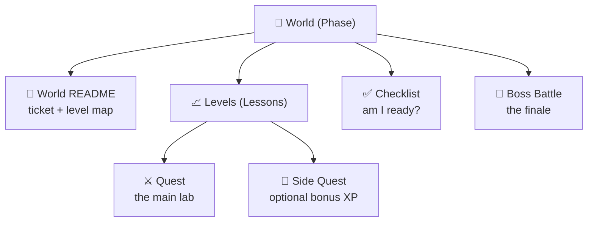
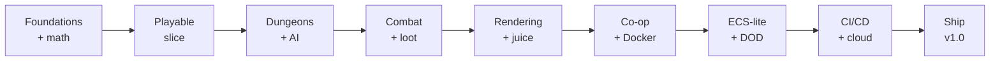

# 📜 Rules of the Game

Welcome to onboarding at **Pixel Forge Studios**. Before you take your first ticket, here's how this whole thing works. Read it once — it'll make everything else click.

[↑ Back to README](README.md) · [🗺️ Roadmap](ROADMAP.md) · [📊 Progress](PROGRESS.md)

---

## 🎯 The one rule that matters

> **You learn by building.** Every lesson ends with something real in the Ashfall codebase. If you finish a lesson and nothing changed on disk, you skipped the important part.

Our split is **20% reading, 80% building**. If you're reading more than building, slow down and do the quest.

---

## 🏰 Worlds, Levels, and structure

- **World** = a phase (e.g. *Artificial Intelligence*). There are **13**, numbered 0–12.
- **Level** = a lesson inside a world. Each ends with something built in Ashfall. There are **59** total.
- **Quest** = the hands-on lab inside a lesson. This is the main event.
- **Side Quest** = an optional bonus challenge for extra XP.
- **Boss Battle** = the end of a world. **No step-by-step instructions** — just a real problem and the skills you've earned. There are **13**.

---

## 🔓 How worlds unlock

> A world unlocks **only when you beat the previous world's Boss Battle.**

You can't skip ahead. Each world assumes the skills *and* the Ashfall project state from the one before it. Beat the boss → the next world opens. The next unchecked box in [PROGRESS.md](PROGRESS.md) is always your next move.

---

## ⭐ Experience Points (XP)

You earn XP for completing things. XP measures progress and ranks you up.

| Action | XP |
|--------|---:|
| Complete a lesson's **Quest** (the main lab) | **100 XP** |
| Pass the lesson **Quiz** | **25 XP** |
| Complete a **Side Quest** | **50 XP** |
| Defeat a **Boss Battle** | **500 XP** |
| Finish an entire **World** (all lessons + boss) | **+250 XP bonus** |

> A fully-completed lesson is worth **125 XP** (100 Quest + 25 Quiz).

---

## 🎚️ Rank ladder

Your total XP sets your rank at Pixel Forge:

| Total XP | Rank |
|---------:|------|
| 0 | 🥚 Intern |
| 1,500 | 🐣 Junior Gameplay Programmer |
| 5,000 | 🎮 Gameplay Programmer |
| 9,000 | ⚙️ Senior Gameplay Engineer |
| 13,000 | 🧠 Lead Engineer |
| 17,000+ | 🏆 **Master Game Developer** |

You start as an 🥚 Intern. Ship Ashfall and you walk out a 🏆 Master Game Developer.

---

## 👹 Boss Battles

Every world ends with a Boss Battle. The rules:

1. **No tutorials.** You get a problem statement (a ticket or an incident) and a list of victory conditions.
2. **You may use** your notes, the official docs, and everything you've already built.
3. **You may not** copy a step-by-step guide. The point is to prove the skill is *yours*.
4. **You win** when every victory condition is met and you can explain *why* it works.

Boss Battles mirror real production problems. Beating one is your proof you're ready for the next world — and it's what unlocks it.

---

## 📦 The Golden Thread: one game, the whole way

Everything you build feeds **one** project: **[Ashfall](GAME_OVERVIEW.md)**.

You don't build throwaway demos. Each world evolves the same codebase. Don't delete your work between worlds — you'll need it on Launch Day.

---

## ✅ How to "complete" a lesson

A lesson is done when:

1. ✅ You finished the **Quest** (the thing is built and works).
2. ✅ You can answer the **Reflection Questions** out loud.
3. ✅ You passed the **Quiz**.
4. ✅ You ticked the **Completion Checklist** at the bottom of the lesson.
5. ✅ You updated [PROGRESS.md](PROGRESS.md) with your new XP.

Then — and only then — follow the **→ Next Lesson** link.

---

## 🏆 Achievements

Unlock badges along the way (tracked in [PROGRESS.md](PROGRESS.md)):

| Badge | Achievement | How to earn it |
|:-----:|-------------|----------------|
| 🧹 | **Spaghetti Slayer** | Beat World 1 (clean architecture refactor) |
| 🎯 | **Dead-Eye** | Beat World 2 (the aiming reticle) |
| 🕹️ | **First Playable** | Beat World 3 (the playable slice) |
| 🧭 | **Pathfinder** | A\*-path an agent across a generated dungeon |
| ⚔️ | **Loot Goblin** | Beat World 5 (the loot run) |
| 🐉 | **Wardenslayer** | Defeat the Ashen Warden |
| ✨ | **Atmosphere Artist** | Beat World 7 (the atmosphere pass) |
| 🐳 | **Captain Container** | Run the Ashfall server in Docker |
| 🚄 | **60 FPS Club** | Simulate 1000+ entities at 60 FPS |
| ☁️ | **Cloud Walker** | Deploy the server to AWS Kubernetes |
| 🚀 | **Launch Commander** | Defeat the Final Boss — ship Ashfall `v1.0` |
| 💯 | **Completionist** | Finish every side quest in the bootcamp |

---

## 📈 Your character sheet

[PROGRESS.md](PROGRESS.md) is your character sheet — XP, rank, worlds cleared, and badges. It's **auto-rendered** by `scripts/update_progress.py`, which also generates your shareable **profile.html** and your badges. Keep your checkboxes current and let the script do the rest.

---

[↑ Back to README](README.md) · [🗺️ Roadmap →](ROADMAP.md) · [📊 Your Progress →](PROGRESS.md)
