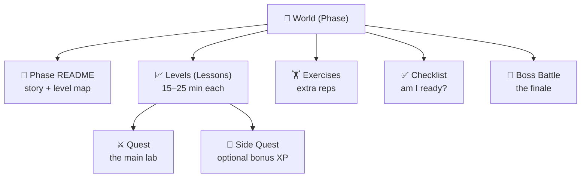
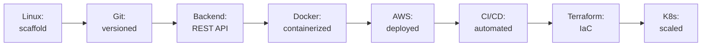

# 📜 Rules of the Game

Welcome to your onboarding at **CloudForge Inc.** Before you take your first ticket, here's how this whole thing works. Read this once — it'll make everything else click.

[↑ Back to README](README.md)

---

## 🎯 The one rule that matters

> **You learn by building.** Every single lesson ends with something real on your machine. If you finish a lesson and nothing changed on disk, you skipped the important part.

Our split is **20% reading, 80% building**. If you find yourself reading more than building, slow down and do the labs.

---

## 🏰 Worlds, Levels, and the structure

- **World** = a phase (e.g. *Docker*). There are 11, numbered 0–10.
- **Level** = a lesson inside a world. Each takes **15–25 minutes** and ends with something built.
- **Quest** = the hands-on lab inside a lesson. This is the main event.
- **Side Quest** = optional bonus challenge for extra XP.
- **Boss Battle** = the end of a world. **No step-by-step instructions** — just a real problem and the skills you've earned.

---

## ⭐ Experience Points (XP)

You earn XP for completing things. XP is how you measure progress and level up.

| Action | XP |
|--------|---:|
| Complete a lesson's **Quest** (the main lab) | **100 XP** |
| Pass the lesson **Quiz** | **25 XP** |
| Complete a **Side Quest** | **50 XP** |
| Defeat a **Boss Battle** | **500 XP** |
| Finish an entire **World** (all lessons + boss) | **+250 XP bonus** |

Track your XP in [PROGRESS.md](PROGRESS.md). Add it up as you go — it's your score.

### 🎚️ Levels (your rank)

| Total XP | Rank |
|---------:|------|
| 0 | 🥚 Intern |
| 1,000 | 🐣 Junior Engineer |
| 3,000 | 🔧 Engineer |
| 6,000 | ⚙️ Senior Engineer |
| 9,000 | 🛡️ Staff Engineer |
| 12,000+ | ☁️ **Cloud Engineer** |

---

## 👹 Boss Battles

Every world ends with a Boss Battle. The rules:

1. **No tutorials.** You get a problem statement (usually a ticket or an incident) and a list of "victory conditions."
2. **You may use** your notes, the official docs, and everything you built earlier.
3. **You may not** copy a step-by-step guide. The point is to prove the skill is *yours*.
4. **You win** when every victory condition is met and you can explain *why* it works.

Boss Battles mirror real production problems. Beating them is the proof you're ready for the next world.

---

## 📦 The Golden Thread: one project, the whole way

Everything you build feeds **one** application: the **[Task Manager Platform](PROJECT_OVERVIEW.md)**.

You don't build throwaway demos. Each world evolves the same project:

By Launch Day, that scaffold has become a production-grade platform. Don't delete your work between phases — you'll need it.

---

## 🧭 How to navigate

Every document has navigation links at the top and bottom:

> ← Previous Lesson  ·  ↑ Phase Home  ·  → Next Lesson

You should **never** wonder what to do next. If you ever do, return to your [Progress Tracker](PROGRESS.md) — the next unchecked box is your next move.

---

## ✅ How to "complete" a lesson

A lesson is done when:

1. ✅ You finished the **Quest** (the thing is built and works).
2. ✅ You can answer the **Reflection Questions** out loud.
3. ✅ You passed the **Quiz**.
4. ✅ You ticked the **Completion Checklist** at the bottom of the lesson.
5. ✅ You updated [PROGRESS.md](PROGRESS.md) with your new XP.

Then — and only then — follow the **→ Next Lesson** link.

---

## 🛟 When you get stuck

Getting stuck is part of the job. Here's the order to try things:

1. **Re-read the error message.** Slowly. Out loud. It usually tells you what's wrong.
2. **Check Common Mistakes** — every lesson has a section for the traps you just hit.
3. **Search the exact error text.** Copy-paste it into a search engine.
4. **Rubber-duck it.** Explain the problem to an imaginary teammate. You'll often answer your own question.
5. **Check the [Glossary](GLOSSARY.md)** if a word is fuzzy.

> 💡 Struggling for 15 minutes and then solving it teaches you more than reading the answer in 15 seconds. Embrace the struggle — but don't suffer for an hour. Use the steps above.

---

## 🏆 Achievements

Unlock these along the way (track them in [PROGRESS.md](PROGRESS.md)):

| Badge | Achievement | How to earn it |
|:-----:|-------------|----------------|
| 🐧 | **Penguin Whisperer** | Finish World 2 (Linux) |
| 🌿 | **Time Traveler** | Recover a deleted file with Git |
| ⚙️ | **API Architect** | Ship the Task Manager REST API |
| 🐳 | **Captain Container** | Run your app in Docker |
| ☁️ | **Cloud Walker** | Reach your app's public IP on AWS |
| 🤖 | **Robot Overlord** | Deploy automatically with CI/CD |
| 🏗️ | **The Architect** | Build all infra with `terraform apply` |
| 🌊 | **Surge Survivor** | Auto-scale under load in Kubernetes |
| 🚀 | **Launch Commander** | Defeat the final Boss Battle |
| 💯 | **Completionist** | Finish every side quest in the bootcamp |

---

[↑ Back to README](README.md)  ·  [🗺️ Roadmap →](ROADMAP.md)  ·  [📊 Your Progress →](PROGRESS.md)
