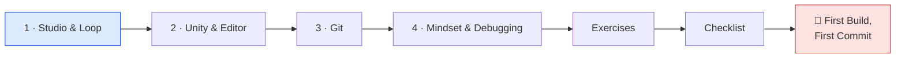
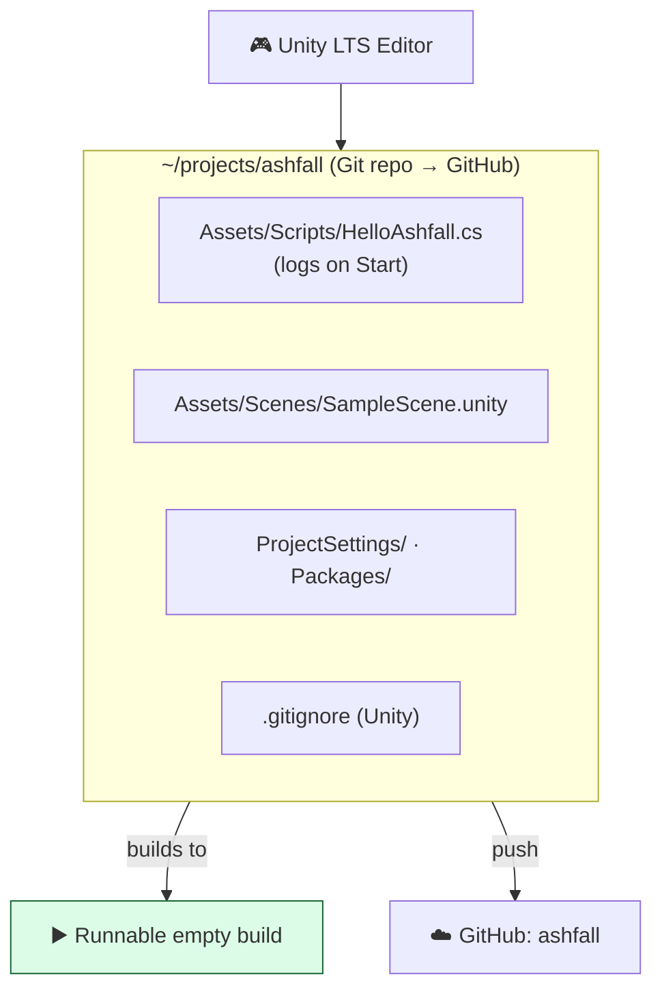

# 🖥️ World 0 — Dev Environment & Mindset

> Welcome to **Pixel Forge Studios**. Before you write a line of gameplay, you need a working dev box, the studio's version-control conventions, and the mindset of an engineer who *finds bugs* instead of fearing them. This world gets you battle-ready. Then Maya starts handing you real work.

[↑ Home](../../README.md) · [🗺️ Roadmap](../../ROADMAP.md) · [📊 Progress](../../PROGRESS.md)

---

## 📨 Your onboarding ticket

```
From:    IT Support <it@pixelforge.studio>
To:      You <new-hire@pixelforge.studio>
Cc:      Kenji <kenji@pixelforge.studio>
Subject: [ONBOARD-000] Set up your dev box & prove you can build

Welcome to Pixel Forge! Your machine is bare. Before Maya hands you a
single feature ticket, finish onboarding:

  1. Understand what a game actually IS (the game loop) — Kenji insists.
  2. Install Unity + a C# editor, and create our project: "Ashfall".
  3. Put Ashfall under Git with our standard Unity .gitignore.
  4. Prove the toolchain end-to-end: a script that runs, and you can debug it.

Boss check ("First Build, First Commit"): produce a runnable empty
Ashfall BUILD and push a clean first commit. Do that and you're cleared
for real work.

— IT Support
```

This is World 0 of a 13-world journey. Everything you build from here lives in **one growing project — Ashfall**, a 2D top-down action-roguelite. Today it's an empty folder. By the end of the bootcamp it ships.

---

## 🎯 What you'll achieve in this world

- 🧠 Understand the **game loop** and **delta time** — the first principle every engine runs on
- 🧰 Install **Unity Hub + a Unity LTS** editor and **VS Code/Rider** (all free)
- 🎮 Create the empty **Ashfall** 2D project and tour the Editor as a *tool over a runtime*
- 🔀 Put Ashfall under **Git** with a correct Unity `.gitignore`, commit, branch, and push to GitHub
- 🐛 Adopt the **engineer mindset** — read errors, `Debug.Log`, breakpoints, isolate bugs — and write Ashfall's first script

---

## 🗺️ Level map

| Level | Lesson | Difficulty | XP |
|------:|--------|:----------:|---:|
| 1 | [Meet the Studio & the Game Loop](lessons/01-meet-the-studio-and-the-loop.md) | 🟢 Easy | 125 |
| 2 | [Install Unity & Your Editor](lessons/02-install-unity-and-editor.md) | 🟢 Easy | 125 |
| 3 | [Version Control with Git](lessons/03-version-control-with-git.md) | 🟡 Medium | 125 |
| 4 | [The Engineer Mindset & Debugging](lessons/04-engineer-mindset-and-debugging.md) | 🟡 Medium | 125 |
| 👹 | [Boss Battle — First Build, First Commit](boss-battle.md) | 🟡 Medium | 500 |

➕ Extra reps: [exercises.md](exercises.md) · ✅ Ready to advance? [checklist.md](checklist.md)

---

## 🧭 Recommended order



Go in order — each lesson sets up the next, and Lessons 2–4 all touch the *same* Ashfall project on disk.

---

## 📦 Ashfall project status

**Entering World 0:** nothing exists. No engine, no repo, no project — a bare machine.

**Leaving World 0:** a real, version-controlled, buildable foundation.



You hand this to **World 1 — Programming Mastery**, where you'll start writing the clean architecture Ashfall's code will live on for years.

---

## 👹 Boss teaser

**"First Build, First Commit"** — create the Ashfall repo, produce a *runnable empty Unity build*, push a clean first commit with `.gitignore` working, and reproduce + fix a seeded bug using the debugging instincts from Level 4. Beat it to earn the **🖥️ Onboarded** badge and unlock World 1.

---

[↑ Home](../../README.md) · [🗺️ Roadmap](../../ROADMAP.md) · [📊 Progress](../../PROGRESS.md) · [▶️ Start Level 1 →](lessons/01-meet-the-studio-and-the-loop.md)
