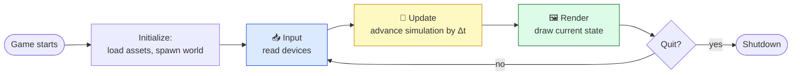

# Level 1 — Meet the Studio & the Game Loop

| | |
|---|---|
| 🎚️ **Difficulty** | 🟢 Easy |
| ⏱️ **Estimated time** | 20 minutes |
| ⭐ **XP reward** | 100 (Quest) + 25 (Quiz) |

[← Prev](../README.md) · [↑ Phase Home](../README.md) · [→ Next](02-install-unity-and-editor.md)

---

## 📖 Story

> *"Welcome to Pixel Forge, new blood. I'm Kenji — senior gameplay engineer, and your mentor for the foreseeable future. Before you touch the engine, I want you to understand the one idea every game on earth is built on. Doom, Stardew, our little Ashfall — all the same heartbeat underneath. Get this and the rest of the job is just details. — Kenji"*

Maya (our lead designer) will start filing real feature tickets next week. Theo (the director) wants a vertical slice by end of year. None of that matters yet. Today is about the *mental model*. Let's build it.

---

## 🎯 Goal

- Understand what a game **is**, from first principles — not "what engine do I use" but "what is the machine doing"
- Learn the **game loop**: input → update → render, running many times per second
- Understand **delta time** and why frame-rate-independent code is non-negotiable
- See a tiny, engine-agnostic loop in plain C# so the idea sticks before Unity hides it

---

## 🧠 Concepts

A game, stripped of art and story, is a program stuck in a very fast `while` loop. Each pass through the loop is a **frame**. Every frame it does three things:

1. **Input** — read the keyboard, mouse, gamepad. *What did the player just do?*
2. **Update** — advance the simulation by a tiny slice of time. *Move things, run AI, check collisions, apply rules.*
3. **Render** — draw the current state to the screen. *Show the player what the world looks like now.*

Do that 60+ times a second and a still picture becomes a living, responsive world. That's it. That's the whole machine.



### Delta time — the part everyone gets wrong first

Frames don't take equal time. A simple scene might run at 200 FPS; a busy one drops to 40. If you move the player "5 units every frame," the player teleports on a fast machine and crawls on a slow one. Same code, different game. Unacceptable.

The fix is **delta time** (`Δt`, often `deltaTime`): *the number of seconds the previous frame took*. Instead of "move 5 per frame," you say "move 5 **per second**" and multiply by `Δt`:

```
distanceThisFrame = speed * deltaTime
```

Now a 60 FPS machine moves in 60 small steps and a 30 FPS machine moves in 30 bigger steps — and after one real-world second, **both have moved the same distance.** This is the difference between a toy and a real engine.

### A tiny game loop in plain C#

No Unity yet — just the bare idea, so you see there's no magic. This is a console "game" where a value drifts at a constant real-world speed regardless of how fast the loop spins:

```csharp
using System;
using System.Diagnostics;

class TinyGame
{
    static void Main()
    {
        float position = 0f;        // our entire "game state"
        float speed = 2f;           // units PER SECOND, not per frame
        bool running = true;

        var clock = Stopwatch.StartNew();
        double lastSeconds = 0;

        while (running)             // ← the game loop
        {
            // --- timing: how long did the last frame take? ---
            double now = clock.Elapsed.TotalSeconds;
            float deltaTime = (float)(now - lastSeconds);
            lastSeconds = now;

            // --- 1. INPUT ---
            if (Console.KeyAvailable && Console.ReadKey(true).Key == ConsoleKey.Q)
                running = false;

            // --- 2. UPDATE (frame-rate independent thanks to deltaTime) ---
            position += speed * deltaTime;

            // --- 3. RENDER ---
            Console.SetCursorPosition(0, 0);
            Console.WriteLine($"position = {position:F2}   (press Q to quit)   ");
        }
    }
}
```

Notice `speed * deltaTime`. Whether this loop runs 1,000 times a second or 10, `position` increases by ~2 every real second. **Every engine does exactly this** — Unity, Unreal, Godot, your own. They just give you nicer names (`Update()`, `Time.deltaTime`) and draw sprites instead of text.

### Why this exists

Computers can't show motion — they show *a sequence of still frames fast enough that your brain fills in the motion* (same trick as film). To produce those frames, the program must re-decide the entire world state, over and over, forever, until you quit. The game loop is the only structure that does this. Delta time exists because hardware speed varies and players on different machines must get the *same game*. Learn this once and it transfers to **any** engine, language, or platform — because it's not an engine feature, it's how interactive simulation fundamentally works.

---

## 🛠️ Hands-on Lab

> 💻 You don't have Unity yet (that's next lesson). But you almost certainly have a terminal, and proving the loop yourself beats reading about it. We'll use **dotnet-script** if you have .NET, or any free online C# runner.

### Step 1 — Pick a way to run C#

You have two zero-cost options:

```bash
# Option A: if you have the .NET SDK (we'll install it properly next lesson anyway)
dotnet --version       # any 6.0+ is fine
```

If that prints a version, great. If not, **Option B**: open a free in-browser C# playground (see [RESOURCES.md](../../../RESOURCES.md) for this world's link). No install needed.

### Step 2 — Run the tiny loop

Paste the `TinyGame` code from the Concepts section into your runner. With local .NET:

```bash
mkdir -p ~/scratch/tinygame && cd ~/scratch/tinygame
dotnet new console -n TinyGame -o .   # creates Program.cs
# paste TinyGame's Main body into Program.cs (replace the class), then:
dotnet run
```

(In a browser playground, just paste and press Run — note `Console.KeyAvailable`/cursor moves may not work in every sandbox; that's fine, the point is the math.)

### Step 3 — Watch frame-rate independence

Add a deliberate slowdown inside the loop to simulate a heavy frame, and confirm `position` still climbs at the same real-world rate:

```csharp
// Put this at the very end of the while-loop body to fake a slow frame:
System.Threading.Thread.Sleep(100);   // 100 ms per frame ≈ 10 FPS
```

Run it. The number on screen updates far less often now — but time it: after ~5 seconds, `position` is still about `10` (because `2 units/sec × 5 sec`). The loop got *slower*, the game did **not** change speed. That's delta time earning its keep.

### Step 4 — Break it on purpose (so you never forget)

Replace the update line with the naive, wrong version:

```csharp
// WRONG: per-frame movement, no deltaTime
position += 0.05f;
```

Now run it **with** and **without** the `Sleep(100)`. Two different speeds, same code. This bug ships in real games when people forget `deltaTime` — now you'll smell it instantly.

---

## 🎮 Mini Challenge

Your loop moves `position` forward forever. Make it **bounce**: when `position` goes above `10`, it should start decreasing; when it drops below `0`, increase again — all still frame-rate independent.

<details>
<summary>💡 Reveal answer</summary>

Track a direction and flip it at the bounds:

```csharp
float position = 0f;
float speed = 2f;
int direction = 1;            // +1 = up, -1 = down

// ...inside Update:
position += speed * direction * deltaTime;
if (position > 10f) { position = 10f; direction = -1; }
if (position < 0f)  { position = 0f;  direction = +1; }
```

Same trick a Pong ball uses. Multiplying by `deltaTime` means it bounces at the same speed on any machine.
</details>

---

## 📦 Project Mission

Ashfall has no code yet — that's correct for Level 1. Your mission is to lock in the **mental model** and prepare your workspace, because next lesson you'll create the real project on disk.

1. Create the parent folder your whole career here will live in:
   ```bash
   mkdir -p ~/projects
   ```
2. In a note (a `.txt` file, a notebook, anywhere) write, in your own words, the three phases of the game loop and the one-line role of `deltaTime`. No copy-paste — say it like you'd explain it to a friend.
3. Keep your working `TinyGame` from the lab — it's proof you understand the heartbeat before the engine hides it from you.

🎯 **Mission complete when:** `~/projects` exists, you've written the loop + delta-time explanation in your own words, and your `TinyGame` runs and moves at a constant real-world speed regardless of the `Sleep` value.

---

## ⚠️ Common Mistakes

| Mistake | What happens | Fix |
|--------|--------------|-----|
| Moving "X per frame" instead of "X per second × deltaTime" | Game runs faster on fast PCs, slower on slow ones | Always multiply per-second rates by `deltaTime` |
| Thinking the engine "is" the game | You memorize buttons, not concepts; skills don't transfer | Learn the loop first; the engine is just a tool over it |
| Doing rendering work inside Update logic | Tangled code, hard to reason about timing | Keep input / update / render mentally separate even when the engine blends them |
| Assuming a fixed frame rate | Physics jitter, inconsistent gameplay | Treat frame time as variable; that's reality |
| Putting `Thread.Sleep` in real game code to "control speed" | Freezes the whole loop, kills responsiveness | Control speed with `deltaTime`, never by sleeping |

---

## 🤔 Reflection Questions

1. In one sentence each, what does the Input, Update, and Render phase do — and why must they happen in that order?
2. A teammate says "just move the player 3 pixels every frame, it's simpler." What breaks, and what's your one-line fix?
3. Unity will give you an `Update()` method and `Time.deltaTime`. Based on this lesson, what do you already know they're doing under the hood?

---

## 📝 Quiz

1. **A "frame" in a game is…**
   - a) a picture file on disk
   - b) one pass through the input → update → render loop
   - c) the border around the window
2. **Why multiply movement by `deltaTime`?**
   - a) it makes the game look prettier
   - b) so motion is the same speed regardless of frame rate
   - c) it's required by C# syntax
3. **The game loop is…**
   - a) a Unity-only feature
   - b) how every real-time engine works, on any platform
   - c) only needed for 3D games

<details>
<summary>✅ Answers</summary>

1: **b** · 2: **b** · 3: **b**
</details>

---

## ✅ Completion Checklist

- [ ] I can explain the three phases of the game loop from memory
- [ ] I understand `deltaTime` and why per-frame movement is a bug
- [ ] I ran `TinyGame` and saw frame-rate-independent movement
- [ ] I broke it on purpose (naive per-frame move) and saw the difference
- [ ] `~/projects` exists, ready for Ashfall next lesson
- [ ] I passed the quiz
- [ ] Added **+125 XP** to [PROGRESS.md](../../../PROGRESS.md)

---

[← Prev](../README.md) · [↑ Phase Home](../README.md) · [→ Next](02-install-unity-and-editor.md)
