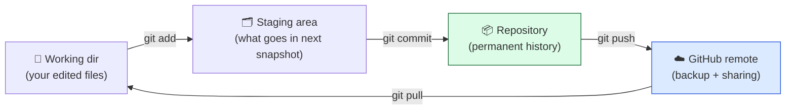
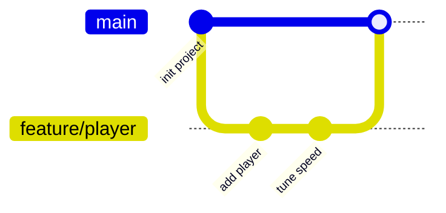

# Level 3 — Version Control with Git

| | |
|---|---|
| 🎚️ **Difficulty** | 🟡 Medium |
| ⏱️ **Estimated time** | 30 minutes |
| ⭐ **XP reward** | 100 (Quest) + 25 (Quiz) |

[← Prev](02-install-unity-and-editor.md) · [↑ Phase Home](../README.md) · [→ Next](04-engineer-mindset-and-debugging.md)

---

## 📖 Story

> *"Real talk: the day you delete the wrong folder and lose three days of work is the day you wish you'd set up Git on day one. So we're doing it on day one. Every Ashfall change from here lives in version control. No exceptions — Maya's tickets, my reviews, the boss build, all of it. — Kenji"*

Priya (our DevOps lead) chimes in on Slack: *"And please get the Unity `.gitignore` right. Last newbie committed their entire `Library/` folder — 4 GB of generated cache. My pull took ten minutes. 🙃"*

---

## 🎯 Goal

- Understand Git from first principles: **commits as snapshots**, the staging area, history
- Turn `~/projects/ashfall` into a Git repository with a proper **Unity `.gitignore`**
- Make a clean **first commit** of the project
- Learn **branches** (and why every future ticket gets one) and push to a **GitHub remote**

---

## 🧠 Concepts

Git is a **time machine for your project**. A **commit** is a labeled snapshot of every tracked file at a moment in time. History is a chain of these snapshots — you can travel to any of them, compare them, or branch off them. Nothing is "saved over"; the old snapshot still exists.

Files move through three places:



- **Working directory** — your files as they are right now.
- **Staging area** (the "index") — the deliberate list of changes you're about to snapshot. This is why Git makes you `add` then `commit`: you choose *exactly* what each snapshot contains.
- **Repository** — the full history of commits, stored in the hidden `.git/` folder.
- **Remote** (GitHub) — a copy of that history in the cloud: backup, and how a team shares work.

**Branches** are cheap, parallel timelines. `main` is the trusted line. When Maya files a ticket, you branch (`feature/dash-ability`), build there, and merge back when it works — so `main` is always in a good state and your experiments never endanger it.



### The Unity `.gitignore` — non-negotiable

A Unity project on disk is mostly **generated cache**. You must commit your *source* (`Assets/`, `ProjectSettings/`, `Packages/manifest.json`) and **ignore** everything Unity rebuilds (`Library/`, `Temp/`, `obj/`, `Build/`, `Logs/`). Committing the cache bloats the repo, causes merge hell, and is machine-specific garbage. A `.gitignore` file tells Git which paths to never track.

### Why this exists

Before version control, "backup" meant `project_final_v2_REAL_final.zip` and "collaboration" meant emailing folders and praying. Git solves three felt problems at once: **safety** (any past state is recoverable), **collaboration** (many people, one history, no overwrites), and **understanding** (the commit log is the story of *why* the code is the way it is). This is universal — every studio, every backend team, every open-source project runs on this exact model. The staging area exists so commits are *intentional units of change*, not random saves; that discipline is what makes history readable. Learn it now and it serves every project you'll ever touch.

---

## 🛠️ Hands-on Lab

> 💻 Make sure Git is installed: `git --version` should print something. If not, grab it from [RESOURCES.md](../../../RESOURCES.md). Close the Unity Editor for a clean first commit (so no temp files churn).

### Step 1 — One-time Git identity

So your commits are attributed to you:

```bash
git config --global user.name  "Your Name"
git config --global user.email "you@example.com"
git config --global init.defaultBranch main   # use 'main' as the default branch
```

### Step 2 — Initialize the repo

```bash
cd ~/projects/ashfall
git init
git status        # lots of untracked files — including Library/ (don't panic, we'll ignore it)
```

### Step 3 — Add the Unity `.gitignore` BEFORE the first add

This is the order that saves you. Create `.gitignore` in `~/projects/ashfall`:

```bash
cat > .gitignore <<'EOF'
# --- Unity generated/cache (never commit) ---
[Ll]ibrary/
[Tt]emp/
[Oo]bj/
[Bb]uild/
[Bb]uilds/
[Ll]ogs/
[Uu]ser[Ss]ettings/
[Mm]emoryCaptures/

# IDE / editor
.vs/
.idea/
.vscode/

# OS cruft
.DS_Store
Thumbs.db

# Unity crash/asset cache
*.pidb.meta
*.apk
*.aab
EOF
```

> 💡 This is the standard Unity ignore (Unity even ships an official one — see RESOURCES.md). The `[Ll]` pattern matches both `Library` and `library` across operating systems.

> ⚠️ **Do NOT ignore `*.meta` files.** Unity creates a `.meta` for every asset to track import settings and references — those **must** be committed or the project breaks for teammates. Many a beginner ignores them by accident.

### Step 4 — Verify the ignore works, then make the first commit

```bash
git status     # Library/, Temp/, obj/ should NO LONGER appear. .gitignore + Assets/ etc. should.

git add .
git commit -m "chore: initial Ashfall project (Unity 2D) with .gitignore"
git log --oneline    # your first snapshot 🎉
```

If `Library/` still shows up, your `.gitignore` is misplaced or misspelled — fix it before committing.

### Step 5 — Practice a branch

Every future ticket = a branch. Rehearse the flow now:

```bash
git switch -c feature/readme        # create + switch to a branch
echo "# Ashfall" > README.md
echo "A 2D top-down action-roguelite. Built at Pixel Forge Studios." >> README.md
git add README.md
git commit -m "docs: add project README"

git switch main                     # back to the trusted line
git merge feature/readme            # fold the work in
git branch -d feature/readme        # tidy up the finished branch
git log --oneline                   # history shows both commits
```

### Step 6 — Push to GitHub

1. Create a **new, empty** repo on GitHub called `ashfall` (no README/license — yours already has them). See RESOURCES.md for the GitHub signup link.
2. Connect and push:

```bash
git remote add origin https://github.com/<your-username>/ashfall.git
git push -u origin main
```

Refresh the GitHub page — your project is now backed up in the cloud. The `-u` sets `origin main` as the default, so future pushes are just `git push`.

---

## 🎮 Mini Challenge

You accidentally staged a file you didn't mean to (say you ran `git add` before fixing the `.gitignore` and `Library/` got staged). Un-stage it **without** deleting it from disk.

<details>
<summary>💡 Reveal answer</summary>

```bash
git restore --staged Library/      # un-stage, keep the files on disk
# (older Git: git reset HEAD Library/)
```

If it was already committed, remove it from tracking but keep it locally:

```bash
git rm -r --cached Library/
git commit -m "chore: stop tracking generated Library/ folder"
```

Then make sure `Library/` is in `.gitignore` so it never comes back.
</details>

---

## 📦 Project Mission

Put Ashfall under version control, for real and for good.

1. `git init` inside `~/projects/ashfall`.
2. Add the Unity `.gitignore` **first**; verify `Library/`/`Temp/`/`obj/` are ignored and `.meta` files are **not**.
3. Make a clean first commit of the project.
4. Create the GitHub `ashfall` remote and `git push -u origin main`.
5. Confirm `git log` shows your commit(s) and the repo appears on GitHub.

🎯 **Mission complete when:** `~/projects/ashfall` is a Git repo with a working Unity `.gitignore`, a clean first commit (no `Library/`, with `.meta` files), and the history is pushed to a GitHub `ashfall` remote.

---

## ⚠️ Common Mistakes

| Mistake | What happens | Fix |
|--------|--------------|-----|
| `git add .` before adding `.gitignore` | `Library/` (gigabytes) gets staged | Add `.gitignore` first; if too late, `git rm -r --cached Library/` |
| Ignoring `*.meta` files | Asset references/import settings break for teammates | Never ignore `.meta`; commit every one |
| Committing without `user.name`/`user.email` set | Commits unattributed or refused | `git config --global user.name/email` once |
| Working directly on `main` for every change | One bad edit corrupts the trusted line | Branch per ticket; merge when it works |
| Creating GitHub repo *with* a README, then pushing | Push rejected (histories diverge) | Make the remote empty, or `git pull --rebase` first |
| Forgetting to push | Local-only history; a dead laptop = lost work | `git push` after committing; it's your backup |

---

## 🤔 Reflection Questions

1. Explain the staging area to a friend: why does Git make you `add` *and* `commit` instead of just saving?
2. Why must `Library/` be ignored but `.meta` files committed? What goes wrong if you flip those?
3. Maya files a ticket for a dash ability. Walk through the branch → commit → merge flow you'd use, and why you wouldn't just edit `main`.

---

## 📝 Quiz

1. **A Git commit is…**
   - a) a live-syncing copy of your folder
   - b) a labeled snapshot of your tracked files at a point in time
   - c) a backup of only the file you last opened
2. **In a Unity repo you should…**
   - a) commit `Library/` and ignore `.meta` files
   - b) ignore `Library/` and commit `.meta` files
   - c) ignore both
3. **A branch is for…**
   - a) deleting old code
   - b) working on a change in parallel without endangering `main`
   - c) speeding up the game

<details>
<summary>✅ Answers</summary>

1: **b** · 2: **b** · 3: **b**
</details>

---

## ✅ Completion Checklist

- [ ] Git identity configured (`user.name`, `user.email`)
- [ ] `~/projects/ashfall` is a Git repo (`git init`)
- [ ] Unity `.gitignore` added; `Library/`/`Temp/`/`obj/` ignored, `.meta` files tracked
- [ ] Clean first commit made (`git log` shows it)
- [ ] Practiced a branch → commit → merge cycle
- [ ] Pushed to a GitHub `ashfall` remote (`git push -u origin main`)
- [ ] I passed the quiz
- [ ] Added **+125 XP** to [PROGRESS.md](../../../PROGRESS.md)

---

[← Prev](02-install-unity-and-editor.md) · [↑ Phase Home](../README.md) · [→ Next](04-engineer-mindset-and-debugging.md)
