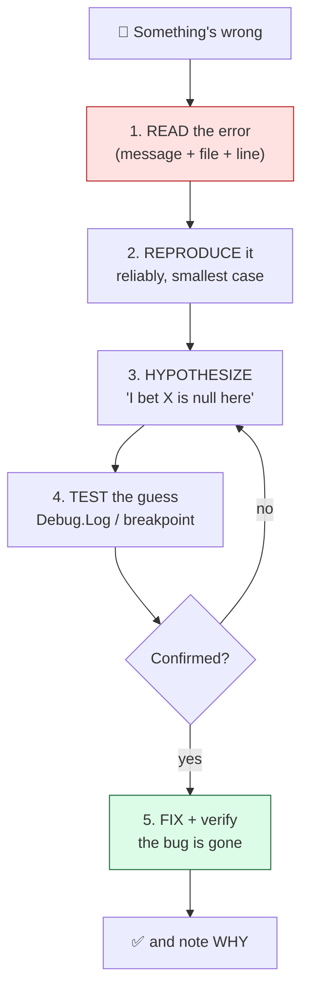

# Level 4 — The Engineer Mindset & Debugging

| | |
|---|---|
| 🎚️ **Difficulty** | 🟡 Medium |
| ⏱️ **Estimated time** | 25 minutes |
| ⭐ **XP reward** | 100 (Quest) + 25 (Quiz) |

[← Prev](03-version-control-with-git.md) · [↑ Phase Home](../README.md) · [→ Next](../boss-battle.md)

---

## 📖 Story

> *"Last onboarding lesson, and the most important one. You will spend more of your career fixing code than writing it — so the real skill isn't typing, it's *finding the bug*. Juniors panic at a red error. Seniors read it. Let me show you how I actually think when something breaks, then you'll write Ashfall's first real script to prove the whole toolchain works end to end. — Kenji"*

---

## 🎯 Goal

- Adopt the engineer mindset: **read the error**, isolate, hypothesize, verify — don't guess randomly
- Use `Debug.Log` to make invisible state visible
- Use the **debugger**: breakpoints, stepping, inspecting variables
- Learn **rubber-ducking** and bug **isolation** as everyday tools
- Write Ashfall's first script — a `HelloAshfall` that logs on `Start()` — proving the engine + editor + compile loop works

---

## 🧠 Concepts

A bug is just a gap between what you *think* the code does and what it *actually* does. Debugging is the disciplined process of closing that gap. The panic-free loop every senior runs:



**Read the error.** An error message is a *gift* — it usually names the problem, the file, and the line. `NullReferenceException` on `Player.cs:42` means: something on line 42 was `null` when you used it. That's 80% of the answer. Read it; don't skim past it to Google blindly.

**Make the invisible visible — `Debug.Log`.** You can't see variables in your head. Print them:

```csharp
Debug.Log($"health = {health}, position = {transform.position}");
```

The output lands in Unity's **Console** window. Logging *the actual values at the actual moment* turns "I think" into "I know."

**The debugger — `Debug.Log` on steroids.** A **breakpoint** pauses the program on a line so you can inspect *every* variable, then **step** line by line and watch state change. You attach your C# editor (VS Code/Rider) to Unity, set a breakpoint, press Play, and the moment that line runs, everything freezes for you to examine. No guessing.

| Tool | When to reach for it |
|------|----------------------|
| **Read the error** | Always first — it's free information |
| `Debug.Log` | Quick "what's the value here?" checks, timing, loops |
| **Breakpoint + step** | Complex state, "how did it even get here?", many variables |
| **Rubber-ducking** | When you're stuck and stewing — explain it out loud |
| **Isolation** | When too much could be wrong — cut the problem in half |

**Rubber-ducking:** explain the broken code, line by line, *out loud* to a rubber duck (or a patient teammate). The act of forcing the logic into words is shockingly good at exposing the flaw — you'll often catch it mid-sentence.

**Isolation (bisecting):** when many things could be the cause, cut the search space in half. Comment out half the code — still broken? It's in the other half. Repeat. You'll corner any bug in a handful of steps instead of staring at all of it at once. (Git history helps too: a known-good past commit tells you the bug arrived *between* two snapshots.)

### Why this exists

Code is written once and *read, run, and fixed* a thousand times. The bottleneck in real software is almost never typing speed — it's understanding *why the running program disagrees with your mental model*. These techniques exist because the human brain is bad at simulating code in its head and great at reading concrete evidence. `Debug.Log` and debuggers replace "I assume" with "I observed." This is fully engine-agnostic: every language has print-debugging, every serious toolchain has a breakpoint debugger, and rubber-ducking works on a shader, a server, or a spreadsheet. Train this instinct now — it's the single highest-leverage skill in the whole bootcamp.

---

## 🛠️ Hands-on Lab

> 💻 Open Ashfall in Unity, with VS Code/Rider wired up from Level 2.

### Step 1 — Create Ashfall's first script

In the **Project** window: `Assets/` → right-click → **Create → Folder** → name it `Scripts`. Inside `Scripts`, right-click → **Create → C# Script** → name it **`HelloAshfall`** (Unity ties the file name to the class name — keep them identical).

### Step 2 — Write the script

Open it in your editor and make it exactly this:

```csharp
using UnityEngine;

public class HelloAshfall : MonoBehaviour
{
    // Unity calls Start() ONCE, the first frame this object is alive.
    void Start()
    {
        Debug.Log("Hello, Ashfall! The toolchain works. 🔥");

        int torches = 3;
        int rooms = 5;
        Debug.Log($"World seeded with {rooms} rooms and {torches} torches.");
    }

    // Unity calls Update() EVERY frame (remember the game loop from Level 1).
    void Update()
    {
        // Intentionally empty for now — but this is where per-frame logic lives.
    }
}
```

> 💡 `MonoBehaviour` is the base class that lets Unity call `Start()`/`Update()` for you — it's how your code hooks into the game loop you learned in Level 1.

### Step 3 — Attach the script to an object

A script does nothing until it's on a GameObject:

1. In **Hierarchy**: right-click → **Create Empty** → rename it `GameBootstrap`.
2. Select it. In the **Inspector**, click **Add Component**, search `HelloAshfall`, add it. (Or drag the script onto the object.)

### Step 4 — Run it and read the Console

Open **Window → General → Console**, then press **▶️ Play**. You should see your two log lines appear. 🎉 That single message means *the entire toolchain* — editor, C# compile, Unity runtime, the `Start()` hook — works end to end.

### Step 5 — Read a real error on purpose

Let's manufacture and read the most common Unity error. Add this line inside `Start()`:

```csharp
GameObject ghost = null;
Debug.Log(ghost.name);   // ⚠️ using a null reference
```

Press **Play**. The Console shows a red **`NullReferenceException`** with the file and **line number**. *Read it* — it's pointing right at `ghost.name`, telling you `ghost` was `null`. That's the skill: the error already told you what and where. Now delete those two lines and confirm the Console is clean again.

### Step 6 — Set a breakpoint (the debugger)

1. In your editor, **attach to Unity**: VS Code → Run and Debug → *Attach to Unity*; Rider → the *Attach to Unity Editor* run config. (See RESOURCES.md if the option is missing.)
2. Click in the gutter left of the `int torches = 3;` line to set a red **breakpoint**.
3. Press **Play** in Unity. Execution **freezes** on that line. Hover `torches`/`rooms` (or check the Variables panel) to inspect them, then **step over** line by line and watch the values appear. **Continue** to resume. You just inspected a live, running game.

---

## 🎮 Mini Challenge

Make `HelloAshfall` log a different message every frame for the first few seconds, then stop — using `Update()` and `Time.time`. (This forces you to use the loop *and* read live values.)

<details>
<summary>💡 Reveal answer</summary>

```csharp
void Update()
{
    if (Time.time < 3f)   // Time.time = seconds since the game started
    {
        Debug.Log($"Frame at t = {Time.time:F2}s");
    }
}
```

You'll see many log lines stream in for ~3 seconds, then silence. Each line is one trip through the **Update** phase of the loop — exactly the heartbeat from Level 1, now visible.
</details>

---

## 📦 Project Mission

Prove Ashfall's toolchain is fully operational and commit the first real code.

1. Create `Assets/Scripts/HelloAshfall.cs` with the `Start()` log (and your `Update()` challenge if you did it).
2. Attach it to a `GameBootstrap` empty object in the scene; save the scene.
3. Press Play and confirm the log appears with a clean Console (no red errors).
4. Commit it on a branch, then merge — practicing Level 3's flow:
   ```bash
   cd ~/projects/ashfall
   git switch -c feature/hello-ashfall
   git add Assets/Scripts/HelloAshfall.cs Assets/Scripts/HelloAshfall.cs.meta Assets/Scenes
   git commit -m "feat: HelloAshfall script logs on Start() — toolchain verified"
   git switch main
   git merge feature/hello-ashfall
   git push
   ```

🎯 **Mission complete when:** pressing Play logs "Hello, Ashfall!" to the Console with no errors, and the `HelloAshfall` script (with its `.meta`) is committed and pushed.

---

## ⚠️ Common Mistakes

| Mistake | What happens | Fix |
|--------|--------------|-----|
| Ignoring the error text, Googling blindly | Wastes time; the answer was on screen | Read message + file + line **first** |
| Script not attached to any GameObject | `Start()`/`Update()` never run, no logs | Add the component to an object in the scene |
| Script file name ≠ class name | Compile error, component won't attach | Make the file name match the class exactly |
| Guess-and-check editing | Random changes, new bugs, no understanding | Hypothesize, then verify with a log/breakpoint |
| Leaving spammy `Debug.Log` in every frame forever | Console floods, perf drops, real logs hidden | Remove/guard logs once the bug's found |
| Forgetting to commit the `.meta` file | Teammate's project loses the script link | Commit `Script.cs` **and** `Script.cs.meta` |

---

## 🤔 Reflection Questions

1. Walk through the five-step debugging loop in your own words. Which step do beginners skip — and why is skipping it expensive?
2. When would you reach for a breakpoint instead of a `Debug.Log`, and vice versa?
3. Rubber-ducking feels silly. Why does explaining a bug out loud actually work?

---

## 📝 Quiz

1. **The first thing to do when you hit an error is…**
   - a) restart the computer
   - b) read the message, file, and line number
   - c) rewrite the whole file
2. **`Debug.Log` is for…**
   - a) making the game faster
   - b) printing live values so you can see what the code is actually doing
   - c) deleting bugs automatically
3. **A breakpoint…**
   - a) permanently stops your code from running
   - b) pauses execution on a line so you can inspect variables
   - c) is the same as a comment

<details>
<summary>✅ Answers</summary>

1: **b** · 2: **b** · 3: **b**
</details>

---

## ✅ Completion Checklist

- [ ] I can describe the read → reproduce → hypothesize → test → fix loop
- [ ] `Assets/Scripts/HelloAshfall.cs` logs on `Start()` with a clean Console
- [ ] I triggered and **read** a real `NullReferenceException`, then fixed it
- [ ] I set a breakpoint and inspected a live variable
- [ ] I committed and pushed `HelloAshfall.cs` (with its `.meta`)
- [ ] I passed the quiz
- [ ] Added **+125 XP** to [PROGRESS.md](../../../PROGRESS.md)

---

[← Prev](03-version-control-with-git.md) · [↑ Phase Home](../README.md) · [→ Next](../boss-battle.md)
