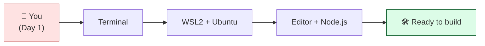
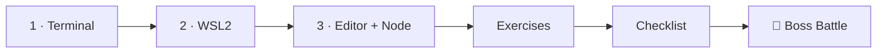

# 🖥️ World 0 — Environment Setup

> *"Welcome aboard! Your laptop just arrived. Before you can touch any code, let's get you a real engineer's workstation. — IT @ CloudForge"*



---

## 📨 Your first ticket

```
From:    IT Support <it@cloudforge.inc>
To:      You <new-hire@cloudforge.inc>
Subject: [TICKET-001] New workstation setup

Hey, welcome to the team! 🎉

Your dev machine is a Windows laptop, but our servers all run Linux —
so every engineer here works inside WSL2 (Linux on Windows). Before
your first real task, get your environment set up:

  1. Get comfortable in the terminal
  2. Install WSL2 + Ubuntu
  3. Install VS Code + Node.js

When you're done, there's a broken setup waiting for you to fix as a
final check. Ping me if you're stuck — but try the steps first!

— IT
```

This is where every cloud engineer starts: **a working environment**. You can't deploy to the cloud if you can't run a command on your own machine.

---

## 🎯 What you'll achieve in this world

- ✅ Understand what a terminal/shell is and feel comfortable in one
- ✅ Install **WSL2 + Ubuntu** — a real Linux system on your Windows PC
- ✅ Install **VS Code** (with the WSL extension) and **Node.js**
- ✅ Prove your environment works by running real commands

By the end, you'll have the exact setup we use for the *entire* rest of the bootcamp.

---

## 🗺️ Level map

| Level | Lesson | Difficulty | Time | XP |
|------:|--------|:----------:|:----:|---:|
| 1 | [Meet Your Machine & the Terminal](lessons/01-meet-your-machine.md) | 🟢 Easy | 15 min | 125 |
| 2 | [Install WSL2 + Ubuntu](lessons/02-install-wsl2-ubuntu.md) | 🟢 Easy | 25 min | 125 |
| 3 | [Editor, Node.js & a Sane Setup](lessons/03-editor-and-nodejs.md) | 🟢 Easy | 20 min | 125 |
| 👹 | [Boss Battle — The Broken Workstation](boss-battle.md) | 🟡 Medium | 30 min | 500 |

➕ Extra reps: [exercises.md](exercises.md) · ✅ Ready to advance? [checklist.md](checklist.md)

---

## 🧭 Recommended order



Start at **Level 1** even if you've used a terminal before — it's quick, and it sets the vocabulary we use everywhere.

---

## 📦 Project status after this world

TaskFlow doesn't exist yet — but the **workshop where you'll build it** does. You're sharpening your tools before the real work begins in World 2.

---

[↑ Back to README](../../README.md)  ·  [🗺️ Roadmap](../../ROADMAP.md)  ·  [▶️ Start Level 1 →](lessons/01-meet-your-machine.md)
