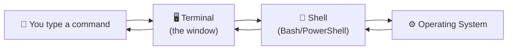

# Level 1 — Meet Your Machine & the Terminal

| | |
|---|---|
| 🎚️ **Difficulty** | 🟢 Easy |
| ⏱️ **Estimated time** | 15 minutes |
| ⭐ **XP reward** | 100 (Quest) + 25 (Quiz) |

[← World Home](../README.md) · [↑ Phase Home](../README.md) · [→ Next: Install WSL2](02-install-wsl2-ubuntu.md)

---

## 📖 Story

It's 9:02 AM on your first day. Your manager drops by:

> *"Before we throw a real ticket at you — open a terminal and tell me what kind of machine you're on. Every engineer here lives in the terminal. If clicking buttons is how you work, today's the day that changes."*

No pressure. Let's make the terminal feel like home.

---

## 🎯 Goal

By the end of this lesson you will:
- Know what a **terminal** and a **shell** are (and the difference)
- Open a terminal on Windows
- Run your first commands and read their output without fear

---

## 🧠 Concepts

A **terminal** is just a window that takes typed commands. A **shell** is the program *inside* that window that reads your commands and runs them. On Windows you might use **PowerShell**; on Linux the most common shell is **Bash**.



Think of it like ordering at a counter: the **terminal** is the counter, the **shell** is the cashier who understands your order and passes it to the **kitchen** (the OS), then hands you the result.

### Why this exists
Clicking is fine for one thing once. But engineers do the *same* thing a thousand times, on *remote* machines that have **no screen to click**. A cloud server is a computer in a data center you'll never physically see — the terminal is your only way in. Learning it now is non-negotiable.

---

## 🛠️ Hands-on Lab

> 🪟 You're on Windows, so we'll start with **PowerShell** (built in). In the next lesson you'll install Linux. For now, any terminal works to learn the rhythm.

**Open a terminal:**
1. Press the `Windows` key.
2. Type `PowerShell`.
3. Press `Enter`.

You'll see a prompt — something ending in `>`. That blinking cursor means: *"I'm waiting for a command."*

**Run these, one at a time, pressing `Enter` after each:**

```powershell
# Who am I logged in as?
whoami

# What folder am I currently in?
pwd

# What's in this folder?
ls

# What version of Windows / PowerShell?
$PSVersionTable
```

> 💡 Lines starting with `#` are **comments** — notes for humans. You don't type them (PowerShell ignores them, but type the command below each).

Read each output slowly. You just *talked to your computer* and it answered.

---

## 🎮 Mini Challenge

Without looking it up, predict what this does — then run it:

```powershell
echo "Hello from $(whoami)"
```

❓ Did the output match your prediction? What did `$(...)` do?

<details>
<summary>💡 Reveal answer</summary>

`echo` prints text. `$(whoami)` runs the `whoami` command *first* and drops its result into the string. So you get `Hello from yourname`. This "command inside a command" trick is called **command substitution** — you'll use it constantly.
</details>

---

## 📦 Project Mission

TaskFlow doesn't exist yet, but good engineers keep notes. Create a notes file for your journey:

```powershell
# Make a folder for bootcamp notes on your Desktop
mkdir $HOME\Desktop\cloudforge-notes

# Create a file recording your day-1 system info
"Day 1: $(whoami) on $(hostname)" > $HOME\Desktop\cloudforge-notes\day1.txt

# Prove it worked
cat $HOME\Desktop\cloudforge-notes\day1.txt
```

🎯 **Mission complete when:** `cat` prints your name and machine name back to you. You just created a file *entirely from the keyboard*.

---

## ⚠️ Common Mistakes

| Mistake | What happens | Fix |
|--------|--------------|-----|
| Typing the `#` comment lines | Nothing or an error | Skip comment lines; type only the command |
| Forgetting to press `Enter` | The command just sits there | Press `Enter` to run it |
| `mkdir` says folder exists | It's already there | That's fine — move on, or pick a new name |
| Copy-pasting "smart quotes" (`"`) | Syntax error | Retype the quotes manually in the terminal |

---

## 🤔 Reflection Questions

1. In your own words, what's the difference between a *terminal* and a *shell*?
2. Why can't you "just click" on a cloud server?
3. What did `pwd` tell you, and why might that matter before running a command?

---

## 📝 Quiz

1. **The shell is…**
   - a) the window itself
   - b) the program that reads and runs your commands
   - c) a type of file
2. **`pwd` shows…**
   - a) your password
   - b) the current folder you're in
   - c) the weather
3. **Why do engineers rely on the terminal for servers?**
   - a) It looks cool
   - b) Remote servers often have no graphical screen to click
   - c) It's required by law

<details>
<summary>✅ Answers</summary>

1: **b** · 2: **b** · 3: **b**
</details>

---

## ✅ Completion Checklist

- [x] I opened a terminal on Windows
- [x] I ran `whoami`, `pwd`, and `ls` and understood each output
- [x] I completed the Mini Challenge and explained `$(...)`
- [x] I created `day1.txt` from the terminal (Project Mission)
- [x] I passed the quiz
- [x] I added **+125 XP** to [PROGRESS.md](../../../PROGRESS.md)

---

[← World Home](../README.md) · [↑ Phase Home](../README.md) · [→ Next: Install WSL2 + Ubuntu](02-install-wsl2-ubuntu.md)
