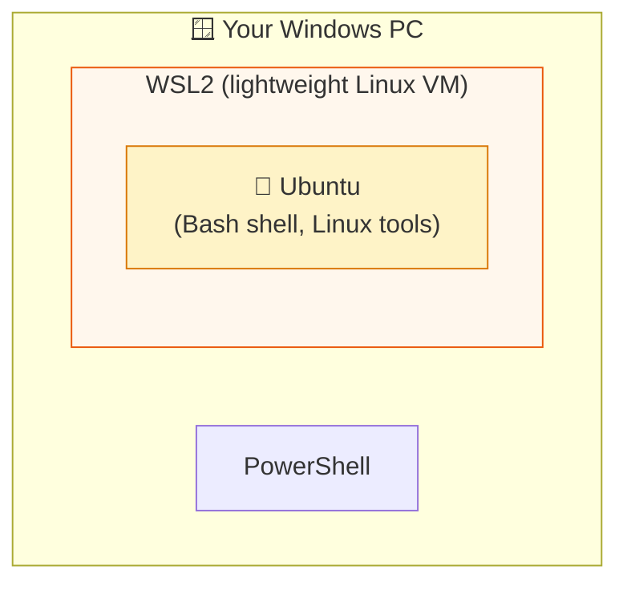

# Level 2 — Install WSL2 + Ubuntu

| | |
|---|---|
| 🎚️ **Difficulty** | 🟢 Easy |
| ⏱️ **Estimated time** | 25 minutes |
| ⭐ **XP reward** | 100 (Quest) + 25 (Quiz) |

[← Prev: Meet Your Machine](01-meet-your-machine.md) · [↑ Phase Home](../README.md) · [→ Next: Editor & Node.js](03-editor-and-nodejs.md)

---

## 📖 Story

> *"Great, you found the terminal. But PowerShell isn't what our servers run — they run **Linux**. Rather than buy you a second laptop, we'll run Linux **inside** your Windows machine using WSL2. Every engineer here does the same. Get it installed." — IT*

This is the single most important setup step in the whole bootcamp. From here on, **you work inside Ubuntu.**

---

## 🎯 Goal

- Install **WSL2** (Windows Subsystem for Linux, version 2)
- Install the **Ubuntu** Linux distribution
- Launch your first real Linux shell and confirm it works

---

## 🧠 Concepts

**WSL2** lets Windows run a genuine Linux kernel in a lightweight virtual machine — fast, integrated, and free. **Ubuntu** is the Linux *distribution* (the actual OS files and tools) that runs on top of it.



### Why this exists
Real production servers run Linux, not Windows. If you learn on Windows tools, your commands won't match the servers you'll manage. WSL2 gives you the *exact same environment* as a cloud server — so what you practice here works identically in World 6 when you SSH into AWS. **Train how you'll fight.**

---

## 🛠️ Hands-on Lab

> ⚠️ You need **Windows 10 (version 2004+)** or **Windows 11**, and admin rights. The whole thing is free.

### Step 1 — Open PowerShell **as Administrator**
1. Press `Windows`, type `PowerShell`.
2. Right-click **Windows PowerShell** → **Run as administrator**.
3. Click **Yes** on the prompt.

### Step 2 — Install WSL with one command
```powershell
wsl --install
```
This single command enables WSL2 and installs Ubuntu by default. When it finishes, **restart your computer** (it'll tell you to).

### Step 3 — First launch of Ubuntu
After the restart, Ubuntu opens automatically (or press `Windows`, type `Ubuntu`, hit `Enter`). The first launch takes a minute, then asks you to:
- Create a **username** (lowercase, no spaces — e.g. your first name)
- Create a **password** (you won't see characters as you type — that's normal!)

> 🔑 Remember this password. You'll need it for `sudo` (admin) commands. It is **separate** from your Windows password.

### Step 4 — Confirm you're really in Linux
In the Ubuntu window, run:
```bash
# Show the Linux kernel and version — should mention "Linux" and "WSL2"
uname -a

# Confirm you're Ubuntu
cat /etc/os-release

# Who and where am I?
whoami
pwd
```

### Step 5 — Update your fresh system
Ubuntu ships with a package list that's slightly stale. Refresh it:
```bash
sudo apt update && sudo apt upgrade -y
```
Type your Linux password when asked. This downloads the latest package info and upgrades installed software. (We'll explain `apt` properly in World 2 — for now, just know it's how Linux installs software.)

---

## 🎮 Mini Challenge

Run this and explain *why* the second line might differ from your Windows username:

```bash
echo "Linux user: $(whoami)"
```

<details>
<summary>💡 Reveal answer</summary>

Your **Linux** username (the one you just created) is independent of your **Windows** username. They can be different because Ubuntu is its own operating system running inside WSL2 — it has its own users, files, and home folder (`/home/yourname`).
</details>

---

## 📦 Project Mission

Set up the home for everything you'll build. Inside **Ubuntu** (not PowerShell):

```bash
# Go to your Linux home folder
cd ~

# Create a projects directory — TaskFlow will live here later
mkdir -p ~/projects

# Verify it exists
ls -la ~/projects

# Leave yourself a note
echo "WSL2 + Ubuntu ready on $(date)" > ~/projects/SETUP.md
cat ~/projects/SETUP.md
```

🎯 **Mission complete when:** `ls -la ~/projects` shows your `SETUP.md`, and `cat` prints the date. This `~/projects` folder is where TaskFlow is born in World 2.

---

## ⚠️ Common Mistakes

| Mistake | What happens | Fix |
|--------|--------------|-----|
| Running `wsl --install` in a non-admin terminal | Permission error | Re-open PowerShell as **Administrator** |
| Panicking when password shows nothing | "My typing isn't working!" | It *is* — Linux hides password characters by design. Type and press `Enter`. |
| Skipping the restart | WSL acts broken | Restart your PC after install |
| Working in PowerShell instead of Ubuntu | Commands like `apt` fail | Open the **Ubuntu** app for all Linux work |
| Forgetting the Linux password | `sudo` won't work | You can reset it; easier to remember it now |

---

## 🤔 Reflection Questions

1. Why does CloudForge want you on Linux instead of Windows tools?
2. What's the difference between your Windows user and your new Ubuntu user?
3. What did `sudo apt update && sudo apt upgrade -y` actually do?

---

## 📝 Quiz

1. **WSL2 lets you…**
   - a) replace Windows entirely
   - b) run a real Linux system inside Windows
   - c) speed up your internet
2. **When typing your Linux password you see nothing because…**
   - a) it's broken
   - b) Linux hides password characters on purpose
   - c) the keyboard is off
3. **Why train on Linux now?**
   - a) Cloud servers run Linux, so your skills transfer directly
   - b) It's the only OS that exists
   - c) Windows can't run code

<details>
<summary>✅ Answers</summary>

1: **b** · 2: **b** · 3: **a**
</details>

---

## ✅ Completion Checklist

- [ ] `wsl --install` completed and I restarted my PC
- [ ] I created a Linux username + password
- [ ] `uname -a` confirms I'm in Linux/WSL2
- [ ] I ran `sudo apt update && sudo apt upgrade -y` successfully
- [ ] I created `~/projects` with a `SETUP.md` (Project Mission)
- [ ] I passed the quiz
- [ ] I added **+125 XP** to [PROGRESS.md](../../../PROGRESS.md)

---

[← Prev: Meet Your Machine](01-meet-your-machine.md) · [↑ Phase Home](../README.md) · [→ Next: Editor, Node.js & a Sane Setup](03-editor-and-nodejs.md)
