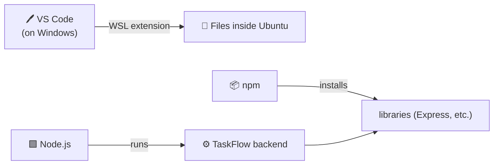

# Level 3 — Editor, Node.js & a Sane Setup

| | |
|---|---|
| 🎚️ **Difficulty** | 🟢 Easy |
| ⏱️ **Estimated time** | 20 minutes |
| ⭐ **XP reward** | 100 (Quest) + 25 (Quiz) |

[← Prev: Install WSL2](02-install-wsl2-ubuntu.md) · [↑ Phase Home](../README.md) · [→ Next: Boss Battle](../boss-battle.md)

---

## 📖 Story

> *"You've got Linux running — nice. Last setup step: an editor and the language runtime. We build the backend in Node.js, and we edit everything in VS Code connected to WSL. Get those in and you're officially ready for real work." — IT*

---

## 🎯 Goal

- Install **VS Code** and connect it to your Ubuntu (WSL) environment
- Install **Node.js** (the runtime our backend uses) inside Ubuntu
- Confirm everything works with a one-line program

---

## 🧠 Concepts

Two tools, two jobs:

- **VS Code** — a free, powerful code editor. With the **WSL extension**, it edits files *inside* Ubuntu while running on Windows. Best of both worlds.
- **Node.js** — lets you run JavaScript outside a browser (e.g. on a server). It's what TaskFlow's backend runs on. It comes with **npm**, the package manager for JavaScript libraries.



### Why this exists
You *could* edit files with terminal tools alone, but a real editor gives you syntax highlighting, error squiggles, and a file tree — it makes you faster and catches mistakes early. And Node.js is simply what our project runs on; installing it now means World 4 (Backend) starts without friction.

---

## 🛠️ Hands-on Lab

### Step 1 — Install VS Code (on Windows)
1. In a browser, go to **https://code.visualstudio.com** and download for Windows.
2. Run the installer. ✅ Tick **"Add to PATH"** if offered. Accept defaults otherwise.

### Step 2 — Connect VS Code to WSL
1. Open VS Code.
2. Press `Ctrl+Shift+X` to open Extensions.
3. Search **"WSL"** (publisher: Microsoft) and click **Install**.
4. Now, from your **Ubuntu** terminal, run:
   ```bash
   cd ~/projects
   code .
   ```
   The first time, VS Code installs a small server inside WSL, then opens — editing your Linux files directly. 🎉 The bottom-left corner should say **"WSL: Ubuntu"**.

### Step 3 — Install Node.js (inside Ubuntu)
We'll install via Ubuntu's package manager. In the **Ubuntu** terminal:
```bash
# Install Node.js and npm
sudo apt update
sudo apt install -y nodejs npm

# Confirm versions
node --version
npm --version
```
Both commands should print a version number (e.g. `v18.x` and `9.x`). If they do — Node is alive.

> 💡 Later worlds may use a specific Node version. For now, whatever Ubuntu installs is perfect for learning.

### Step 4 — Run your first program
```bash
# Run a one-liner directly
node -e "console.log('TaskFlow backend will run on Node ' + process.version)"
```
You should see your message printed with the Node version. **You just executed code on your Linux machine via Node.** That's the engine your whole backend runs on.

---

## 🎮 Mini Challenge

Create and run an actual file (not just a one-liner):

```bash
cd ~/projects
echo "console.log('Hello from a real file!')" > hello.js
node hello.js
```

❓ What's the difference between `node -e "..."` and `node hello.js`?

<details>
<summary>💡 Reveal answer</summary>

`node -e "..."` runs code passed directly as a string — handy for quick tests. `node hello.js` runs code saved in a **file** — which is how real programs (like TaskFlow) are written and run. You'll almost always use the file form.
</details>

---

## 📦 Project Mission

Make your `~/projects` folder a proper, editor-friendly workspace and verify your full toolchain in one shot:

```bash
cd ~/projects

# Open it in VS Code
code .

# Create a setup-verification script
cat > verify-setup.js << 'EOF'
console.log("✅ Node version:", process.version);
console.log("✅ Running on:", process.platform);
console.log("✅ Workshop ready. Time to build TaskFlow.");
EOF

# Run it
node verify-setup.js
```

🎯 **Mission complete when:** `node verify-setup.js` prints all three ✅ lines, *and* you can see/edit `verify-setup.js` in VS Code's file tree with "WSL: Ubuntu" showing in the corner.

---

## ⚠️ Common Mistakes

| Mistake | What happens | Fix |
|--------|--------------|-----|
| Installing Node on Windows, not Ubuntu | `node` not found in Ubuntu | Run the `apt install` commands inside the **Ubuntu** terminal |
| `code .` not recognized | Command missing | Make sure VS Code is installed on Windows with "Add to PATH"; reopen the Ubuntu terminal |
| Editing files in Windows paths (`/mnt/c/...`) | Slow, permission issues | Keep project files in `~/projects` (the Linux side) |
| VS Code corner says nothing about WSL | You opened a Windows folder | Launch with `code .` from inside Ubuntu |

---

## 🤔 Reflection Questions

1. Why connect VS Code to WSL instead of editing Linux files some other way?
2. What's the difference between Node.js and npm?
3. Why do we keep project files in `~/projects` and not on the Windows `C:` drive?

---

## 📝 Quiz

1. **Node.js lets you…**
   - a) edit photos
   - b) run JavaScript outside the browser (e.g. on a server)
   - c) browse the web
2. **`npm` is…**
   - a) a text editor
   - b) the package manager that installs JavaScript libraries
   - c) a Linux distribution
3. **The VS Code "WSL: Ubuntu" indicator means…**
   - a) you're editing files inside your Linux environment
   - b) your internet is connected
   - c) Node is installed

<details>
<summary>✅ Answers</summary>

1: **b** · 2: **b** · 3: **a**
</details>

---

## ✅ Completion Checklist

- [ ] VS Code is installed with the WSL extension
- [ ] `code .` from Ubuntu opens VS Code showing "WSL: Ubuntu"
- [ ] `node --version` and `npm --version` both print versions
- [ ] I ran a `.js` file with `node`
- [ ] `verify-setup.js` prints all three ✅ lines (Project Mission)
- [ ] I passed the quiz
- [ ] I added **+125 XP** to [PROGRESS.md](../../../PROGRESS.md)

---

> 🎉 Your workstation is complete! One challenge stands between you and World 1: the Boss Battle.

[← Prev: Install WSL2](02-install-wsl2-ubuntu.md) · [↑ Phase Home](../README.md) · [→ 👹 Boss Battle: The Broken Workstation](../boss-battle.md)
