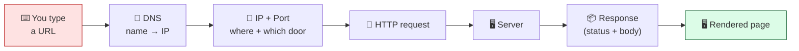
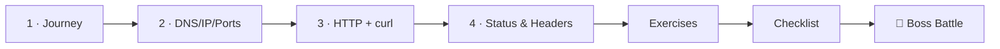

# 🌐 World 1 — Internet Fundamentals

> *"Before you build an API, you need to understand what an API actually answers. Learn how the internet moves a request — then we'll talk code. — Marcus, Senior Eng"*



---

## 📨 Your ticket

```
From:    Marcus <marcus@cloudforge.inc>
To:      You <new-hire@cloudforge.inc>
Subject: [TICKET-014] Learn how a request travels before you build one

Welcome, your workstation passed inspection. 🎉

Next month you'll build TaskFlow's backend — an HTTP API that
answers requests like "give me my tasks" or "create a new task."
But here's the thing: most junior engineers can write an endpoint
without understanding what actually happens when someone calls it.
Then the first time something breaks in production, they're lost.

Not you. Before you write a single line of API code, I want you to
understand the journey of a request — from typing a URL to seeing a
page. DNS, IP, ports, HTTP, status codes. All of it.

The best part: you don't need to install anything. You already have
`curl`, a browser, and the whole internet to practice on. We use a
free service called httpbin.org that echoes your requests back so you
can SEE what you're sending.

When you can trace every hop of a request and prove it with curl,
you'll be ready to build the thing that answers them.

— Marcus
```

This world is **conceptual + hands-on**. No app code yet — TaskFlow is born in World 2. Here you build the **mental model** every backend engineer relies on, and you get fluent with `curl`, the tool you'll use to test TaskFlow for the rest of the bootcamp.

---

## 🎯 What you'll achieve in this world

- ✅ Explain **end-to-end** what happens when you visit a URL (the request/response model)
- ✅ Understand **DNS, IP addresses, and ports** — how a name becomes a destination
- ✅ Speak **HTTP** by hand using `curl`: GET, POST, PUT, DELETE
- ✅ Read a response like an engineer: **status codes** (200/301/404/500) and **headers**
- ✅ Sketch what TaskFlow's future HTTP API will need to **answer**

By the end, you'll trace a request from keystroke to rendered page — and demonstrate it live with `curl`.

---

## 🗺️ Level map

| Level | Lesson | Difficulty | Time | XP |
|------:|--------|:----------:|:----:|---:|
| 1 | [The Journey of a Request](lessons/01-the-journey-of-a-request.md) | 🟢 Easy | 20 min | 125 |
| 2 | [Names & Addresses: DNS, IP & Ports](lessons/02-names-and-addresses.md) | 🟢 Easy | 20 min | 125 |
| 3 | [Speaking HTTP with curl](lessons/03-speaking-http-with-curl.md) | 🟢 Easy | 25 min | 125 |
| 4 | [Status Codes & Headers](lessons/04-status-codes-and-headers.md) | 🟢 Easy | 20 min | 125 |
| 👹 | [Boss Battle — Trace the Request](boss-battle.md) | 🟡 Medium | 40 min | 500 |

➕ Extra reps: [exercises.md](exercises.md) · ✅ Ready to advance? [checklist.md](checklist.md)

---

## 🧭 Recommended order



Do them in order — each lesson is a hop in the journey, and the Boss Battle asks you to narrate the *whole* trip.

---

## 📦 Project status after this world

TaskFlow still doesn't exist on disk — but by the end of this world you'll have **sketched the requests it must answer** (e.g. `GET /tasks`, `POST /tasks`) and practiced making exactly those kinds of requests against a real server with `curl`. When you build the backend in World 4, you'll already know what "good" looks like from the *client's* side.

> 🧪 Practice playground for the whole world: [httpbin.org](https://httpbin.org) — a free server that echoes your requests back so you can see them. See [RESOURCES.md](../../RESOURCES.md) for this world's curated free links.

---

[↑ Back to README](../../README.md)  ·  [🗺️ Roadmap](../../ROADMAP.md)  ·  [▶️ Start Level 1 →](lessons/01-the-journey-of-a-request.md)
