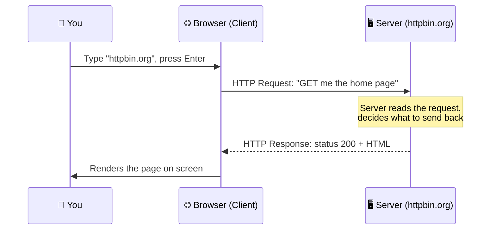

# Level 1 — The Journey of a Request

| | |
|---|---|
| 🎚️ **Difficulty** | 🟢 Easy |
| ⏱️ **Estimated time** | 20 minutes |
| ⭐ **XP reward** | 100 (Quest) + 25 (Quiz) |

[← World Home](../README.md) · [↑ Phase Home](../README.md) · [→ Next: Names & Addresses](02-names-and-addresses.md)

---

## 📖 Story

Marcus pulls up a chair on your second week.

> *"Quick test. You open your browser, type `httpbin.org`, hit Enter, and a page appears. Walk me through everything that happened in between."*
>
> *"...the internet happened?"*
>
> *"Ha. That's what everyone says. By the end of this world you'll be able to name every hop. Let's start with the big picture: it's just two computers having a very polite conversation."*

---

## 🎯 Goal

By the end of this lesson you will:
- Know what a **client** and a **server** are
- Understand the **request/response** model — the heartbeat of the entire web
- Be able to describe, at a high level, what happens **end-to-end** when you visit a URL

---

## 🧠 Concepts

The whole internet runs on one simple idea: a **client** asks, a **server** answers.

- **Client** — the thing that *makes the request*. Your browser. A mobile app. `curl` in your terminal. It wants something.
- **Server** — the thing that *answers*. A computer, somewhere, running a program that listens for requests and sends back responses. TaskFlow's backend will be a server.

They talk in a strict back-and-forth called the **request/response model**: one request gets exactly one response. The client speaks first, always.



Notice the shape: **one request → one response**. The server doesn't randomly send you things; it answers what you asked. This is why TaskFlow's API will be a list of questions it can answer ("give me tasks", "create a task") — and nothing more.

### A URL is an address with instructions

When you type a URL, you're handing the client everything it needs to make a request:

```
https://httpbin.org/get?name=marcus
└─┬─┘   └────┬────┘└┬┘ └────┬─────┘
scheme     host   path   query string
(how)     (who)  (what) (extra details)
```

- **scheme** (`https`) — the rules of the conversation (HTTPS = HTTP, encrypted)
- **host** (`httpbin.org`) — *which* server to talk to
- **path** (`/get`) — *which* thing on that server you want
- **query string** (`?name=marcus`) — optional extra details for the request

### Why this exists

Every app you've ever used — banking, chat, games — is built on this one pattern. If you understand "client asks, server answers, one request → one response," you understand the skeleton of the entire web. When TaskFlow breaks in production later, your first question will always be: *"What was the request, and what response came back?"* Engineers who skip this never stop guessing.

---

## 🛠️ Hands-on Lab

You don't need to install anything — your browser and `curl` are both clients. Let's watch a request happen.

### Step 1 — Make a request the everyday way (browser)

1. Open your browser.
2. Go to **https://httpbin.org/get**
3. You'll see a block of text (JSON) that the server sent back. That text **is the response**. httpbin is special: it echoes details of *your request* back to you, so you can see exactly what your browser sent.

Look for fields like `"url"`, `"headers"`, and `"origin"` (your public IP). You just read a raw response — most people never do.

### Step 2 — Make the *same* request the engineer's way (curl)

Open your **Ubuntu** terminal and run:

```bash
# curl is a client that lives in your terminal. It makes a request and prints the response.
curl https://httpbin.org/get
```

You'll see the same kind of JSON the browser showed. **Same request, same server, same response** — just no pretty browser wrapping it. This is the raw conversation.

### Step 3 — Prove the request/response shape

```bash
# Ask the server what time it is on its end (a different "question")
curl https://httpbin.org/uuid
```

One request, one response — a freshly generated unique ID. Run it twice; the answer changes, because the server *computes* a response each time you ask.

> 💡 `curl` = "Client URL." It's the most important tool in this world. You'll use it to test TaskFlow for the rest of the bootcamp.

---

## 🎮 Mini Challenge

Without running it first, predict what the server will echo back, then run it:

```bash
curl "https://httpbin.org/get?project=taskflow&world=1"
```

❓ Where do `project=taskflow` and `world=1` show up in the response, and what part of the URL are they?

<details>
<summary>💡 Reveal answer</summary>

They appear under an `"args"` field in the JSON:
```json
"args": { "project": "taskflow", "world": "1" }
```
That `?project=taskflow&world=1` part is the **query string** — optional extra details attached to the request. The server received them and echoed them back. You just sent structured data to a server using nothing but a URL.

(We wrapped the URL in quotes so the shell doesn't treat `&` as a special character — more on that in Lesson 3.)
</details>

---

## 📦 Project Mission

TaskFlow will be a server. Before you build it, sketch the **conversations** it must support. Create a notes file:

```bash
cd ~/projects

cat > taskflow-requests.md << 'EOF'
# TaskFlow — Requests our API must answer (draft v1)

The web is "client asks, server answers." Here are the questions
(requests) TaskFlow's server should be able to answer:

| The client wants to...        | Request (rough sketch)      |
|-------------------------------|-----------------------------|
| See all tasks                 | GET  /tasks                 |
| See one specific task         | GET  /tasks/42              |
| Create a new task             | POST /tasks                 |
| Update an existing task       | PUT  /tasks/42              |
| Delete a task                 | DELETE /tasks/42            |

(We'll learn what GET/POST/PUT/DELETE mean in Lesson 3.)
Every line above is one request → one response.
EOF

cat taskflow-requests.md
```

🎯 **Mission complete when:** `cat taskflow-requests.md` prints your draft list of TaskFlow requests. You've just defined what your future server will *answer* — the whole point of building it.

---

## ⚠️ Common Mistakes

| Mistake | What happens | Fix |
|--------|--------------|-----|
| Thinking the server "pushes" pages to you | Confusion about how the web works | Remember: the **client asks first**, always — one request → one response |
| Confusing the client and the server | "Where does my code run?" | Browser/curl = client (asks); the machine that answers = server |
| Expecting `curl` to show a pretty page | "It's just text!" | `curl` shows the **raw response**. The browser adds the styling |
| Typing the URL without `https://` into curl | Error or odd behavior | Include the scheme: `curl https://...` |

---

## 🤔 Reflection Questions

1. In your own words, what's the difference between a **client** and a **server**?
2. Why is "one request → one response" such an important rule to remember?
3. When TaskFlow eventually breaks in production, why is *"what was the request and response?"* a good first question?

---

## 📝 Quiz

1. **In the request/response model, who speaks first?**
   - a) The server
   - b) The client
   - c) They speak at the same time
2. **`curl https://httpbin.org/get` is acting as…**
   - a) a server
   - b) a client
   - c) a database
3. **In `https://httpbin.org/get?id=5`, the `?id=5` part is the…**
   - a) scheme
   - b) host
   - c) query string

<details>
<summary>✅ Answers</summary>

1: **b** · 2: **b** · 3: **c**
</details>

---

## ✅ Completion Checklist

- [x] I can explain client vs. server and the request/response model
- [x] I opened `httpbin.org/get` in a browser and read the response
- [x] I ran `curl https://httpbin.org/get` and saw the same response raw
- [x] I completed the Mini Challenge and found the query string in the response
- [x] I created `~/projects/taskflow-requests.md` (Project Mission)
- [x] I passed the quiz
- [x] I added **+125 XP** to [PROGRESS.md](../../../PROGRESS.md)

---

[← World Home](../README.md) · [↑ Phase Home](../README.md) · [→ Next: Names & Addresses](02-names-and-addresses.md)
