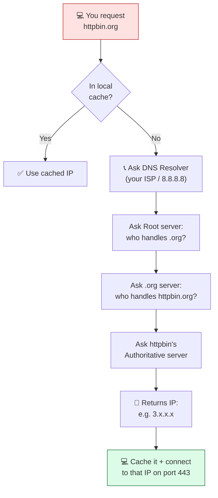
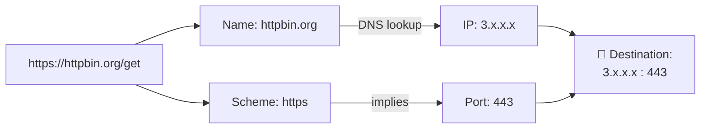

# Level 2 — Names & Addresses: DNS, IP & Ports

| | |
|---|---|
| 🎚️ **Difficulty** | 🟢 Easy |
| ⏱️ **Estimated time** | 20 minutes |
| ⭐ **XP reward** | 100 (Quest) + 25 (Quiz) |

[← Prev: The Journey of a Request](01-the-journey-of-a-request.md) · [↑ Phase Home](../README.md) · [→ Next: Speaking HTTP with curl](03-speaking-http-with-curl.md)

---

## 📖 Story

> *"Yesterday you sent a request to `httpbin.org`," Marcus says. "But computers don't actually know what `httpbin.org` means. They only talk to numbers — IP addresses. So how did your request find the right machine out of billions?"*
>
> *"...magic?"*
>
> *"Close. It's called DNS, and it's the internet's phone book. Let's learn how a name becomes an address."*

---

## 🎯 Goal

By the end of this lesson you will:
- Understand **IP addresses** — the actual numeric address of a machine
- Understand **DNS** — how a human-friendly name becomes an IP
- Understand **ports** (especially **80** and **443**) — which "door" on the machine to knock on
- Resolve a real domain to its IP using `nslookup`, `dig`, and `ping`

---

## 🧠 Concepts

You type a **name** (`httpbin.org`). Computers route by **number** (an IP address). Something has to translate between the two — that's **DNS**.

### IP address — the building's street address
An **IP address** is the numeric address of a machine on a network, e.g. `93.184.216.34` (IPv4) or a longer `2606:...` (IPv6). Every server has one. It's how packets know where to go.

### Port — which door at that address
A single machine runs many programs. A **port** is a numbered door so the right program gets your request:

| Port | Used for | Why you care |
|-----:|----------|--------------|
| **80** | HTTP (unencrypted web) | The default "web" door |
| **443** | HTTPS (encrypted web) | What almost every site uses today |
| 22 | SSH (remote login) | You'll use this in World 6 (AWS) |
| 3000 | Common dev server | TaskFlow's backend will listen here locally |

So `https://httpbin.org` really means: *"talk HTTPS to the machine named httpbin.org, on port 443."* The port is usually hidden because the scheme implies it (`http`→80, `https`→443).

### DNS — the internet's phone book
**DNS** (Domain Name System) translates a **name** into an **IP**. Your computer asks a chain of servers, "what's the IP for httpbin.org?" and gets a number back.



The result gets **cached** (remembered) for a while, so you don't repeat the whole lookup every time — that's why the *second* visit to a site feels faster.

### Putting it together — what a URL really triggers



### Why this exists

Humans can't remember `93.184.216.34`; we remember `httpbin.org`. DNS lets names stay friendly while the underlying IP can change freely (a company can move servers without changing its domain). And **half of all "the site is down!" incidents are actually DNS or port problems**. When TaskFlow won't connect in World 6, knowing "is it DNS? is the right port open?" will save you hours.

---

## 🛠️ Hands-on Lab

All of these tools are already on your system. Let's turn a name into a number.

### Step 1 — Resolve a domain with `nslookup`

```bash
# "name server lookup" — ask DNS for the IP behind a name
nslookup httpbin.org
```

You'll see a **Name** and one or more **Address** lines — those addresses are the IPs DNS returned for `httpbin.org`. The "Server" line at the top is *which* DNS resolver answered you.

### Step 2 — Get cleaner output with `dig`

`dig` ("domain information groper") is the engineer's favorite — more detailed, scriptable. If it's missing, install it once:

```bash
# Install dig if needed (part of dns-utils)
sudo apt update && sudo apt install -y dnsutils

# Ask for just the answer, no noise
dig +short httpbin.org
```

`dig +short` prints just the IP(s). Clean. That single line is the whole point of DNS: **name in, address out.**

### Step 3 — Confirm the machine is reachable with `ping`

```bash
# Send a few small packets to the name and time the round-trip
ping -c 4 google.com
```

- `-c 4` = send 4 packets then stop (otherwise it goes forever; press `Ctrl+C` to stop).
- Notice ping **also** resolves the name to an IP first (it prints the IP it's pinging), then reports the round-trip **time in ms** — how long a packet takes to get there and back.

> 💡 Some servers (including httpbin's host) ignore ping for security. That's normal — "no ping reply" does **not** always mean "down." `ping google.com` is a reliable demo.

### Step 4 — See the port in action

```bash
# -v (verbose) makes curl show the connection details
curl -v https://httpbin.org/get 2>&1 | head -n 5
```

In the first lines you'll see something like `Trying 3.x.x.x:443...` — curl resolved the **name** to an **IP**, then connected on **port 443** (because the scheme was `https`). You just watched DNS + port selection happen live.

---

## 🎮 Mini Challenge

Run a DNS lookup for two different big sites and compare:

```bash
dig +short github.com
dig +short cloudflare.com
```

❓ Why might a single domain return **multiple** IP addresses?

<details>
<summary>💡 Reveal answer</summary>

Big sites run **many servers** behind one name for scale and reliability. DNS can hand out several IPs so traffic spreads across them (a simple form of **load balancing**), and if one server dies, the others still answer. The name stays the same (`github.com`) while the IPs behind it change freely — exactly the flexibility DNS was designed to give.
</details>

---

## 📦 Project Mission

TaskFlow will run on a machine, on a port. Capture what you've learned about *where* it will live. Append to your notes:

```bash
cd ~/projects

cat >> taskflow-requests.md << 'EOF'

## Where TaskFlow will live (addressing notes)

- Locally (Worlds 4–5): http://localhost:3000
    - name "localhost" → IP 127.0.0.1 (this machine), port 3000
- In production (World 6, AWS): a public IP, reached over
    - port 80  (http)  and/or
    - port 443 (https, the secure default)
- A friendly domain name will point at that IP via DNS.

Lookup proof (run today):
EOF

# Append a real DNS result so your notes contain live data
echo "  httpbin.org resolves to: $(dig +short httpbin.org | head -n 1)" >> taskflow-requests.md

cat taskflow-requests.md
```

🎯 **Mission complete when:** your `taskflow-requests.md` ends with a real IP address that `dig` resolved for `httpbin.org`. You've recorded *where* requests travel — names, IPs, and ports.

---

## ⚠️ Common Mistakes

| Mistake | What happens | Fix |
|--------|--------------|-----|
| Assuming a name *is* an address | Confusion about DNS | A name is translated to an IP **by DNS** before any connecting happens |
| `dig: command not found` | Tool missing | `sudo apt install -y dnsutils` |
| Thinking "no ping reply = site down" | False alarms | Many servers block ping on purpose; test with `curl` instead |
| Forgetting `-c` on `ping` | It pings forever | Use `ping -c 4 host`, or press `Ctrl+C` to stop |
| Confusing port 80 and 443 | http vs https mixups | 80 = HTTP (plain), 443 = HTTPS (encrypted) |

---

## 🤔 Reflection Questions

1. In one sentence, what does DNS do?
2. Why do we use **ports**? What problem would we have without them?
3. Why is it useful that a domain name can point to a *different* IP over time?

---

## 📝 Quiz

1. **DNS exists to…**
   - a) encrypt your traffic
   - b) translate a human-friendly name into an IP address
   - c) make pages load images
2. **HTTPS traffic normally uses which port?**
   - a) 22
   - b) 80
   - c) 443
3. **A domain returning several IP addresses usually means…**
   - a) the site is broken
   - b) traffic is spread across multiple servers for scale/reliability
   - c) you typed it wrong

<details>
<summary>✅ Answers</summary>

1: **b** · 2: **c** · 3: **b**
</details>

---

## ✅ Completion Checklist

- [ ] I resolved a domain to an IP with `nslookup`
- [ ] I used `dig +short` to get a clean IP
- [ ] I ran `ping -c 4` and understood the round-trip time
- [ ] I saw curl connect on port 443 with `curl -v`
- [ ] I appended addressing notes (with a real IP) to `taskflow-requests.md` (Project Mission)
- [ ] I passed the quiz
- [ ] I added **+125 XP** to [PROGRESS.md](../../../PROGRESS.md)

---

[← Prev: The Journey of a Request](01-the-journey-of-a-request.md) · [↑ Phase Home](../README.md) · [→ Next: Speaking HTTP with curl](03-speaking-http-with-curl.md)
