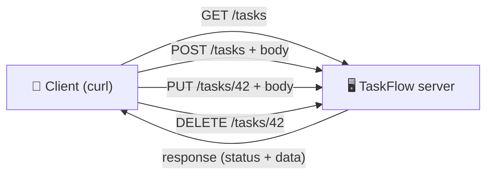

# Level 3 — Speaking HTTP with curl

| | |
|---|---|
| 🎚️ **Difficulty** | 🟢 Easy |
| ⏱️ **Estimated time** | 25 minutes |
| ⭐ **XP reward** | 100 (Quest) + 25 (Quiz) |

[← Prev: Names & Addresses](02-names-and-addresses.md) · [↑ Phase Home](../README.md) · [→ Next: Status Codes & Headers](04-status-codes-and-headers.md)

---

## 📖 Story

> *"You know how a request finds a server. Now learn what the request actually SAYS," Marcus says.*
>
> *"Every request has a verb — a method. GET means 'give me this.' POST means 'here, create this.' Your whole TaskFlow API will be a handful of these verbs pointed at the right paths. Today you stop using the browser as a crutch and speak HTTP directly, with curl. This is the skill you'll use every single day."*

---

## 🎯 Goal

By the end of this lesson you will:
- Know the four core **HTTP methods**: GET, POST, PUT, DELETE
- Make each kind of request with `curl` against httpbin.org
- Send **JSON** in a request body (exactly how a real API client works)
- Map these methods to the TaskFlow requests you sketched in Lesson 1

---

## 🧠 Concepts

An HTTP request has a **method** (the verb — what you want to *do*) and a **path** (the thing you want to do it to). The four you'll use constantly:

| Method | Means | TaskFlow example | Real-world analogy |
|--------|-------|------------------|--------------------|
| **GET** | Read / fetch (changes nothing) | `GET /tasks` — list tasks | Reading a page in a book |
| **POST** | Create something new | `POST /tasks` — add a task | Filling out a new form |
| **PUT** | Replace / update an existing thing | `PUT /tasks/42` — edit task 42 | Rewriting a page |
| **DELETE** | Remove something | `DELETE /tasks/42` — delete task 42 | Tearing a page out |



A request can also carry a **body** — data you're sending *to* the server. You don't need a body to GET something (you're just asking), but to POST or PUT you usually send a body describing what to create or change. On the modern web that body is almost always **JSON**:

```json
{ "title": "Write tests", "done": false }
```

> 💡 **JSON** (JavaScript Object Notation) is just text in `{ "key": "value" }` form. It's the universal language APIs use to exchange data — TaskFlow will speak it too.

### Why this exists

HTTP methods give every request a clear *intent*. A `GET` should never change data; a `DELETE` should never just "read." This shared agreement is what lets any client (a browser, a phone app, curl, another server) talk to any API without a custom manual. When you build TaskFlow, you won't invent how clients talk to it — you'll follow these same verbs, and the whole world will already know how to use your API.

---

## 🛠️ Hands-on Lab

httpbin.org has an endpoint for each method that echoes your request back, so you can *see* exactly what you sent.

### Step 1 — GET (the default)

```bash
# curl does GET unless you tell it otherwise
curl https://httpbin.org/get
```

Look at the JSON: `"method"` isn't shown here, but the path `/get` confirms it. GET asks for data and sends no body.

### Step 2 — POST with JSON (create something)

```bash
# -X sets the method, -H sets a header, -d sends the body
curl -X POST https://httpbin.org/post \
  -H "Content-Type: application/json" \
  -d '{"title":"Write tests","done":false}'
```

Breakdown of the flags:
- `-X POST` — use the POST method
- `-H "Content-Type: application/json"` — tell the server "my body is JSON" (a **header**, covered next lesson)
- `-d '{...}'` — the request **body** (the data you're sending)
- The `\` at line ends just lets one command span multiple lines for readability.

In the response, find the `"json"` field — httpbin parsed your body and echoed it back. **That round-trip is exactly what creating a task will look like.**

### Step 3 — PUT (update something)

```bash
curl -X PUT https://httpbin.org/put \
  -H "Content-Type: application/json" \
  -d '{"title":"Write better tests","done":true}'
```

Same idea as POST, but the *intent* is "replace/update an existing thing." httpbin echoes it under `"json"` again.

### Step 4 — DELETE (remove something)

```bash
curl -X DELETE https://httpbin.org/delete
```

A DELETE usually needs no body — you're just saying "remove the thing at this path." The response confirms the method was DELETE.

### Step 5 — Send query params cleanly

```bash
# Quote the URL so the shell doesn't choke on & and ?
curl "https://httpbin.org/get?status=open&assignee=marcus"
```

Find your params under `"args"`. This is how a client filters a GET (e.g. "give me only the *open* tasks").

> 💡 Save typing: add `-s` to silence curl's progress meter, and pipe to a formatter if you have one. We'll keep it simple for now — readable raw output is the goal.

---

## 🎮 Mini Challenge

You want to create a task called **"Deploy TaskFlow"** that is **not** done yet. Write the `curl` command from scratch (don't peek until you've tried), then run it and find your data in the response.

<details>
<summary>💡 Reveal answer</summary>

```bash
curl -X POST https://httpbin.org/post \
  -H "Content-Type: application/json" \
  -d '{"title":"Deploy TaskFlow","done":false}'
```

In the response, your data appears under `"json"`:
```json
"json": { "title": "Deploy TaskFlow", "done": false }
```
That's a complete "create a task" request — method `POST`, a JSON body, the right content-type header. You just spoke fluent HTTP.
</details>

---

## 📦 Project Mission

Turn your Lesson 1 sketch into **real, runnable curl commands** — a practice harness for the TaskFlow API you'll build later. Create a script:

```bash
cd ~/projects

cat > taskflow-curl-practice.sh << 'EOF'
#!/usr/bin/env bash
# TaskFlow API — practice requests (run against httpbin until World 4)
# Each command mirrors a real TaskFlow operation.

echo "== LIST tasks (GET) =="
curl -s "https://httpbin.org/get?resource=tasks"

echo; echo "== CREATE a task (POST) =="
curl -s -X POST https://httpbin.org/post \
  -H "Content-Type: application/json" \
  -d '{"title":"Buy milk","done":false}'

echo; echo "== UPDATE task 42 (PUT) =="
curl -s -X PUT https://httpbin.org/put \
  -H "Content-Type: application/json" \
  -d '{"title":"Buy oat milk","done":true}'

echo; echo "== DELETE task 42 (DELETE) =="
curl -s -X DELETE https://httpbin.org/delete

echo; echo "== Done =="
EOF

# Make it executable and run it
chmod +x taskflow-curl-practice.sh
./taskflow-curl-practice.sh
```

🎯 **Mission complete when:** running `./taskflow-curl-practice.sh` prints four labelled responses (list, create, update, delete). You now have a reusable script that exercises every method TaskFlow will support.

---

## ⚠️ Common Mistakes

| Mistake | What happens | Fix |
|--------|--------------|-----|
| Forgetting `-X POST` and just using `-d` | curl quietly assumes POST — usually fine, but be explicit | Use `-X POST` so your intent is clear |
| Missing the `Content-Type: application/json` header | Server may not parse your JSON | Always send `-H "Content-Type: application/json"` with JSON bodies |
| Single vs. double quotes in the body | Shell errors or mangled JSON | Wrap the whole JSON body in **single** quotes: `-d '{"k":"v"}'` |
| Unquoted URL with `&` | Shell runs part in background | Wrap the URL in quotes: `"https://...?a=1&b=2"` |
| Using GET to change data | Breaks the shared HTTP contract | Read = GET, create = POST, update = PUT, delete = DELETE |

---

## 🤔 Reflection Questions

1. Why should a `GET` request never change data on the server?
2. What does the `Content-Type: application/json` header tell the server, and why does it matter?
3. Map each TaskFlow operation from Lesson 1 to its HTTP method — which verb deletes a task?

---

## 📝 Quiz

1. **Which method creates a new resource?**
   - a) GET
   - b) POST
   - c) DELETE
2. **In `curl`, the `-d` flag is used to…**
   - a) set the method
   - b) send a request body
   - c) delete a file
3. **The data format almost all modern APIs exchange is…**
   - a) JSON
   - b) a Word document
   - c) a spreadsheet

<details>
<summary>✅ Answers</summary>

1: **b** · 2: **b** · 3: **a**
</details>

---

## ✅ Completion Checklist

- [ ] I made a GET request with curl
- [ ] I made a POST request sending a JSON body
- [ ] I made PUT and DELETE requests
- [ ] I completed the Mini Challenge from scratch
- [ ] I created and ran `~/projects/taskflow-curl-practice.sh` (Project Mission)
- [ ] I passed the quiz
- [ ] I added **+125 XP** to [PROGRESS.md](../../../PROGRESS.md)

---

[← Prev: Names & Addresses](02-names-and-addresses.md) · [↑ Phase Home](../README.md) · [→ Next: Status Codes & Headers](04-status-codes-and-headers.md)
