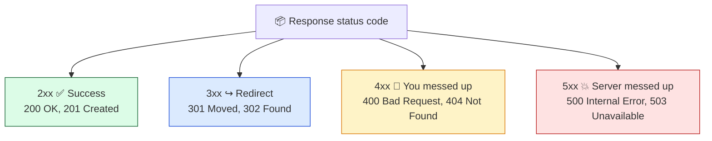

# Level 4 — Status Codes & Headers

| | |
|---|---|
| 🎚️ **Difficulty** | 🟢 Easy |
| ⏱️ **Estimated time** | 20 minutes |
| ⭐ **XP reward** | 100 (Quest) + 25 (Quiz) |

[← Prev: Speaking HTTP with curl](03-speaking-http-with-curl.md) · [↑ Phase Home](../README.md) · [→ Next: 👹 Boss Battle](../boss-battle.md)

---

## 📖 Story

> *"Last piece," Marcus says. "You can send requests. Now learn to READ the answers."*
>
> *"Every response comes with a status code — a three-digit number that tells you, instantly, whether things went well. `200` means OK. `404` means 'not found.' `500` means the server broke. When TaskFlow misbehaves at 2 AM, this number is the first thing you'll look at. Learn to read it like a pulse."*

---

## 🎯 Goal

By the end of this lesson you will:
- Read an HTTP **status code** and know which family it belongs to
- Recognize the big ones: **200, 301, 404, 500**
- Read response **headers** (metadata about the response)
- Use `curl -i` and `curl -v` to see the full picture

---

## 🧠 Concepts

Every response has three parts: a **status code**, a set of **headers**, and (usually) a **body**.

### Status codes — the response's verdict
A status code is a three-digit number. The **first digit** tells you the family:



The ones you'll meet most:

| Code | Name | Means | Whose "fault"? |
|-----:|------|-------|----------------|
| **200** | OK | Request succeeded | 🎉 nobody — it worked |
| 201 | Created | A new resource was created (after POST) | worked |
| **301** | Moved Permanently | The thing lives at a new URL now | redirect |
| 400 | Bad Request | Your request was malformed | the **client** |
| **404** | Not Found | No such thing at that path | the **client** (wrong URL) |
| **500** | Internal Server Error | The server crashed/errored | the **server** |
| 503 | Service Unavailable | Server is overloaded/down | the **server** |

> 🧠 Memory hook: **4xx = "you" (the client) did something wrong. 5xx = the server did.**

### Headers — metadata about the response
**Headers** are key-value lines that travel *alongside* the body, describing it. Examples:

- `Content-Type: application/json` — "the body is JSON"
- `Content-Length: 312` — "the body is 312 bytes"
- `Server: gunicorn` — what software answered
- `Location: /new-url` — where to go (on a 3xx redirect)

The **body** is the actual content (the JSON, the HTML). The status + headers tell you *how to interpret it*.

### Why this exists

Status codes are a universal, language-independent signal. A monitoring tool, a browser, another server — all of them know that `500` means "broken" without reading your body. When TaskFlow returns the *right* codes (200 for success, 404 for a missing task, 400 for bad input), every client and every dashboard understands it automatically. Returning the wrong code (like `200` on an error) is one of the most common API bugs — and now you'll never make it.

---

## 🛠️ Hands-on Lab

httpbin.org can return **any** status code on demand via `/status/CODE`. Perfect for practice.

### Step 1 — See headers + status with `curl -i`

```bash
# -i includes the response headers AND status line in the output
curl -i https://httpbin.org/get
```

The very first line is the **status line**, e.g. `HTTP/2 200`. Below it are the **headers** (one per line), then a blank line, then the **body**. Read top to bottom: verdict → metadata → content.

### Step 2 — Trigger specific status codes

```bash
# Ask httpbin to respond with a 200 (success)
curl -i https://httpbin.org/status/200

# A 404 — "not found"
curl -i https://httpbin.org/status/404

# A 500 — "server error"
curl -i https://httpbin.org/status/500
```

Notice each `HTTP/2 ...` status line changes. The bodies are mostly empty — the **code itself** is the message.

### Step 3 — Watch a redirect (3xx) happen

```bash
# This returns a 302 (a redirect) with a Location header pointing elsewhere
curl -i "https://httpbin.org/redirect-to?url=https://httpbin.org/get"
```

You'll see a `3xx` status and a `Location:` header. By default curl does **not** follow it. Now tell it to:

```bash
# -L = follow redirects to the final destination
curl -i -L "https://httpbin.org/redirect-to?url=https://httpbin.org/get"
```

This time you end up at the final `200`. That's exactly what your browser does silently every day.

### Step 4 — Get *just* the status code (scripting trick)

```bash
# -o /dev/null throws away the body; -s silences; -w prints a chosen value
curl -s -o /dev/null -w "Status: %{http_code}\n" https://httpbin.org/status/404
```

This prints `Status: 404` and nothing else — incredibly handy in scripts and health checks (you'll reuse this idea in CI/CD and monitoring later).

### Step 5 — See the whole conversation with `-v`

```bash
# -v (verbose) shows the request you SENT (>) and the response headers (<)
curl -v https://httpbin.org/get
```

Lines starting with `>` are what *you sent*; lines with `<` are what the *server sent back*. This is the full two-way HTTP conversation, laid bare.

---

## 🎮 Mini Challenge

A teammate says: *"My request to `/tasks/9999` returned a 404 — is the server broken?"* Without running anything, answer: whose fault is a 404, and what does it actually mean? Then prove a 404 yourself.

<details>
<summary>💡 Reveal answer</summary>

A **404 is a client-side problem**, not a server crash. It means "the server is fine, but there's nothing at that path" — here, task `9999` doesn't exist. The server worked correctly by *telling* you it's missing. (A broken server would return **5xx**.)

Prove it:
```bash
curl -s -o /dev/null -w "%{http_code}\n" https://httpbin.org/status/404
```
Output: `404`. So the answer to the teammate: "Not broken — that task just doesn't exist. A real server bug would show a 5xx."
</details>

---

## 📦 Project Mission

A real API isn't just "make a request" — it's "make a request and **check the response was right**." Build a tiny TaskFlow health-check script that asserts the status codes you expect:

```bash
cd ~/projects

cat > taskflow-healthcheck.sh << 'EOF'
#!/usr/bin/env bash
# TaskFlow health check (practice vs httpbin until World 4).
# Each line: make a request, print only the status code we got back.

check () {  # check <label> <url>
  code=$(curl -s -o /dev/null -w "%{http_code}" "$2")
  echo "$1 -> HTTP $code"
}

check "Healthy endpoint (expect 200)" "https://httpbin.org/status/200"
check "Missing task    (expect 404)" "https://httpbin.org/status/404"
check "Server error    (expect 500)" "https://httpbin.org/status/500"
EOF

chmod +x taskflow-healthcheck.sh
./taskflow-healthcheck.sh
```

🎯 **Mission complete when:** running `./taskflow-healthcheck.sh` prints three lines showing `HTTP 200`, `HTTP 404`, and `HTTP 500`. You can now *read the pulse* of any API — the skill behind every monitoring dashboard you'll build later.

---

## ⚠️ Common Mistakes

| Mistake | What happens | Fix |
|--------|--------------|-----|
| Reading only the body, ignoring the status | You miss that it failed | Check the status line **first** (use `-i`) |
| Thinking 404 means "server is down" | Wrong diagnosis | 4xx = client/URL problem; 5xx = server problem |
| Expecting curl to follow redirects by default | "It just shows a 301!" | Add `-L` to follow redirects |
| Returning 200 on an error (future API bug) | Clients think it worked | Return the *correct* code (4xx/5xx) — clients rely on it |
| Confusing headers with the body | Mixing metadata and content | Headers describe the body; the body is the content itself |

---

## 🤔 Reflection Questions

1. What's the difference between a `4xx` and a `5xx` status code? Give an example of each.
2. What is a header, and how is it different from the response body?
3. Why is returning the *correct* status code so important for a tool that monitors TaskFlow?

---

## 📝 Quiz

1. **A `500` status code means…**
   - a) the request succeeded
   - b) the server hit an error
   - c) the page moved
2. **`curl -i` adds what to the output?**
   - a) the response headers and status line
   - b) an image
   - c) a redirect
3. **A `404` is generally caused by…**
   - a) the server crashing
   - b) asking for something that isn't there (client/URL side)
   - c) slow internet

<details>
<summary>✅ Answers</summary>

1: **b** · 2: **a** · 3: **b**
</details>

---

## ✅ Completion Checklist

- [ ] I used `curl -i` to see the status line and headers
- [ ] I triggered 200, 404, and 500 via `httpbin.org/status/CODE`
- [ ] I followed a 301 redirect with `-L`
- [ ] I printed just the status code with `-w "%{http_code}"`
- [ ] I created and ran `~/projects/taskflow-healthcheck.sh` (Project Mission)
- [ ] I passed the quiz
- [ ] I added **+125 XP** to [PROGRESS.md](../../../PROGRESS.md)

---

> 🎉 You can now send requests *and* read responses. One challenge stands between you and World 2: the Boss Battle.

[← Prev: Speaking HTTP with curl](03-speaking-http-with-curl.md) · [↑ Phase Home](../README.md) · [→ 👹 Boss Battle: Trace the Request](../boss-battle.md)
