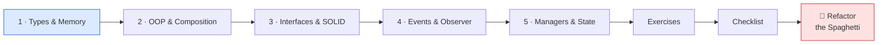
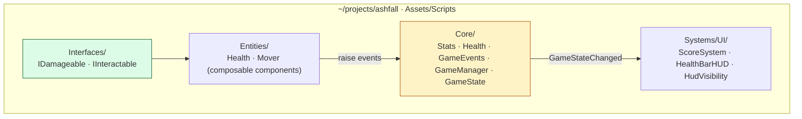

# 🧠 World 1 — Programming Mastery (Advanced C#)

> You're cleared for real work. Before Maya hands you a single gameplay feature, Kenji wants Ashfall's code to rest on an architecture you can live with for *years* — not the 3000-line spaghetti that sank the last prototype. This world is where you learn to write code that stays flexible: clean types, composition, SOLID, events, and managers.

[↑ Home](../../README.md) · [🗺️ Roadmap](../../ROADMAP.md) · [📊 Progress](../../PROGRESS.md)

---

## 📨 Your ticket

```
From:    Kenji <kenji@pixelforge.studio>
To:      You <new-hire@pixelforge.studio>
Cc:      Maya <maya@pixelforge.studio>
Subject: [W1-ARCH] Before you write gameplay, write code we can live with

Welcome to the gameplay team for real. Quick reality check before Maya
starts firing feature tickets at you:

  Our last prototype was ONE 3000-line class. Player, enemies, UI, audio,
  saving — all jammed together. Every change broke three other things.
  We deleted it. We are NOT doing that again.

This world, you set the foundation EVERY future feature sits on:

  1. Know where your data lives (value vs reference, the GC) so you don't
     ship frame hitches.
  2. Build entities by COMPOSITION, not deep inheritance trees.
  3. Use interfaces + SOLID so adding a feature means adding code, not
     editing (and breaking) old code.
  4. Decouple systems with EVENTS — no more god-class calling everything.
  5. Give the game a real backbone: a GameManager + a clean state machine.

Boss check ("Refactor the Spaghetti"): I'll hand you a deliberately awful
god-class. You'll refactor it into components + interfaces + events +
a manager — with ZERO behavior change. Beat it and World 2 unlocks.

— Kenji
```

This is World 1 of 13. Everything you build advances the **one growing Ashfall project** in `~/projects/ashfall`. You leave this world with clean, decoupled architecture that World 2's movement math will plug straight into.

---

## 🎯 What you'll achieve in this world

- 🧠 Reason about **value vs reference types**, the **stack/heap**, and the **GC** — and avoid allocation-driven frame hitches
- 🧩 Build entities by **composition over inheritance** using Unity's component model
- 📜 Apply **interfaces** and the five **SOLID** principles — `IDamageable`, `IInteractable`, depend on abstractions
- 📡 Decouple systems with **delegates, events, and the observer pattern** — Ashfall's central `GameEvents` bus
- 🎛️ Coordinate the game with a **GameManager** singleton and a **Menu/Playing/Paused/GameOver** state machine

---

## 🗺️ Level map

| Level | Lesson | Difficulty | XP |
|------:|--------|:----------:|---:|
| 1 | [C# Types & Memory](lessons/01-csharp-types-and-memory.md) | 🟡 Medium | 125 |
| 2 | [OOP & Composition](lessons/02-oop-and-composition.md) | 🟡 Medium | 125 |
| 3 | [Interfaces & SOLID](lessons/03-interfaces-and-solid.md) | 🔴 Hard | 125 |
| 4 | [Events & the Observer Pattern](lessons/04-events-and-the-observer-pattern.md) | 🔴 Hard | 125 |
| 5 | [Managers & Game State](lessons/05-managers-and-game-state.md) | 🔴 Hard | 125 |
| 👹 | [Boss Battle — Refactor the Spaghetti](boss-battle.md) | 🔴 Hard | 500 |

➕ Extra reps: [exercises.md](exercises.md) · ✅ Ready to advance? [checklist.md](checklist.md)

---

## 🧭 Recommended order



Go in order — each lesson stacks on the last. By Level 5 the techniques *combine*: composition (L2) + interfaces (L3) + events (L4) meet under one manager (L5), which is exactly what the boss asks you to assemble.

---

## 📦 Ashfall project status

**Entering World 1:** a version-controlled, buildable empty project with one `HelloAshfall` script — proof the toolchain works, but no real architecture.

**Leaving World 1:** a clean, decoupled, component-based codebase — the backbone every future system plugs into.



You hand this to **World 2 — Mathematics for Games**, where the `Mover` you built gets real vector movement, smoothing, and aiming math.

---

## 👹 Boss teaser

**"Refactor the Spaghetti"** — Kenji drops a tangled single-file god-class (player + enemies + UI + audio + save, all in one) onto your desk. Your mission: refactor it into composed components, interfaces, an event bus, and a GameManager — with **zero behavior change**. Beat it to earn the **🧠 Architect** badge, a +250 world-complete bonus, and unlock World 2.

---

[↑ Home](../../README.md) · [🗺️ Roadmap](../../ROADMAP.md) · [📊 Progress](../../PROGRESS.md) · [➡️ Next World: Math for Games](../phase-02-math-for-games/README.md) · [▶️ Start Level 1 →](lessons/01-csharp-types-and-memory.md)
