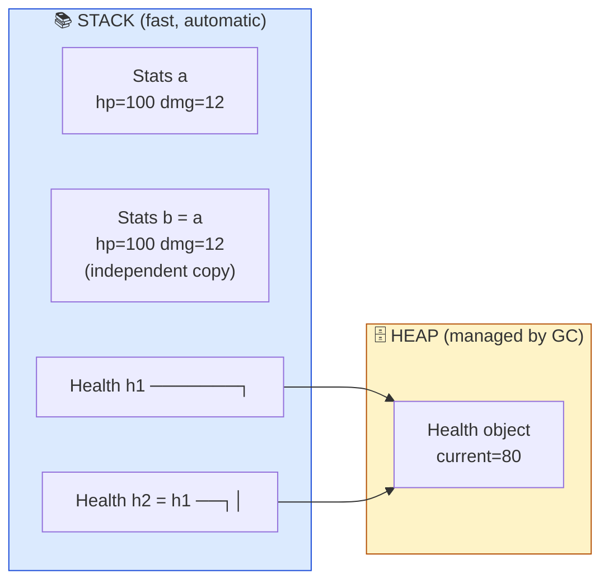
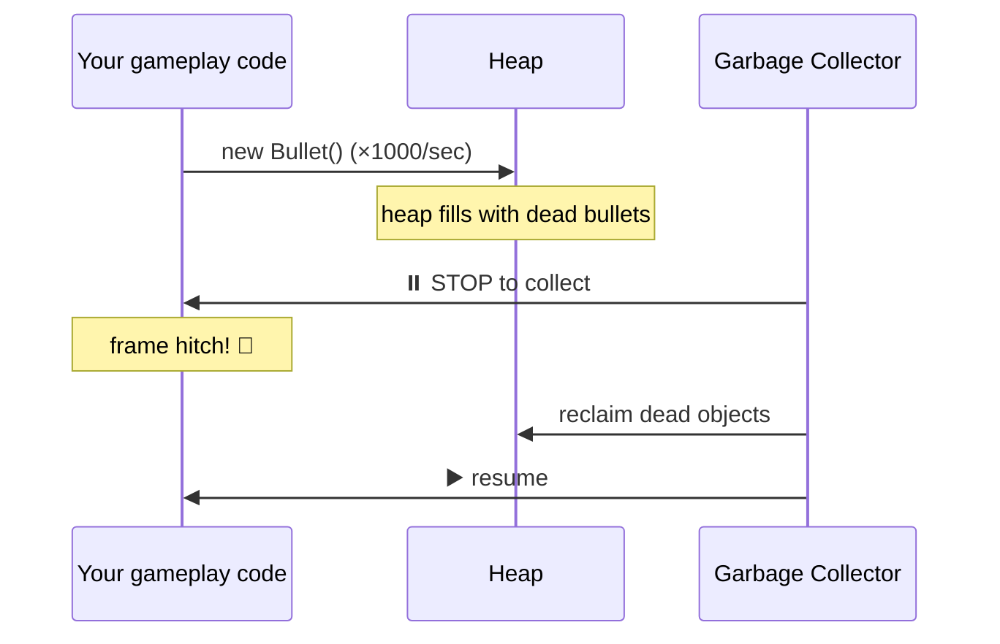

# Level 1 — C# Types & Memory

| | |
|---|---|
| 🎚️ **Difficulty** | 🟡 Medium |
| ⏱️ **Estimated time** | 30 minutes |
| ⭐ **XP reward** | 100 (Quest) + 25 (Quiz) |

[← Prev](../README.md) · [↑ Phase Home](../README.md) · [→ Next](02-oop-and-composition.md)

---

## 📖 Story

> *"Welcome to the gameplay team for real. Before you model a single enemy, you need to know where your data actually lives. Last month our old prototype dropped a frame every time a bullet spawned — not because the math was slow, but because we were allocating garbage on the heap a thousand times a second. Once you understand value vs reference types and how the garbage collector works, you'll never write that bug. Let's build Ashfall's first two data types the right way. — Kenji"*

---

## 🎯 Goal

- Understand **value types** (`struct`) vs **reference types** (`class`) from first principles
- Know what lives on the **stack** vs the **heap**, and why it matters for a 60fps game
- Understand the **garbage collector** (GC) and why allocations cause frame hitches
- Recognize and avoid **boxing**
- Build Ashfall's core `Stats` struct and `Health` class — choosing the right tool for each

---

## 🧠 Concepts

Every variable you create is *data sitting somewhere in memory*. C# gives you two fundamentally different kinds of "somewhere," and picking the wrong one is the #1 cause of mysterious frame stutters in games.

A **value type** holds its data *directly*. When you copy it, you copy the whole thing. `int`, `float`, `bool`, and any `struct` are value types.

A **reference type** holds a *pointer* to data living elsewhere. When you copy it, you copy the *address*, not the data — both copies point at the same object. `class`, `string`, and arrays are reference types.



The diagram captures the whole idea:

- `Stats b = a` makes a **separate copy**. Change `b.hp` and `a.hp` is untouched.
- `Health h2 = h1` copies the **reference**. Change `h2.current` and `h1.current` changes too — they're the *same object* on the heap.

**Stack vs heap.** The **stack** is a tiny, blazing-fast scratchpad that grows and shrinks automatically as methods are called and return. Value types and method locals live there — when the method ends, they're gone instantly, for free. The **heap** is a big shared pool for objects whose lifetime the compiler can't predict. Allocating there is slower, and *cleaning up* is the job of the garbage collector.

**The garbage collector.** C# is *memory-managed*: you never `free()` anything. Periodically the **GC** pauses your program, scans the heap, and reclaims objects nothing points to anymore. That pause is the problem. At 60fps you have ~16ms per frame; a GC pause can eat all of it and cause a visible **hitch**. The fix is not "turn off the GC" — it's **allocate less on the heap during gameplay**, especially in `Update()`.

**Boxing.** When you store a value type in a variable typed as `object` (or a non-generic collection), C# silently *boxes* it — wraps it in a heap object. That's a sneaky allocation:

```csharp
int score = 100;
object boxed = score;   // ⚠️ BOXING — allocates on the heap
```

Boxing in a hot loop is a classic source of GC pressure. Generics (`List<int>`) avoid it.



### Why this exists

Hardware has two realities: a small chunk of memory that's cheap to manage automatically (the stack), and a large pool that needs bookkeeping (the heap). Languages expose this split because *you*, the programmer, know which data is short-lived (a position, a damage number — value types) and which is a long-lived shared entity (a player, a world — reference types). The GC exists so you don't leak memory by hand, but it trades that safety for unpredictable pauses. **This is engine-agnostic:** Unreal/C++ has stack vs heap and manual `new`/`delete`; Unity/C# has the GC; Rust has ownership. Every engine forces you to decide *where data lives* — and games, uniquely, punish heap churn with dropped frames. Learn it once, apply it forever.

---

## 🛠️ Hands-on Lab

> 💻 You can run every snippet below in [dotnetfiddle.net](https://dotnetfiddle.net) (free, in-browser — see RESOURCES.md) before putting it in Ashfall. No engine needed yet.

### Step 1 — See value-copy vs reference-copy with your own eyes

```csharp
using System;

// A VALUE type: copies hold independent data
struct Stats
{
    public int hp;
    public int damage;
}

// A REFERENCE type: copies share one object
class Health
{
    public int current;
}

class Program
{
    static void Main()
    {
        Stats a = new Stats { hp = 100, damage = 12 };
        Stats b = a;          // full COPY
        b.hp = 1;
        Console.WriteLine($"a.hp = {a.hp}, b.hp = {b.hp}");   // 100, 1  → independent

        Health h1 = new Health { current = 100 };
        Health h2 = h1;       // copies the REFERENCE
        h2.current = 1;
        Console.WriteLine($"h1.current = {h1.current}, h2.current = {h2.current}"); // 1, 1  → same object
    }
}
```

Run it. The `struct` rows are independent; the `class` rows move together. That single difference drives every design decision in this lesson.

### Step 2 — Prove the "shared object" gotcha

Pass a reference type to a method and you can mutate the caller's object:

```csharp
static void TakeDamage(Health h, int amount)
{
    h.current -= amount;   // mutates the ORIGINAL — h is a reference
}

// ...
Health boss = new Health { current = 50 };
TakeDamage(boss, 20);
Console.WriteLine(boss.current);   // 30 — the method changed the caller's object
```

Try the same with a `struct` parameter — the original is untouched, because the method got a *copy*. This is exactly why a tiny, frequently-copied bundle like position/stats wants to be a `struct`, and a shared living entity wants to be a `class`.

### Step 3 — Watch boxing happen

```csharp
int n = 7;
object boxed = n;        // allocation #1 (boxing)
int unboxed = (int)boxed; // unboxing back to a value type

// The hot-loop trap:
object[] junk = new object[1000];
for (int i = 0; i < 1000; i++)
    junk[i] = i;         // ⚠️ 1000 boxing allocations!
```

The `object[]` version boxes on every iteration. Swap it for `int[]` (or `List<int>`) and the allocations vanish. In gameplay code that runs every frame, that difference is felt as smoothness.

### Step 4 — Choose the right type for Ashfall

Rule of thumb: a **struct** for small, immutable-ish bundles of data you copy a lot (≤ ~16 bytes, no identity). A **class** for entities with identity and lifetime that systems share.

```csharp
// Stats: a small data bundle the combat system copies around → STRUCT
public struct Stats
{
    public int maxHp;
    public int damage;
    public float moveSpeed;

    public Stats(int maxHp, int damage, float moveSpeed)
    {
        this.maxHp = maxHp;
        this.damage = damage;
        this.moveSpeed = moveSpeed;
    }
}

// Health: a living, shared entity multiple systems read/modify → CLASS
public class Health
{
    public int Current { get; private set; }
    public int Max { get; }

    public Health(int max)
    {
        Max = max;
        Current = max;
    }

    public void TakeDamage(int amount) => Current = Math.Max(0, Current - amount);
    public bool IsDead => Current <= 0;
}
```

`Stats` is a value type because it's just numbers we tune and copy. `Health` is a reference type because the player's health is *one thing* the UI, the combat system, and the save system all point at.

---

## 🎮 Mini Challenge

Predict the output **before running**, then verify:

```csharp
struct Point { public int x; }
class Box { public int x; }

Point p1 = new Point { x = 5 };
Point p2 = p1; p2.x = 99;

Box b1 = new Box { x = 5 };
Box b2 = b1; b2.x = 99;

Console.WriteLine($"{p1.x} {p2.x} {b1.x} {b2.x}");
```

<details>
<summary>💡 Reveal answer</summary>

**`5 99 99 99`**

- `Point` is a **struct** → `p2 = p1` copied the data; changing `p2.x` left `p1.x` at `5`.
- `Box` is a **class** → `b2 = b1` copied the reference; `b1` and `b2` are the *same* object, so both read `99`.

If you got this right, you understand the single most important distinction in C# memory.
</details>

---

## 📦 Project Mission

Lay the first stones of Ashfall's clean architecture: the core data types every later system will use.

1. In `~/projects/ashfall`, create `Assets/Scripts/Core/Stats.cs` with the `Stats` **struct** above.
2. Create `Assets/Scripts/Core/Health.cs` with the `Health` **class** above.
3. Make a quick `StatsDemo : MonoBehaviour` that, in `Start()`, builds a `Stats` and a `Health`, deals damage, and logs the result — proving the type choice works in Unity:
   ```csharp
   using UnityEngine;

   public class StatsDemo : MonoBehaviour
   {
       void Start()
       {
           Stats hero = new Stats(maxHp: 100, damage: 12, moveSpeed: 5f);
           Health hp = new Health(hero.maxHp);

           hp.TakeDamage(hero.damage);
           Debug.Log($"Hero HP: {hp.Current}/{hp.Max}  dead? {hp.IsDead}");
       }
   }
   ```
4. Attach `StatsDemo` to a `GameBootstrap` object, press Play, confirm the log.
5. Commit on a branch and merge:
   ```bash
   cd ~/projects/ashfall
   git switch -c feature/core-data-types
   git add Assets/Scripts/Core
   git commit -m "feat: add Stats struct and Health class (core data types)"
   git switch main && git merge feature/core-data-types && git push
   ```

🎯 **Mission complete when:** `Stats` is a struct, `Health` is a class, the demo logs `Hero HP: 88/100  dead? False`, and both files are committed and pushed.

---

## ⚠️ Common Mistakes

| Mistake | What happens | Fix |
|--------|--------------|-----|
| Making `Health` a `struct` | Systems get *copies*, damage "doesn't stick" | Entities with shared identity = `class` |
| Big mutable `struct`s | Surprise copies, confusing bugs, perf cost | Keep structs small; use classes for big/shared data |
| Allocating (`new`) every frame in `Update()` | GC pressure → frame hitches | Allocate once, reuse; pool objects |
| Boxing in hot loops (`object` lists) | Hidden per-iteration heap allocations | Use generics (`List<int>`, `int[]`) |
| Expecting a struct passed to a method to mutate | The method got a copy; original unchanged | Pass a class, return a new struct, or use `ref` |
| "The GC will handle it, so allocations are free" | True for correctness, false for *smoothness* | Minimize gameplay-loop allocations |

---

## 🤔 Reflection Questions

1. You have a `Vector2 position` updated 60 times a second per entity. Should it be a struct or a class, and why does it matter for the GC?
2. A teammate passes a `Health` into a method and is "shocked" the original changed. Explain what happened in terms of stack vs heap.
3. Why is "the GC frees memory for me" both a great feature *and* a thing you must actively design around in games?

---

## 📝 Quiz

1. **Which is a value type?**
   - a) `class Player`
   - b) `struct Stats`
   - c) `string name`
2. **A frame hitch caused by allocations is usually due to…**
   - a) too many `struct`s on the stack
   - b) the garbage collector pausing to reclaim heap objects
   - c) using `float` instead of `int`
3. **Boxing is…**
   - a) wrapping a value type in a heap object (a hidden allocation)
   - b) a way to make code faster
   - c) packaging your game for release

<details>
<summary>✅ Answers</summary>

1: **b** · 2: **b** · 3: **a**
</details>

---

## ✅ Completion Checklist

- [ ] I can explain value-copy vs reference-copy and predict the Mini Challenge output
- [ ] I can say what lives on the stack vs the heap, and why GC pauses hurt games
- [ ] I can spot boxing and know how generics avoid it
- [ ] `Stats` (struct) and `Health` (class) exist in `Assets/Scripts/Core` and the demo logs correctly
- [ ] Work committed and pushed on a branch, merged to `main`
- [ ] I passed the quiz
- [ ] Added **+125 XP** to [PROGRESS.md](../../../PROGRESS.md)

---

[← Prev](../README.md) · [↑ Phase Home](../README.md) · [→ Next](02-oop-and-composition.md)
