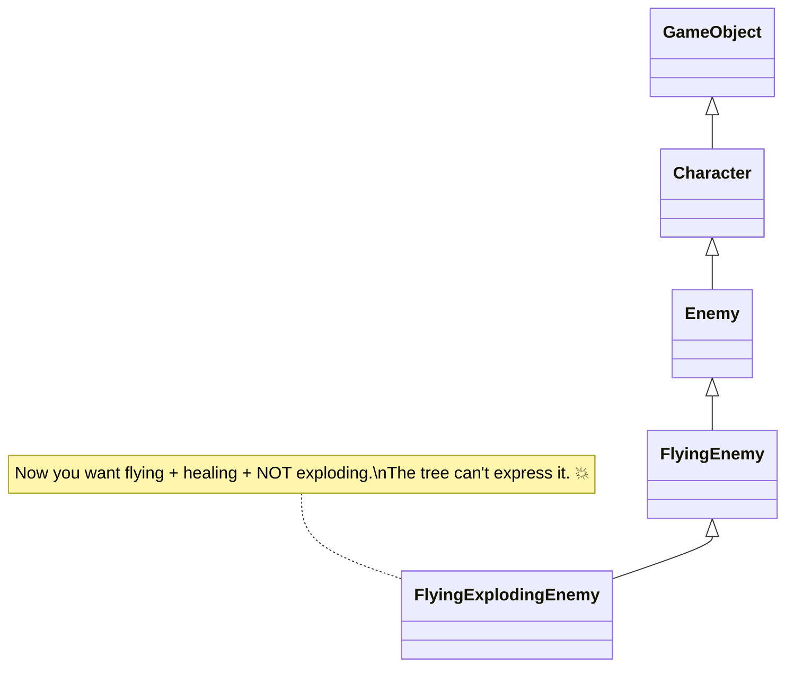
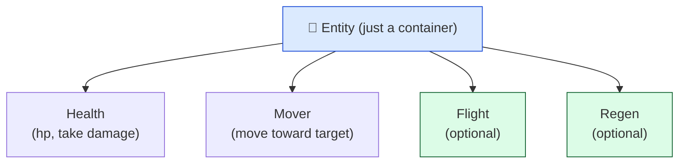

# Level 2 — OOP & Composition

| | |
|---|---|
| 🎚️ **Difficulty** | 🟡 Medium |
| ⏱️ **Estimated time** | 30 minutes |
| ⭐ **XP reward** | 100 (Quest) + 25 (Quiz) |

[← Prev](01-csharp-types-and-memory.md) · [↑ Phase Home](../README.md) · [→ Next](03-interfaces-and-solid.md)

---

## 📖 Story

> *"Here's the trap every junior falls into. You make a `GameObject` class. Then `Enemy : GameObject`. Then `FlyingEnemy : Enemy`. Then `FlyingExplodingEnemy : FlyingEnemy`. Six months later someone wants a flying enemy that *doesn't* explode but *does* heal, and the whole tree falls over. That tree is exactly why our last prototype was unmaintainable. Today I'll show you why the whole industry — and Unity itself — picks **composition over inheritance**. You'll build an Ashfall entity out of snap-together parts. — Kenji"*

---

## 🎯 Goal

- Master the four pillars of OOP: **encapsulation, abstraction, inheritance, polymorphism**
- Understand why **deep inheritance hierarchies** become brittle
- Apply **"favor composition over inheritance"** — the studio's default
- See how Unity's **component model** *is* composition, and why
- Build an Ashfall `Entity` assembled from composed components instead of a class tree

---

## 🧠 Concepts

**OOP in one breath:** bundle *data* and the *behavior* that operates on it into objects.

- **Encapsulation** — hide internals behind a clean surface. `Health` exposes `TakeDamage()` and `Current`, not a raw mutable field. Callers can't put it in an invalid state.
- **Abstraction** — model the *idea*, not the wiring. A `Mover` says "move toward X"; how it does it is hidden.
- **Inheritance** — a subclass *is-a* parent (`Wolf : Animal`) and reuses its code.
- **Polymorphism** — one call, many behaviors. `animal.MakeSound()` barks or meows depending on the actual object.

Inheritance is seductive because the first two levels feel clean. The problem is it forces a **single, rigid "is-a" tree**, and game entities don't fit one tree — they're *combinations* of capabilities.



The cure is **composition**: instead of *being* a chain of ancestors, an entity *has* a set of independent parts. Want flying + healing? Attach a `Flight` part and a `Regen` part. Don't want exploding? Don't attach `Explode`. Capabilities mix and match freely.



**This is literally how Unity works.** A `GameObject` is an empty container; you give it abilities by adding **Components** (`Transform`, `Rigidbody2D`, your `Health`, your `Mover`). Unity chose composition on purpose — a `MonoBehaviour` *is* a composable part. When you "favor composition," you're working *with* the engine, not against it.

### Why this exists

Inheritance models a fixed taxonomy; the real world (and game design) is a *combinatorial* explosion of features that don't nest. A rigid tree can only express one axis of variation cleanly — add a second ("can fly" × "can heal" × "is boss") and you get an exponential mess of subclasses or duplicated code. Composition replaces "what *is* this thing?" with "what can this thing *do*?", and capabilities snap together independently. **This is engine-agnostic and bigger than games:** Unity calls them Components, Unreal has ActorComponents, modern ECS architectures (you'll meet them in World 9) take it to the extreme, and the same instinct shows up in web back-ends as dependency injection. Inheritance still has its place (small, genuine "is-a" relationships), but *default to composition* and your codebase stays flexible for years — which is exactly the brief Kenji gave you.

---

## 🛠️ Hands-on Lab

> 💻 The first snippets are plain C# (runnable in [dotnetfiddle.net](https://dotnetfiddle.net)); the Project Mission ports the idea into Unity's component model.

### Step 1 — Feel encapsulation

Bad: a public field anyone can corrupt. Good: a guarded surface.

```csharp
// ❌ leaky — any code can set hp to -9999 or above max
public class BadHealth { public int hp; }

// ✅ encapsulated — invariants protected
public class Health
{
    public int Current { get; private set; }
    public int Max { get; }
    public Health(int max) { Max = max; Current = max; }
    public void TakeDamage(int amt) => Current = System.Math.Max(0, Current - amt);
    public void Heal(int amt)       => Current = System.Math.Min(Max, Current + amt);
    public bool IsDead => Current <= 0;
}
```

`Health` can *never* be negative or exceed `Max` — the rules live in one place. That's encapsulation earning its keep.

### Step 2 — See inheritance + polymorphism (and its limit)

```csharp
abstract class Animal { public abstract string Speak(); }
class Wolf : Animal { public override string Speak() => "Howl"; }
class Bat  : Animal { public override string Speak() => "Screech"; }

Animal[] zoo = { new Wolf(), new Bat() };
foreach (var a in zoo) System.Console.WriteLine(a.Speak()); // Howl, Screech — polymorphism
```

Clean — because "is-a-kind-of-animal" is a *genuine, single-axis* relationship. The trouble starts when you bolt on a second axis ("flying", "exploding") and try to express it with more subclasses.

### Step 3 — Build the same entity with composition

Each capability is its own small class. The entity just holds them.

```csharp
public class Mover
{
    public float Speed;
    public Mover(float speed) => Speed = speed;
    public void MoveToward(string target) =>
        System.Console.WriteLine($"Moving toward {target} at {Speed}/s");
}

public class Entity
{
    public Health Health;
    public Mover Mover;
    // Optional parts can simply be null when not present.
}

var slime = new Entity { Health = new Health(30), Mover = new Mover(2f) };
slime.Mover.MoveToward("player");
slime.Health.TakeDamage(10);
```

Want a healing flyer? Add a `Flight` and `Regen` field. Want a stationary turret? Leave `Mover` null. No new subclass, no tree surgery — you *compose*.

### Step 4 — The Unity translation

In Unity each part is a `MonoBehaviour`, and the `GameObject` is the `Entity` container. Same idea, engine-native:

```csharp
using UnityEngine;

public class Health : MonoBehaviour
{
    [SerializeField] private int max = 100;
    public int Current { get; private set; }
    public int Max => max;

    void Awake() => Current = max;

    public void TakeDamage(int amount)
    {
        Current = Mathf.Max(0, Current - amount);
        if (Current == 0) Debug.Log($"{name} died");
    }
    public bool IsDead => Current <= 0;
}

public class Mover : MonoBehaviour
{
    [SerializeField] private float speed = 5f;

    public void Move(Vector2 direction)
    {
        // Frame-rate independent (full movement math arrives in World 2).
        transform.position += (Vector3)(direction.normalized * speed * Time.deltaTime);
    }
}
```

To make a "player," you create an empty GameObject and **Add Component → Health** and **Add Component → Mover**. To make a "turret," add `Health` only. The GameObject is composition in action.

---

## 🎮 Mini Challenge

Design (just describe, in components) three Ashfall entities **without inheritance**: a *Player* (takes damage, moves, can attack), a *Turret* (takes damage, attacks, can't move), and a *Health Pickup* (no health, no attack, just triggers a heal). List the components each one has.

<details>
<summary>💡 Reveal answer</summary>

| Entity | Components |
|--------|-----------|
| Player | `Health`, `Mover`, `Attacker` |
| Turret | `Health`, `Attacker` |
| Health Pickup | `Healer` (and a trigger collider) — *no* `Health`, *no* `Attacker` |

Notice there is **no `Character` base class**. Each entity is just the set of capabilities it needs. Adding a "moving pickup" later means attaching `Mover` — zero refactoring. That's the payoff of composition.
</details>

---

## 📦 Project Mission

Turn Ashfall's data types from Level 1 into composable Unity components and assemble a real entity.

1. Move/convert your Level 1 `Health` into a `MonoBehaviour` at `Assets/Scripts/Entities/Health.cs` (the Unity version above). Keep `Stats` as the plain struct (data, not a component).
2. Create `Assets/Scripts/Entities/Mover.cs` (the `Mover` component above).
3. In the scene, create an empty GameObject named **Player**, then **Add Component → Health** and **Add Component → Mover**. Tune `max` and `speed` in the Inspector.
4. Add a tiny `PlayerProbe : MonoBehaviour` that, in `Update()`, calls `GetComponent<Mover>().Move(Vector2.right)` and on the spacebar calls `GetComponent<Health>().TakeDamage(10)` — proving the composed parts work together:
   ```csharp
   using UnityEngine;

   public class PlayerProbe : MonoBehaviour
   {
       private Health health;
       private Mover mover;

       void Awake()
       {
           health = GetComponent<Health>();
           mover  = GetComponent<Mover>();
       }

       void Update()
       {
           mover.Move(Vector2.right);
           if (Input.GetKeyDown(KeyCode.Space)) health.TakeDamage(10);
       }
   }
   ```
5. Press Play: the Player drifts right, Space drops its HP, and at 0 it logs "died." Commit:
   ```bash
   cd ~/projects/ashfall
   git switch -c feature/component-entity
   git add Assets/Scripts/Entities
   git commit -m "feat: component-based entity (Health + Mover) via composition"
   git switch main && git merge feature/component-entity && git push
   ```

🎯 **Mission complete when:** a single Player GameObject is built purely by *adding components* (no entity subclass exists), it moves and takes damage in Play Mode, and the components are committed and pushed.

---

## ⚠️ Common Mistakes

| Mistake | What happens | Fix |
|--------|--------------|-----|
| Deep inheritance trees (`A : B : C : D`) | Rigid, brittle, can't mix features | Compose small components instead |
| Public mutable fields everywhere | Anyone corrupts state; bugs are untraceable | Encapsulate behind methods/properties |
| One giant `Enemy` class doing everything | Becomes the spaghetti you're paid to avoid | Split into single-purpose components |
| Caching `GetComponent` in `Update()` | Per-frame lookup, slower, noisy | Cache it once in `Awake()` |
| Inheriting just to reuse a method | Couples unrelated classes | Extract the method into a shared component/helper |
| Forcing everything to be a component | Pure data (like `Stats`) doesn't need to be one | Components for behavior; structs/classes for data |

---

## 🤔 Reflection Questions

1. Maya asks for a "flying healer that doesn't take fall damage." Sketch how composition gives you that with zero changes to existing entities.
2. Encapsulation hides fields behind methods — what concrete bug does that prevent in `Health`?
3. Unity makes you `AddComponent` rather than subclass `GameObject`. Why is that a deliberate design choice, not a limitation?

---

## 📝 Quiz

1. **"Favor composition over inheritance" means…**
   - a) never use classes
   - b) prefer assembling objects from independent parts over deep "is-a" trees
   - c) always copy-paste code
2. **In Unity, the component model is an example of…**
   - a) inheritance
   - b) composition
   - c) garbage collection
3. **Encapsulation primarily gives you…**
   - a) faster code
   - b) protected invariants — internals can't be set to invalid states
   - c) smaller builds

<details>
<summary>✅ Answers</summary>

1: **b** · 2: **b** · 3: **b**
</details>

---

## ✅ Completion Checklist

- [ ] I can name the four OOP pillars and give a one-line example of each
- [ ] I can explain why deep inheritance trees become brittle
- [ ] I can describe an entity purely as a set of components (no base class)
- [ ] An Ashfall Player exists built only by *adding* `Health` + `Mover` components
- [ ] It moves and takes damage in Play Mode; work committed and pushed
- [ ] I passed the quiz
- [ ] Added **+125 XP** to [PROGRESS.md](../../../PROGRESS.md)

---

[← Prev](01-csharp-types-and-memory.md) · [↑ Phase Home](../README.md) · [→ Next](03-interfaces-and-solid.md)
