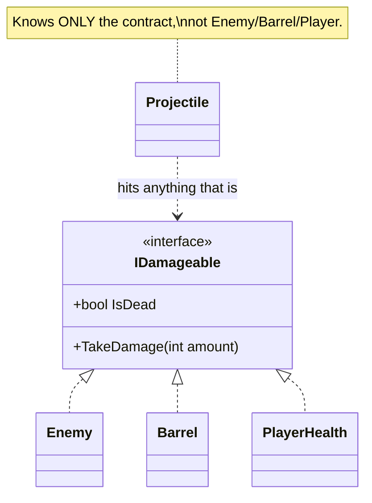
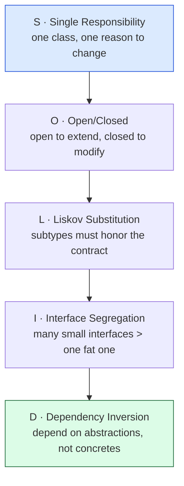

# Level 3 — Interfaces & SOLID

| | |
|---|---|
| 🎚️ **Difficulty** | 🔴 Hard |
| ⏱️ **Estimated time** | 35 minutes |
| ⭐ **XP reward** | 100 (Quest) + 25 (Quiz) |

[← Prev](02-oop-and-composition.md) · [↑ Phase Home](../README.md) · [→ Next](04-events-and-the-observer-pattern.md)

---

## 📖 Story

> *"Here's the problem we hit constantly: the projectile script needs to deal damage. But to *what*? An enemy? A barrel? A breakable wall? The player? If the projectile has to know about every one of those types, it's coupled to the entire game. The fix is an **interface** — a contract. The projectile says 'I damage anything that's `IDamageable`' and stops caring what the thing actually is. Today you learn interfaces and the five **SOLID** principles. These five rules are the literal antidote to the spaghetti you're going to refactor at the boss. — Kenji"*

---

## 🎯 Goal

- Understand **interfaces** as contracts, and how they differ from **abstract classes**
- Apply the five **SOLID** principles to Ashfall, especially **SRP** and **DIP**
- Build `IDamageable` and `IInteractable` — contracts every later combat/interaction system uses
- Write code that depends on *abstractions*, not concrete types

---

## 🧠 Concepts

An **interface** is a *contract*: a list of capabilities with **no implementation**. `IDamageable` says "I can take damage" — it doesn't say *how*. Any class can sign the contract by implementing it, and code can then work with *anything* that signs it, never knowing the concrete type.



The `Projectile` arrow points at the *interface*, not at `Enemy`/`Barrel`/`Player`. That one indirection means you can add a new damageable type tomorrow and the projectile never changes. That's decoupling.

**Interface vs abstract class:**

| | Interface | Abstract class |
|---|---|---|
| Contains | only the contract (mostly) | contract **+ shared code/state** |
| A type can have | **many** interfaces | **one** base class |
| Use when | "can do X" capabilities that cut across unrelated types | a genuine "is-a" family sharing real implementation |

Rule of thumb: reach for an **interface** first (it composes, like Level 2); use an **abstract class** only when several types share actual code and a true is-a bond.

### The five SOLID principles

SOLID is five rules that keep code flexible. They are the cure for god-classes.



- **S — Single Responsibility.** A class should have one job, one reason to change. `Health` manages HP. It does *not* also play sounds, update UI, and save the game. (Mixing those is exactly how you get a 3000-line class.)
- **O — Open/Closed.** You should be able to add behavior by adding *new* code, not editing old, tested code. New enemy type? New class implementing the contract — don't touch the projectile.
- **L — Liskov Substitution.** Anywhere the base/interface is expected, any implementation must work without surprises. If `IDamageable.TakeDamage` is supposed to reduce HP, an implementation that *heals* instead breaks the contract.
- **I — Interface Segregation.** Prefer many small, focused interfaces over one fat one. A barrel is `IDamageable` but not `IMovable` — don't force it to implement methods it doesn't need.
- **D — Dependency Inversion.** High-level code should depend on **abstractions**, not concrete classes. The projectile depends on `IDamageable`, not `Enemy`. This is the big one for decoupling.

### Why this exists

Software's only constant is *change* — requirements shift, features pile on. Code that's a tangle of concrete types resists change: touching one thing breaks five others (that's spaghetti). SOLID is five hard-won heuristics that make change *cheap*: each class is small and single-purpose (S), you extend without editing (O), substitutions are safe (L), interfaces stay lean (I), and dependencies point at stable abstractions instead of volatile details (D). Interfaces are the mechanical tool that makes O, L, I, and D possible. **This is engine- and language-agnostic:** SOLID came from enterprise software, but it governs Unreal C++, Godot, web back-ends, and your Ashfall combat system equally. Internalize it now — your boss battle is *literally* applying it.

---

## 🛠️ Hands-on Lab

> 💻 Plain-C# snippets run in [dotnetfiddle.net](https://dotnetfiddle.net); the Project Mission lands the interfaces in Ashfall.

### Step 1 — Define the contract

```csharp
public interface IDamageable
{
    void TakeDamage(int amount);
    bool IsDead { get; }
}
```

No bodies — just the promise. Anything implementing it *guarantees* these members exist.

### Step 2 — Many unrelated types sign it

```csharp
public class Enemy : IDamageable
{
    private int hp = 30;
    public void TakeDamage(int amount) => hp -= amount;
    public bool IsDead => hp <= 0;
}

public class Barrel : IDamageable
{
    private int hp = 5;
    public void TakeDamage(int amount) { hp -= amount; if (hp <= 0) System.Console.WriteLine("💥 Barrel explodes"); }
    public bool IsDead => hp <= 0;
}
```

`Enemy` and `Barrel` share *no* base class and behave totally differently — yet both satisfy `IDamageable`.

### Step 3 — Depend on the abstraction (DIP in action)

```csharp
public class Projectile
{
    // Depends on IDamageable — NOT on Enemy or Barrel. This is Dependency Inversion.
    public void HitTarget(IDamageable target, int damage)
    {
        target.TakeDamage(damage);
        if (target.IsDead) System.Console.WriteLine("Target destroyed");
    }
}

var p = new Projectile();
p.HitTarget(new Enemy(), 30);   // works
p.HitTarget(new Barrel(), 10);  // also works — projectile never changed
```

Add a `BreakableWall : IDamageable` next week and `Projectile` needs **zero** edits (Open/Closed). That's the whole point.

### Step 4 — A second, segregated interface

Interaction is a *different* capability from taking damage — so it's a *different* interface (Interface Segregation):

```csharp
public interface IInteractable
{
    string Prompt { get; }   // e.g. "Press E to open"
    void Interact();
}

public class Chest : IInteractable
{
    public string Prompt => "Press E to open chest";
    public void Interact() => System.Console.WriteLine("Chest opened — loot!");
}
```

A `Chest` is `IInteractable` but not `IDamageable`. A `Barrel` might be *both*. Small interfaces let each type pick exactly the capabilities it has — no fat contract forcing empty methods.

### Step 5 — SRP cleanup

Spot the violation and split it:

```csharp
// ❌ SRP violation: Health also does UI and audio — three reasons to change.
class FatHealth { /* hp + UpdateHealthBar() + PlayHurtSound() ... */ }

// ✅ Each class has one job. The bar and audio will REACT to events (Level 4).
class Health : IDamageable { /* only hp logic */ }
// HealthBar  → only draws
// AudioPlayer → only plays sound
```

Right now `Health` shouldn't know the UI exists. In Level 4 you'll connect them with *events* so they stay decoupled.

---

## 🎮 Mini Challenge

Which SOLID principle does each scenario violate?

1. Adding a new enemy type forces you to edit a `switch` inside `CombatManager`.
2. `Health` also writes the save file and plays a sound.
3. `IEntity` has 12 methods; a `Rock` must implement `Jump()` and `Shoot()` it never uses.

<details>
<summary>💡 Reveal answer</summary>

1. **Open/Closed (O)** — you're *modifying* existing code to extend it. Fix: have enemies implement an interface the manager loops over, so new types add code instead of editing the switch.
2. **Single Responsibility (S)** — three reasons to change in one class. Fix: split saving and audio out; let them react to events.
3. **Interface Segregation (I)** — a fat interface forces unused methods. Fix: split into `IDamageable`, `IMovable`, `IShooter`, etc., and implement only what applies.

(Both 1 and the projectile example also touch **Dependency Inversion** — depend on contracts, not concretes.)
</details>

---

## 📦 Project Mission

Give Ashfall the contracts its entire combat and interaction systems will be built on.

1. Create `Assets/Scripts/Interfaces/IDamageable.cs` and `Assets/Scripts/Interfaces/IInteractable.cs` (the interfaces above).
2. Make your `Health` component implement `IDamageable`:
   ```csharp
   using UnityEngine;

   public class Health : MonoBehaviour, IDamageable
   {
       [SerializeField] private int max = 100;
       public int Current { get; private set; }
       void Awake() => Current = max;

       public void TakeDamage(int amount) => Current = Mathf.Max(0, Current - amount);
       public bool IsDead => Current <= 0;
   }
   ```
3. Create a `Chest : MonoBehaviour, IInteractable` that logs loot on `Interact()`.
4. Create a `Projectile` (or test `Attacker`) component whose hit logic takes an `IDamageable`, **not** a concrete type:
   ```csharp
   using UnityEngine;

   public class Attacker : MonoBehaviour
   {
       [SerializeField] private int damage = 10;

       // Depends on the abstraction → works on Enemy, Barrel, Player, anything.
       public void Strike(IDamageable target)
       {
           target.TakeDamage(damage);
           if (target.IsDead) Debug.Log($"{name} destroyed its target");
       }
   }
   ```
5. Prove it: in a probe script, `Strike(GetComponent<Health>())` on a damageable object and watch HP fall. Commit:
   ```bash
   cd ~/projects/ashfall
   git switch -c feature/interfaces-solid
   git add Assets/Scripts/Interfaces Assets/Scripts/Entities
   git commit -m "feat: IDamageable/IInteractable contracts; Attacker depends on abstraction"
   git switch main && git merge feature/interfaces-solid && git push
   ```

🎯 **Mission complete when:** `IDamageable` and `IInteractable` exist, `Health` implements `IDamageable`, `Attacker.Strike` depends on the *interface* (never on `Enemy`/`Health` by name), and damage applies in Play Mode.

---

## ⚠️ Common Mistakes

| Mistake | What happens | Fix |
|--------|--------------|-----|
| Projectile/manager referencing concrete types | Coupled to the whole game; can't extend | Depend on `IDamageable`/`IInteractable` |
| One fat `IEntity` interface | Types implement methods they don't use | Split into small, focused interfaces (ISP) |
| Using an abstract class where an interface fits | Locks the type into one base; can't mix capabilities | Prefer interfaces for "can-do" capabilities |
| God-class doing HP + UI + audio + save | Untestable, fragile, the spaghetti you must refactor | One responsibility per class (SRP) |
| Editing tested code to add a feature | Risk of regressions every release | Add a new implementation (Open/Closed) |
| A subtype that breaks the contract's intent | Callers get surprises; bugs at a distance | Honor the contract (Liskov) |

---

## 🤔 Reflection Questions

1. The projectile depends on `IDamageable`. Concretely, what work do you *save* when a new "BreakableWall" enemy is added next sprint?
2. When would you genuinely pick an **abstract class** over an **interface**? Give an Ashfall example.
3. Pick the SOLID principle you think most directly prevents "spaghetti," and defend your choice.

---

## 📝 Quiz

1. **An interface is best described as…**
   - a) a class with all its code written
   - b) a contract of capabilities with no implementation
   - c) a way to store data on the stack
2. **"Depend on abstractions, not concretions" is…**
   - a) Single Responsibility
   - b) Dependency Inversion
   - c) Liskov Substitution
3. **Splitting one fat interface into several small focused ones is…**
   - a) Interface Segregation
   - b) Open/Closed
   - c) Encapsulation

<details>
<summary>✅ Answers</summary>

1: **b** · 2: **b** · 3: **a**
</details>

---

## ✅ Completion Checklist

- [ ] I can explain an interface as a contract and when to use an abstract class instead
- [ ] I can state all five SOLID principles in my own words
- [ ] `IDamageable` and `IInteractable` exist; `Health` implements `IDamageable`
- [ ] `Attacker.Strike` depends on the interface, never a concrete type
- [ ] Damage applies in Play Mode; work committed and pushed
- [ ] I passed the quiz
- [ ] Added **+125 XP** to [PROGRESS.md](../../../PROGRESS.md)

---

[← Prev](02-oop-and-composition.md) · [↑ Phase Home](../README.md) · [→ Next](04-events-and-the-observer-pattern.md)
