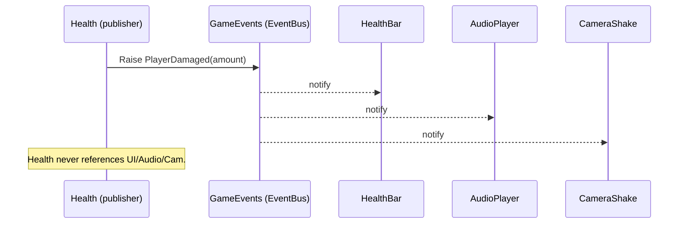
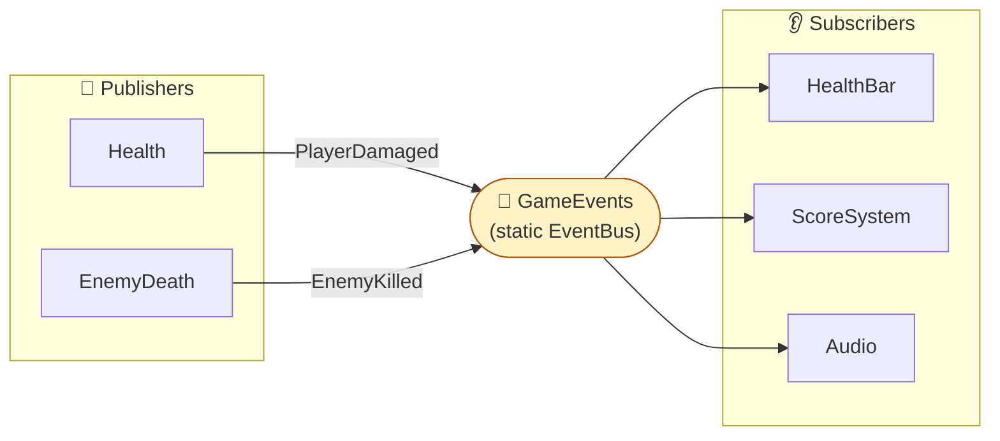

# Level 4 — Events & the Observer Pattern

| | |
|---|---|
| 🎚️ **Difficulty** | 🔴 Hard |
| ⏱️ **Estimated time** | 35 minutes |
| ⭐ **XP reward** | 100 (Quest) + 25 (Quiz) |

[← Prev](03-interfaces-and-solid.md) · [↑ Phase Home](../README.md) · [→ Next](05-managers-and-game-state.md)

---

## 📖 Story

> *"Quick one that'll save you a thousand headaches. When the player takes damage, *five* things should happen: the HP bar updates, a hurt sound plays, the camera shakes, the score system notices, maybe an achievement unlocks. The wrong instinct is to make `Health` call all five. Now `Health` knows about UI, audio, camera, score, achievements — and you're back to a god-class. The right move: `Health` just *shouts* 'I got damaged!' and whoever cares is *listening*. That's the **observer pattern**, and we'll build Ashfall's central **EventBus** with it today. — Kenji"*

---

## 🎯 Goal

- Understand **delegates**, `Action`, and `Func` — variables that hold *methods*
- Understand C# **`event`** and the **publish/subscribe (observer)** pattern
- See how events **decouple** systems (the publisher doesn't know its listeners)
- Build Ashfall's central **EventBus** (`GameEvents`) so systems communicate without referencing each other

---

## 🧠 Concepts

A **delegate** is a variable that holds a *method* — you can pass behavior around like data. C# ships two ready-made ones so you rarely declare your own:

- **`Action`** — a method that returns nothing. `Action<int>` takes an int, returns void.
- **`Func`** — a method that returns a value. `Func<int,bool>` takes an int, returns a bool.

```csharp
Action<int> onScore = points => Debug.Log($"+{points} points");
onScore(10);   // logs "+10 points" — we stored a method and called it later
```

An **`event`** is a delegate with guard rails: outsiders can **subscribe** (`+=`) and **unsubscribe** (`-=`), but only the declaring class can **raise** it. That asymmetry is what makes the observer pattern safe.

**The observer pattern (publish/subscribe):** one **publisher** announces that something happened; any number of **subscribers** react. The publisher has *no idea who is listening* — it just raises the event. This is the cure for the god-class.



`Health` raises one event; three unrelated systems react. Tomorrow you add an achievement system — it just *subscribes*, and nothing else changes (Open/Closed from Level 3, in action).

**Why a central EventBus?** You *could* put events on each component, but then subscribers need a reference to that exact component. A static **EventBus** is a single, global "radio station": publishers broadcast, subscribers tune in, and **no system holds a reference to another**. That's maximum decoupling for cross-cutting game events.



### Why this exists

In any non-trivial program, "X happened" must trigger many unrelated reactions — and the naive solution (the source directly calls every reaction) couples everything to everything (an N×N tangle: spaghetti). The observer pattern inverts the dependency: reactions *register interest*, and the source stays ignorant of them. You go from N×N hard-wires to N publishers + M subscribers that never name each other. The price is a bit of indirection (you can't see all listeners at a glance) and a discipline (always unsubscribe to avoid leaks). **This is engine-agnostic and everywhere:** Unity's own UI uses `UnityEvent`, JavaScript has `addEventListener`, back-ends use message queues, OS GUIs are built on it. Mastering pub/sub is how large systems stay loosely coupled — exactly the architecture you're laying down for Ashfall.

---

## 🛠️ Hands-on Lab

> 💻 Steps 1–3 run in [dotnetfiddle.net](https://dotnetfiddle.net); the EventBus goes into Ashfall in the Mission.

### Step 1 — Store and call a method (delegate)

```csharp
using System;

Action greet = () => Console.WriteLine("Hello!");
greet();                                  // Hello!

Action<int> report = n => Console.WriteLine($"value = {n}");
report(42);                               // value = 42

Func<int, int, int> add = (a, b) => a + b;
Console.WriteLine(add(2, 3));             // 5
```

A delegate is just "a method in a variable." Events are built on top of these.

### Step 2 — Publish/subscribe with `event`

```csharp
using System;

class Health
{
    public event Action<int> Damaged;   // the announcement
    private int hp = 100;

    public void TakeDamage(int amount)
    {
        hp -= amount;
        Damaged?.Invoke(amount);        // raise it (null-safe: only fires if someone subscribed)
    }
}

class Program
{
    static void Main()
    {
        var health = new Health();

        // Two unrelated subscribers tune in:
        health.Damaged += amt => Console.WriteLine($"UI: lost {amt} HP");
        health.Damaged += amt => Console.WriteLine($"Audio: play hurt sound");

        health.TakeDamage(15);
        // UI: lost 15 HP
        // Audio: play hurt sound
    }
}
```

`Health` never mentions UI or Audio. It raises `Damaged`; both subscribers react. The `?.Invoke` is the idiom — it does nothing if there are zero subscribers (no `NullReferenceException`).

### Step 3 — Always unsubscribe

Subscriptions keep the subscriber *alive* in memory. Forgetting `-=` is a classic leak (and double-fires after a scene reload):

```csharp
Action<int> handler = amt => Console.WriteLine($"react {amt}");
health.Damaged += handler;   // subscribe
health.Damaged -= handler;   // unsubscribe when done
```

(That's why you need a *named* handler — you can't `-=` a lambda you never stored.)

### Step 4 — Build the central EventBus

In Unity, a `static` class makes a perfect global radio station. The pattern: subscribe in `OnEnable`, unsubscribe in `OnDisable`.

```csharp
using System;

// The single hub every Ashfall system talks through.
public static class GameEvents
{
    public static event Action<int> PlayerDamaged;   // amount
    public static event Action EnemyKilled;

    public static void RaisePlayerDamaged(int amount) => PlayerDamaged?.Invoke(amount);
    public static void RaiseEnemyKilled()             => EnemyKilled?.Invoke();
}
```

Publisher side — `Health` raises through the bus:

```csharp
using UnityEngine;

public class Health : MonoBehaviour, IDamageable
{
    [SerializeField] private int max = 100;
    public int Current { get; private set; }
    void Awake() => Current = max;

    public void TakeDamage(int amount)
    {
        Current = Mathf.Max(0, Current - amount);
        GameEvents.RaisePlayerDamaged(amount);   // shout it — don't call UI/audio directly
    }
    public bool IsDead => Current <= 0;
}
```

Subscriber side — a HUD that tunes in (and *out*):

```csharp
using UnityEngine;

public class HealthBarHUD : MonoBehaviour
{
    void OnEnable()  => GameEvents.PlayerDamaged += OnPlayerDamaged;
    void OnDisable() => GameEvents.PlayerDamaged -= OnPlayerDamaged;   // prevent leaks

    private void OnPlayerDamaged(int amount) =>
        Debug.Log($"[HUD] Player took {amount} damage — refreshing bar");
}
```

Add a `ScoreSystem` that subscribes to `EnemyKilled`, and you've got three systems coordinating with **zero references between them**.

---

## 🎮 Mini Challenge

You add `HealthBarHUD` to the scene, play, take damage — the HUD logs correctly. Then you reload the scene and now it logs **twice** per hit. What went wrong, and how do you fix it?

<details>
<summary>💡 Reveal answer</summary>

The old HUD's subscription was **never removed**, so after reload there are *two* handlers on `GameEvents.PlayerDamaged` (the dead one and the new one), and the event fires both. `static` events outlive scene reloads — they don't get garbage-collected with the object.

**Fix:** always pair subscribe/unsubscribe with the object's lifecycle — `+=` in `OnEnable`, `-=` in `OnDisable`. With both in place, the stale subscription is removed on reload and you get exactly one log per hit. This is the #1 event bug in real Unity projects.
</details>

---

## 📦 Project Mission

Give Ashfall a real EventBus and decouple two systems through it.

1. Create `Assets/Scripts/Core/GameEvents.cs` (the static EventBus above) with at least `PlayerDamaged(int)` and `EnemyKilled`.
2. Update `Health.TakeDamage` to raise `GameEvents.RaisePlayerDamaged(amount)` instead of touching UI/audio.
3. Create `Assets/Scripts/UI/HealthBarHUD.cs` that subscribes in `OnEnable`, unsubscribes in `OnDisable`, and logs on damage.
4. Create `Assets/Scripts/Systems/ScoreSystem.cs` that subscribes to `EnemyKilled` and logs/increments a score. Add a temporary key press that calls `GameEvents.RaiseEnemyKilled()` to test it.
5. Play: damage the player (Space from Level 2's probe) → HUD reacts; trigger an enemy kill → ScoreSystem reacts. Neither system references the other or `Health`. Commit:
   ```bash
   cd ~/projects/ashfall
   git switch -c feature/event-bus
   git add Assets/Scripts/Core/GameEvents.cs Assets/Scripts/UI Assets/Scripts/Systems Assets/Scripts/Entities/Health.cs
   git commit -m "feat: central GameEvents EventBus; HUD + ScoreSystem decoupled via observer pattern"
   git switch main && git merge feature/event-bus && git push
   ```

🎯 **Mission complete when:** `Health` raises events through `GameEvents` (and references no UI/audio), `HealthBarHUD` and `ScoreSystem` react purely by subscribing, both correctly unsubscribe in `OnDisable`, and there is **no double-firing** after a scene reload.

---

## ⚠️ Common Mistakes

| Mistake | What happens | Fix |
|--------|--------------|-----|
| Subscribing but never unsubscribing | Memory leaks; double-firing after reloads | `+=` in `OnEnable`, `-=` in `OnDisable` |
| Subscribing with a lambda | Can't `-=` it later (no reference to it) | Use a named method as the handler |
| Raising an event with no null check | `NullReferenceException` when zero subscribers | Use `MyEvent?.Invoke(...)` |
| `Health` calling UI/audio/camera directly | God-class, tight coupling returns | Raise an event; let systems subscribe |
| Putting *everything* on the global bus | Hard to trace; "spooky action at a distance" | Bus for cross-cutting events; direct calls for local ones |
| Forgetting `static` events outlive scenes | Stale handlers accumulate | Always unsubscribe; reset the bus if needed |

---

## 🤔 Reflection Questions

1. `Health` raises `PlayerDamaged` and three systems react. What does the publisher know about its subscribers — and why is that ignorance a *feature*?
2. Explain the double-fire-after-reload bug to a teammate, including the exact fix.
3. When is an event the *wrong* tool, and a plain direct method call clearer?

---

## 📝 Quiz

1. **An `Action<int>` is…**
   - a) a value type stored on the stack
   - b) a delegate holding a method that takes an int and returns nothing
   - c) an interface
2. **In the observer pattern, the publisher…**
   - a) holds a reference to every subscriber and calls them directly
   - b) raises an event without knowing who (if anyone) is listening
   - c) must be a singleton
3. **The most common Unity event bug is…**
   - a) using `Func` instead of `Action`
   - b) subscribing without ever unsubscribing (leaks / double-fires)
   - c) raising events too quickly

<details>
<summary>✅ Answers</summary>

1: **b** · 2: **b** · 3: **b**
</details>

---

## ✅ Completion Checklist

- [ ] I can explain delegates, `Action`/`Func`, and `event` in my own words
- [ ] I can describe the observer pattern and why it decouples systems
- [ ] `GameEvents` EventBus exists; `Health` raises through it (no direct UI/audio calls)
- [ ] `HealthBarHUD` and `ScoreSystem` react purely by subscribing, and unsubscribe in `OnDisable`
- [ ] No double-firing after a scene reload; work committed and pushed
- [ ] I passed the quiz
- [ ] Added **+125 XP** to [PROGRESS.md](../../../PROGRESS.md)

---

[← Prev](03-interfaces-and-solid.md) · [↑ Phase Home](../README.md) · [→ Next](05-managers-and-game-state.md)
