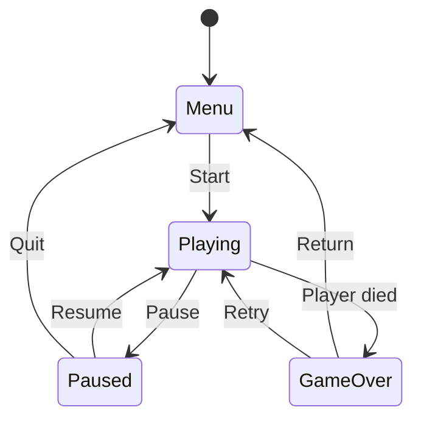

# Level 5 — Managers & Game State

| | |
|---|---|
| 🎚️ **Difficulty** | 🔴 Hard |
| ⏱️ **Estimated time** | 35 minutes |
| ⭐ **XP reward** | 100 (Quest) + 25 (Quiz) |

[← Prev](04-events-and-the-observer-pattern.md) · [↑ Phase Home](../README.md) · [→ Next](../boss-battle.md)

---

## 📖 Story

> *"Last lesson of World 1, and it ties the room together. Right now your systems can talk via events — but who owns the *big picture*? Is the game in the menu, playing, paused, or game-over? Pausing has to freeze gameplay but not the menu; the HUD shows only while playing. You need one conductor — a **GameManager** — and a clean **state machine** for those modes. I'll also be honest about the **Singleton**: it's the most-used and most-abused pattern in games. Use it with eyes open. Build this and Ashfall has a real backbone for World 2. — Kenji"*

---

## 🎯 Goal

- Understand the **Singleton** pattern, its real tradeoffs, and the safer **Service Locator** alternative
- Build a `GameManager` as Ashfall's single coordinator
- Model app flow as a **finite state machine** (Menu / Playing / Paused / GameOver)
- Broadcast state changes through the Level 4 EventBus so systems react cleanly

---

## 🧠 Concepts

A **manager** is a class that owns a *system-wide* concern — the overall game flow, the audio mixer, the save system. The question is always: *how does the rest of the code find the one manager?*

**The Singleton** guarantees exactly one instance and offers a global access point: `GameManager.Instance`. It's everywhere in games because it's convenient — but that convenience is also its danger.

```csharp
public class GameManager : MonoBehaviour
{
    public static GameManager Instance { get; private set; }

    void Awake()
    {
        if (Instance != null && Instance != this) { Destroy(gameObject); return; }
        Instance = this;
        DontDestroyOnLoad(gameObject);   // survive scene loads
    }
}
```

**The honest tradeoff:**

| Singleton ✅ | Singleton ⚠️ |
|---|---|
| Trivial global access | Hidden dependencies (anyone can reach in) |
| Guarantees one instance | Global mutable state → hard-to-trace bugs |
| Great for *truly* app-wide systems | Hard to unit-test (can't swap a fake) |
| Survives scene loads | Overuse recreates the god-object you're fleeing |

Rule: use a Singleton for *genuinely* app-wide, single-instance coordinators (a `GameManager`), and **prefer events** (Level 4) for most cross-system talk so you're not reaching into `Instance` everywhere.

**Service Locator** is the safer cousin: a registry you ask for a service by its *interface*. Because you depend on the interface (Dependency Inversion!), you can register a fake in tests.

```csharp
public static class Services
{
    private static readonly Dictionary<Type, object> map = new();
    public static void Register<T>(T service) => map[typeof(T)] = service;
    public static T Get<T>() => (T)map[typeof(T)];
}
// Services.Register<ISaveSystem>(new JsonSaveSystem());
// var save = Services.Get<ISaveSystem>();   // depends on the abstraction
```

**The state machine.** Game flow is a handful of **states** with **legal transitions** between them. A finite state machine (FSM) makes the rules explicit and impossible to violate (you can't go Menu → Paused).



Each state defines what's allowed. On every transition the `GameManager` raises an event (Level 4) so the HUD, input, and audio reconfigure themselves — without the manager knowing they exist.

### Why this exists

Every app eventually needs *one* authority over global flow and *one* way to find shared services — otherwise that knowledge smears across the codebase and you get the spaghetti you've spent this world killing. The Singleton answers "one instance, found globally," but its global mutable state is a trap, so the discipline is: few singletons, prefer interfaces + events. The state machine exists because "what mode are we in?" governed by scattered booleans (`isPaused`, `isInMenu`, `isDead`) inevitably reaches an impossible combination (paused *and* dead?) and breaks; a single explicit state with defined transitions makes illegal states unrepresentable. **This is engine-agnostic:** Unreal has GameMode/GameInstance, every UI framework has a router/state, and FSMs run enemy AI, animation, and network protocols alike. You'll reuse this state-machine instinct for enemy AI in World 6 — learn the shape now.

---

## 🛠️ Hands-on Lab

> 💻 This lesson is Unity-centric (managers live in the scene). The FSM logic itself is plain C# you can prototype in [dotnetfiddle.net](https://dotnetfiddle.net).

### Step 1 — Name the states

An `enum` makes the legal set explicit — no stray booleans.

```csharp
public enum GameState { Menu, Playing, Paused, GameOver }
```

### Step 2 — Extend the EventBus with a state-changed event

Reuse Level 4's `GameEvents` so systems react to transitions:

```csharp
using System;

public static class GameEvents
{
    // ...PlayerDamaged / EnemyKilled from Level 4...
    public static event Action<GameState> GameStateChanged;
    public static void RaiseGameStateChanged(GameState s) => GameStateChanged?.Invoke(s);
}
```

### Step 3 — Build the GameManager (Singleton + FSM)

```csharp
using UnityEngine;

public class GameManager : MonoBehaviour
{
    public static GameManager Instance { get; private set; }
    public GameState State { get; private set; } = GameState.Menu;

    void Awake()
    {
        if (Instance != null && Instance != this) { Destroy(gameObject); return; }
        Instance = this;
        DontDestroyOnLoad(gameObject);
    }

    // The ONLY way state changes — transitions go through here.
    public void SetState(GameState next)
    {
        if (next == State) return;
        State = next;
        Time.timeScale = (next == GameState.Paused) ? 0f : 1f;  // pause freezes gameplay
        GameEvents.RaiseGameStateChanged(next);                 // tell everyone who cares
        Debug.Log($"[GameManager] → {next}");
    }

    // Intent methods enforce legal transitions:
    public void StartGame() { if (State == GameState.Menu)    SetState(GameState.Playing); }
    public void Pause()     { if (State == GameState.Playing) SetState(GameState.Paused); }
    public void Resume()    { if (State == GameState.Paused)  SetState(GameState.Playing); }
    public void GameOver()  { if (State == GameState.Playing) SetState(GameState.GameOver); }
    public void ToMenu()    { SetState(GameState.Menu); }
}
```

`Time.timeScale = 0` is the engine-level pause — gameplay `Update` slows to a halt while menu UI (which can ignore timescale) keeps working. The intent methods make illegal jumps (Menu → Paused) simply *not happen*.

### Step 4 — A subscriber reconfigures itself per state

The HUD shows only while Playing — and it never asks the manager anything; it *listens*:

```csharp
using UnityEngine;

public class HudVisibility : MonoBehaviour
{
    void OnEnable()  => GameEvents.GameStateChanged += OnStateChanged;
    void OnDisable() => GameEvents.GameStateChanged -= OnStateChanged;

    private void OnStateChanged(GameState s)
    {
        bool show = (s == GameState.Playing);
        Debug.Log($"[HUD] visible = {show}");   // later: gameObject.SetActive(show)
    }
}
```

### Step 5 — Drive transitions from input

```csharp
using UnityEngine;

public class GameFlowInput : MonoBehaviour
{
    void Update()
    {
        var gm = GameManager.Instance;
        if (Input.GetKeyDown(KeyCode.Return)) gm.StartGame();          // Menu → Playing
        if (Input.GetKeyDown(KeyCode.Escape))
        {
            if (gm.State == GameState.Playing) gm.Pause();
            else if (gm.State == GameState.Paused) gm.Resume();
        }
    }
}
```

Press Enter to start, Escape to pause/resume — and watch the HUD log flip as the FSM transitions.

---

## 🎮 Mini Challenge

Wire game-over to the player's death **without** `GameManager` referencing `Health`. (Hint: you already have the tools from Level 4.)

<details>
<summary>💡 Reveal answer</summary>

Make death an *event* and let the manager subscribe. Add `PlayerDied` to the bus, have `Health` raise it when `Current` hits 0, and the manager calls `GameOver()` in response:

```csharp
// GameEvents
public static event System.Action PlayerDied;
public static void RaisePlayerDied() => PlayerDied?.Invoke();

// Health.TakeDamage(...) when Current == 0:
GameEvents.RaisePlayerDied();

// GameManager
void OnEnable()  => GameEvents.PlayerDied += GameOver;
void OnDisable() => GameEvents.PlayerDied -= GameOver;
```

`Health` never names `GameManager`, and `GameManager` never names `Health` — they meet at the bus. That's the whole world's architecture clicking together: composition (L2) + interfaces (L3) + events (L4) + a manager (L5).
</details>

---

## 📦 Project Mission

Give Ashfall its backbone: a single coordinator and an explicit game-state machine — the foundation World 2 builds movement on.

1. Create `Assets/Scripts/Core/GameState.cs` (the enum) and `Assets/Scripts/Core/GameManager.cs` (Singleton + FSM above).
2. Extend `GameEvents` with `GameStateChanged(GameState)` (and `PlayerDied` for the challenge).
3. Add a `GameManager` GameObject to a bootstrap scene; add `GameFlowInput` and `HudVisibility`.
4. Wire the player's death to `GameManager.GameOver()` **through an event** (Mini Challenge) — no direct reference.
5. Play and walk the whole machine: Menu → (Enter) Playing → (Esc) Paused → (Esc) Playing → take lethal damage → GameOver. Confirm the HUD log and `timeScale` behave per state. Commit:
   ```bash
   cd ~/projects/ashfall
   git switch -c feature/game-manager
   git add Assets/Scripts/Core Assets/Scripts/UI Assets/Scripts/Entities/Health.cs
   git commit -m "feat: GameManager singleton + FSM (Menu/Playing/Paused/GameOver) via events"
   git switch main && git merge feature/game-manager && git push
   ```

🎯 **Mission complete when:** `GameManager` is a single-instance coordinator that survives scene loads, the four states transition only along legal paths, pausing freezes gameplay via `timeScale`, subscribers react through `GameStateChanged`, and player death drives GameOver via an event (no direct reference). All committed and pushed.

---

## ⚠️ Common Mistakes

| Mistake | What happens | Fix |
|--------|--------------|-----|
| Making *everything* a Singleton | Global state everywhere; god-objects return | Few singletons; prefer events + interfaces |
| Tracking state with scattered booleans | Impossible combos (`paused && dead`) | One `enum` state + an FSM |
| No `Instance` null/duplicate guard in `Awake` | Two managers after reload; chaos | Guard and `DontDestroyOnLoad` |
| Manager directly referencing every system | Tight coupling; untestable | Broadcast `GameStateChanged`; systems subscribe |
| Forgetting `timeScale` back to 1 on resume | Game stays frozen | Set `timeScale` explicitly per state |
| Allowing any-to-any transitions | Illegal flows (Menu → Paused) | Gate transitions behind intent methods |

---

## 🤔 Reflection Questions

1. Give one Ashfall system that genuinely *deserves* to be a Singleton and one that does **not** — justify both.
2. How does an `enum` + FSM make a whole category of bugs (impossible state combinations) literally unrepresentable?
3. The GameManager announces state changes via an event instead of calling each system. What did that buy you, in terms of the other four lessons?

---

## 📝 Quiz

1. **The biggest danger of the Singleton pattern is…**
   - a) it's slow
   - b) global mutable state and hidden dependencies that are hard to test
   - c) it can't survive scene loads
2. **A finite state machine for game flow exists to…**
   - a) make the game run faster
   - b) make legal transitions explicit and illegal states unrepresentable
   - c) replace the garbage collector
3. **The GameManager tells other systems a state changed by…**
   - a) calling each system's method directly
   - b) raising a `GameStateChanged` event they subscribe to
   - c) storing a global boolean each system polls every frame

<details>
<summary>✅ Answers</summary>

1: **b** · 2: **b** · 3: **b**
</details>

---

## ✅ Completion Checklist

- [ ] I can explain the Singleton's tradeoffs and when Service Locator is safer
- [ ] `GameManager` is a single, scene-surviving coordinator with a duplicate guard
- [ ] Game flow is an `enum` FSM (Menu/Playing/Paused/GameOver) with legal-only transitions
- [ ] Pausing freezes gameplay via `timeScale`; subscribers react to `GameStateChanged`
- [ ] Player death drives GameOver through an event (no direct reference); committed and pushed
- [ ] I passed the quiz
- [ ] Added **+125 XP** to [PROGRESS.md](../../../PROGRESS.md)

---

[← Prev](04-events-and-the-observer-pattern.md) · [↑ Phase Home](../README.md) · [→ Next](../boss-battle.md)
