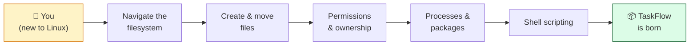
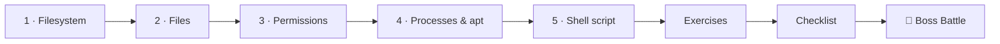

# 🐧 World 2 — Linux

> *"Servers run Linux. Time to learn to live in the terminal — and while you're at it, build the home for our new project. Welcome to TaskFlow, day zero. — Dana"*



---

## 📨 Your ticket

```
From:    Dana (Manager) <dana@cloudforge.inc>
To:      You <new-hire@cloudforge.inc>
Subject: [TICKET-014] Get fluent in Linux — and start TaskFlow

Welcome back! Your environment's solid, so here's your real first
assignment. Two things:

  1. Every server we own runs Linux. You need to live in the terminal:
     move around the filesystem, manage files, set permissions, watch
     processes, install software, and write a shell script.

  2. We're kicking off a new product: TaskFlow, a task manager. YOU are
     creating its home folder this week. By the end you'll have a real
     project directory with a README, source folder, and an automated
     backup script. This is the seed the whole rest of the bootcamp grows.

Do it all inside WSL2 Ubuntu — no cloud bills, all free. There's a
locked-down server waiting as your final test. Have fun. 🐧

— Dana
```

This is the world where **TaskFlow is born**. Everything you build from World 3 onward lives in the folder you create here.

---

## 🎯 What you'll achieve in this world

- ✅ Navigate the Linux filesystem with confidence (`cd`, `ls`, `pwd`, `tree`)
- ✅ Create, move, copy, read, and delete files and folders
- ✅ Understand **permissions** (`rwx`, octal) and **ownership** (`chown`)
- ✅ Inspect and control **processes** (`ps`, `top`, `kill`) and install software with **`apt`**
- ✅ Write and run a real **shell script** — an automated TaskFlow backup
- ✅ Scaffold the `~/projects/taskflow` directory the entire bootcamp builds on

---

## 🗺️ Level map

| Level | Lesson | Difficulty | Time | XP |
|------:|--------|:----------:|:----:|---:|
| 1 | [The Linux Filesystem & Navigation](lessons/01-filesystem-and-navigation.md) | 🟢 Easy | 20 min | 125 |
| 2 | [Creating, Moving & Reading Files](lessons/02-working-with-files.md) | 🟢 Easy | 20 min | 125 |
| 3 | [Permissions & Ownership](lessons/03-permissions-and-ownership.md) | 🟡 Medium | 25 min | 125 |
| 4 | [Processes & Package Management](lessons/04-processes-and-packages.md) | 🟢 Easy | 20 min | 125 |
| 5 | [Shell Scripting: A Backup Script](lessons/05-shell-scripting-a-backup.md) | 🟡 Medium | 25 min | 125 |
| 👹 | [Boss Battle — The Locked Server](boss-battle.md) | 🟡 Medium | 30 min | 500 |

➕ Extra reps: [exercises.md](exercises.md) · ✅ Ready to advance? [checklist.md](checklist.md)

---

## 🧭 Recommended order



Go in order. Each Project Mission builds the TaskFlow folder a little more — by Level 5 you'll have a complete project scaffold with an automated backup.

---

## 📦 Project status after this world

**TaskFlow is born.** You'll finish with:

```
~/projects/taskflow/
├── README.md
├── .gitignore        # (drafted; Git arrives in World 3)
├── src/
└── scripts/
    └── backup.sh     # automated, dated backups
```

It's just folders, a README, and a script for now — but this is the exact directory World 3 (Git) initializes, World 4 (Backend) fills with Express code, and World 5 (Docker) containerizes. Treat it well.

---

## 📚 Resources for this world

See the curated, **free** links for World 2 in [RESOURCES.md](../../RESOURCES.md#-world-2--linux) — the Ubuntu command-line tutorial, an interactive practice site, and the `man` pages. Do one practice module after each lesson to make the commands stick.

---

[↑ Back to README](../../README.md)  ·  [🗺️ Roadmap](../../ROADMAP.md)  ·  [▶️ Start Level 1 →](lessons/01-filesystem-and-navigation.md)
