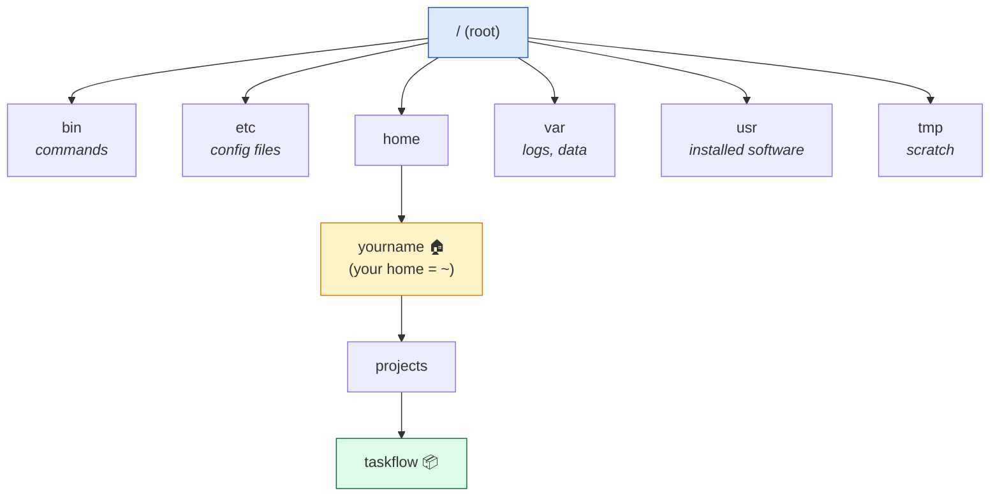

# Level 1 — The Linux Filesystem & Navigation

| | |
|---|---|
| 🎚️ **Difficulty** | 🟢 Easy |
| ⏱️ **Estimated time** | 20 minutes |
| ⭐ **XP reward** | 100 (Quest) + 25 (Quiz) |

[← World Home](../README.md) · [↑ Phase Home](../README.md) · [→ Next: Working with Files](02-working-with-files.md)

---

## 📖 Story

It's your first real day on the TaskFlow project. Dana leans over:

> *"Before you touch a single line of code, you need to know your way around. A Linux box has no Desktop, no double-clicking — just a tree of folders. If you can't say where you are and how to get somewhere else, you're lost on every server we own. Show me you can move around."*

Let's learn to walk before we run.

---

## 🎯 Goal

By the end of this lesson you will:
- Understand the Linux filesystem as **one big tree** starting at `/`
- Tell the difference between an **absolute** path and a **relative** path
- Move around with `cd`, see where you are with `pwd`, and look around with `ls`
- Visualize a folder tree with `tree`
- Create the **`~/projects/taskflow`** folder — TaskFlow's birthplace

---

## 🧠 Concepts

Windows has drives (`C:\`, `D:\`). Linux has **one tree**. It starts at the **root**, written `/`, and every file and folder hangs off it.



A few landmarks you'll meet constantly:
- **`/`** — the root of everything.
- **`/home/yourname`** — your personal folder, also written **`~`** (tilde). This is where *your* stuff lives.
- **`/etc`** — system configuration files.
- **`/var`** — variable data like logs (`/var/log`).
- **`/usr`** — installed programs and their files.

**Absolute vs relative paths** — the single most important idea here:
- An **absolute path** starts with `/` and works from *anywhere*: `/home/yourname/projects`.
- A **relative path** is *from where you currently are*: if you're in `~`, then `projects` and `./projects` mean the same folder.
- **`.`** = the current folder. **`..`** = the parent folder. **`~`** = your home.

### Why this exists

When you SSH into a production server in World 6, there is **no file explorer** — just you and a prompt. Paths are how you tell the computer exactly which file you mean. Get one wrong and you might edit the wrong config, or worse, delete the wrong thing. Reading and writing paths fluently is the bedrock skill of every command that follows.

---

## 🛠️ Hands-on Lab

> 🐧 Do everything in this lesson inside **Ubuntu (WSL2)** — not PowerShell.

### Step 1 — Where am I?

```bash
# Print Working Directory — your current location
pwd
```

Fresh terminals usually start in your home folder: `/home/yourname`.

### Step 2 — Look around

```bash
# List the contents of the current folder
ls

# Long format: permissions, owner, size, date
ls -l

# Include hidden files (names starting with a dot)
ls -la
```

> 💡 Files like `.bashrc` are **hidden** — their names start with `.`. They hold config. `ls -la` reveals them.

### Step 3 — Move around

```bash
# Go to the root of the whole filesystem
cd /

# Look at the top-level folders
ls

# Jump straight to your home folder (three ways, all equivalent)
cd ~
cd /home/$USER
cd            # cd with no argument also goes home

# Go up one level (to the parent folder)
cd ..

# Go back to where you just were
cd -
```

After each `cd`, run `pwd` to confirm where you landed. Build the habit: *move, then check.*

### Step 4 — Absolute vs relative, side by side

```bash
cd ~

# Relative: "etc" would look for etc INSIDE home — there is none, so this fails
ls etc        # → error: No such file or directory

# Absolute: works from anywhere because it starts at /
ls /etc       # → lists system config files
```

That error is the lesson: a path *without* a leading `/` is interpreted **from your current folder**.

### Step 5 — See the tree

`tree` draws the folder structure visually. It may not be installed yet:

```bash
# Install it (we cover apt properly in Level 4 — for now, just run this)
sudo apt update && sudo apt install -y tree

# Draw your home folder, only 2 levels deep
tree -L 2 ~
```

If you prefer not to install anything yet, `ls -R` recursively lists folders too.

---

## 🎮 Mini Challenge

You're sitting in `/home/yourname/projects`. Using a **single relative path** (no leading `/`), how do you `cd` into `/etc`? Predict, then test it.

<details>
<summary>💡 Reveal answer</summary>

```bash
cd ../../../etc
```

From `projects`, `..` → `yourname`, `..` → `home`, `..` → `/`, then down into `etc`. Three `..` to climb out of three nested folders, then the name. (Of course `cd /etc` is simpler — but the point is understanding how `..` walks *up* the tree.)
</details>

---

## 📦 Project Mission

Time to create **TaskFlow's home**. This is the most important folder in the entire bootcamp.

```bash
# Start from your home folder
cd ~

# Create the projects folder if it doesn't exist, and taskflow inside it.
# -p creates parent folders as needed and never errors if they already exist.
mkdir -p ~/projects/taskflow

# Move into it
cd ~/projects/taskflow

# Confirm you're standing in the right place — should print:
# /home/yourname/projects/taskflow
pwd

# Confirm it's empty (for now)
ls -la
```

🎯 **Mission complete when:** `pwd` prints a path ending in `/projects/taskflow`. TaskFlow now has a home — empty, but real. Next lesson we fill it.

---

## ⚠️ Common Mistakes

| Mistake | What happens | Fix |
|--------|--------------|-----|
| Forgetting the leading `/` on a system path | `ls etc` errors — it looks inside the current folder | Use `/etc` (absolute) when you mean the system folder |
| Confusing `.` and `..` | You move the wrong direction | `.` = here, `..` = up one level |
| `cd` into a *file* instead of a folder | `Not a directory` error | `cd` only works on folders; check with `ls -l` |
| Capitalizing names wrong | `cd Projects` fails when it's `projects` | Linux is **case-sensitive** — match exactly |
| Spaces in names without quotes | Path breaks into two arguments | Quote it (`cd "My Folder"`) or avoid spaces |

---

## 🤔 Reflection Questions

1. What's the difference between `cd projects` and `cd /projects`? Why does only one work from your home folder?
2. In your own words, what do `~`, `.`, and `..` each mean?
3. Why is there **no `C:\` drive** in Linux? What replaces the idea of drives?

---

## 📝 Quiz

1. **The Linux filesystem starts at…**
   - a) `C:\`
   - b) `/` (root)
   - c) `~`
2. **An *absolute* path always…**
   - a) starts with `/`
   - b) starts with `.`
   - c) is shorter than a relative one
3. **`cd ..` does what?**
   - a) Goes to your home folder
   - b) Goes up to the parent folder
   - c) Lists files

<details>
<summary>✅ Answers</summary>

1: **b** · 2: **a** · 3: **b**
</details>

---

## ✅ Completion Checklist

- [ ] I can explain the filesystem tree and what `/`, `~`, `/etc` are
- [ ] I used `pwd`, `ls -la`, and `cd` (including `..`, `~`, `-`)
- [ ] I can tell an absolute path from a relative one
- [ ] I created `~/projects/taskflow` and `pwd` confirms I'm in it (Project Mission)
- [ ] I passed the quiz
- [ ] I added **+125 XP** to [PROGRESS.md](../../../PROGRESS.md)

---

[← World Home](../README.md) · [↑ Phase Home](../README.md) · [→ Next: Creating, Moving & Reading Files](02-working-with-files.md)
