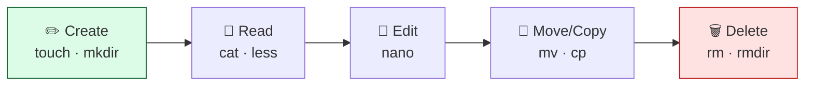

# Level 2 — Creating, Moving & Reading Files

| | |
|---|---|
| 🎚️ **Difficulty** | 🟢 Easy |
| ⏱️ **Estimated time** | 20 minutes |
| ⭐ **XP reward** | 100 (Quest) + 25 (Quiz) |

[← Prev: Filesystem & Navigation](01-filesystem-and-navigation.md) · [↑ Phase Home](../README.md) · [→ Next: Permissions & Ownership](03-permissions-and-ownership.md)

---

## 📖 Story

The TaskFlow folder exists but it's empty. Dana pings you on Slack:

> *"Nice, the folder's there. Now make it look like a real project. Every repo needs a README so people know what it is, a `src/` folder for the code, and we'll want a `.gitignore` ready for when Git shows up. Build the skeleton — all from the keyboard."*

Today you become fluent at creating, moving, copying, reading, and deleting — the verbs you'll use thousands of times.

---

## 🎯 Goal

By the end of this lesson you will:
- Create files with `touch` and folders with `mkdir`
- Copy (`cp`), move/rename (`mv`), and delete (`rm`) files and folders
- Read files with `cat`, page through them with `less`, and edit with `nano`
- Scaffold the real TaskFlow file structure (README, `src/`, a future `.gitignore`)

---

## 🧠 Concepts

In Linux, **everything is a file** — your notes, your config, even devices. So a small set of verbs covers almost all your daily work:



Key distinctions:
- **`touch`** makes an empty file (or updates a file's timestamp). **`mkdir`** makes a folder.
- **`cp`** *copies* (original stays). **`mv`** *moves* — and because moving to the same folder with a new name = renaming, `mv` is also how you **rename**.
- **`cat`** dumps a whole file to the screen (great for short files). **`less`** opens a scrollable pager for long ones (`q` to quit).
- **`nano`** is a beginner-friendly text editor right in the terminal.

### Why this exists

There's no "right-click → New → Folder" on a server. When you deploy TaskFlow, you'll create config files, read log files, and edit settings entirely from the terminal — often over SSH on a machine thousands of miles away. These six verbs are the muscle memory that makes that feel natural instead of scary.

---

## 🛠️ Hands-on Lab

> 🐧 All inside **Ubuntu**. Let's warm up in a throwaway sandbox first, then do the real work in the Project Mission.

### Step 1 — Create files and folders

```bash
# Make a scratch playground and move into it
mkdir -p ~/sandbox && cd ~/sandbox

# Create empty files
touch notes.txt ideas.txt

# Create a nested folder structure in one shot
mkdir -p stuff/deep/folder

# See what you made
ls -la
tree .        # (installed in Level 1; or use: ls -R)
```

### Step 2 — Put some text in a file (without an editor)

```bash
# Overwrite a file with one line ( > replaces all contents )
echo "TaskFlow ideas" > ideas.txt

# Append a line ( >> adds to the end, keeps existing content )
echo "- add a due date field" >> ideas.txt
echo "- add task priorities" >> ideas.txt
```

### Step 3 — Read files

```bash
# Dump the whole file
cat ideas.txt

# For long files, page through (↑/↓ to scroll, q to quit)
less ideas.txt
```

### Step 4 — Copy, move, rename

```bash
# Copy a file (original remains)
cp ideas.txt ideas-backup.txt

# Rename: move to a new name in the same folder
mv notes.txt todo.txt

# Move a file INTO a folder
mv ideas-backup.txt stuff/

# Copy a whole folder needs -r (recursive)
cp -r stuff stuff-copy
```

### Step 5 — Edit with nano

```bash
nano todo.txt
```
Type a few lines. Then:
- **`Ctrl+O`** then `Enter` → save ("write Out")
- **`Ctrl+X`** → exit

### Step 6 — Delete (carefully!)

```bash
# Delete a file
rm ideas.txt

# Delete an empty folder
rmdir stuff/deep/folder    # only works if empty

# Delete a folder AND everything in it (recursive). Powerful — be sure!
rm -r stuff-copy
```

> ⚠️ There is **no Recycle Bin**. `rm` is permanent. Read the path twice before pressing Enter.

When you're done playing, clean up: `cd ~ && rm -r ~/sandbox`.

---

## 🎮 Mini Challenge

In one command, create a folder `logs` and an empty file `logs/app.log` inside it — even though `logs` doesn't exist yet. (Hint: you'll need two commands joined, or think about order.)

<details>
<summary>💡 Reveal answer</summary>

```bash
mkdir -p logs && touch logs/app.log
```

`touch` can't create the file if its parent folder is missing, so you make the folder first. `&&` runs the second command **only if** the first succeeds. You can verify with `ls -la logs`.
</details>

---

## 📦 Project Mission

Scaffold the real TaskFlow project skeleton.

```bash
# Go to the project home you created last lesson
cd ~/projects/taskflow

# Create the source folder where code will live (World 4)
mkdir -p src

# Create a README that explains the project
cat > README.md << 'EOF'
# TaskFlow

A simple task manager built throughout the Cloud Engineer Bootcamp.

## Status
- World 2: project scaffolded on Linux.

## Structure
- `src/`     application source (coming in World 4)
- `scripts/` automation scripts (e.g. backups)
EOF

# Draft a .gitignore now — Git arrives in World 3 and will use it.
# These are the files we never want to commit.
cat > .gitignore << 'EOF'
node_modules/
*.log
.env
EOF

# A placeholder so src/ isn't empty
touch src/index.js

# Look at what you built
ls -la
tree .        # or: ls -R
cat README.md
```

You should now have:

```
~/projects/taskflow/
├── README.md
├── .gitignore
└── src/
    └── index.js
```

🎯 **Mission complete when:** `ls -la` shows `README.md`, `.gitignore`, and a `src/` folder, and `cat README.md` prints your project description. TaskFlow now *looks* like a real project.

> 💡 `cat > file << 'EOF' ... EOF` is a **heredoc** — it writes everything between the markers into the file. Handy for multi-line content without opening an editor.

---

## ⚠️ Common Mistakes

| Mistake | What happens | Fix |
|--------|--------------|-----|
| Using `>` when you meant `>>` | Overwrites the whole file, losing content | `>` replaces, `>>` appends — pick deliberately |
| `rm` on the wrong path | Permanent data loss (no Recycle Bin) | Re-read the path; consider `rm -i` to confirm each delete |
| `cp`/`rm` a folder without `-r` | "omitting directory" / it refuses | Add `-r` (recursive) for folders |
| `rmdir` on a non-empty folder | "Directory not empty" | Use `rm -r` to remove contents too |
| Forgetting to save in nano | Edits lost on exit | `Ctrl+O`, `Enter` to save, then `Ctrl+X` |

---

## 🤔 Reflection Questions

1. What's the difference between `>` and `>>`? When would using the wrong one be costly?
2. `mv` does two jobs — what are they, and why is "rename" just a special case of "move"?
3. Why is `rm -r` something to be extra careful with on a server?

---

## 📝 Quiz

1. **`touch report.txt` does what if `report.txt` doesn't exist?**
   - a) Deletes it
   - b) Creates an empty file
   - c) Opens an editor
2. **To rename `a.txt` to `b.txt` you use…**
   - a) `cp a.txt b.txt`
   - b) `mv a.txt b.txt`
   - c) `rename a.txt`
3. **`echo "hi" >> log.txt` will…**
   - a) Replace the whole file with "hi"
   - b) Append "hi" to the end of the file
   - c) Delete the file

<details>
<summary>✅ Answers</summary>

1: **b** · 2: **b** · 3: **b**
</details>

---

## ✅ Completion Checklist

- [ ] I created files (`touch`) and folders (`mkdir -p`)
- [ ] I copied (`cp -r`), moved/renamed (`mv`), and deleted (`rm -r`) safely
- [ ] I read a file with `cat` and edited one with `nano`
- [ ] I scaffolded `~/projects/taskflow` with `README.md`, `.gitignore`, and `src/` (Project Mission)
- [ ] I passed the quiz
- [ ] I added **+125 XP** to [PROGRESS.md](../../../PROGRESS.md)

---

[← Prev: Filesystem & Navigation](01-filesystem-and-navigation.md) · [↑ Phase Home](../README.md) · [→ Next: Permissions & Ownership](03-permissions-and-ownership.md)
