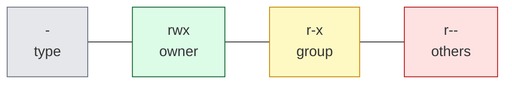
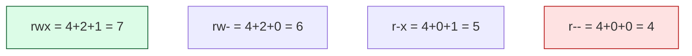

# Level 3 — Permissions & Ownership

| | |
|---|---|
| 🎚️ **Difficulty** | 🟡 Medium |
| ⏱️ **Estimated time** | 25 minutes |
| ⭐ **XP reward** | 100 (Quest) + 25 (Quiz) |

[← Prev: Working with Files](02-working-with-files.md) · [↑ Phase Home](../README.md) · [→ Next: Processes & Packages](04-processes-and-packages.md)

---

## 📖 Story

Marcus, a senior engineer, drops a message in the TaskFlow channel:

> *"Heads up — on the staging server, someone left a config file world-readable that had a secret in it. And a deploy script wouldn't run because it wasn't marked executable. Both are permissions problems. Before you ever touch a server, you need to **read** and **set** permissions in your sleep. Let me see you do it."*

This is the lesson that separates "I can use Linux" from "I won't get the team hacked."

---

## 🎯 Goal

By the end of this lesson you will:
- Read the `rwx` permission string from `ls -l`
- Understand the three identities: **owner**, **group**, **others**
- Set permissions with `chmod` (both symbolic and **octal**)
- Change ownership with `chown`
- Explain **why** permissions matter on real servers

---

## 🧠 Concepts

Every file has **permissions** for three sets of people, across three actions:

- **Identities:** the **owner** (user), the **group**, and **others** (everyone else).
- **Actions:** **r**ead (4), **w**rite (2), e**x**ecute (1).

`ls -l` shows it as a 10-character string like `-rwxr-xr--`:



- 1st char: type (`-` file, `d` directory, `l` link).
- Next 3: **owner** can read/write/execute.
- Next 3: **group** permissions.
- Last 3: **others** permissions.

**Octal shorthand** — add up r=4, w=2, x=1 per identity:



So `chmod 755 file` means **owner=7 (rwx), group=5 (r-x), others=5 (r-x)** → the classic "executable everyone can run, only I can change." `chmod 644` = owner read/write, everyone else read-only (the default for normal files). `chmod 600` = only the owner can read or write — perfect for secrets.

### Why this exists

Servers are multi-user and exposed to the world. Permissions are the **first line of defense**:
- A secret file (`.env`, an SSH key) readable by *others* is a leak waiting to happen → use `600`.
- A script needs the **execute** bit or the OS refuses to run it (`Permission denied`).
- A file owned by the wrong user means your app can't write to it (or *anyone* can).

You'll fix exactly these problems in this world's Boss Battle.

---

## 🛠️ Hands-on Lab

> 🐧 Inside **Ubuntu**. Build a sandbox so mistakes are harmless.

### Step 1 — Read what's already there

```bash
mkdir -p ~/perms-lab && cd ~/perms-lab
touch secret.txt
echo "echo hello" > run.sh

# Look at the permission strings and the owner/group columns
ls -l
```

You'll see something like `-rw-r--r-- 1 yourname yourname ... run.sh`. Read it: owner `rw-`, group `r--`, others `r--`. No `x` anywhere — so it can't run yet.

### Step 2 — Make a script executable (symbolic mode)

```bash
# Try to run it — it fails because there's no execute bit
./run.sh                 # → Permission denied

# Add execute for everyone (u=user, g=group, o=others, a=all)
chmod +x run.sh

# Now it runs
./run.sh                 # → hello

# Look again — note the new x's
ls -l run.sh
```

`chmod +x` is symbolic. You can be precise too: `chmod u+x run.sh` (only owner), `chmod go-w file` (remove write from group & others).

### Step 3 — Lock down a secret (octal mode)

```bash
echo "DB_PASSWORD=hunter2" > secret.txt

# Right now others can read it — bad!
ls -l secret.txt          # -rw-r--r--  (others can read)

# 600 = owner rw, group nothing, others nothing
chmod 600 secret.txt
ls -l secret.txt          # -rw-------  (only you)
```

### Step 4 — Read ownership and change it

```bash
# The 3rd and 4th columns of ls -l are owner and group
ls -l

# Who am I?
whoami

# Change owner (needs sudo because you can't give away files freely).
# Change run.sh to be owned by you (replace with your username if needed):
sudo chown $USER run.sh

# Change owner AND group at once: owner:group
sudo chown $USER:$USER run.sh

# Confirm
ls -l run.sh
```

> 🧹 Clean up when done: `cd ~ && rm -r ~/perms-lab`.

---

## 🎮 Mini Challenge

A file currently shows `-rwxrwxrwx`. That's `777` — everyone can do everything (dangerous). What single `chmod` makes it **owner: read+write+execute, group: read+execute, others: nothing**? Give the octal.

<details>
<summary>💡 Reveal answer</summary>

```bash
chmod 750 file
```

Owner `rwx` = 7, group `r-x` = 5, others `---` = 0 → **750**. This is a common pattern for a private script the owner runs and a trusted group can read/execute, while the public can't touch it.
</details>

---

## 📦 Project Mission

Apply real permission hygiene to TaskFlow.

```bash
cd ~/projects/taskflow

# Create a scripts folder (we'll fill it in Level 5)
mkdir -p scripts

# Pretend we have an environment secrets file. Lock it to owner-only.
echo "API_KEY=changeme" > .env
chmod 600 .env

# Source files and README should be the normal 644 (owner rw, others read)
chmod 644 README.md src/index.js

# Verify the whole project's permissions at a glance
ls -la
```

Check your work — you should see:
- `.env` → `-rw-------` (only you can read the secret)
- `README.md`, `src/index.js` → `-rw-r--r--`

🎯 **Mission complete when:** `ls -la` shows `.env` as `-rw-------` and you can explain *why* a secrets file should never be readable by `others`.

---

## ⚠️ Common Mistakes

| Mistake | What happens | Fix |
|--------|--------------|-----|
| `chmod 777` "to make it work" | Everyone can read/write/run it — a security hole | Use the **least** permission needed (`644`, `600`, `750`) |
| Script gives `Permission denied` | Missing execute bit | `chmod +x script.sh` |
| Editing `chown` without `sudo` | "Operation not permitted" | Changing ownership usually needs `sudo` |
| Confusing octal digits | Wrong access granted | Remember r=4, w=2, x=1; add per identity |
| Forgetting directories need `x` to enter | `cd` into it fails | Folders use `x` as "may enter"; `755` is typical |

---

## 🤔 Reflection Questions

1. Read `-rwxr-x---` out loud: what can the owner, group, and others each do? What's the octal?
2. Why is `chmod 777` almost always the wrong fix?
3. Why must a shell script have the **execute** bit, and why is `600` right for a secrets file?

---

## 📝 Quiz

1. **In `-rw-r--r--`, what can *others* do?**
   - a) Read and write
   - b) Read only
   - c) Nothing
2. **Octal `755` means…**
   - a) owner rwx, group r-x, others r-x
   - b) owner rwx, group rwx, others rwx
   - c) owner rw-, others nothing
3. **A script returns `Permission denied`. The most likely fix is…**
   - a) `chmod +x script.sh`
   - b) `rm script.sh`
   - c) run it twice

<details>
<summary>✅ Answers</summary>

1: **b** · 2: **a** · 3: **a**
</details>

---

## ✅ Completion Checklist

- [ ] I can read an `rwx` string and name owner/group/others
- [ ] I used `chmod +x` and octal (`600`, `644`, `755`)
- [ ] I changed ownership with `chown` (and know why it needs `sudo`)
- [ ] I locked TaskFlow's `.env` to `600` and set `644` on source files (Project Mission)
- [ ] I passed the quiz
- [ ] I added **+125 XP** to [PROGRESS.md](../../../PROGRESS.md)

---

[← Prev: Working with Files](02-working-with-files.md) · [↑ Phase Home](../README.md) · [→ Next: Processes & Package Management](04-processes-and-packages.md)
