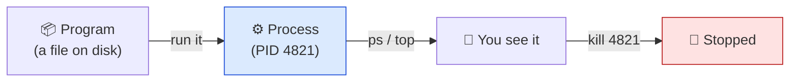

# Level 4 — Processes & Package Management

| | |
|---|---|
| 🎚️ **Difficulty** | 🟢 Easy |
| ⏱️ **Estimated time** | 20 minutes |
| ⭐ **XP reward** | 100 (Quest) + 25 (Quiz) |

[← Prev: Permissions & Ownership](03-permissions-and-ownership.md) · [↑ Phase Home](../README.md) · [→ Next: Shell Scripting](05-shell-scripting-a-backup.md)

---

## 📖 Story

Priya, the DevOps lead, catches you between meetings:

> *"Two things every engineer does daily. One: **see what's running** and kill it when something runs away with the CPU — happens more than you'd think. Two: **install software**. On Ubuntu that's `apt`, not downloading installers off websites. Let me see you find a process, stop it, and install a tool the clean way."*

These are the skills that keep a server alive and well-equipped.

---

## 🎯 Goal

By the end of this lesson you will:
- List running **processes** with `ps` and watch them live with `top`
- Stop a process with `kill` (and understand its PID)
- Run a command in the **background** with `&`
- Install, update, and remove software with **`apt`**
- Install a real tool (`htop`) and use it

---

## 🧠 Concepts

A **process** is a running program. Each one has a **PID** (Process ID) — a number the OS uses to track and control it.



- **`ps`** takes a one-time snapshot of processes. **`ps aux`** shows *all* of them with CPU/memory.
- **`top`** (and the nicer **`htop`**) is a live, refreshing view — like Task Manager for the terminal. `q` quits.
- **`kill <PID>`** asks a process to stop politely. **`kill -9 <PID>`** force-kills one that won't listen.
- **`&`** at the end of a command runs it in the **background**, freeing your prompt.

**Package management** is how Linux installs software *safely*:
- **`sudo apt update`** — refresh the list of available packages (doesn't install anything).
- **`sudo apt upgrade`** — upgrade everything that's installed.
- **`sudo apt install <pkg>`** — install a package and its dependencies.
- **`sudo apt remove <pkg>`** — uninstall it.

### Why this exists

On a real server, a buggy deploy can spawn a process that pins the CPU at 100% and takes the site down. Finding it (`top`), getting its PID (`ps`), and killing it is a core incident-response reflex — you'll use it in this world's Boss Battle. And `apt` matters because installing software from a trusted, signed repository (instead of random downloads) is how you keep a server secure and reproducible.

---

## 🛠️ Hands-on Lab

> 🐧 Inside **Ubuntu**.

### Step 1 — See what's running

```bash
# A one-time snapshot of YOUR processes
ps

# ALL processes, with user / CPU% / memory% / command
ps aux | head -20

# Find a specific process by name (e.g. bash, your shell)
ps aux | grep bash
```

> 💡 The `|` (pipe) sends the output of one command into another. `grep` filters lines. You'll lean on this combo constantly.

### Step 2 — Watch processes live

```bash
# Built-in live view (press q to quit)
top
```

Look at the `%CPU` column — that's how you spot a runaway. Quit with `q`.

### Step 3 — Install software with apt

```bash
# Always refresh the package list first
sudo apt update

# Install htop — a friendlier, colorful top. (Also install tree if you skipped Level 1.)
sudo apt install -y htop tree

# Run it (q to quit). Use arrows; F9 to kill a selected process.
htop
```

You just installed software the professional way — signed, versioned, and removable.

### Step 4 — Background a process, then kill it

```bash
# Start a long-running command in the BACKGROUND with &
sleep 300 &

# Bash prints its PID, e.g. [1] 4821. List your background jobs:
jobs

# Find that sleep's PID directly
ps aux | grep "[s]leep 300"

# Kill it by PID (replace 4821 with the real number)
kill 4821

# If something refuses to die, force it:
# kill -9 4821

# Confirm it's gone
jobs
```

### Step 5 — Clean up a package (optional)

```bash
# If you don't want htop after trying it:
# sudo apt remove -y htop
```

---

## 🎮 Mini Challenge

You ran `sleep 500 &` and lost track of the PID. Without scrolling through all of `ps aux`, what one-liner finds **just** that process's PID?

<details>
<summary>💡 Reveal answer</summary>

```bash
pgrep -f "sleep 500"
```

`pgrep` searches for processes by name/pattern and prints their PIDs — cleaner than `ps aux | grep`. You could then `kill $(pgrep -f "sleep 500")` to find-and-kill in one shot.
</details>

---

## 📦 Project Mission

Equip your TaskFlow workshop and record your toolkit.

```bash
cd ~/projects/taskflow

# Make sure the tools we'll use for backups and inspection are installed
sudo apt update
sudo apt install -y tree htop

# Record the versions in a tooling note (proof + future reference)
{
  echo "# TaskFlow dev tools"
  echo "tree:  $(tree --version | head -1)"
  echo "htop:  $(htop --version | head -1)"
  echo "bash:  $(bash --version | head -1)"
} > TOOLS.md

cat TOOLS.md
```

🎯 **Mission complete when:** `htop` runs (then `q` to quit), and `cat TOOLS.md` shows version lines for `tree`, `htop`, and `bash`. Your workshop is stocked.

---

## ⚠️ Common Mistakes

| Mistake | What happens | Fix |
|--------|--------------|-----|
| `apt install` without `sudo` | "Permission denied" / "are you root?" | Prefix with `sudo` |
| Skipping `apt update` before install | Installs an old version or "package not found" | Run `sudo apt update` first |
| `kill -9` on everything | Force-kill skips cleanup, can corrupt data | Try plain `kill` first; `-9` only as a last resort |
| Killing the wrong PID | Stops an unrelated program | Confirm with `ps aux \| grep` or `pgrep` before killing |
| Forgetting `&` and getting stuck | A long command locks your prompt | `Ctrl+C` to stop, or re-run with `&` to background it |

---

## 🤔 Reflection Questions

1. What's the difference between `ps` and `top`? When would you reach for each?
2. Why is installing via `apt` safer than downloading an installer from a website?
3. When is `kill -9` appropriate, and why shouldn't it be your first choice?

---

## 📝 Quiz

1. **A PID is…**
   - a) a password
   - b) a Process ID — a number identifying a running program
   - c) a permission
2. **To install software on Ubuntu you typically run…**
   - a) `sudo apt install <pkg>`
   - b) download an `.exe`
   - c) `chmod +x`
3. **Adding `&` to the end of a command…**
   - a) deletes it
   - b) runs it in the background, freeing your prompt
   - c) runs it as admin

<details>
<summary>✅ Answers</summary>

1: **b** · 2: **a** · 3: **b**
</details>

---

## ✅ Completion Checklist

- [ ] I listed processes with `ps aux` and watched them with `top`/`htop`
- [ ] I backgrounded a command with `&` and killed it by PID
- [ ] I installed a tool with `sudo apt update && sudo apt install`
- [ ] I created `TOOLS.md` in TaskFlow with version info (Project Mission)
- [ ] I passed the quiz
- [ ] I added **+125 XP** to [PROGRESS.md](../../../PROGRESS.md)

---

[← Prev: Permissions & Ownership](03-permissions-and-ownership.md) · [↑ Phase Home](../README.md) · [→ Next: Shell Scripting: A Backup Script](05-shell-scripting-a-backup.md)
