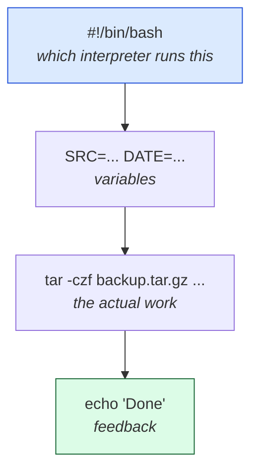

# Level 5 — Shell Scripting: A Backup Script

| | |
|---|---|
| 🎚️ **Difficulty** | 🟡 Medium |
| ⏱️ **Estimated time** | 25 minutes |
| ⭐ **XP reward** | 100 (Quest) + 25 (Quiz) |

[← Prev: Processes & Packages](04-processes-and-packages.md) · [↑ Phase Home](../README.md) · [→ Boss Battle](../boss-battle.md)

---

## 📖 Story

Dana again, and this time it's important:

> *"TaskFlow's going to grow, and the worst thing that can happen to a young project is losing it. I want backups — but I'm not going to type a long `tar` command by hand every day, and neither should you. Write a **shell script** that backs up the whole project with one command, stamped with today's date. Automating yourself out of repetitive work is literally the job."*

This is where all four previous lessons fuse: files, permissions, processes, and now **scripting**.

---

## 🎯 Goal

By the end of this lesson you will:
- Understand what a **shell script** is and the **shebang** (`#!/bin/bash`)
- Use **variables**, command substitution, and `tar`
- Make a script executable (`chmod +x`) and run it
- Build `backup.sh` that archives TaskFlow into a **dated** `.tar.gz` file

---

## 🧠 Concepts

A **shell script** is just a text file of commands the shell runs top to bottom — the same commands you've been typing, saved so you can run them all with one word.



The building blocks:
- **Shebang** — the first line `#!/bin/bash` tells the OS *which program* should run the file. Without it, the OS doesn't know it's a Bash script.
- **Variables** — `NAME="value"` stores text; you read it back with `$NAME`. No spaces around the `=`.
- **Command substitution** — `$(command)` runs a command and drops its output in. `$(date +%Y-%m-%d)` → `2026-06-26`.
- **`tar`** — bundles many files into one archive. `-c` create, `-z` gzip-compress, `-f` filename, `-v` verbose. So `tar -czf out.tar.gz folder/` compresses a folder.

### Why this exists

Engineers automate. A task you do twice, you script. Backups, deploys, log rotation, environment setup — all start as a human typing the same commands, then become a script, then get scheduled (you'll do that in the Side Quest with `cron`). Scripting is the gateway from "using Linux" to "*operating* systems," and it's the foundation for the CI/CD pipelines you'll build in later worlds.

---

## 🛠️ Hands-on Lab

> 🐧 Inside **Ubuntu**. We'll build the script piece by piece, then assemble it in the Project Mission.

### Step 1 — Your first script

```bash
mkdir -p ~/script-lab && cd ~/script-lab
nano hello.sh
```

Type this in:

```bash
#!/bin/bash
NAME="$(whoami)"
echo "Hello, $NAME — the date is $(date +%Y-%m-%d)"
```

Save (`Ctrl+O`, `Enter`) and exit (`Ctrl+X`).

### Step 2 — Make it executable and run it

```bash
# Try to run it without the execute bit — it fails (you saw this in Level 3!)
./hello.sh                # → Permission denied

# Add the execute bit
chmod +x hello.sh

# Run it
./hello.sh                # → Hello, yourname — the date is 2026-06-26
```

> 💡 `./` means "the file in *this* folder." Without it, the shell searches its `PATH` and won't find your local script.

### Step 3 — Understand the pieces

```bash
# Variables: no spaces around =
GREETING="hi"
echo "$GREETING there"           # → hi there

# Command substitution produces a dated string
echo "backup-$(date +%Y-%m-%d).tar.gz"   # → backup-2026-06-26.tar.gz

# tar a folder into a compressed archive, then peek inside it
tar -czf demo.tar.gz hello.sh
tar -tzf demo.tar.gz             # -t lists contents without extracting
```

> 🧹 Clean up later with `cd ~ && rm -r ~/script-lab`.

---

## 🎮 Mini Challenge

You want a filename that includes the date **and time** so two backups on the same day don't overwrite each other. What `date` format string gives something like `2026-06-26_14-30-05`?

<details>
<summary>💡 Reveal answer</summary>

```bash
date +%Y-%m-%d_%H-%M-%S
```

`%H` hours, `%M` minutes, `%S` seconds. So `backup-$(date +%Y-%m-%d_%H-%M-%S).tar.gz` is guaranteed unique each run — important for a backup script you might run several times a day.
</details>

---

## 📦 Project Mission

Write the real TaskFlow backup script.

```bash
cd ~/projects/taskflow/scripts
nano backup.sh
```

Type in the full script:

```bash
#!/bin/bash
# backup.sh — archive the TaskFlow project into a dated .tar.gz

# What we're backing up and where backups go
SRC="$HOME/projects/taskflow"
DEST="$HOME/backups"
DATE="$(date +%Y-%m-%d_%H-%M-%S)"
ARCHIVE="$DEST/taskflow-$DATE.tar.gz"

# Make sure the backup destination exists
mkdir -p "$DEST"

# Create the compressed archive of the whole project
tar -czf "$ARCHIVE" -C "$HOME/projects" taskflow

echo "✅ Backup created: $ARCHIVE"
```

> 💡 `-C "$HOME/projects" taskflow` tells `tar` to step into `~/projects` first, so the archive contains a clean `taskflow/...` path instead of the full absolute path.

Save and exit, then:

```bash
# Make it executable
chmod +x backup.sh

# Run it
./backup.sh

# Verify a dated archive appeared
ls -lh ~/backups

# Peek inside to confirm your files are in there
tar -tzf ~/backups/taskflow-*.tar.gz | head
```

🎯 **Mission complete when:** running `./backup.sh` prints `✅ Backup created: ...` and `ls -lh ~/backups` shows a `taskflow-<date>.tar.gz` file that contains your README, `src/`, and `scripts/`. You just automated yourself out of a chore — that's the job.

> 🌟 Want to run this **automatically every day**? That's the Side Quest in [exercises.md](../exercises.md) — schedule it with `cron`.

---

## ⚠️ Common Mistakes

| Mistake | What happens | Fix |
|--------|--------------|-----|
| Missing shebang `#!/bin/bash` | Script may run with the wrong interpreter | Make line 1 exactly `#!/bin/bash` |
| Spaces around `=` in a variable | `command not found` | Write `NAME="x"`, never `NAME = "x"` |
| Running without `chmod +x` | `Permission denied` | `chmod +x backup.sh` once |
| Running `backup.sh` instead of `./backup.sh` | `command not found` | Prefix `./` for a script in the current folder |
| Unquoted variables with spaces | Paths break | Quote them: `"$SRC"`, `"$ARCHIVE"` |

---

## 🤔 Reflection Questions

1. What does the shebang line do, and what happens without it?
2. Why store paths in variables (`SRC`, `DEST`) instead of repeating them throughout the script?
3. Why include the date/time in the backup filename instead of a fixed name like `backup.tar.gz`?

---

## 📝 Quiz

1. **The line `#!/bin/bash` is called the…**
   - a) comment
   - b) shebang — it picks the interpreter
   - c) variable
2. **To create a compressed archive of a folder you use…**
   - a) `tar -czf out.tar.gz folder/`
   - b) `rm -r folder/`
   - c) `chmod +x folder/`
3. **Before you can run `./backup.sh` you must…**
   - a) reboot
   - b) give it the execute bit with `chmod +x`
   - c) install Node

<details>
<summary>✅ Answers</summary>

1: **b** · 2: **a** · 3: **b**
</details>

---

## ✅ Completion Checklist

- [ ] I wrote a script with a shebang, variables, and command substitution
- [ ] I made it executable with `chmod +x` and ran it with `./`
- [ ] I understand `tar -czf` and dated filenames
- [ ] `~/projects/taskflow/scripts/backup.sh` runs and produces a dated archive in `~/backups` (Project Mission)
- [ ] I passed the quiz
- [ ] I added **+125 XP** to [PROGRESS.md](../../../PROGRESS.md)

---

[← Prev: Processes & Packages](04-processes-and-packages.md) · [↑ Phase Home](../README.md) · [→ 👹 Boss Battle: The Locked Server](../boss-battle.md)
