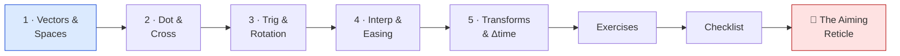
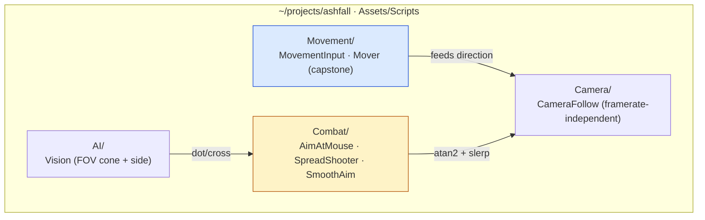

# 📐 World 2 — Mathematics for Games

> The architecture is clean (World 1) — now Ashfall has to *move* and *aim*, and make both feel good. That's all math: vectors for movement, dot/cross for "where is that relative to me," trig for aiming, lerp + delta-time for smooth, framerate-independent feel. This world turns the empty `Mover` from World 1 into a real, tunable movement-and-aim foundation.

[↑ Home](../../README.md) · [🗺️ Roadmap](../../ROADMAP.md) · [📊 Progress](../../PROGRESS.md)

---

## 📨 Your ticket

```
From:    Maya <maya@pixelforge.studio>
To:      You <new-hire@pixelforge.studio>
Cc:      Kenji <kenji@pixelforge.studio>
Subject: [W2-FEEL] Movement and aim feel WRONG — fix the math

The architecture's lovely, but Ashfall plays like a spreadsheet right now:

  - Diagonal movement is mysteriously faster than straight lines.
  - The gun "aims" by snapping in 4 directions; it can't point at the mouse.
  - The camera teleports to the player instead of following smoothly.
  - And whatever the build does, it runs at a different SPEED on my laptop
    than on Kenji's desktop. That's a non-starter.

The player needs to MOVE and AIM and it has to feel right — and "feel" is
math I can tune. Give me:

  1. Vectors I can trust for movement (equal speed in every direction).
  2. A way to know what's "in front of" an enemy (for AI vision later).
  3. Real aiming — point at the mouse, fire a spread.
  4. Smoothing on the camera and aim that feels the SAME on every machine.
  5. One reusable Mover that everything (player, enemies) drives.

Kenji will mentor you through the math. Boss check: an aiming reticle that
tracks the mouse and fires a facing-aware 3-shot spread. Nail it and we move
on to the actual player controller.

— Maya
```

This is World 2 of 13. Everything you build advances the **one growing Ashfall project** in `~/projects/ashfall`. You leave with movement, aiming, and smoothing math that World 3's player controller plugs straight into.

---

## 🎯 What you'll achieve in this world

- ➡️ Think in **vectors** — position vs direction vs displacement; magnitude, normalization, equal-speed movement
- 🎯 Use the **dot product** (facing / FOV) and **cross product** (left/right, normals) to answer "where is that relative to me?"
- 📐 Use **trigonometry** — the unit circle, radians, and `atan2` — to aim at the mouse and fan a spread
- 🪄 Apply **lerp, easing, and slerp** for smooth camera and aim — done **framerate-independently**
- ⏱️ Master **transforms** and **`* Time.deltaTime`**, then fold it all into a reusable `Mover`

---

## 🗺️ Level map

| Level | Lesson | Difficulty | XP |
|------:|--------|:----------:|---:|
| 1 | [Vectors & Coordinate Spaces](lessons/01-vectors-and-coordinate-spaces.md) | 🟢 Easy | 125 |
| 2 | [Dot & Cross Products](lessons/02-dot-and-cross-products.md) | 🟡 Medium | 125 |
| 3 | [Trigonometry & Rotation](lessons/03-trigonometry-and-rotation.md) | 🟡 Medium | 125 |
| 4 | [Interpolation & Easing](lessons/04-interpolation-and-easing.md) | 🟡 Medium | 125 |
| 5 | [Transforms & Delta Time](lessons/05-transforms-and-delta-time.md) | 🟡 Medium | 125 |
| 👹 | [Boss Battle — The Aiming Reticle](boss-battle.md) | 🔴 Hard | 500 |

➕ Extra reps: [exercises.md](exercises.md) · ✅ Ready to advance? [checklist.md](checklist.md)

---

## 🧭 Recommended order



Go in order — the math stacks. Vectors (L1) are the alphabet; dot/cross (L2) read relative position; trig (L3) turns directions into angles for aiming; lerp (L4) smooths it; transforms + delta-time (L5) apply all of it correctly. The boss *combines* every piece into one aiming reticle.

---

## 📦 Ashfall project status

**Entering World 2:** a clean, decoupled, component-based codebase from World 1 — including an empty/stub `Mover` and a `GameEvents` bus, but no real movement or aiming math.

**Leaving World 2:** equal-speed 8-directional movement, an enemy vision check, mouse-aim + spread, smooth framerate-independent camera & aim, and one reusable `Mover` everything drives.



You hand this to **World 3 — Core Game Programming**, where the `Mover`, aim, and camera become a full input-driven player controller with physics, collision, and saving.

---

## 👹 Boss teaser

**"The Aiming Reticle"** — Maya needs a turret/reticle that smoothly rotates to face the mouse (or stick) and fires a **3-shot spread that respects facing**, all framerate-independent. No tutorial: you'll combine vectors, the dot product, `atan2`, and lerp/slerp from this entire world into one feature. Beat it to earn the **📐 Mathematician** badge, a +250 world-complete bonus, and unlock World 3.

---

## 📚 Resources

Don't go link-hunting — the curated free list lives in [RESOURCES.md](../../RESOURCES.md). For this world, the standouts are **Freya Holmer**'s talks/videos on vectors, dot/cross, and "lerp smoothing" (the math intuition is unmatched) and **Red Blob Games**' interactive guides on vectors and 2D geometry.

---

[↑ Home](../../README.md) · [🗺️ Roadmap](../../ROADMAP.md) · [📊 Progress](../../PROGRESS.md) · [➡️ Next World: Core Game Programming](../phase-03-core-game-programming/README.md) · [▶️ Start Level 1 →](lessons/01-vectors-and-coordinate-spaces.md)
