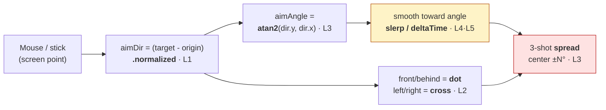

# 👹 Boss Battle — The Aiming Reticle

| | |
|---|---|
| 🎚️ **Difficulty** | 🔴 Hard |
| ⏱️ **Estimated time** | 60 minutes |
| ⭐ **XP reward** | 500 |
| 🔓 **Unlocks** | World 3 — Core Game Programming |

[← Checklist](checklist.md) · [↑ Phase Home](README.md) · [↑ Home](../../README.md)

---

## 📨 The incident

```
From:    Maya <maya@pixelforge.studio>
To:      You <new-hire@pixelforge.studio>
Cc:      Kenji <kenji@pixelforge.studio>
Subject: [W2-BOSS] Aiming feels dead. Make the reticle ALIVE — and fair.

The math lessons paid off — movement's smooth now. But the gun is the
thing players stare at for hours, and right now it's lifeless: it snaps
to the mouse instantly (no weight), and when it fires a "spread" the
pellets ignore which way the player is actually facing.

I need a real aiming reticle:

  - It tracks the mouse (or right stick) and rotates to face it SMOOTHLY
    — with a little lag/weight, not an instant snap.
  - On fire, it throws a 3-shot spread that fans out around the CURRENT
    facing — center shot dead-on, two flankers at ±N degrees.
  - It has to feel IDENTICAL on Kenji's 144Hz desktop and my 30fps laptop.
  - Bonus I'll love you for: the reticle subtly reacts to whether the
    target is in front of vs behind the player.

No tutorial this time — you have the whole world. Combine vectors, the
dot/cross products, atan2, and lerp/slerp into ONE feature. Nail it and
World 3 — the real player controller — is yours.

— Maya
```

> ⚔️ **Boss Battle rules:** No tutorials, no copying lesson files wholesale. **Apply** World 2: derive the aim angle, the spread, and the smoothing yourself, and prove the feel is framerate-independent. You win when every victory condition is met **and you can explain which piece of math powers each behavior** (normalize, dot, cross, `atan2`, lerp/slerp, `deltaTime`).

---

## 🎯 Your mission

Build an **aiming reticle** in Ashfall that smoothly rotates to face the mouse/stick and fires a **3-shot spread that respects the player's facing**, all framerate-independent. This is the capstone that fuses every lesson:



Build it from these pieces (at minimum):

1. **Aim direction (L1):** turn the mouse/stick into a *normalized* direction from the reticle's origin — screen→world for the mouse.
2. **Aim angle (L3):** convert that direction to an angle with `atan2`, and drive the reticle's rotation from it.
3. **Smoothing (L4 + L5):** the reticle rotates *toward* the aim angle each frame via `slerp`/`RotateTowards`/`LerpAngle` — framerate-independent (`Time.deltaTime`), with visible weight, never an instant snap.
4. **Facing-aware spread (L3):** firing spawns **3** projectiles — the center along the current facing, two flankers at `±spreadDegrees` rotated around that same facing. The spread fans off the reticle's *actual* angle, not the raw mouse.
5. **Relative read (L2):** use the **dot** product (in front vs behind) and the **cross** product (left vs right) of the target relative to facing — at minimum to drive Maya's "bonus" reticle reaction.

---

## 🏆 Victory conditions

- [ ] The reticle tracks the mouse (or right stick) and **rotates smoothly** toward it — visible lag/weight, no instant snap
- [ ] The aim angle is derived with **`atan2`** from a **normalized** aim direction (not 4-direction snapping)
- [ ] Smoothing uses **slerp / `RotateTowards` / `LerpAngle`** scaled by **`Time.deltaTime`** (framerate-independent)
- [ ] Firing produces a **3-shot spread**: center on facing, flankers at **±spreadDegrees** rotated around the *current* facing
- [ ] The spread respects the reticle's **actual smoothed facing**, not the raw mouse position
- [ ] The **dot** product distinguishes target in-front vs behind, and the **cross** product distinguishes left vs right (drives at least the bonus reaction)
- [ ] Feel is **identical at 30 fps and 144 fps** (verify by capping `Application.targetFrameRate`)
- [ ] You can explain which math powers each behavior

---

## 🧪 How you'll know you won

```bash
cd ~/projects/ashfall
ls Assets/Scripts/Combat
# → AimReticle.cs, SpreadShooter.cs (+ your Projectile)
```

Then in the Editor:
- Move the mouse in a circle — the reticle **follows with weight**, easing toward the cursor rather than teleporting.
- Fire — exactly **3** projectiles leave in a fan centered on where the reticle is *currently* pointing; whip the mouse and fire mid-turn, and the spread still fans off the **lagged** facing, not the cursor.
- In `Awake`, set `Application.targetFrameRate = 30;` then `= 144;` — the smoothing **looks the same** (same time to settle), only smoother.
- Walk the player past a target — the reticle's front/behind (dot) and left/right (cross) reaction flips correctly.

If all that holds, the reticle is alive and fair. You've won.

<details>
<summary>🔎 Reference solution — only after you've tried! (high-level sketch + key code)</summary>

**The shape of it (one component aims, one fires):**

| Piece | Job | Math it uses |
|---|---|---|
| `AimReticle` | screen/stick → world dir → angle → smoothed rotation | normalize (L1), `atan2` (L3), slerp + `deltaTime` (L4/L5) |
| `SpreadShooter` | spawn 3 projectiles fanned around current facing | rotate a vector by ±deg (L3) |
| dot/cross read | front/behind + left/right reaction | dot & cross (L2) |

**Reticle: normalize → atan2 → smooth (framerate-independent):**

```csharp
using UnityEngine;

public class AimReticle : MonoBehaviour
{
    [SerializeField] private Transform origin;     // the player / turret pivot
    [SerializeField] private float turnSharpness = 12f; // higher = snappier (still smooth)
    public float CurrentAngleDeg { get; private set; }  // the smoothed facing

    void Update()
    {
        // L1: mouse → world → normalized aim direction
        Vector3 mouseWorld = Camera.main.ScreenToWorldPoint(Input.mousePosition);
        Vector2 aimDir = ((Vector2)mouseWorld - (Vector2)origin.position).normalized;

        // L3: direction → target angle (radians → degrees)
        float targetDeg = Mathf.Atan2(aimDir.y, aimDir.x) * Mathf.Rad2Deg;

        // L4/L5: ease toward it, SAME at any frame rate (exp smoothing on deltaTime)
        float t = 1f - Mathf.Exp(-turnSharpness * Time.deltaTime);
        CurrentAngleDeg = Mathf.LerpAngle(CurrentAngleDeg, targetDeg, t);
        transform.rotation = Quaternion.Euler(0, 0, CurrentAngleDeg);

        // L2 (bonus): is the target in front / to which side of the player's facing?
        Vector2 facing = new(Mathf.Cos(CurrentAngleDeg * Mathf.Deg2Rad),
                             Mathf.Sin(CurrentAngleDeg * Mathf.Deg2Rad));
        float front = Vector2.Dot(facing, aimDir);            // + front, - behind
        float side  = facing.x * aimDir.y - facing.y * aimDir.x; // + left, - right
        // ...tint/scale the reticle from front & side here...
    }
}
```

**Spread: fan 3 shots around the *current smoothed* facing:**

```csharp
using UnityEngine;

public class SpreadShooter : MonoBehaviour
{
    [SerializeField] private AimReticle reticle;
    [SerializeField] private GameObject projectile;
    [SerializeField] private float spreadDegrees = 12f;
    [SerializeField] private float muzzleSpeed = 14f;

    public void Fire()
    {
        float center = reticle.CurrentAngleDeg;             // respect the LAGGED facing
        foreach (float offset in new[] { -spreadDegrees, 0f, spreadDegrees })
        {
            float rad = (center + offset) * Mathf.Deg2Rad;  // L3: rotate around facing
            Vector2 dir = new(Mathf.Cos(rad), Mathf.Sin(rad));
            var go = Instantiate(projectile, transform.position,
                                 Quaternion.Euler(0, 0, center + offset));
            go.GetComponent<Rigidbody2D>().velocity = dir * muzzleSpeed; // * speed, not raw
        }
    }
}
```

**Why each piece is the right tool:**
- `.normalized` makes the aim a pure *direction*, so distance to the cursor never changes behavior (L1).
- `Atan2(dir.y, dir.x)` is the only safe direction→angle conversion (correct quadrant, no divide-by-zero) (L3).
- `1 - Exp(-k * deltaTime)` is the framerate-independent lerp factor — same settle time at 30 or 144 fps (L4/L5).
- The spread is built from `CurrentAngleDeg` (the *smoothed* facing), so a whipped mouse can't make pellets ignore where the gun is actually pointing (L3).
- Dot = in-front/behind, cross = left/right — exactly the "where is that relative to me" reads from L2.

Same math, one cohesive feature. That's all of World 2 in a single component.
</details>

---

## 🎁 Rewards

- 🏆 **+500 XP**
- 🏅 Achievement unlocked: **📐 Mathematician** — you turned raw math into *feel* players can't put down
- 🔓 **World 3 — Core Game Programming** unlocks
- 📈 Update [PROGRESS.md](../../PROGRESS.md): mark World 2 ✅ and add the **+250 World Complete bonus**

> 🗒️ Reflection: aiming "feel" is one of the most-tuned things in any action game — and you just built it from first principles, not a plugin. The `Mover`, the aim, and the smoothing you wrote are framerate-independent and reusable. World 3 plugs them straight into a real input-driven player controller with physics, collision, and saving.

---

[← Checklist](checklist.md) · [↑ Phase Home](README.md) · [↑ Home](../../README.md) · [🎮 Enter World 3 →](../phase-03-core-game-programming/README.md)
