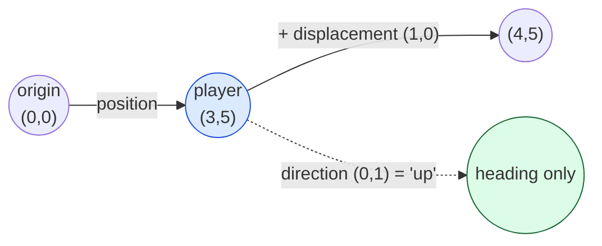
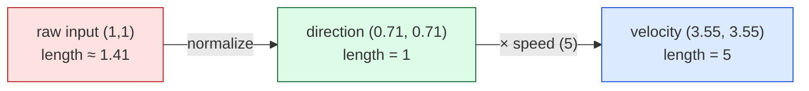

# Level 1 — Vectors & Coordinate Spaces

| | |
|---|---|
| 🎚️ **Difficulty** | 🟢 Easy |
| ⏱️ **Estimated time** | 30 minutes |
| ⭐ **XP reward** | 100 (Quest) + 25 (Quiz) |

[← Prev](../README.md) · [↑ Phase Home](../README.md) · [→ Next](02-dot-and-cross-products.md)

---

## 📖 Story

> *"Okay, the architecture's clean — now let's make Ashfall actually *move*. First instinct everyone has is `transform.position.x += speed` for left, a separate branch for up, another for diagonals… and then diagonals are mysteriously faster and you've written eight `if`s. Stop. A direction is one thing: a **vector**. Press right + up and you get a single arrow pointing northeast — and once you can think in arrows, movement, aiming, knockback, and AI all become the same three operations. Today you learn to think in vectors. — Kenji"*

---

## 🎯 Goal

- Understand a **vector** as a single object carrying **direction + magnitude** (not "two numbers")
- Tell apart the three jobs a vector does: **position**, **direction**, and **displacement**
- Do the core operations: **add, subtract, scale, measure length, normalize**
- Know the difference between **world space** and **local space**
- Build Ashfall's **8-directional movement** as a single normalized input vector → velocity

---

## 🧠 Concepts

A **vector** is an arrow. It has a **direction** (where it points) and a **magnitude** (how long it is). In 2D it's `(x, y)`; in 3D it's `(x, y, z)`. That's it — but the *meaning* of those numbers depends on the job:

- **Position** — an arrow from the world origin to a point. "The player is *at* `(3, 5)`."
- **Direction** — an arrow that only means "this way." Usually length 1 (a *unit* vector). "Face `(0, 1)`" = face up.
- **Displacement** — an arrow that means "move *by* this much." "Step `(1, 0)`" = move one unit right.

Same data type, three jobs. Mixing them up is the #1 beginner bug, so keep asking: *is this a place, a heading, or a change?*



### The five operations you'll use forever

| Operation | What it does | Game use |
|---|---|---|
| **Add** `a + b` | tip-to-tail: combine two arrows | apply displacement to a position |
| **Subtract** `b - a` | the arrow *from a to b* | "direction from me to the target" |
| **Scale** `v * s` | stretch/shrink, keep direction | speed × direction = velocity |
| **Magnitude** `‖v‖` | the arrow's length | distance, "how far?" |
| **Normalize** `v / ‖v‖` | shrink to length 1, keep direction | turn any arrow into a pure heading |

The magnitude is just the Pythagorean theorem: `‖v‖ = √(x² + y²)`. **Normalizing** divides a vector by its own length so it ends up length 1 — that strips out "how long" and leaves only "which way." You normalize *constantly*, because most game logic wants a clean direction it can then multiply by its own speed.



That diagram *is* the fix for the "diagonals are faster" bug: raw `(1,1)` has length ≈ 1.41, so a diagonal moves 41% faster than a straight line. Normalize first, then scale by speed, and every direction moves at exactly `speed`.

### World space vs local space

The same point can be described from different origins. **World space** is the one global grid every object shares. **Local space** is *relative to a particular object* — "two units in front of *me*," whichever way I'm facing. A bullet spawns in the gun's local space ("at the muzzle, pointing forward"), but the physics world tracks it in world space. Engines convert between the two for you (`transform.TransformPoint` / `InverseTransformPoint`), but you must know *which space a vector is in* — adding a local offset to a world position is the second-most-common vector bug.

### Why this exists

Games are simulations of *space*, and space is made of vectors. Before vectors, you'd track each axis separately and re-derive "move the same speed in every direction" by hand — error-prone and unscalable to 3D. A vector packages direction-and-magnitude into one value with a tiny, consistent algebra (add/subtract/scale/normalize) that means the *same thing* in 2D and 3D, in Unity, Unreal, Godot, or a custom engine. **Every** engine represents position, velocity, forces, and normals as vectors — they're the alphabet of game math. Learn the alphabet now and the rest of this world is just words.

---

## 🛠️ Hands-on Lab

> 💻 Steps 1–3 are pure C# you can run in [dotnetfiddle.net](https://dotnetfiddle.net) (no Unity needed — `Vector2`/`Vector3` math is identical). The movement script in step 4 goes into Ashfall.

### Step 1 — Build vectors and do the basics

```csharp
using UnityEngine;   // for Vector2; the math is engine-agnostic

Vector2 player = new Vector2(3, 5);   // a POSITION
Vector2 step   = new Vector2(1, 0);   // a DISPLACEMENT (move right)

Vector2 moved  = player + step;       // (4, 5) — add a displacement to a position
Vector2 scaled = step * 2.5f;         // (2.5, 0) — scale keeps direction, changes length
```

### Step 2 — "Direction from A to B" (subtraction)

The single most useful trick in game math: **target − self** gives the arrow pointing from you to the target.

```csharp
Vector2 self   = new Vector2(2, 2);
Vector2 target = new Vector2(6, 5);

Vector2 toTarget = target - self;          // (4, 3) — points from self to target
float   distance = toTarget.magnitude;     // 5  (√(4² + 3²))
Vector2 heading  = toTarget.normalized;    // (0.8, 0.6) — same direction, length 1
```

Remember it as **"to-minus-from"**: the arrow *to* the target equals target *minus* you.

### Step 3 — Why you normalize (the diagonal bug)

```csharp
Vector2 diagonalRaw = new Vector2(1, 1);
Debug.Log(diagonalRaw.magnitude);              // 1.4142  ← too fast!

Vector2 dir   = diagonalRaw.normalized;        // (0.707, 0.707)
float   speed = 5f;
Vector2 velocity = dir * speed;                // length is exactly 5, any direction
Debug.Log(velocity.magnitude);                 // 5
```

> ⚠️ Never normalize a zero vector — `(0,0).normalized` is undefined (you'd divide by zero). Unity returns `(0,0)` instead of crashing, but always guard with `if (input != Vector2.zero)` before relying on a normalized direction.

### Step 4 — 8-directional input as one vector

In Ashfall, gather both axes into a single vector, normalize it, and you get all 8 directions (4 straight + 4 diagonal) for free — no per-direction branches.

```csharp
using UnityEngine;

public class MovementInput : MonoBehaviour
{
    [SerializeField] private float speed = 5f;

    void Update()
    {
        // Read both axes into ONE vector (-1, 0, or 1 on each axis)
        Vector2 input = new Vector2(
            Input.GetAxisRaw("Horizontal"),
            Input.GetAxisRaw("Vertical"));

        // Guard the zero case, then normalize → pure direction
        Vector2 direction = input == Vector2.zero ? Vector2.zero : input.normalized;

        // direction × speed = velocity; × deltaTime makes it per-second (Level 5 explains why)
        Vector3 velocity = (Vector3)direction * speed;
        transform.position += velocity * Time.deltaTime;
    }
}
```

Press Right → `(1,0)`. Press Right+Up → `(0.71, 0.71)`. Eight directions, identical speed, four lines of logic.

---

## 🎮 Mini Challenge

You have an enemy at `enemyPos` and the player at `playerPos`. In **one expression**, give the enemy a velocity that chases the player at `chaseSpeed` (constant speed regardless of distance).

<details>
<summary>💡 Reveal answer</summary>

```csharp
Vector2 velocity = (playerPos - enemyPos).normalized * chaseSpeed;
```

`playerPos - enemyPos` is the arrow *to* the player ("to-minus-from"), `.normalized` strips out the distance so speed doesn't scale with how far away the player is, and `* chaseSpeed` sets the constant pace. This exact line is the seed of enemy AI in World 6.
</details>

---

## 📦 Project Mission

Give Ashfall real, framerate-aware 8-directional movement built on a clean direction vector.

1. In `~/projects/ashfall`, create `Assets/Scripts/Movement/MovementInput.cs` from the step-4 script (or extend the `Mover` you built in World 1 to compute its direction this way).
2. Read both axes into **one** `Vector2`, guard the zero case, and `normalized` it so diagonals don't run faster.
3. Multiply `direction * speed * Time.deltaTime` and apply it to the player.
4. Add a `[SerializeField] float speed` so Maya can tune feel in the Inspector.
5. Play and verify: every direction (including all four diagonals) moves at the **same** visible speed. Then commit:
   ```bash
   cd ~/projects/ashfall
   git switch -c feature/vector-movement
   git add Assets/Scripts/Movement
   git commit -m "feat: 8-directional movement from a normalized input vector"
   git switch main && git merge feature/vector-movement && git push
   ```

🎯 **Mission complete when:** the player moves in all 8 directions at one consistent speed, the direction comes from a single normalized vector (no per-direction `if` chain), and the zero-input case is guarded.

---

## ⚠️ Common Mistakes

| Mistake | What happens | Fix |
|--------|--------------|-----|
| Not normalizing diagonal input | Diagonals move ~41% faster | `input.normalized` before scaling by speed |
| Normalizing a zero vector | Undefined / `(0,0)` direction, jitter | Guard `if (input != Vector2.zero)` first |
| Confusing position with direction | Adding a "place" where a "heading" belongs | Ask: is this a place, a heading, or a change? |
| `from - to` instead of `to - from` | Direction points the wrong way | Memorize **"to minus from"** (`target - self`) |
| Mixing local & world space vectors | Bullets spawn in the wrong place/angle | Convert with `TransformPoint`/`InverseTransformPoint` |
| Forgetting `* Time.deltaTime` | Speed depends on framerate | Scale per-frame motion by delta time (Level 5) |

---

## 🤔 Reflection Questions

1. The same `Vector2 (0, 1)` could be a position, a direction, or a displacement. Give an Ashfall example of each, and how you'd *tell* which one a variable holds.
2. Why does normalizing input fix the "diagonals are faster" bug, in terms of vector length?
3. A muzzle flash should appear "just in front of the gun." Why is that easier to express in local space than world space?

---

## 📝 Quiz

1. **`target - self` gives you…**
   - a) the midpoint between them
   - b) the vector pointing from `self` to `target`
   - c) the distance as a single number
2. **Normalizing a vector…**
   - a) sets its length to 1 while keeping its direction
   - b) makes all its components positive
   - c) rounds it to whole numbers
3. **You read raw 8-direction input as `(1, 1)`. Before using it as a movement direction you should…**
   - a) use it as-is
   - b) normalize it so diagonal speed matches straight-line speed
   - c) divide only the x by 2

<details>
<summary>✅ Answers</summary>

1: **b** · 2: **a** · 3: **b**
</details>

---

## ✅ Completion Checklist

- [ ] I can explain a vector as direction + magnitude, and name its three jobs (position/direction/displacement)
- [ ] I can compute "direction from A to B," magnitude, and a normalized heading
- [ ] I understand why normalizing fixes faster diagonals (and to guard the zero vector)
- [ ] I can explain world space vs local space in one sentence
- [ ] Ashfall has 8-directional movement from a single normalized input vector; work committed
- [ ] I passed the quiz
- [ ] Added **+125 XP** to [PROGRESS.md](../../../PROGRESS.md)

---

[← Prev](../README.md) · [↑ Phase Home](../README.md) · [→ Next](02-dot-and-cross-products.md)
