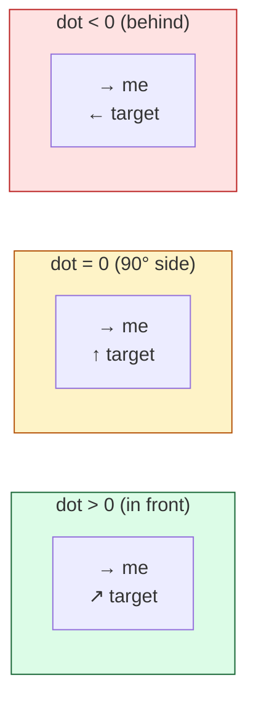
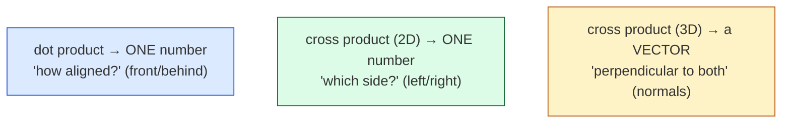

# Level 2 — Dot & Cross Products

| | |
|---|---|
| 🎚️ **Difficulty** | 🟡 Medium |
| ⏱️ **Estimated time** | 32 minutes |
| ⭐ **XP reward** | 100 (Quest) + 25 (Quiz) |

[← Prev](01-vectors-and-coordinate-spaces.md) · [↑ Phase Home](../README.md) · [→ Next](03-trigonometry-and-rotation.md)

---

## 📖 Story

> *"Enemy AI ticket from Maya: guards should only notice you if you're actually **in their cone of vision** — not behind them, not off to the side. Sounds like it needs trig and angles, right? It doesn't. Two operations answer almost every 'where is this relative to me?' question in games: the **dot product** tells you *how much* two directions agree (in front / behind / facing), and the **cross product** tells you which *side* something's on (left / right). Master these two and you've built the core of stealth, FOV, AI, and aiming — with no `atan2` in sight. — Kenji"*

---

## 🎯 Goal

- Understand the **dot product** geometrically: agreement between two directions (and the sign = in front/behind)
- Use the dot product for **facing checks** and **field-of-view (FOV) cones**
- Understand the **cross product**: in 2D its **z-sign** = left/right; in 3D it gives a **perpendicular** (normals)
- Build Ashfall's reusable **"is the target in front of me, within my cone?"** check for enemy line-of-sight

---

## 🧠 Concepts

### The dot product — "how much do these agree?"

The **dot product** takes two vectors and returns a single number measuring how much they point the same way:

```
a · b = a.x*b.x + a.y*b.y        (and + a.z*b.z in 3D)
```

The magic is what its **sign** tells you when the vectors are *normalized*:

- `a · b > 0` → they point the **same general way** (target is **in front**)
- `a · b = 0` → they're **perpendicular** (target is exactly to the side, 90°)
- `a · b < 0` → they point **opposite** ways (target is **behind**)

For two **unit** vectors, the dot product equals `cos(angle between them)` exactly — it ranges from `+1` (same direction) through `0` (90°) to `-1` (opposite). That single number is a facing-meter.



**FOV cones fall right out of this.** A 90°-total cone means "within 45° of forward," and `cos(45°) ≈ 0.707`. So "is the target inside my vision cone?" is literally: `dot(forward, toTarget) > 0.707`. Wider cone → lower threshold. No trig call, just a comparison.

### The cross product — "which side / which perpendicular?"

The **cross product** answers the question the dot product can't: *left or right?* In 2D it produces a single number (the z-component of the 3D cross):

```
cross = a.x*b.y - a.y*b.x
```

- `cross > 0` → `b` is to the **left** of `a` (counter-clockwise)
- `cross < 0` → `b` is to the **right** of `a` (clockwise)
- `cross = 0` → they're **parallel** (same or opposite line)

In **3D**, the cross product returns a whole **vector** that is **perpendicular to both** inputs — that's how engines compute **surface normals** (the "which way does this face outward?" vector lighting needs) and how you build a coordinate frame from two axes.



Together they're a complete relative-position toolkit: **dot = front/back**, **cross = left/right**. An enemy that knows both knows exactly where you are relative to its facing — and an AI in World 6 will use this to decide whether to turn left or right to track you.

### Why this exists

"Where is that thing relative to where I'm looking?" is the most common spatial question in games, and computing an actual angle for it (with `atan2` + trig) is slower and clumsier than you need. The dot and cross products extract the *two facts you usually want* — alignment and sidedness — as cheap multiply-add operations, no trig, no normalization-of-the-answer required. They're built into **every** engine's vector type (`Vector3.Dot`, `Vector3.Cross`) because they underpin lighting (normals), physics (projection of velocity onto a surface), AI (vision, flanking), and culling (is it on-screen?). This is the workhorse math of 3D — learn to *reach for it* instead of trig.

---

## 🛠️ Hands-on Lab

> 💻 Runs in [dotnetfiddle.net](https://dotnetfiddle.net); the FOV check goes into Ashfall in the Mission.

### Step 1 — Facing check with the dot product

```csharp
using UnityEngine;

Vector2 forward  = Vector2.up;                       // the guard faces "up"
Vector2 toTarget = (targetPos - guardPos).normalized; // direction to the player

float d = Vector2.Dot(forward, toTarget);
// d > 0 → player is in front;  d < 0 → behind;  d ≈ 0 → directly to the side
Debug.Log(d > 0 ? "in front" : "behind");
```

> 🔑 Normalize both vectors first. Only then does the dot equal `cos(angle)` and behave as a clean −1…+1 facing meter.

### Step 2 — Field-of-view cone (the whole point)

```csharp
// A vision cone of TOTAL angle `fovDegrees` = "within fovDegrees/2 of forward".
bool InCone(Vector2 forward, Vector2 toTarget, float fovDegrees)
{
    float threshold = Mathf.Cos(fovDegrees * 0.5f * Mathf.Deg2Rad); // half-angle → cosine
    return Vector2.Dot(forward.normalized, toTarget.normalized) > threshold;
}
// 90° cone → threshold ≈ 0.707;  120° cone → ≈ 0.5;  360° → -1 (sees everything)
```

A wider cone is just a *lower* threshold. That one comparison is a complete FOV gate.

### Step 3 — Left or right? (2D cross)

```csharp
float Cross2D(Vector2 a, Vector2 b) => a.x * b.y - a.y * b.x;

float side = Cross2D(forward, toTarget);
Debug.Log(side > 0 ? "target is on my LEFT" : "target is on my RIGHT");
// An enemy uses this to decide which way to TURN to face you.
```

### Step 4 — 3D cross = a perpendicular (normal)

```csharp
using UnityEngine;

// Two edges of a triangle → the cross product is the face's outward normal.
Vector3 edge1 = b - a;
Vector3 edge2 = c - a;
Vector3 normal = Vector3.Cross(edge1, edge2).normalized;
// This is exactly how lighting knows which way a surface faces (World 7).
```

---

## 🎮 Mini Challenge

A guard faces `forward`. You want it to fire only when the player is within a **tight 30° total** cone in front. Write the boolean condition.

<details>
<summary>💡 Reveal answer</summary>

```csharp
Vector2 toPlayer = (playerPos - guardPos).normalized;
bool canFire = Vector2.Dot(forward.normalized, toPlayer) > Mathf.Cos(15f * Mathf.Deg2Rad);
// 30° total = 15° half-angle; cos(15°) ≈ 0.966 — a high, strict threshold.
```

A *tighter* cone needs a *higher* threshold (closer to 1), because the directions must agree more strongly. That inverse relationship trips people up — say it out loud: tighter cone → higher cosine.
</details>

---

## 📦 Project Mission

Build Ashfall's reusable enemy line-of-sight check — the foundation World 6's AI will plug straight into.

1. Create `Assets/Scripts/AI/Vision.cs` with a method `CanSee(Vector2 eyePos, Vector2 forward, Vector2 targetPos, float fovDegrees, float range)`.
2. It returns `true` only when the target is **within `range`** (use `magnitude`/`sqrMagnitude` from Level 1) **and inside the FOV cone** (dot-product test from step 2).
3. Add a `Side(...)` helper returning left/right via the 2D cross product — the AI will use it later to decide which way to rotate.
4. Drop a quick test: place a dummy "guard" and "player," log `CanSee(...)` as you move the player around the guard, and confirm front-vs-behind and in-cone-vs-out flip correctly.
5. Commit:
   ```bash
   cd ~/projects/ashfall
   git switch -c feature/enemy-vision
   git add Assets/Scripts/AI
   git commit -m "feat: dot/cross-based enemy vision (FOV cone + range + sidedness)"
   git switch main && git merge feature/enemy-vision && git push
   ```

🎯 **Mission complete when:** `Vision.CanSee` returns true only for targets in range **and** inside the cone (behind/too-wide returns false), uses the **dot product** (no `atan2`), and `Side(...)` correctly reports left/right via the cross product.

---

## ⚠️ Common Mistakes

| Mistake | What happens | Fix |
|--------|--------------|-----|
| Dot product on un-normalized vectors | Sign still works, but it's no longer `cos(angle)` — FOV thresholds break | Normalize both before comparing to a cosine |
| Tighter cone → lower threshold | FOV logic inverted; enemies see too much | Tighter cone = **higher** cosine (closer to 1) |
| Comparing `magnitude` in a hot loop | Needless `√` every check | Compare `sqrMagnitude` to `range*range` |
| Expecting 2D `Cross` as a Unity method | `Vector2.Cross` doesn't exist | Write `a.x*b.y - a.y*b.x` yourself |
| Forgetting 3D cross is order-sensitive | Normal points the wrong way (inside-out lighting) | `Cross(a,b) = -Cross(b,a)`; mind edge order |
| Using trig where a dot/cross suffices | Slower, more code, more bugs | Reach for dot (front/back) + cross (left/right) first |

---

## 🤔 Reflection Questions

1. Why must both vectors be normalized for the dot product to equal the cosine of the angle between them?
2. You widen a guard's vision cone from 60° to 120°. Does the dot-product threshold go up or down, and why?
3. The dot product can't tell left from right — what *is* it blind to, and why does the cross product complete the picture?

---

## 📝 Quiz

1. **A normalized dot product of `-0.9` means the target is…**
   - a) almost directly in front of me
   - b) almost directly behind me
   - c) exactly 90° to my side
2. **To test "inside a 90° vision cone," you compare the dot product against…**
   - a) `cos(90°) = 0`
   - b) `cos(45°) ≈ 0.707` (the half-angle)
   - c) `90`
3. **In 2D, `a.x*b.y - a.y*b.x` (the cross) being positive tells you `b` is…**
   - a) farther away than `a`
   - b) to the left of `a`
   - c) the same length as `a`

<details>
<summary>✅ Answers</summary>

1: **b** · 2: **b** (cone is total angle, so use the half-angle's cosine) · 3: **b**
</details>

---

## ✅ Completion Checklist

- [ ] I can explain the dot product as alignment, and read its sign as front/side/behind
- [ ] I can build an FOV cone from `cos(half-angle)` and a dot product
- [ ] I can use the 2D cross product's sign for left/right, and know the 3D cross gives a normal
- [ ] Ashfall has a reusable `Vision.CanSee` (range + cone) and a `Side` helper; work committed
- [ ] I passed the quiz
- [ ] Added **+125 XP** to [PROGRESS.md](../../../PROGRESS.md)

---

[← Prev](01-vectors-and-coordinate-spaces.md) · [↑ Phase Home](../README.md) · [→ Next](03-trigonometry-and-rotation.md)
