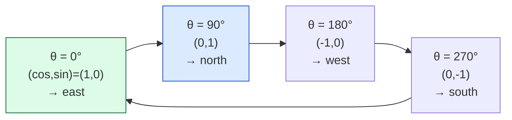
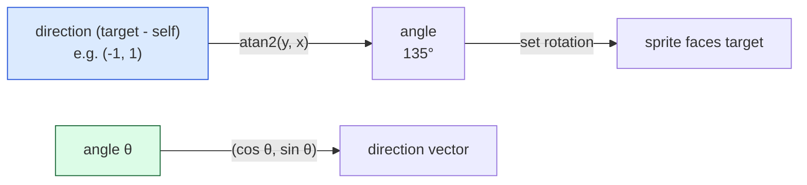

# Level 3 — Trigonometry & Rotation

| | |
|---|---|
| 🎚️ **Difficulty** | 🟡 Medium |
| ⏱️ **Estimated time** | 33 minutes |
| ⭐ **XP reward** | 100 (Quest) + 25 (Quiz) |

[← Prev](02-dot-and-cross-products.md) · [↑ Phase Home](../README.md) · [→ Next](04-interpolation-and-easing.md)

---

## 📖 Story

> *"Maya wants the gun to point at the mouse, and the shotgun to fire a 3-pellet spread. Dot and cross told us *where* the target is — now we need an actual **angle**: to rotate the sprite to face it, and to fan shots out by ±10°. That's trigonometry. Forget the dusty triangles from school — for us, **sin and cos draw circles**, and **atan2 turns a direction into an angle**. Three functions, and you can aim, spread, and orbit anything. — Kenji"*

---

## 🎯 Goal

- Understand the **unit circle**: `cos` = x, `sin` = y as you sweep an angle
- Know **radians vs degrees** and never mix them up again
- Use **`atan2(y, x)`** to turn a *direction* into an *angle* (the aiming workhorse)
- Use `sin`/`cos` to turn an *angle* into a *direction* (spread shots, orbiting)
- **Rotate** a vector by an angle
- Build Ashfall's **aim-at-mouse** angle and a **3-shot spread**

---

## 🧠 Concepts

### The unit circle is the whole idea

Walk around a circle of radius 1, starting at the right (east) and going counter-clockwise. At any angle `θ`, your position is `(cos θ, sin θ)`. That's the entire relationship: **`cos` is the x you've traveled, `sin` is the y.**



So **`(cos θ, sin θ)` *is* a direction vector** for the angle `θ`. Need to fire a bullet at 30°? Its direction is `(cos 30°, sin 30°)`. That's how you convert an angle → a heading.

### Radians vs degrees — the #1 footgun

Humans think in **degrees** (a full turn = 360). Math functions (`sin`, `cos`, `atan2`) think in **radians** (a full turn = 2π ≈ 6.283). They are the same angles in different units. Mix them and your gun points 57× the wrong way.

- degrees → radians: `× Mathf.Deg2Rad`  (i.e. `× π/180`)
- radians → degrees: `× Mathf.Rad2Deg`  (i.e. `× 180/π`)

Rule of thumb: **store/display in degrees (Unity's `transform.eulerAngles` is degrees), but the moment you call `sin`/`cos`/`atan2`, you're in radians.**

### atan2 — direction → angle (the aiming workhorse)

`atan2(y, x)` takes a vector's components and returns its angle, correctly, in **all four quadrants** (plain `atan` can't). This is how you make something *face* a target: get the direction (`target - self`, Level 1), then `atan2` it into an angle, then set the rotation.



Two arrows, opposite directions: **`atan2` goes vector → angle; `(cos, sin)` goes angle → vector.** Aiming uses the first; spread and orbiting use the second.

### Rotating a vector

To spin a vector by angle `θ` (e.g. to fan a pellet off the aim direction):

```
x' = x·cos θ − y·sin θ
y' = x·sin θ + y·cos θ
```

You'll rarely hand-write this in Unity (you can multiply by a `Quaternion`), but knowing it exists demystifies what "rotate by 10°" *is*: a fixed formula that re-mixes x and y. A **spread shot** is just the aim direction rotated by `−10°, 0°, +10°`.

### Why this exists

Rotation and aiming are *angular* problems, and angles live on circles — which is exactly what sin/cos parameterize. Without trig you'd have no general way to convert between "an angle" (how UIs, designers, and rotations think) and "a direction vector" (how movement and physics think). `atan2` in particular is irreplaceable: it's the only clean way to recover an angle from a direction across all four quadrants, and it powers aiming, turrets, minimap arrows, and analog-stick rotation in **every** engine (`Mathf.Atan2`, `Math.atan2`, identical everywhere). Sin/cos build circular and oscillating motion — orbits, spread, bobbing, waves. This is the bridge between the angle world and the vector world.

---

## 🛠️ Hands-on Lab

> 💻 Steps 1–2 run in [dotnetfiddle.net](https://dotnetfiddle.net); the aim + spread go into Ashfall.

### Step 1 — Angle → direction (and back)

```csharp
using UnityEngine;

// Angle → direction vector (the unit circle)
float angleDeg = 30f;
float rad = angleDeg * Mathf.Deg2Rad;            // ALWAYS convert before sin/cos
Vector2 dir = new Vector2(Mathf.Cos(rad), Mathf.Sin(rad));   // ≈ (0.87, 0.5)

// Direction → angle (atan2), back in degrees for humans/rotations
Vector2 d = new Vector2(-1, 1);
float angle = Mathf.Atan2(d.y, d.x) * Mathf.Rad2Deg;         // 135°
```

Note the argument order: **`Atan2(y, x)`** — y first. It catches everyone once.

### Step 2 — Rotate a direction by an angle

```csharp
Vector2 Rotate(Vector2 v, float degrees)
{
    float r = degrees * Mathf.Deg2Rad;
    float cos = Mathf.Cos(r), sin = Mathf.Sin(r);
    return new Vector2(v.x * cos - v.y * sin,
                       v.x * sin + v.y * cos);
}
Vector2 fanned = Rotate(aimDir, 10f);   // aimDir nudged 10° counter-clockwise
```

### Step 3 — Aim a sprite at the mouse (Ashfall)

```csharp
using UnityEngine;

public class AimAtMouse : MonoBehaviour
{
    void Update()
    {
        Vector3 mouse = Camera.main.ScreenToWorldPoint(Input.mousePosition);
        Vector2 toMouse = (Vector2)(mouse - transform.position);   // direction (Level 1)

        float angle = Mathf.Atan2(toMouse.y, toMouse.x) * Mathf.Rad2Deg;
        transform.rotation = Quaternion.Euler(0, 0, angle);        // 2D: spin around Z
    }
}
```

`toMouse` is "direction to target," `atan2` turns it into the facing angle, and a Z-rotation points the sprite there. That's a complete mouse-aimed turret.

### Step 4 — A 3-shot spread that respects facing

```csharp
using UnityEngine;

public class SpreadShooter : MonoBehaviour
{
    [SerializeField] private float spreadDegrees = 10f;   // ± off center
    [SerializeField] private GameObject bulletPrefab;

    public void Fire(Vector2 aimDir)
    {
        foreach (float offset in new[] { -spreadDegrees, 0f, spreadDegrees })
        {
            Vector2 dir = Rotate(aimDir.normalized, offset);   // step-2 helper
            var b = Instantiate(bulletPrefab, transform.position, Quaternion.identity);
            b.GetComponent<Rigidbody2D>().velocity = dir * 12f; // launch along the fanned dir
        }
    }

    Vector2 Rotate(Vector2 v, float deg)
    {
        float r = deg * Mathf.Deg2Rad, c = Mathf.Cos(r), s = Mathf.Sin(r);
        return new Vector2(v.x * c - v.y * s, v.x * s + v.y * c);
    }
}
```

Three pellets, fanned ±10° around wherever you're aiming — change `spreadDegrees` and Maya can tune the choke.

---

## 🎮 Mini Challenge

Make a pickup **orbit** a point: at the center `(cx, cy)`, radius `R`, advancing `angle` over time. Give the orbiting position.

<details>
<summary>💡 Reveal answer</summary>

```csharp
angle += orbitSpeed * Time.deltaTime;          // advance the angle each frame
float r = angle;                                // already a running value; treat as radians
Vector2 pos = new Vector2(cx + Mathf.Cos(r) * R,
                          cy + Mathf.Sin(r) * R);
```

`(cos, sin) * R` is a point on a circle of radius `R`; adding the center moves the whole circle into place. Increasing `angle` over time walks around it. This is the unit circle doing literally its one job — and the seed of orbiting shields and rotating hazards.
</details>

---

## 📦 Project Mission

Give Ashfall a mouse-aimed weapon with a tunable spread.

1. Create `Assets/Scripts/Combat/AimAtMouse.cs` (step 3) on the player's weapon pivot so it always points at the cursor.
2. Create `Assets/Scripts/Combat/SpreadShooter.cs` (step 4); on fire, spawn a 3-pellet fan around the current aim direction.
3. Expose `spreadDegrees` as a `[SerializeField]` so the spread is Inspector-tunable. Wire fire to a mouse click for now (it gets a real input action in World 3).
4. Confirm: the weapon faces the mouse in all four quadrants (the `atan2` quadrant test), and the three pellets fan symmetrically around the aim line.
5. Commit:
   ```bash
   cd ~/projects/ashfall
   git switch -c feature/aim-and-spread
   git add Assets/Scripts/Combat
   git commit -m "feat: atan2 mouse-aim + tunable 3-shot spread (sin/cos rotation)"
   git switch main && git merge feature/aim-and-spread && git push
   ```

🎯 **Mission complete when:** the weapon points at the mouse correctly in every quadrant (uses `atan2`), and firing produces a symmetric 3-pellet spread around the aim direction whose width is set by a serialized `spreadDegrees`.

---

## ⚠️ Common Mistakes

| Mistake | What happens | Fix |
|--------|--------------|-----|
| Passing degrees to `sin`/`cos`/`atan2` | Wildly wrong angles | Multiply by `Mathf.Deg2Rad` first |
| `Atan2(x, y)` (wrong order) | Angle is mirrored/off by 90° | It's `Atan2(y, x)` — y first |
| Using `atan` instead of `atan2` | Wrong quadrant (left = right) | Always `atan2` for directions |
| Reading the mouse in screen pixels | Aim is way off | `Camera.main.ScreenToWorldPoint` first |
| Spreading before normalizing aim | Pellet speeds vary with aim length | `aimDir.normalized` before rotating |
| Rotating around the wrong axis in 2D | Sprite spins in depth, looks broken | 2D faces via `Quaternion.Euler(0,0,angle)` (Z) |

---

## 🤔 Reflection Questions

1. In one sentence, what do `cos` and `sin` give you as you sweep an angle, and how does that make `(cos θ, sin θ)` a direction?
2. Why is `atan2` the right tool for aiming when plain `atan` exists? What does it handle that `atan` can't?
3. A designer asks for a 5-pellet spread instead of 3. What changes in your shooter, and what stays the same?

---

## 📝 Quiz

1. **`(cos θ, sin θ)` represents…**
   - a) the distance to an angle
   - b) a unit direction vector pointing at angle θ
   - c) the area of a circle
2. **To make a sprite face a target you should…**
   - a) `atan2(direction.y, direction.x)` then set the Z rotation
   - b) add the two positions together
   - c) take the dot product and use it as the angle
3. **Before calling `Mathf.Sin(angle)` where `angle` is in degrees, you must…**
   - a) multiply by `Mathf.Rad2Deg`
   - b) multiply by `Mathf.Deg2Rad`
   - c) nothing — Unity uses degrees

<details>
<summary>✅ Answers</summary>

1: **b** · 2: **a** · 3: **b**
</details>

---

## ✅ Completion Checklist

- [ ] I can explain the unit circle: `(cos θ, sin θ)` is the direction at angle θ
- [ ] I never mix radians and degrees (convert before any trig call)
- [ ] I can use `atan2` to turn a direction into a facing angle
- [ ] I can rotate a vector / build a spread from sin/cos
- [ ] Ashfall has mouse-aim + a tunable 3-shot spread; work committed
- [ ] I passed the quiz
- [ ] Added **+125 XP** to [PROGRESS.md](../../../PROGRESS.md)

---

[← Prev](02-dot-and-cross-products.md) · [↑ Phase Home](../README.md) · [→ Next](04-interpolation-and-easing.md)
