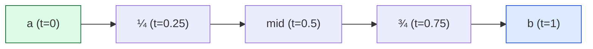
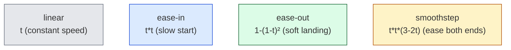

# Level 4 — Interpolation & Easing

| | |
|---|---|
| 🎚️ **Difficulty** | 🟡 Medium |
| ⏱️ **Estimated time** | 32 minutes |
| ⭐ **XP reward** | 100 (Quest) + 25 (Quiz) |

[← Prev](03-trigonometry-and-rotation.md) · [↑ Phase Home](../README.md) · [→ Next](05-transforms-and-delta-time.md)

---

## 📖 Story

> *"The aim works, but Maya says it feels 'robotic' — the gun snaps to the mouse instantly, the camera teleports to the player. Real game feel is in the *transitions*. The single function behind 90% of juice is **lerp** — blend from A toward B by a fraction t. Sprinkle in an **easing curve** so the motion accelerates and settles instead of moving like a machine, and do the smoothing **framerate-independently** so it feels the same at 30fps and 144fps. This lesson is where Ashfall stops feeling like a tech demo and starts feeling *good*. — Kenji"*

---

## 🎯 Goal

- Understand **linear interpolation (lerp)**: blend A→B by a fraction `t` (0…1)
- Understand **inverse lerp** (the reverse: "what `t` is this value at?") and **slerp** (lerp for rotations)
- Use **easing curves** to shape motion (ease-in, ease-out, smoothstep)
- Do **framerate-independent smoothing** correctly (the right way to lerp every frame)
- Build Ashfall's **smooth camera follow** and **smoothed aim**

---

## 🧠 Concepts

### Lerp — the one function

**Linear interpolation** blends from `a` to `b` by a fraction `t`:

```
lerp(a, b, t) = a + (b - a) * t
```

- `t = 0` → exactly `a`
- `t = 1` → exactly `b`
- `t = 0.5` → the midpoint
- `t = 0.25` → a quarter of the way from `a` to `b`

It works on anything you can subtract and scale: numbers, `Vector2/3` (positions, colors), even angles. Health bars draining, fades, color blends, an object sliding into place — all lerp.



**Inverse lerp** runs it backwards: given a value, what `t` produced it? `invLerp(a, b, v) = (v - a) / (b - a)`. Perfect for "current HP is what fraction of max?" → feed that `t` straight into a bar's fill or a color lerp. Lerp maps `t → value`; inverse lerp maps `value → t`. Chain them to **remap** one range onto another (a classic Freya Holmer tip — see RESOURCES.md).

**Slerp** (spherical lerp) is lerp for *rotations/directions*: it blends along the shortest arc at constant angular speed, so a turret rotating from facing-left to facing-up sweeps smoothly instead of skewing through the middle. Use `Vector3.Slerp`/`Quaternion.Slerp` for directions and orientations; plain `Lerp` for positions and scalars.

### Easing — making it feel alive

Linear motion looks mechanical (things in the real world accelerate and decelerate). **Easing curves** reshape `t` before you lerp, so the *fraction* itself speeds up or slows down:



- **Ease-out** (`1-(1-t)²`) — fast then settles. The single best default for UI and camera; things "arrive" gently.
- **Ease-in** (`t*t`) — slow then fast. Good for wind-ups and things leaving.
- **Smoothstep** (`t*t*(3-2t)`) — eased on *both* ends; Unity ships it as `Mathf.SmoothStep`.

You still call lerp — you just feed it an eased `t` instead of a raw one.

### Framerate-independent smoothing (do this right)

A *very* common pattern is "ease toward a target every frame":

```csharp
current = Vector3.Lerp(current, target, 0.1f);   // ⚠️ framerate-DEPENDENT
```

This looks smooth but it's a **trap**: it runs once per frame, so at 144fps it lerps far more often than at 30fps — the camera is "snappier" on a fast machine and "laggy" on a slow one. The fix is to make the blend depend on **time**, not frame count:

```csharp
current = Vector3.Lerp(current, target, 1f - Mathf.Exp(-sharpness * Time.deltaTime));
```

`1 - exp(-k·dt)` is the framerate-correct amount to move toward the target this frame. Same feel at any framerate. (A simpler, very common approximation is `Mathf.Lerp(current, target, sharpness * Time.deltaTime)` — good enough for most game feel, and it's a huge improvement over the constant-`t` version.) The deep "why" of `Time.deltaTime` is Level 5.

### Why this exists

The difference between "functional" and "feels great" is almost entirely *how values change over time* — and lerp is the universal tool for "move this toward that." It's so fundamental that every engine ships it (`Mathf.Lerp`, `Vector3.Lerp`, GLSL `mix`, CSS transitions are eased lerps). Easing exists because linear motion reads as robotic to humans — our perception expects acceleration, so designers shape `t` to add weight, snap, and softness. And framerate independence exists because your game runs on a 30fps phone *and* a 144fps PC, and "feel" must not depend on the hardware. Lerp + easing + delta-time is the trinity of game *juice*.

---

## 🛠️ Hands-on Lab

> 💻 Steps 1–2 run in [dotnetfiddle.net](https://dotnetfiddle.net); the camera + aim smoothing go into Ashfall.

### Step 1 — Lerp and inverse lerp

```csharp
using UnityEngine;

float mid = Mathf.Lerp(0f, 100f, 0.5f);     // 50
Vector2 p = Vector2.Lerp(start, end, 0.25f); // a quarter of the way from start to end

// Inverse: 75 HP out of 200 max is what fraction? → feed it to a health bar.
float t = Mathf.InverseLerp(0f, 200f, 75f);  // 0.375
```

### Step 2 — Easing a value

```csharp
float EaseOut(float t)  => 1f - (1f - t) * (1f - t);   // soft landing
float EaseIn(float t)   => t * t;                       // slow start

float rawT    = 0.3f;
float easedT  = EaseOut(rawT);                          // 0.51 — already "further along"
float value   = Mathf.Lerp(a, b, easedT);              // lerp with the eased fraction
// Or use Unity's built-in both-ends ease:
float smooth  = Mathf.SmoothStep(a, b, rawT);
```

### Step 3 — Smooth camera follow (Ashfall)

```csharp
using UnityEngine;

public class CameraFollow : MonoBehaviour
{
    [SerializeField] private Transform target;
    [SerializeField] private float sharpness = 8f;   // higher = snappier
    [SerializeField] private Vector3 offset = new Vector3(0, 0, -10);

    // LateUpdate: move the camera AFTER the player has moved this frame.
    void LateUpdate()
    {
        Vector3 goal = target.position + offset;
        float k = 1f - Mathf.Exp(-sharpness * Time.deltaTime);   // framerate-independent
        transform.position = Vector3.Lerp(transform.position, goal, k);
    }
}
```

Tune `sharpness` for feel — and because it's exponential-with-deltaTime, that feel is identical at 30fps and 144fps.

### Step 4 — Smoothed aim (no more robotic snap)

Instead of instantly setting the weapon angle (Level 3), **lerp the rotation toward** the target angle so it swings to the mouse:

```csharp
using UnityEngine;

public class SmoothAim : MonoBehaviour
{
    [SerializeField] private float turnSharpness = 12f;

    public void AimAt(Vector2 dir)
    {
        float targetAngle = Mathf.Atan2(dir.y, dir.x) * Mathf.Rad2Deg;   // Level 3
        Quaternion goal = Quaternion.Euler(0, 0, targetAngle);
        float k = 1f - Mathf.Exp(-turnSharpness * Time.deltaTime);
        // Slerp = correct interpolation for rotations (shortest arc, constant speed)
        transform.rotation = Quaternion.Slerp(transform.rotation, goal, k);
    }
}
```

Note `Slerp` for the rotation — that's the "lerp for orientations" from Concepts.

---

## 🎮 Mini Challenge

You want a low-HP health bar to glow from green → red as HP drops. Given `current` and `max` HP, produce the bar color in one or two lines.

<details>
<summary>💡 Reveal answer</summary>

```csharp
float t = Mathf.InverseLerp(0f, max, current);     // value → fraction (1 = full)
Color barColor = Color.Lerp(Color.red, Color.green, t);  // blend red↔green by that fraction
```

Inverse-lerp turns HP into a 0…1 fraction; `Color.Lerp` blends two colors by it. Full HP (`t=1`) is green, empty (`t=0`) is red, and it slides smoothly between — the canonical lerp-of-two-things pattern, reused for fades, damage flashes, and tints everywhere.
</details>

---

## 📦 Project Mission

Make Ashfall *feel* smooth — camera and aim both ease instead of snap, framerate-independently.

1. Create `Assets/Scripts/Camera/CameraFollow.cs` (step 3) on the main camera; assign the player as `target`. Use `LateUpdate` and the `1 - exp(-k·dt)` blend.
2. Upgrade Level 3's instant aim into `Assets/Scripts/Combat/SmoothAim.cs` (step 4) using `Quaternion.Slerp` so the weapon swings to the cursor.
3. Expose `sharpness` / `turnSharpness` as serialized fields so Maya can dial the feel.
4. Verify framerate independence: in Player/Editor settings cap to 30fps, then to 120fps — the smoothing should *feel the same* (this is the whole point of the exp/deltaTime form).
5. Commit:
   ```bash
   cd ~/projects/ashfall
   git switch -c feature/smoothing
   git add Assets/Scripts/Camera Assets/Scripts/Combat/SmoothAim.cs
   git commit -m "feat: framerate-independent smooth camera follow + slerped aim"
   git switch main && git merge feature/smoothing && git push
   ```

🎯 **Mission complete when:** the camera eases toward the player (in `LateUpdate`) and the weapon slerps toward the mouse, both using a `Time.deltaTime`-based blend, and the feel is consistent when you cap the framerate to 30 vs 120fps.

---

## ⚠️ Common Mistakes

| Mistake | What happens | Fix |
|--------|--------------|-----|
| `Lerp(current, target, 0.1f)` every frame | Feel changes with framerate (snappy on fast PCs) | Use `1 - Mathf.Exp(-k * Time.deltaTime)` |
| `t` outside 0…1 | Over/undershoot (unless you want extrapolation) | Clamp `t`, or use `Mathf.Clamp01` |
| Lerping rotations with `Lerp` | Skews/takes the long way around | Use `Slerp` / `Quaternion.Slerp` |
| Camera follow in `Update` | Jitter (camera moves before/while player does) | Move the camera in `LateUpdate` |
| Expecting eased motion from raw `t` | Looks robotic | Pass `t` through an easing function first |
| Hardcoding the smoothing constant | Not tunable for feel | Expose `sharpness` as a serialized field |

---

## 🤔 Reflection Questions

1. Explain `lerp(a, b, t)` for `t = 0`, `0.5`, and `1`. What does inverse lerp give you instead?
2. Why does `Lerp(current, target, 0.1f)` every frame *feel* different at 30fps vs 144fps, and how does the `deltaTime` form fix it?
3. When do you reach for `Slerp` instead of `Lerp`, and what goes wrong if you pick the wrong one?

---

## 📝 Quiz

1. **`Mathf.Lerp(10, 20, 0.5f)` returns…**
   - a) 5
   - b) 15
   - c) 30
2. **Smoothing toward a target each frame is framerate-independent when the blend factor…**
   - a) is a fixed constant like `0.1`
   - b) depends on `Time.deltaTime` (e.g. `1 - exp(-k·dt)`)
   - c) is recomputed only every 10 frames
3. **To rotate a turret smoothly along the shortest arc you should use…**
   - a) `Mathf.Lerp` on the raw angle
   - b) `Quaternion.Slerp`
   - c) the dot product

<details>
<summary>✅ Answers</summary>

1: **b** · 2: **b** · 3: **b**
</details>

---

## ✅ Completion Checklist

- [ ] I can explain lerp, inverse lerp, and when to use slerp
- [ ] I can shape motion with an easing curve (ease-in/out, smoothstep)
- [ ] I know why constant-`t` per-frame lerp is framerate-dependent, and the deltaTime fix
- [ ] Ashfall has smooth camera follow (`LateUpdate`) and slerped aim, both framerate-independent
- [ ] I passed the quiz
- [ ] Added **+125 XP** to [PROGRESS.md](../../../PROGRESS.md)

---

[← Prev](03-trigonometry-and-rotation.md) · [↑ Phase Home](../README.md) · [→ Next](05-transforms-and-delta-time.md)
