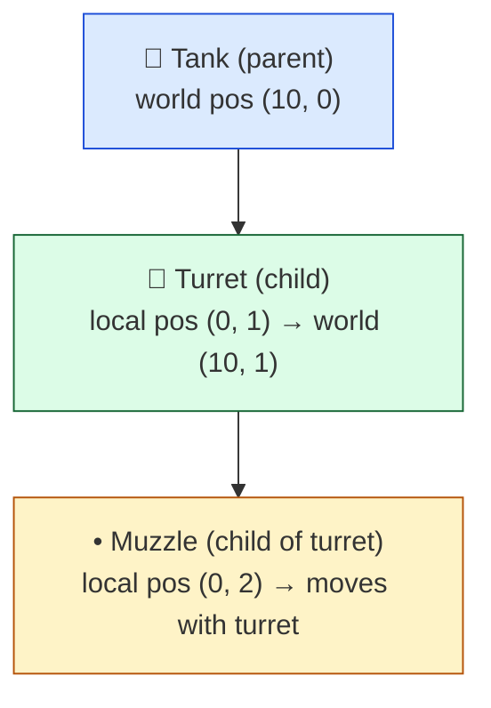
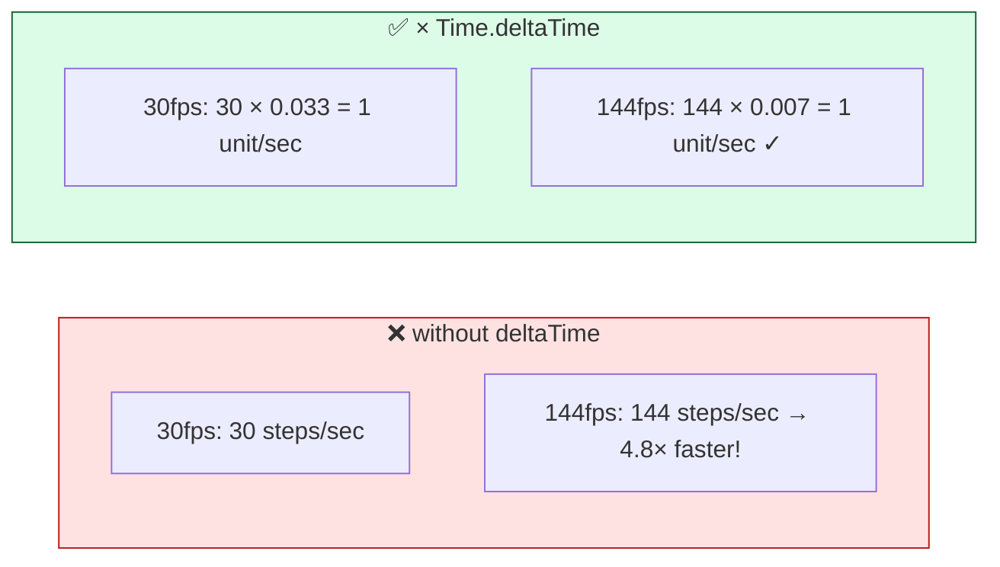

# Level 5 — Transforms & Delta Time

| | |
|---|---|
| 🎚️ **Difficulty** | 🟡 Medium |
| ⏱️ **Estimated time** | 33 minutes |
| ⭐ **XP reward** | 100 (Quest) + 25 (Quiz) |

[← Prev](04-interpolation-and-easing.md) · [↑ Phase Home](../README.md) · [→ Next](../boss-battle.md)

---

## 📖 Story

> *"Last math lesson, and it ties the world together. Everything we built — direction vectors, aim angles, smoothing — has to be *applied* to the actual objects in the scene. That happens through the **Transform**: position, rotation, scale, and the parent-child hierarchy that lets a turret ride on a tank. And there's one rule that, if you get it wrong, makes your whole game feel broken on half your players' machines: **`* Time.deltaTime`**. Today you learn exactly what a transform is and why that little multiply is non-negotiable — then you'll fold all five lessons into one reusable `Mover`. — Kenji"*

---

## 🎯 Goal

- Understand a **Transform** as **position + rotation + scale** (and the matrix idea underneath)
- Understand **parent-child** spaces: how local transforms compose into world transforms
- Understand **delta time** and why per-frame motion *must* be `* Time.deltaTime`
- Know the difference between **`Update`** (variable) and **`FixedUpdate`** (fixed, for physics)
- Build Ashfall's reusable, framerate-independent **`Mover`** — the capstone of World 2

---

## 🧠 Concepts

### A Transform is position + rotation + scale

Every object in every engine has a **Transform**: where it is (**position**, a vector — Level 1), which way it's turned (**rotation**, an angle/quaternion — Level 3), and how big it is (**scale**). Under the hood the engine bundles these into a **transformation matrix** — a compact table that, multiplied by a point, applies all three at once. You rarely touch the matrix directly; you set `position`, `rotation`, `localScale` and the engine builds it. But the mental model matters: *a transform is a recipe for converting "local" coordinates into "world" coordinates.*

### Parent-child: spaces stack

Transforms form a **hierarchy**. A child's transform is expressed **relative to its parent** (local space, Level 1), and the engine multiplies up the chain to get its final **world** transform.



Move or rotate the tank and the turret and muzzle come along *for free*, each staying put in its own local space. This is why you parent a weapon to a hand, a healthbar to an enemy, particles to a muzzle: **the hierarchy does the relative-position math for you.** `transform.position` is world; `transform.localPosition` is relative to the parent — mixing them up is a classic bug.

### Delta time — the rule that makes feel consistent

Your game's `Update` runs once **per frame**, but frames don't come at a fixed rate: a slow phone might do 30fps (a frame every ~0.033s), a gaming PC 144fps (~0.007s). If you write:

```csharp
transform.position += velocity;   // ❌ per FRAME
```

…then the 144fps machine moves the object ~5× as far per second as the 30fps one. Same code, totally different game speed. **`Time.deltaTime`** is the seconds elapsed since the last frame, and multiplying by it converts "per frame" into "per second":

```csharp
transform.position += velocity * Time.deltaTime;   // ✅ per SECOND
```



The rule: **anything you change a little bit every frame** — movement, rotation speed, timers, the smoothing from Level 4 — must scale by `Time.deltaTime` so it's measured **per second**, not per frame. (Values you *set absolutely* in one shot — like snapping to the mouse — do not.)

### Update vs FixedUpdate

- **`Update`** runs once per rendered frame (variable rate) — read input, move kinematic transforms, smoothing.
- **`FixedUpdate`** runs on a fixed timestep (e.g. every 0.02s) — **physics** (Rigidbody forces/velocity) lives here, and uses `Time.fixedDeltaTime`. World 3 dives into physics; for now: input and transform moves in `Update`, physics in `FixedUpdate`.

### Why this exists

A game must look and play the *same* whether it renders at 30 or 300fps — otherwise difficulty, speed, and feel become a lottery based on the player's hardware. Delta-time scaling is the universal fix and it is **engine-agnostic**: Unity's `Time.deltaTime`, Unreal's `DeltaSeconds`, Godot's `delta` — same concept, same reason. The transform/hierarchy is equally universal: every engine composes local transforms up a parent chain via matrices, because that's the only sane way to make complex objects (a character with a weapon with a muzzle with a light) move as one. Get these two ideas right and your motion is both *correct* (frame-independent) and *composable* (hierarchical). That's the foundation the entire player controller in World 3 stands on.

---

## 🛠️ Hands-on Lab

> 💻 All of this lives in Ashfall — transforms only mean something inside the engine.

### Step 1 — Read and set a transform

```csharp
using UnityEngine;

void Start()
{
    Debug.Log(transform.position);       // world position (Vector3)
    Debug.Log(transform.localPosition);  // position relative to the parent
    Debug.Log(transform.eulerAngles);    // rotation in DEGREES (Level 3)
    Debug.Log(transform.localScale);     // size multiplier

    transform.position = new Vector3(5, 0, 0);   // teleport (absolute set — no deltaTime)
}
```

### Step 2 — Per-second motion (the deltaTime rule)

```csharp
void Update()
{
    // Move 3 units PER SECOND to the right, at any framerate:
    transform.position += Vector3.right * 3f * Time.deltaTime;

    // Rotate 90 degrees PER SECOND (Translate/Rotate also need deltaTime):
    transform.Rotate(0, 0, 90f * Time.deltaTime);
}
```

Drop the `* Time.deltaTime` from either line and the speed becomes hostage to the framerate.

### Step 3 — Parenting does the relative math

```csharp
// Attach a muzzle flash at the gun barrel — once parented, it rides along automatically.
flash.transform.SetParent(barrel.transform);
flash.transform.localPosition = new Vector3(0, 0.5f, 0);  // 0.5 "in front" of the barrel, always
// Rotate or move the barrel and the flash follows — no per-frame sync code.
```

### Step 4 — The capstone `Mover` (all of World 2)

This is the reusable component the whole world was building toward: it takes a **direction vector** (L1), moves **per-second** (this lesson), and can be driven by input, AI chase, or knockback — anything that produces a direction.

```csharp
using UnityEngine;

// Engine-agnostic idea: velocity = normalized direction × speed, applied per second.
public class Mover : MonoBehaviour
{
    [SerializeField] private float speed = 5f;
    public float Speed { get => speed; set => speed = value; }

    private Vector2 moveDir;   // a DIRECTION (length 0 or 1)

    /// Anything can set the heading: input, AI, knockback.
    public void SetDirection(Vector2 dir)
        => moveDir = dir == Vector2.zero ? Vector2.zero : dir.normalized;   // L1 guard + normalize

    void Update()
    {
        // direction × speed × deltaTime = correct per-second movement at any framerate
        transform.position += (Vector3)(moveDir * speed) * Time.deltaTime;
    }
}
```

Driver example — input feeds the same `Mover` (and tomorrow, AI feeds it too):

```csharp
public class PlayerInput : MonoBehaviour
{
    private Mover mover;
    void Awake() => mover = GetComponent<Mover>();

    void Update()
    {
        Vector2 input = new Vector2(
            Input.GetAxisRaw("Horizontal"),
            Input.GetAxisRaw("Vertical"));
        mover.SetDirection(input);   // Mover handles normalize + speed + deltaTime
    }
}
```

`Mover` owns the *math*; drivers just hand it a direction. That separation (composition from World 1!) is exactly what World 3's player controller will build on.

---

## 🎮 Mini Challenge

A teammate's enemy moves *fine on their PC but teleports across the room on yours*. Their move line is `transform.position += dir * 6f;`. What's wrong, and what's the fix?

<details>
<summary>💡 Reveal answer</summary>

It's missing `* Time.deltaTime`, so it moves **6 units per frame** instead of per second. On a high-refresh monitor there are far more frames per second, so the enemy flies across the room; on a slow machine it crawls. Fix:

```csharp
transform.position += dir * 6f * Time.deltaTime;   // now 6 units PER SECOND, any framerate
```

This is the single most common motion bug in all of game development — and you'll spot it instantly for the rest of your career.
</details>

---

## 📦 Project Mission

Crown World 2 by giving Ashfall a single, reusable `Mover` that everything drives — closing the loop from World 1's empty `Mover` stub.

1. Create (or replace) `Assets/Scripts/Movement/Mover.cs` with the step-4 component: it takes a direction, normalizes it, and moves `direction * speed * Time.deltaTime`.
2. Refactor your Level 1 movement so input now flows **through** `Mover.SetDirection(...)` instead of moving the transform directly.
3. Confirm the same `Mover` can be driven by a different source: temporarily feed it a chase direction (`(playerPos - enemyPos).normalized` from Level 1) on a dummy enemy — same component, different driver.
4. Verify framerate independence: cap to 30fps then 120fps; the player should cross the screen in the *same* wall-clock time.
5. Commit:
   ```bash
   cd ~/projects/ashfall
   git switch -c feature/mover
   git add Assets/Scripts/Movement
   git commit -m "feat: reusable framerate-independent Mover (direction + speed + deltaTime)"
   git switch main && git merge feature/mover && git push
   ```

🎯 **Mission complete when:** one `Mover` component is driven by input (and provably by any other direction source), all motion is `* Time.deltaTime` (identical speed at 30 vs 120fps), and your Level 1 movement now routes through `Mover.SetDirection`.

---

## ⚠️ Common Mistakes

| Mistake | What happens | Fix |
|--------|--------------|-----|
| Per-frame motion without `* Time.deltaTime` | Speed scales with framerate (teleports on fast PCs) | Multiply per-frame changes by `Time.deltaTime` |
| Putting `* Time.deltaTime` on an absolute set | A teleport/snap gets wrongly scaled | Only scale incremental changes, not one-shot sets |
| Physics (Rigidbody) in `Update` | Jittery, timestep-dependent physics | Do Rigidbody work in `FixedUpdate` |
| Confusing `position` and `localPosition` | Child ends up in the wrong place | World = `position`; relative = `localPosition` |
| Manually syncing a child to a parent each frame | Bugs + wasted code | Parent it; the hierarchy does the math |
| Forgetting `Rotate`/`Translate` also need deltaTime | Spin/slide speed varies by framerate | Scale those by `Time.deltaTime` too |

---

## 🤔 Reflection Questions

1. Describe a Transform in one sentence, and explain how a child's local position becomes a world position.
2. Walk through *why* `position += velocity` (no deltaTime) makes a game run faster on a 144fps machine than a 30fps one.
3. The `Mover` doesn't care whether its direction comes from input, AI, or knockback. Which World 1 principle is that, and why is it valuable here?

---

## 📝 Quiz

1. **`Time.deltaTime` is…**
   - a) the current frame number
   - b) the seconds elapsed since the previous frame
   - c) the target framerate
2. **`transform.position += velocity * Time.deltaTime` makes the motion…**
   - a) frame-rate independent (same speed per second on any hardware)
   - b) faster on high-refresh monitors
   - c) snap instantly to the target
3. **Rigidbody physics code belongs in…**
   - a) `Update`
   - b) `FixedUpdate`
   - c) `LateUpdate`

<details>
<summary>✅ Answers</summary>

1: **b** · 2: **a** · 3: **b**
</details>

---

## ✅ Completion Checklist

- [ ] I can explain a Transform (position/rotation/scale) and how parent→child spaces compose
- [ ] I know why per-frame changes must be `* Time.deltaTime`, and what *not* to scale
- [ ] I know `Update` vs `FixedUpdate` (and that physics goes in `FixedUpdate`)
- [ ] Ashfall has a reusable, framerate-independent `Mover` driven through `SetDirection`
- [ ] Speed is identical at 30fps and 120fps; work committed
- [ ] I passed the quiz
- [ ] Added **+125 XP** to [PROGRESS.md](../../../PROGRESS.md)

---

[← Prev](04-interpolation-and-easing.md) · [↑ Phase Home](../README.md) · [→ Next](../boss-battle.md)
