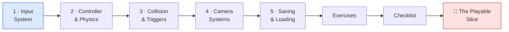
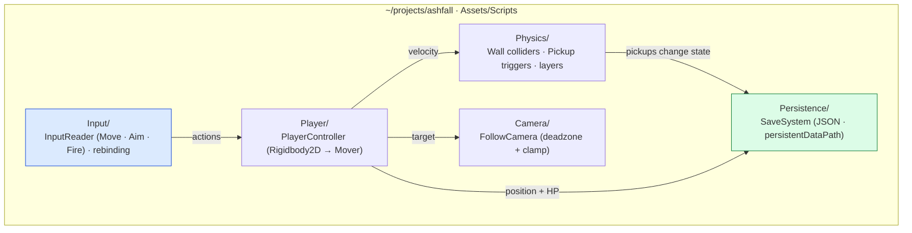

# 🎮 World 3 — Core Game Programming

> The math is in (World 2): Ashfall can move, aim, and smooth itself framerate-independently. But it still isn't a *game* — nothing **reads your controller**, nothing **stops** you at a wall, the camera doesn't **follow**, and a restart wipes everything. This world turns the `Mover` and camera math into a real, input-driven **player controller** with physics, collision, a follow camera, and a save file that survives a reboot.

[↑ Home](../../README.md) · [🗺️ Roadmap](../../ROADMAP.md) · [📊 Progress](../../PROGRESS.md)

---

## 📨 Your ticket

```
From:    Maya <maya@pixelforge.studio>
To:      You <new-hire@pixelforge.studio>
Cc:      Kenji <kenji@pixelforge.studio>
Subject: [W3-PLAY] It moves, but it doesn't feel like a GAME yet

The movement math is genuinely great — but I just sat a playtester down
and watched them get confused in ten seconds. Here's why:

  - Movement is hard-wired to the keyboard. No controller, no rebinding,
    no clean line between "the player pressed a thing" and "the character
    does a thing." That separation matters the second we add a gamepad.
  - You walk straight THROUGH walls. There's no collision, no triggers,
    so pickups can't be picked up.
  - The camera just sits there. The player walks off-screen.
  - And the killer: I closed the build, reopened it, and the character was
    back at spawn with full HP. Nothing persists.

Make it a GAME, not a tech demo:

  1. An input layer (Move / Aim / Fire) that doesn't care what device sent it.
  2. A real top-down player controller on physics that drives the W2 Mover.
  3. Walls that stop you and triggers that fire pickups.
  4. A camera that follows smoothly and stays inside the room.
  5. A save file: position + HP survive a restart.

Kenji's got you. Boss check: a playable vertical slice — move, collide,
collect, the camera follows, and the save sticks. Ship that and World 4
(the actual dungeons) is yours.

— Maya
```

This is World 3 of 13. Everything you build advances the **one growing Ashfall project** in `~/projects/ashfall`. You arrive with clean architecture (W1) and movement/aim/camera math (W2); you leave with a character a stranger can pick up and play.

---

## 🎯 What you'll achieve in this world

- 🎛️ Build an **input abstraction** — devices → *actions* (`Move`, `Aim`, `Fire`), polling vs events, rebinding — decoupled from any keyboard or pad
- 🏃 Write a top-down **player controller on physics** — `Rigidbody2D` vs transform, the fixed timestep, forces vs velocity — driving the W2 `Mover`
- 🧱 Use **colliders, layers, and the collision matrix** — collision vs **trigger**, raycasts — so walls stop you and pickups fire
- 🎥 Build a **follow camera** — smoothing (W2 lerp), a deadzone, clamping to room bounds, screen-to-world
- 💾 Build a **save system** — serialization, JSON, `Application.persistentDataPath`, a save/load lifecycle that survives a restart

---

## 🗺️ Level map

| Level | Lesson | Difficulty | XP |
|------:|--------|:----------:|---:|
| 1 | [The Input System](lessons/01-the-input-system.md) | 🟢 Easy | 125 |
| 2 | [Player Controller & Physics](lessons/02-player-controller-and-physics.md) | 🟡 Medium | 125 |
| 3 | [Collision & Triggers](lessons/03-collision-and-triggers.md) | 🟡 Medium | 125 |
| 4 | [Camera Systems](lessons/04-camera-systems.md) | 🟡 Medium | 125 |
| 5 | [Saving & Loading](lessons/05-saving-and-loading.md) | 🟡 Medium | 125 |
| 👹 | [Boss Battle — The Playable Slice](boss-battle.md) | 🔴 Hard | 500 |

➕ Extra reps: [exercises.md](exercises.md) · ✅ Ready to advance? [checklist.md](checklist.md)

---

## 🧭 Recommended order



Go in order — each lesson feeds the next. Input (L1) is what the controller *reads*; the controller (L2) is what physics *moves*; collision (L3) is what stops that movement and fires pickups; the camera (L4) frames the thing you can now drive; saving (L5) persists the state you've built. The boss **assembles all five** into one playable slice.

---

## 📦 Ashfall project status

**Entering World 3:** clean, decoupled architecture (W1) plus a reusable `Mover`, mouse-aim, and a framerate-independent `CameraFollow` math core (W2) — but input is keyboard-hardwired, there's no collision, the camera doesn't truly follow a target, and nothing persists.

**Leaving World 3:** a controllable player you can **move** with any device, that **collides** with walls and **triggers** pickups, that the camera **follows** and frames within room bounds, and whose position + HP **save and load** across a restart.



You hand this to **World 4 — Algorithms & Data Structures**, where procedurally generated dungeons (which the save system will also persist) give the player something to actually explore.

---

## 👹 Boss teaser

**"The Playable Slice"** — Maya wants proof Ashfall is a *game*: a top-down player you can **move**, that **collides** with walls and **collects** pickups through triggers, that the **camera follows** and keeps on-screen, and whose **position + HP save and load** across a restart. No tutorial — you'll fuse all five lessons into one cohesive vertical slice. Beat it to earn the **🎮 Gameplay Programmer** badge, a +250 world-complete bonus, and unlock World 4.

---

## 📚 Resources

Don't go link-hunting — the curated free list lives in [RESOURCES.md](../../RESOURCES.md). For this world, the standouts are Unity's **official Input System** docs (the actions/bindings model), **Brackeys**' classic save/load and 2D controller tutorials, and Unity's **physics & colliders** manual pages for the 2D collision matrix.

---

[↑ Home](../../README.md) · [🗺️ Roadmap](../../ROADMAP.md) · [📊 Progress](../../PROGRESS.md) · [➡️ Next World: Algorithms & Data Structures](../phase-04-algorithms-data-structures/README.md) · [▶️ Start Level 1 →](lessons/01-the-input-system.md)
