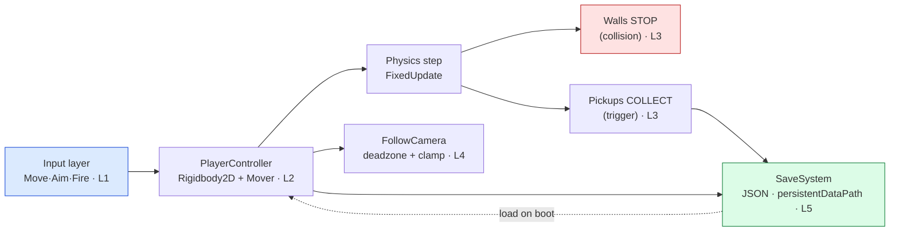

# 👹 Boss Battle — The Playable Slice

| | |
|---|---|
| 🎚️ **Difficulty** | 🔴 Hard |
| ⏱️ **Estimated time** | 75 minutes |
| ⭐ **XP reward** | 500 |
| 🔓 **Unlocks** | World 4 — Algorithms & Data Structures |

[← Checklist](checklist.md) · [↑ Phase Home](README.md) · [↑ Home](../../README.md)

---

## 📨 The incident

```
From:    Maya <maya@pixelforge.studio>
To:      You <new-hire@pixelforge.studio>
Cc:      Kenji <kenji@pixelforge.studio>, Theo <theo@pixelforge.studio>
Subject: [W3-BOSS] Theo wants to PLAY it Friday. Give me a real slice.

Theo's bringing a publisher contact by on Friday and wants to put a
controller in their hands — not a slide deck, not a tech demo. A
"vertical slice": small, but every core loop actually works.

Here's the bar. They walk up, grab the pad, and:

  - The character MOVES — and it works whether they grab keyboard or
    gamepad, because input goes through your action layer, not a device.
  - They hit a wall and it STOPS them. No walking through geometry.
  - They walk over a pickup and it's COLLECTED — a trigger fires, the
    item's gone, a counter ticks up.
  - The CAMERA follows them smoothly and never shows the void outside
    the room.
  - Theo closes the build mid-demo (he will), reopens it — and the
    character is exactly where they left it, with the right HP and the
    pickups they grabbed still gone. The save STICKS.

That's the whole world in one playable scene. No tutorial this time —
you've got input, physics, collision, camera, and saving. Wire them into
ONE slice. Nail it and World 4 — the real dungeons — is yours.

— Maya
```

> ⚔️ **Boss Battle rules:** No tutorials, no copying lesson files wholesale. **Apply** World 3: build the input layer, the physics controller, the collision/triggers, the follow camera, and the save lifecycle yourself, and wire them into one scene. You win when every victory condition is met **and you can explain which system owns each behavior** (input → controller → physics → triggers → camera → save).

---

## 🎯 Your mission

Assemble a **playable vertical slice** of Ashfall in one scene: a top-down player you can **move**, that **collides** with walls, **collects** pickups through triggers, that the **camera follows** within bounds, and whose **state saves and loads** across a restart. This is the capstone that fuses every lesson:



Build it from these pieces (at minimum):

1. **Input (L1):** the controller reads `Move` (and `Fire`/`Aim` if you wish) from your `InputReader` — *actions*, not `Input.GetKey`. Works for keyboard and would work for a pad untouched.
2. **Controller + physics (L2):** a `PlayerController` on a `Rigidbody2D` driving the W2 `Mover`, applying movement in `FixedUpdate` (velocity/`MovePosition`, never transform teleport).
3. **Collision (L3):** walls with solid colliders stop the player — no tunneling.
4. **Triggers (L3):** pickups are triggers; walking over one fires `OnTriggerEnter2D`, removes the item, and increments a collected counter.
5. **Camera (L4):** a `FollowCamera` smoothing in `LateUpdate`, with a deadzone and clamped to the room bounds.
6. **Save/Load (L5):** on quit/keypress, serialize player **position + HP + collected pickups** to JSON in `persistentDataPath`; on boot, load it back so a restart restores the exact state.

---

## 🏆 Victory conditions

- [ ] The player **moves** via the **input action layer** (`Move`), not raw device reads — keyboard works, and a gamepad would work without touching the controller
- [ ] Movement runs through **physics** (`Rigidbody2D` velocity/`MovePosition` in `FixedUpdate`), not a transform teleport
- [ ] Walls **stop** the player — no walking through geometry (collision)
- [ ] Walking over a pickup **collects** it via `OnTriggerEnter2D` — the item disappears and a counter increments (trigger)
- [ ] The **camera follows** smoothly (LateUpdate + framerate-independent smoothing) and **clamps to room bounds** — never shows the void
- [ ] **Save & load works:** quit and relaunch, and player **position + HP + collected pickups** are exactly restored from JSON in `persistentDataPath`
- [ ] It's **one playable scene** a stranger can pick up and play
- [ ] You can explain which system owns each behavior

---

## 🧪 How you'll know you won

```bash
cd ~/projects/ashfall
ls Assets/Scripts/Input Assets/Scripts/Player Assets/Scripts/Camera Assets/Scripts/Persistence
# → InputReader.cs, PlayerController.cs, FollowCamera.cs, SaveSystem.cs (+ Pickup.cs)

# after you play and save once, the file actually exists:
ls "$HOME/Library/Application Support/PixelForgeStudios/Ashfall"   # macOS persistentDataPath
# → save.json
```

Then in the Editor / a build:
- Press WASD (or a stick) — the character **moves** and **stops dead** at walls.
- Walk over a pickup — it **vanishes** and the collected count ticks up.
- Walk to the room edge — the **camera stops** at the boundary instead of revealing emptiness.
- **Quit the app**, relaunch — you spawn exactly where you stood, with the same HP, and the pickups you grabbed are still gone.

If all that holds, Ashfall is a *game* a stranger can play. You've won.

<details>
<summary>🔎 Reference solution — only after you've tried! (high-level sketch + key code)</summary>

**The shape of it (each system owns one job):**

| Piece | Job | Lesson |
|---|---|---|
| `InputReader` | devices → `Move`/`Fire` actions | L1 |
| `PlayerController` | read actions → drive `Mover` through `Rigidbody2D` | L2 |
| walls / `Pickup` | solid colliders stop; triggers collect | L3 |
| `FollowCamera` | smooth follow + deadzone + clamp | L4 |
| `SaveSystem` | serialize/restore state via JSON | L5 |

**Controller: actions in, physics out (FixedUpdate):**

```csharp
using UnityEngine;

[RequireComponent(typeof(Rigidbody2D))]
public class PlayerController : MonoBehaviour
{
    [SerializeField] private InputReader input;
    [SerializeField] private float moveSpeed = 6f;
    public int Hp = 100;
    public int Collected;
    private Rigidbody2D rb;

    void Awake() => rb = GetComponent<Rigidbody2D>();

    void FixedUpdate()
    {
        // L1: intent from the action layer, not a device.  L2: move via physics.
        Vector2 dir = input.Move.normalized;                 // equal-speed (W2)
        rb.MovePosition(rb.position + dir * moveSpeed * Time.fixedDeltaTime);
    }
}
```

**Pickup: a trigger that collects and tells the save state:**

```csharp
using UnityEngine;

public class Pickup : MonoBehaviour
{
    public string id;   // stable id so we know which ones are gone on reload

    void OnTriggerEnter2D(Collider2D other)            // L3: trigger, not collision
    {
        if (!other.TryGetComponent(out PlayerController pc)) return;
        pc.Collected++;
        SaveSystem.MarkCollected(id);                  // remember it's gone
        Destroy(gameObject);
    }
}
```

**Follow camera: LateUpdate + framerate-independent smooth + clamp:**

```csharp
using UnityEngine;

public class FollowCamera : MonoBehaviour
{
    [SerializeField] private Transform target;
    [SerializeField] private float sharpness = 8f;
    [SerializeField] private Vector2 min, max;   // room bounds

    void LateUpdate()                            // L4: after movement
    {
        float t = 1f - Mathf.Exp(-sharpness * Time.deltaTime);  // W2: framerate-independent
        Vector3 desired = new(target.position.x, target.position.y, transform.position.z);
        Vector3 smooth  = Vector3.Lerp(transform.position, desired, t);
        smooth.x = Mathf.Clamp(smooth.x, min.x, max.x);          // clamp to bounds
        smooth.y = Mathf.Clamp(smooth.y, min.y, max.y);
        transform.position = smooth;
    }
}
```

**Save system: JSON to persistentDataPath, restored on boot:**

```csharp
using System.IO;
using System.Collections.Generic;
using UnityEngine;

[System.Serializable]
public class SaveData                                  // L5: plain serializable class
{
    public Vector2 playerPos;
    public int hp;
    public List<string> collected = new();
}

public static class SaveSystem
{
    static string Path => System.IO.Path.Combine(Application.persistentDataPath, "save.json");
    static SaveData data = new();

    public static void MarkCollected(string id) { if (!data.collected.Contains(id)) data.collected.Add(id); }

    public static void Save(PlayerController pc)
    {
        data.playerPos = pc.transform.position;
        data.hp = pc.Hp;
        File.WriteAllText(Path, JsonUtility.ToJson(data, true));   // human-readable
    }

    public static SaveData Load()
    {
        if (!File.Exists(Path)) return null;
        data = JsonUtility.FromJson<SaveData>(File.ReadAllText(Path));
        return data;                                   // controller applies pos/hp; gone pickups destroy themselves
    }
}
```

**Why each piece is the right tool:**
- Reading `Move` from `InputReader` means the *controller never knows* whether a key or a stick sent it — add a pad, change nothing (L1).
- `MovePosition` in `FixedUpdate` lets the solver resolve wall collisions, so the player can't tunnel (L2/L3).
- The pickup is a **trigger** so it collects without shoving the player; the wall is a **collision** so it does (L3).
- `LateUpdate` + `1 - Exp(-k*dt)` keeps the camera glued to the *finished* player position, identically at any frame rate, and `Clamp` hides the void (L4/W2).
- `persistentDataPath` is the only writable per-user spot, and `JsonUtility` over a `[Serializable]` class is the simplest durable format — restart-proof state (L5).

One scene, five systems, every core loop working. That's all of World 3 in a single playable slice.
</details>

---

## 🎁 Rewards

- 🏆 **+500 XP**
- 🏅 Achievement unlocked: **🎮 Gameplay Programmer** — you turned math and architecture into a thing a stranger can pick up and *play*
- 🔓 **World 4 — Algorithms & Data Structures** unlocks
- 📈 Update [PROGRESS.md](../../PROGRESS.md): mark World 3 ✅ and add the **+250 World Complete bonus**

> 🗒️ Reflection: a vertical slice is the single most important artifact in early production — it's what proves the game *is* a game. You just built one from first principles: device-agnostic input, physics movement, collision and triggers, a framing camera, and durable state. World 4 fills this slice with procedurally generated dungeons to explore — and your save system will persist those too.

---

[← Checklist](checklist.md) · [↑ Phase Home](README.md) · [↑ Home](../../README.md) · [🧮 Enter World 4 →](../phase-04-algorithms-data-structures/README.md)
