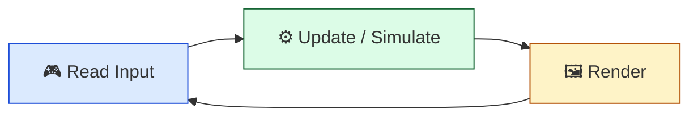
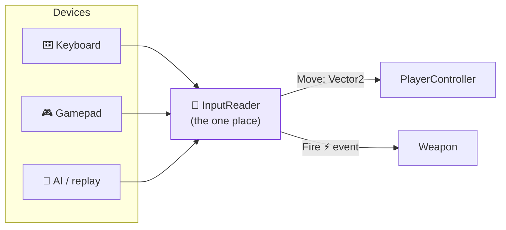

# Level 1 — The Input System

| | |
|---|---|
| 🎚️ **Difficulty** | 🟢 Easy |
| ⏱️ **Estimated time** | 30 minutes |
| ⭐ **XP reward** | 100 (Quest) + 25 (Quiz) |

[← Prev](../README.md) · [↑ Phase Home](../README.md) · [→ Next](02-player-controller-and-physics.md)

---

## 📖 Story

> *"Welcome to World 3 — this is where Ashfall stops being a math demo and becomes a **game you can drive**. First thing first: input. And here's the trap most juniors fall into — they sprinkle `Input.GetKey(KeyCode.W)` all over the player, the menus, the inventory… then Maya asks for controller support, or a player wants to rebind keys, and suddenly we're touching forty files. We don't do that here. Input is a **layer**: devices push raw signals in one side, clean intentions — 'the player wants to move up-left', 'the player wants to fire' — come out the other. The rest of the game never knows whether that came from a keyboard, a gamepad, or an AI. Today you build Ashfall's `InputReader`. — Kenji"*

---

## 🎯 Goal

- Understand where **input** sits in the **game loop** (read → simulate → render)
- Know the difference between **polling** and **events**, and when each fits
- Treat input as an **abstraction**: raw devices → intentions (actions), never wired directly into gameplay
- Hide input behind an **interface** so it's rebindable, testable, and engine-agnostic
- Build Ashfall's **`InputReader`** exposing a `Move` vector and a `Fire` action

---

## 🧠 Concepts

### Input is the first phase of the game loop

Every game, in every engine, runs the same heartbeat every frame: **read input → update the world → draw the world**. Input is *phase one*. If you read it sloppily, everything downstream inherits the mess.



### Polling vs events

There are two ways to learn what the player did:

- **Polling** — every frame you *ask*: "is the move key down right now?" Great for **continuous** state (movement, aiming, holding a button). This is what `Update` is built for.
- **Events** — the system *tells* you the instant something happens ("Fire was pressed"). Great for **discrete, one-shot** actions (jump, shoot, open menu) where you must not miss the exact frame.

Rule of thumb: **poll continuous things, subscribe to discrete things.** Movement is polled (a held direction); firing is an event (a press).

### The real idea: devices → actions

The mistake is reading *devices* in gameplay code. The fix is to read devices in **one place** and translate them into **actions** — named intentions your game understands. `W`/`up-stick`/`AI` all become the same `Move` action. Gameplay subscribes to *actions*, not keys.



This is why we put `InputReader` behind an **interface** (`IInputReader`). Gameplay depends on the interface — so you can swap a keyboard reader for a gamepad reader, an AI reader, or a fake reader in a test, **without changing a line of player code**. (That's the dependency-inversion habit from World 1, applied to input.)

### Why this exists

A game that hard-codes `KeyCode.W` is a game that can't add a gamepad, can't let players rebind, can't be tested without a human pressing keys, and can't be driven by an AI or a replay system. Every serious engine ships an input-action layer for exactly this reason — Unity's **Input System** package (Actions/Maps), Unreal's **Enhanced Input** (Input Actions/Mapping Contexts), Godot's **InputMap**. They're all the same first-principles move: **decouple the physical device from the gameplay intention.** Build that seam once, early, and every later feature — rebinding, co-op, accessibility, bots — slots in cheaply. Skip it, and you pay interest forever. Ashfall builds the seam now, in World 3, because *everything* after this (combat, menus, the boss) reads input.

---

## 🛠️ Hands-on Lab

> 💻 Two ways to read input in Unity: the classic `Input.GetAxis` (simple, fine to learn on) and the newer **Input System** package (action-based, the production choice). We'll abstract *both* behind one interface so Ashfall doesn't care which you use.

### Step 1 — Define the seam (the interface)

Gameplay will depend on this, not on Unity:

```csharp
using System;
using UnityEngine;

// The contract: a source of player intentions. Engine-agnostic.
public interface IInputReader
{
    Vector2 Move { get; }     // polled continuous state: -1..1 on each axis
    event Action FirePressed; // discrete one-shot event
}
```

### Step 2 — A reader using classic Input axes (polling + edge-detect)

```csharp
using System;
using UnityEngine;

// Reads the old Input Manager. Note: NO gameplay logic here — just translation.
public class LegacyInputReader : MonoBehaviour, IInputReader
{
    public Vector2 Move { get; private set; }
    public event Action FirePressed;

    void Update()
    {
        // POLL continuous movement every frame:
        Move = new Vector2(
            Input.GetAxisRaw("Horizontal"),
            Input.GetAxisRaw("Vertical"));

        // EDGE-DETECT a discrete press, then fire the event (so listeners can't miss it):
        if (Input.GetButtonDown("Fire1"))
            FirePressed?.Invoke();
    }
}
```

### Step 3 — A reader using the Input System package (the production path)

> Install via **Window → Package Manager → Input System**, then create an `InputActions` asset with a `Move` (Value/Vector2) and `Fire` (Button) action. Unity can generate a C# wrapper class from it.

```csharp
using System;
using UnityEngine;
using UnityEngine.InputSystem;   // requires the Input System package

// Same interface, different device backend — gameplay can't tell the difference.
public class NewInputReader : MonoBehaviour, IInputReader
{
    private GameControls controls;          // generated from the .inputactions asset
    public Vector2 Move { get; private set; }
    public event Action FirePressed;

    void Awake()  => controls = new GameControls();
    void OnEnable()
    {
        controls.Player.Enable();
        // The package raises events for us — we just relay them through our interface:
        controls.Player.Move.performed += ctx => Move = ctx.ReadValue<Vector2>();
        controls.Player.Move.canceled  += _   => Move = Vector2.zero;
        controls.Player.Fire.performed += _   => FirePressed?.Invoke();
    }
    void OnDisable() => controls.Player.Disable();
}
```

### Step 4 — Gameplay consumes the interface, never a device

```csharp
using UnityEngine;

// This class would work UNCHANGED with the legacy reader, the new reader, or a fake AI reader.
public class WeaponDemo : MonoBehaviour
{
    [SerializeField] private MonoBehaviour inputSource; // assign any IInputReader in the Inspector
    private IInputReader input;

    void Awake()    => input = (IInputReader)inputSource;
    void OnEnable() => input.FirePressed += Shoot;       // subscribe to the ACTION
    void OnDisable()=> input.FirePressed -= Shoot;       // always unsubscribe!

    void Update()
    {
        if (input.Move != Vector2.zero)
            Debug.Log($"Player wants to move: {input.Move}");  // tomorrow: drive the Mover
    }

    private void Shoot() => Debug.Log("💥 Fire!");
}
```

Notice the payoff: `WeaponDemo` has **zero** `KeyCode`s and **zero** `Input.` calls. It speaks intentions.

---

## 🎮 Mini Challenge

A teammate reads firing with `if (Input.GetButton("Fire1"))` inside `Update` and the gun fires ~100 bullets per held press. They swear they "only pressed it once." What's the bug, and what's the fix?

<details>
<summary>💡 Reveal answer</summary>

`GetButton` **polls** — it's `true` for *every frame* the button is held, so a half-second hold fires across ~30+ frames. Firing is a **discrete** action: use the edge-detected `GetButtonDown` (true only on the frame of the press) or subscribe to a `performed` event. Poll continuous state, event discrete actions.

```csharp
if (Input.GetButtonDown("Fire1")) FirePressed?.Invoke(); // once per press
```
</details>

---

## 📦 Project Mission

Give Ashfall its input layer — the seam everything in World 3 plugs into.

1. In `~/projects/ashfall`, create `Assets/Scripts/Input/IInputReader.cs` with the interface from Step 1 (`Move` + `FirePressed`).
2. Create a concrete reader (`LegacyInputReader` from Step 2 is fine to start; upgrade to `NewInputReader` if you've installed the Input System package).
3. Add a throwaway `WeaponDemo` (Step 4) on the player, assign your reader, and confirm the console logs the move vector while you steer and `💥 Fire!` exactly **once per press**.
4. Confirm decoupling: nothing outside the `Input/` folder references `Input.` or `KeyCode` anymore.
5. Commit:
   ```bash
   cd ~/projects/ashfall
   git switch -c feature/input-layer
   git add Assets/Scripts/Input
   git commit -m "feat: InputReader abstraction (Move vector + Fire action, device-agnostic)"
   git switch main && git merge feature/input-layer && git push
   ```

🎯 **Mission complete when:** Ashfall has an `IInputReader` exposing a polled `Move` vector and an event-based `Fire`, a concrete reader implements it, and gameplay code references the interface only — no `KeyCode`/`Input.` outside the input layer.

---

## ⚠️ Common Mistakes

| Mistake | What happens | Fix |
|--------|--------------|-----|
| Reading `Input.GetKey` directly in gameplay | Can't rebind, add gamepad, or test | Read devices only inside the input layer |
| Polling a discrete action (`GetButton` for fire) | Action repeats every held frame | Edge-detect (`GetButtonDown`) or use an event |
| Subscribing to an event but never unsubscribing | Leaks, double-fires after reload | Unsubscribe in `OnDisable` |
| Reading input in `FixedUpdate` | Misses presses between physics ticks | Read input in `Update`; cache for physics |
| Depending on the concrete reader, not the interface | Can't swap device or fake it in tests | Depend on `IInputReader` |

---

## 🤔 Reflection Questions

1. Why is movement polled but firing event-driven? Give the failure mode of swapping them.
2. Maya asks for full gamepad support next sprint. With the `IInputReader` seam in place, what actually has to change — and what doesn't?
3. How would you write an automated test for the player **without a human touching the keyboard**? What does the interface let you do?

---

## 📝 Quiz

1. **The input phase of the game loop runs…**
   - a) once at startup
   - b) once per frame, before simulation
   - c) only when a key changes
2. **A discrete one-shot action (e.g. Fire) is best handled by…**
   - a) polling its held state every frame
   - b) an event / edge-detected press
   - c) reading it in `FixedUpdate`
3. **Putting input behind `IInputReader` mainly buys you…**
   - a) faster frame times
   - b) decoupling from devices (rebinding, gamepad, AI, testing)
   - c) smaller build size

<details>
<summary>✅ Answers</summary>

1: **b** · 2: **b** · 3: **b**
</details>

---

## ✅ Completion Checklist

- [ ] I can place input in the read→simulate→render loop and explain polling vs events
- [ ] I understand devices→actions and why gameplay reads intentions, not keys
- [ ] Ashfall has an `IInputReader` with a `Move` vector + `Fire` event
- [ ] A concrete reader implements it; no `KeyCode`/`Input.` leaks into gameplay
- [ ] Fire triggers exactly once per press; move logs while steering
- [ ] I passed the quiz
- [ ] Added **+125 XP** to [PROGRESS.md](../../../PROGRESS.md)

---

[← Prev](../README.md) · [↑ Phase Home](../README.md) · [→ Next](02-player-controller-and-physics.md)
