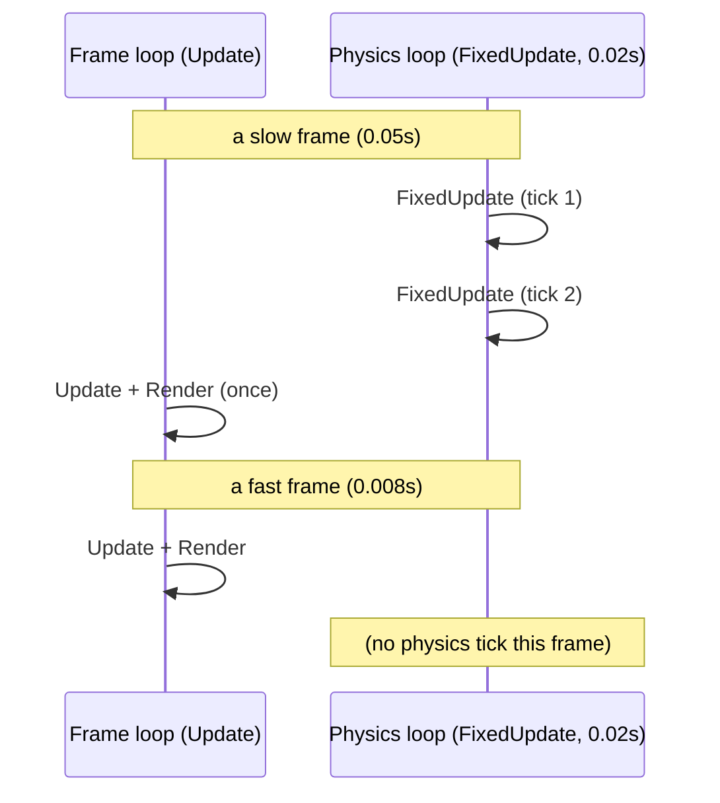
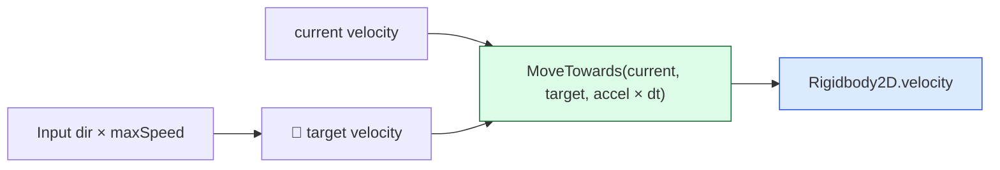

# Level 2 — Player Controller & Physics

| | |
|---|---|
| 🎚️ **Difficulty** | 🟡 Medium |
| ⏱️ **Estimated time** | 34 minutes |
| ⭐ **XP reward** | 100 (Quest) + 25 (Quiz) |

[← Prev](01-the-input-system.md) · [↑ Phase Home](../README.md) · [→ Next](03-collision-and-triggers.md)

---

## 📖 Story

> *"Yesterday you built the seam that tells us **what the player wants**. Today we turn that into a body that **moves** — and not just moves, but *feels* good. Maya's note on the ticket says it all: 'the player should feel responsive but weighty — snaps to top speed fast, glides to a stop, never icy, never twitchy.' That feel is acceleration and deceleration, and it's a few numbers you'll tune by hand. But there's a deeper thing here you have to get right or collisions will betray you next lesson: when the player has a **Rigidbody**, you do **not** shove the transform around — you let the physics engine move it, in `FixedUpdate`. Get that wrong and walls leak. Let me show you the right way. — Kenji"*

---

## 🎯 Goal

- Understand the **fixed timestep** and why physics runs separately from rendering
- Know **`Update` vs `FixedUpdate`** for a physics-driven body
- Move a body two ways — **transform** vs **`Rigidbody2D`** — and know when each is correct
- Understand **velocity** vs **forces**, and build **acceleration/deceleration** for snappy feel
- Build Ashfall's top-down **`PlayerController`** driving a `Rigidbody2D`, fed by Level 1's `InputReader`

---

## 🧠 Concepts

### Two clocks: the frame clock and the physics clock

Rendering runs as fast as it can (variable: 30, 60, 144 fps). Physics needs a **fixed, steady timestep** (default 0.02s = 50 ticks/sec) so collisions and forces are stable and reproducible. So engines run **two loops**: `Update` once per rendered frame, `FixedUpdate` once per physics tick. In a busy frame `FixedUpdate` may run twice (or zero times) before the next render.



**The rule:** read input and do visuals in `Update`; touch the `Rigidbody` in `FixedUpdate` (using `Time.fixedDeltaTime`). Mixing them up causes jitter and tunneling.

### Transform movement vs Rigidbody movement

- **Transform movement** (`transform.position +=`) — you teleport the object yourself each frame. The physics engine isn't involved, so it **can't reliably stop you at walls** (you can shove straight through a collider). Fine for things with no physics (UI, decorations, a kinematic platform you fully control).
- **Rigidbody movement** — you set the body's **velocity** (or apply forces) and the physics engine integrates motion *and* resolves collisions for you. This is what a player who must respect walls needs. **Don't** also write `transform.position` on a Rigidbody — you'd be fighting the engine.

For a 2D top-down player we use a `Rigidbody2D` set to **Dynamic**, **gravity scale 0** (top-down, no falling), and we drive its `velocity`.

### Velocity vs forces, and the *feel*

- **Velocity** = directly setting "how fast, which way" (m/s). Precise, arcade-snappy — great for a top-down character.
- **Forces** (`AddForce`) = pushing; the body builds up velocity over time via its mass. Physical and floaty — great for knockback, explosions, momentum.

For Ashfall we set **target velocity** from input, then **move our current velocity toward it** with an acceleration rate. Big accel = snappy/arcadey; small accel = slippery/weighty. Same trick for stopping (deceleration). This is just the **`MoveTowards`** idea — interpolating a value toward a target at a fixed rate — applied to velocity.



### Why this exists

The separation of a fixed physics clock from a variable render clock is **universal** — Unity's `FixedUpdate`, Unreal's substepping, Godot's `_physics_process`, and every custom engine do it, because numerical integration and collision response are only stable at a steady timestep. And the velocity-toward-target pattern is *the* secret behind why some games feel "tight" and others feel "mushy": responsiveness is literally the accel/decel numbers. By driving a Rigidbody (not the transform), Ashfall's player gets correct wall collisions **for free** next lesson — the physics engine already resolves them. Pick transform movement here and Level 3's walls would leak. This is the load-bearing decision of the whole world.

---

## 🛠️ Hands-on Lab

> 💻 Set up the body first: add a **Rigidbody2D** (Body Type: Dynamic, Gravity Scale: **0**, Freeze Rotation Z: ✓) and a **Collider2D** (e.g. CircleCollider2D) to the player GameObject.

### Step 1 — Cache references and read input in `Update`

```csharp
using UnityEngine;

[RequireComponent(typeof(Rigidbody2D))]
public class PlayerController : MonoBehaviour
{
    [SerializeField] private float maxSpeed = 6f;       // top speed, units/sec
    [SerializeField] private float acceleration = 60f;  // higher = snappier start
    [SerializeField] private float deceleration = 70f;  // higher = snappier stop

    [SerializeField] private MonoBehaviour inputSource; // an IInputReader (Level 1)
    private IInputReader input;
    private Rigidbody2D rb;
    private Vector2 moveInput;

    void Awake()
    {
        rb = GetComponent<Rigidbody2D>();
        input = (IInputReader)inputSource;
    }

    void Update()
    {
        // READ input in Update (so we never miss it between physics ticks):
        moveInput = Vector2.ClampMagnitude(input.Move, 1f); // guard diagonal > 1
    }
}
```

### Step 2 — Move the Rigidbody in `FixedUpdate` with accel/decel

```csharp
    void FixedUpdate()
    {
        // Where we WANT to be going this tick:
        Vector2 targetVelocity = moveInput * maxSpeed;

        // Snap toward it at accel (when input present) or decel (when releasing):
        float rate = moveInput.sqrMagnitude > 0.01f ? acceleration : deceleration;

        // MoveTowards = framerate-independent approach at a fixed rate (uses fixedDeltaTime):
        rb.velocity = Vector2.MoveTowards(
            rb.velocity, targetVelocity, rate * Time.fixedDeltaTime);
    }
```

That's the whole top-down controller: tune `maxSpeed`/`acceleration`/`deceleration` in the Inspector until it matches Maya's "responsive but weighty."

### Step 3 — Feel the difference (why FixedUpdate)

Try moving the body the *wrong* way to see why we don't:

```csharp
// ❌ DON'T ship this — shoving a Rigidbody's transform fights the physics engine
// and lets you clip through walls. Shown only to feel the difference.
void Update_BAD()
{
    transform.position += (Vector3)(moveInput * maxSpeed) * Time.deltaTime;
}
```

Setting `rb.velocity` lets the engine sweep and stop the body at colliders; writing `transform.position` teleports past them. Always drive the body, never the transform, on a physics object.

### Step 4 — (Optional) forces for knockback

Velocity is for steering; **impulses** are for getting hit:

```csharp
public void Knockback(Vector2 dir, float power)
{
    // ForceMode2D.Impulse = an instant kick; mass affects the result.
    rb.AddForce(dir.normalized * power, ForceMode2D.Impulse);
}
```

The accel-toward-target in `FixedUpdate` will smoothly reclaim control afterward — that's *exactly* the weighty feel.

---

## 🎮 Mini Challenge

The player "ice-skates" — slides way past where you release the stick. Which number do you change, and which direction?

<details>
<summary>💡 Reveal answer</summary>

Raise **`deceleration`**. It controls how fast `rb.velocity` is pulled back to zero when there's no input. Low decel = long slide (icy); high decel = quick stop (snappy). If you also want a less twitchy *start*, lower `acceleration`. Tune the two independently — that's the whole craft of movement feel.
</details>

---

## 📦 Project Mission

Make Ashfall's hero actually drivable — a top-down body with great feel, fed by Level 1's input.

1. Add a **Rigidbody2D** (Dynamic, Gravity Scale 0, Freeze Rotation Z) and a `CircleCollider2D` to the Ashfall player.
2. Create `Assets/Scripts/Player/PlayerController.cs` from Steps 1–2; assign your `IInputReader` from Level 1 in the Inspector.
3. Tune `maxSpeed`, `acceleration`, `deceleration` until movement is "responsive but weighty" — snaps up fast, glides to a stop, no ice-skating.
4. Verify framerate independence: cap to 30fps then 120fps — same top speed, same feel (because all motion uses `Time.fixedDeltaTime` and physics ticks).
5. Confirm the body is driven by `rb.velocity` in `FixedUpdate` only — no `transform.position` writes on the player.
6. Commit:
   ```bash
   cd ~/projects/ashfall
   git switch -c feature/player-controller
   git add Assets/Scripts/Player
   git commit -m "feat: top-down Rigidbody2D PlayerController with accel/decel feel"
   git switch main && git merge feature/player-controller && git push
   ```

🎯 **Mission complete when:** the Ashfall player moves via `Rigidbody2D.velocity` in `FixedUpdate`, accelerates/decelerates for a snappy-but-weighty feel, is fed by the Level 1 `InputReader`, and behaves identically at 30 vs 120fps.

---

## ⚠️ Common Mistakes

| Mistake | What happens | Fix |
|--------|--------------|-----|
| Writing `transform.position` on a Rigidbody | Clips through walls, fights the engine | Set `rb.velocity` / use forces in `FixedUpdate` |
| Doing physics in `Update` | Jitter, timestep-dependent behavior | Touch the Rigidbody in `FixedUpdate` |
| Reading input in `FixedUpdate` | Missed presses between ticks | Read in `Update`, cache, apply in `FixedUpdate` |
| Leaving gravity scale at 1 (top-down) | Player falls off-screen | Set Rigidbody2D Gravity Scale to 0 |
| Unclamped diagonal input | Diagonals are ~1.41× faster | `ClampMagnitude(input, 1f)` |
| Setting velocity directly with no accel | Twitchy, instant on/off, no feel | `MoveTowards` current→target velocity |

---

## 🤔 Reflection Questions

1. Why must physics run on a fixed timestep instead of once per rendered frame?
2. You set `rb.velocity` *and* `transform.position` on the same object. Predict the bug and explain who wins.
3. Two games use the same `maxSpeed` but feel completely different — one tight, one mushy. In terms of this lesson, what's different?

---

## 📝 Quiz

1. **Rigidbody movement code belongs in…**
   - a) `Update`
   - b) `FixedUpdate`
   - c) `LateUpdate`
2. **For a top-down character that must stop at walls, you should move it by…**
   - a) writing `transform.position` each frame
   - b) setting the `Rigidbody2D.velocity` (or applying forces)
   - c) calling `Translate` in `Update`
3. **Snappy start + smooth stop is achieved by…**
   - a) a bigger collider
   - b) `MoveTowards`-ing velocity toward a target with accel/decel rates
   - c) raising the framerate

<details>
<summary>✅ Answers</summary>

1: **b** · 2: **b** · 3: **b**
</details>

---

## ✅ Completion Checklist

- [ ] I can explain the fixed timestep and `Update` vs `FixedUpdate`
- [ ] I know transform vs Rigidbody movement and when each is correct
- [ ] I understand velocity vs forces and accel/decel for feel
- [ ] Ashfall's player is a `Rigidbody2D` driven in `FixedUpdate`, fed by `InputReader`
- [ ] Movement feels responsive-but-weighty and is framerate-independent
- [ ] I passed the quiz
- [ ] Added **+125 XP** to [PROGRESS.md](../../../PROGRESS.md)

---

[← Prev](01-the-input-system.md) · [↑ Phase Home](../README.md) · [→ Next](03-collision-and-triggers.md)
