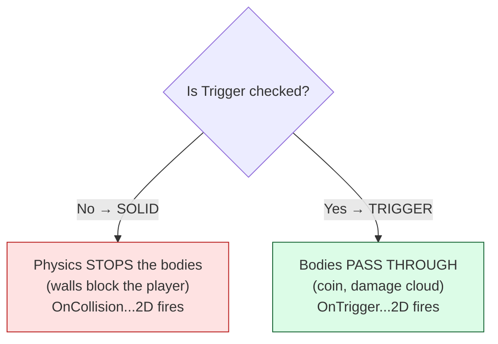
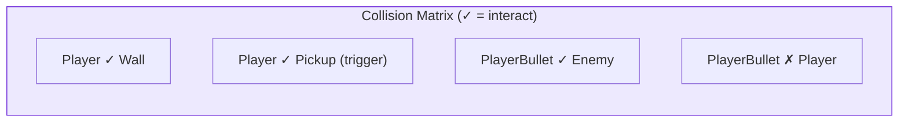

# Level 3 — Collision & Triggers

| | |
|---|---|
| 🎚️ **Difficulty** | 🟡 Medium |
| ⏱️ **Estimated time** | 34 minutes |
| ⭐ **XP reward** | 100 (Quest) + 25 (Quiz) |

[← Prev](02-player-controller-and-physics.md) · [↑ Phase Home](../README.md) · [→ Next](04-camera-systems.md)

---

## 📖 Story

> *"The player drives beautifully — and walks straight through walls. Time to make the world solid. Here's the distinction that trips up every junior: some things should **stop** you (walls), and some things should **notice** you but let you pass (a coin you pick up, a poison cloud that ticks damage). Same colliders underneath — but one is a **solid collision** and one is a **trigger**. Get them backwards and your coins become invisible walls and your walls become coins. Maya's ticket wants three things in the test room: walls that stop you, pickups you collect by touching, and a damage zone that hurts while you're inside it. One lesson, all three. — Kenji"*

---

## 🎯 Goal

- Understand **colliders** as the *shape* the physics engine tests, separate from the visual sprite
- Know the difference between a **solid collision** (blocks) and a **trigger** (overlaps, passes through)
- Understand **layers** and the **collision matrix** — controlling *what can hit what*
- See how overlap is computed from first principles (**AABB** and **circle** tests)
- Use the **collision callbacks** (`OnCollisionEnter2D` / `OnTriggerEnter2D` and Stay/Exit)
- Build Ashfall's **walls** (collision), **pickups** (trigger), and a **damage zone** (trigger Stay)

---

## 🧠 Concepts

### A collider is a shape, not a picture

The sprite is what you *see*; the **collider** is the invisible shape the physics engine actually tests for overlap. They don't have to match — a round coin sprite often gets a `CircleCollider2D`, a crate gets a `BoxCollider2D`. Keep colliders **simple** (box/circle) because overlap math is cheap on simple shapes and expensive on complex ones.

### Collision vs trigger — the core distinction

Every 2D collider has an **Is Trigger** checkbox. That one flag changes everything:



- **Solid collision** → the engine physically separates the bodies; you can't overlap. Use for **walls, obstacles, the player's body**. Callbacks: `OnCollisionEnter2D/Stay2D/Exit2D`.
- **Trigger** → no physical blocking; the engine just *tells you* an overlap started/continues/ended. Use for **pickups, checkpoints, damage zones, sensors**. Callbacks: `OnTriggerEnter2D/Stay2D/Exit2D`.

> ⚠️ For *any* callback to fire, at least one of the two objects must have a **Rigidbody2D** (the player already does, from Level 2).

### Layers and the collision matrix

You rarely want *everything* to collide with *everything*. Put objects on **layers** (`Player`, `Enemy`, `Wall`, `Pickup`, `PlayerBullet`…), then use the **Physics2D collision matrix** (Project Settings → Physics 2D) to check exactly which layer-pairs interact. Player bullets hit enemies but not the player; pickups overlap the player but ignore walls.



Tuning the matrix is both a **correctness** fix (no friendly fire) and a **performance** win (the engine skips pairs you've disabled).

### How overlap is actually computed (first principles)

The engine isn't magic — for simple shapes it's grade-school geometry:

- **Two circles** overlap when the distance between centers is less than the sum of radii:
  `distance(a, b) < rA + rB` (compare *squared* distance to avoid a square root).
- **Two axis-aligned boxes (AABB)** overlap when they overlap on **both** axes:
  `aMin.x < bMax.x && aMax.x > bMin.x && aMin.y < bMax.y && aMax.y > bMin.y`.

Every engine builds on these (then adds broad-phase culling so it doesn't test every pair). You'll almost always let the engine do it — but knowing the test means you understand *why* simpler colliders are faster and why a "near miss" sometimes counts.

### Why this exists

The collision-vs-trigger split is **universal** — Unity's `isTrigger`, Unreal's *Overlap vs Block* response, Godot's `Area2D` (sense) vs `StaticBody2D`/`CharacterBody2D` (block). It exists because games constantly need two different answers to "these two things touched": *stop them* or *just tell me*. Bundling both into one collider type, switchable by a flag, plus a layer matrix to scope *who cares about whom*, is the minimal system that expresses every gameplay interaction — doors, traps, loot, hitboxes, sensors. Master this and combat (World 5) and enemy AI sensing (World 6) are just more triggers and layers.

---

## 🛠️ Hands-on Lab

> 💻 Create layers first: **Project Settings → Tags and Layers** → add `Player`, `Wall`, `Pickup`, `Hazard`. Then set each object's Layer, and trim the **Physics 2D** matrix so only sensible pairs interact.

### Step 1 — A wall (solid collision)

A wall needs a **non-trigger** collider. If it never moves, give it a `Rigidbody2D` set to **Static** (or none) — but the *player* already has a dynamic Rigidbody, so callbacks fire.

```csharp
using UnityEngine;

// On the WALL. Leave its Collider2D "Is Trigger" UNCHECKED so it blocks.
public class Wall : MonoBehaviour
{
    void OnCollisionEnter2D(Collision2D collision)
    {
        // Fires when something physically bumps the wall. We get rich contact data:
        if (collision.gameObject.CompareTag("Player"))
            Debug.Log($"Player hit wall at {collision.GetContact(0).point}");
    }
}
```

The player is already *stopped* by the engine — no code needed for the blocking; the callback is just for reactions (sounds, scuffs).

### Step 2 — A pickup (trigger enter)

Check **Is Trigger** on the pickup's collider. It overlaps the player without blocking, and `OnTriggerEnter2D` fires once on entry.

```csharp
using UnityEngine;

// On the PICKUP. Its Collider2D "Is Trigger" is CHECKED.
public class Pickup : MonoBehaviour
{
    [SerializeField] private int value = 1;

    void OnTriggerEnter2D(Collider2D other)
    {
        if (!other.CompareTag("Player")) return;   // ignore everything else
        // TODO World 5: add to inventory. For now, prove it works:
        Debug.Log($"Picked up +{value}");
        Destroy(gameObject);                       // consume the pickup
    }
}
```

### Step 3 — A damage zone (trigger *stay*)

A poison cloud should hurt **while you're inside**, not just on entry — that's `OnTriggerStay2D`, which fires every physics tick of overlap.

```csharp
using UnityEngine;

// On the HAZARD. "Is Trigger" CHECKED. Deals damage-per-second while overlapped.
public class DamageZone : MonoBehaviour
{
    [SerializeField] private float damagePerSecond = 5f;

    void OnTriggerStay2D(Collider2D other)
    {
        if (!other.TryGetComponent(out IDamageable target)) return;
        // Stay fires on the physics clock → scale by fixedDeltaTime for per-second damage:
        target.TakeDamage(damagePerSecond * Time.fixedDeltaTime);
    }
}

// A tiny contract so the zone doesn't care WHAT it's hurting (player, enemy, crate):
public interface IDamageable { void TakeDamage(float amount); }
```

### Step 4 — Overlap from first principles (prove the math)

You'll let the engine do this in practice, but here's the circle test by hand — exactly what it's doing under the hood:

```csharp
// True if two circles overlap. Uses squared distance to skip the sqrt (faster).
static bool CirclesOverlap(Vector2 aCenter, float aRadius, Vector2 bCenter, float bRadius)
{
    float radii = aRadius + bRadius;
    return (bCenter - aCenter).sqrMagnitude < radii * radii;
}
```

---

## 🎮 Mini Challenge

A teammate's coin is a solid collider (Is Trigger unchecked) and the player "bonks" off it instead of collecting it — and `OnTriggerEnter2D` never fires. Two-part fix?

<details>
<summary>💡 Reveal answer</summary>

1. **Check "Is Trigger"** on the coin's collider so the player passes through (overlap, not block) — that's why it bonks now.
2. Trigger callbacks (`OnTriggerEnter2D`) only fire for trigger colliders; a *solid* collider raises `OnCollisionEnter2D` instead. With Is Trigger on, the trigger callback fires and the coin collects. (Also confirm one object has a Rigidbody2D — the player does.)
</details>

---

## 📦 Project Mission

Make Ashfall's test room solid and interactive — the playable space the camera will frame next lesson.

1. Build a small room: 4 **walls** (BoxCollider2D, *not* triggers, Layer `Wall`) using the `Wall` script. Drive the player into them — the Level 2 Rigidbody should stop dead, no clipping.
2. Add 2–3 **pickups** (trigger colliders, Layer `Pickup`) with the `Pickup` script — collect them by walking over; they log and disappear.
3. Add one **damage zone** (trigger, Layer `Hazard`) with `DamageZone` + the `IDamageable` interface; give the player a stub `Health : IDamageable` that logs current HP. Standing in it should drain HP smoothly per second.
4. Trim the **Physics 2D collision matrix**: Player↔Wall on, Player↔Pickup on, Pickup↔Wall off, etc.
5. Commit:
   ```bash
   cd ~/projects/ashfall
   git switch -c feature/collisions
   git add Assets/Scripts/World Assets/Scripts/Player
   git commit -m "feat: walls (collision), pickups + damage zone (triggers), layer matrix"
   git switch main && git merge feature/collisions && git push
   ```

🎯 **Mission complete when:** walls physically stop the Ashfall player (no clipping), pickups collect on touch via `OnTriggerEnter2D`, a damage zone drains HP per second via `OnTriggerStay2D`, and the collision matrix only enables sensible layer pairs.

---

## ⚠️ Common Mistakes

| Mistake | What happens | Fix |
|--------|--------------|-----|
| Pickup left as a solid collider | Player bonks off it; can't collect | Check "Is Trigger" |
| Expecting `OnTrigger...` from a solid collider (or vice-versa) | Callback never fires | Trigger→`OnTrigger...`, solid→`OnCollision...` |
| No Rigidbody2D on either object | No callbacks at all | One object needs a Rigidbody2D (player has it) |
| Per-tick damage in `Stay` without `fixedDeltaTime` | Damage scales with tick rate | Multiply by `Time.fixedDeltaTime` |
| Everything on the Default layer | Friendly fire, wasted overlap tests | Use layers + trim the matrix |
| Mesh/polygon colliders everywhere | Overlap math gets expensive | Prefer box/circle colliders |

---

## 🤔 Reflection Questions

1. Walls and pickups can use the *same* collider component. What single setting makes one block and the other pass through, and why is that a good design?
2. Why does the damage zone use `OnTriggerStay2D` and scale by `Time.fixedDeltaTime`, while the pickup uses `OnTriggerEnter2D` with no time scaling?
3. How does trimming the collision matrix help both *correctness* and *performance*? Give one example of each.

---

## 📝 Quiz

1. **A collider with "Is Trigger" checked will…**
   - a) physically block other bodies
   - b) let bodies pass through and raise `OnTrigger...2D`
   - c) disable the renderer
2. **For collision/trigger callbacks to fire, you need…**
   - a) both objects to be static
   - b) at least one object to have a Rigidbody2D
   - c) the camera to be orthographic
3. **Two circles overlap when…**
   - a) their centers are equal
   - b) the distance between centers is less than the sum of their radii
   - c) their radii are equal

<details>
<summary>✅ Answers</summary>

1: **b** · 2: **b** · 3: **b**
</details>

---

## ✅ Completion Checklist

- [ ] I can explain colliders vs sprites, and collision vs trigger
- [ ] I know which callbacks fire for solid vs trigger, and the Rigidbody requirement
- [ ] I understand layers + the collision matrix and the AABB/circle overlap tests
- [ ] Ashfall has walls that block, pickups that collect, and a damage zone that ticks
- [ ] The collision matrix only enables sensible layer pairs
- [ ] I passed the quiz
- [ ] Added **+125 XP** to [PROGRESS.md](../../../PROGRESS.md)

---

[← Prev](02-player-controller-and-physics.md) · [↑ Phase Home](../README.md) · [→ Next](04-camera-systems.md)
