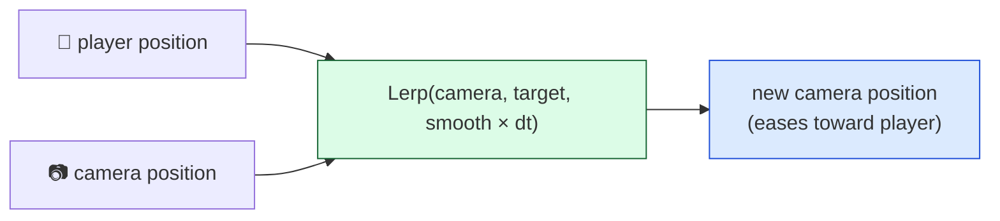
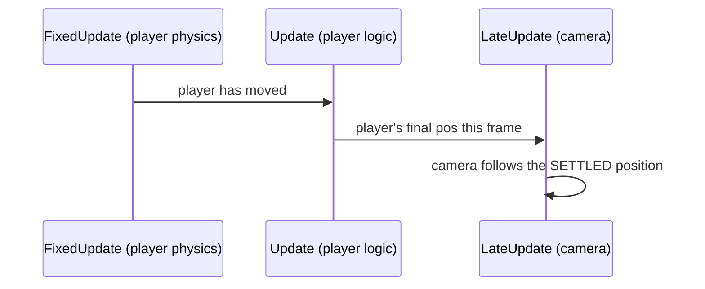

# Level 4 — Camera Systems

| | |
|---|---|
| 🎚️ **Difficulty** | 🟡 Medium |
| ⏱️ **Estimated time** | 32 minutes |
| ⭐ **XP reward** | 100 (Quest) + 25 (Quiz) |

[← Prev](03-collision-and-triggers.md) · [↑ Phase Home](../README.md) · [→ Next](05-saving-and-loading.md)

---

## 📖 Story

> *"We've got a player who moves, walls that stop them, pickups that pop. But the camera is bolted to the origin, so the hero walks right off the edge of the screen — instant motion sickness. A camera is its own little character: it has to **follow** the player, but smoothly, never snapping or jittering. It needs a **deadzone** so tiny wiggles don't make the whole world shudder. And it must **clamp** to the level bounds so we never show the black void outside the room. Good news — the smoothing is the exact **lerp** you learned in World 2. Today the camera becomes invisible in the best way: players never notice it, they just feel framed. — Kenji"*

---

## 🎯 Goal

- Understand the **orthographic** camera (2D) and what `orthographicSize` controls
- Build a **smooth follow** using lerp (from World 2) — and know *why* it goes in `LateUpdate`
- Add a **deadzone** so small movements don't jitter the view
- **Clamp** the camera to level bounds so you never reveal the void
- Understand **screen vs world** coordinates and converting between them
- Build Ashfall's **smooth follow camera**

---

## 🧠 Concepts

### Orthographic = no perspective (the 2D camera)

A **perspective** camera makes far things smaller (3D). An **orthographic** camera projects everything flat — no shrinking with distance — which is exactly what a 2D top-down game wants. Its one key knob is **`orthographicSize`**: the number of world units from the center to the **top** edge of the view (so the visible *height* is `2 × size`). Smaller size = zoomed in.

### Smooth follow is just lerp toward the target

A camera that hard-sets its position to the player every frame **snaps** — any tiny stutter in the player shows up in the whole world. Instead, ease toward the target each frame with a **lerp** (World 2): move a *fraction* of the remaining distance, every frame. That gives a soft, weighted follow with a trailing feel.



> Keep the camera's **z** fixed (e.g. -10 for a 2D cam) — only follow on x/y.

### Why `LateUpdate`

The player moves in `Update`/`FixedUpdate`. If the camera follows in `Update`, it might run **before** the player moved this frame — so it chases a stale position and **jitters**. `LateUpdate` runs *after* all `Update`s, so the player's final position for the frame is locked in. **Camera follow belongs in `LateUpdate`.**



### Deadzone — ignore the small stuff

Following *every* pixel of movement makes the view twitch. A **deadzone** is a small box around the camera center: while the player stays inside it, the camera holds still; only when they push past the edge does it start to follow. This keeps the frame calm during small adjustments and aiming.

### Clamp to bounds

The room has edges. Without clamping, following the player to the corner reveals the black void outside. **Clamp** the camera's center so its *view edges* never pass the level's min/max — accounting for half the view width/height (derived from `orthographicSize` and aspect).

### Screen vs world coordinates

Two different coordinate systems:
- **World space** — where objects live (meters, the player at `(12, -3)`).
- **Screen space** — pixels on the display (the mouse at `(640, 360)`).

You constantly convert: `Camera.ScreenToWorldPoint` (mouse → where in the world you clicked, for aiming) and `WorldToScreenPoint` (world object → where to draw a healthbar on the HUD). Mixing them up is why "the bullet won't go where I click."

### Why this exists

A camera is a *gameplay* system, not a passive lens — it decides what the player can see, how grounded the motion feels, and whether the world feels framed or seasick. The pieces are **engine-universal**: every engine smooths with lerp, runs camera logic *after* gameplay (Unity `LateUpdate`, Unreal `Tick` post-movement / spring arms, Godot `_process` with `Camera2D` smoothing + limits), uses deadzones, and clamps to bounds. Unity's **Cinemachine** package packages all of this for free — but you build it by hand once so you understand every knob it exposes. Get the follow right and Ashfall finally *plays* like a game instead of a tech demo.

---

## 🛠️ Hands-on Lab

> 💻 Set the Main Camera to **Projection: Orthographic**. Pick an `orthographicSize` that frames the room nicely (e.g. 5 → 10 units tall).

### Step 1 — Smooth follow in `LateUpdate`

```csharp
using UnityEngine;

public class CameraFollow : MonoBehaviour
{
    [SerializeField] private Transform target;     // the player
    [SerializeField] private float smoothSpeed = 8f;
    private float zDepth;

    void Awake() => zDepth = transform.position.z; // keep the camera's z fixed (e.g. -10)

    void LateUpdate()  // AFTER the player has moved this frame → no jitter
    {
        if (target == null) return;
        Vector3 desired = new Vector3(target.position.x, target.position.y, zDepth);

        // Lerp = ease a fraction toward the target each frame (World 2). dt = framerate-independent.
        transform.position = Vector3.Lerp(
            transform.position, desired, smoothSpeed * Time.deltaTime);
    }
}
```

### Step 2 — Add a deadzone

Only start following once the player leaves a small box around the camera center:

```csharp
    [SerializeField] private Vector2 deadzone = new Vector2(1.5f, 1f); // half-extents

    Vector3 ApplyDeadzone(Vector3 desired)
    {
        Vector3 cam = transform.position;
        float dx = desired.x - cam.x;
        float dy = desired.y - cam.y;

        // Only move on an axis if the player pushed past the deadzone edge:
        float targetX = Mathf.Abs(dx) > deadzone.x ? desired.x - Mathf.Sign(dx) * deadzone.x : cam.x;
        float targetY = Mathf.Abs(dy) > deadzone.y ? desired.y - Mathf.Sign(dy) * deadzone.y : cam.y;
        return new Vector3(targetX, targetY, zDepth);
    }
```

Then lerp toward `ApplyDeadzone(desired)` instead of the raw target.

### Step 3 — Clamp to level bounds

```csharp
    [SerializeField] private Vector2 minBounds; // bottom-left of the level
    [SerializeField] private Vector2 maxBounds; // top-right of the level

    Vector3 ClampToBounds(Vector3 pos)
    {
        Camera cam = Camera.main;
        float halfH = cam.orthographicSize;          // half the view height
        float halfW = halfH * cam.aspect;            // half the view width

        // Keep the camera's view edges inside the level rectangle:
        float x = Mathf.Clamp(pos.x, minBounds.x + halfW, maxBounds.x - halfW);
        float y = Mathf.Clamp(pos.y, minBounds.y + halfH, maxBounds.y - halfH);
        return new Vector3(x, y, zDepth);
    }
```

### Step 4 — Put it together + screen↔world

```csharp
    void LateUpdate()
    {
        if (target == null) return;
        Vector3 desired   = new Vector3(target.position.x, target.position.y, zDepth);
        Vector3 deadzoned = ApplyDeadzone(desired);
        Vector3 smoothed  = Vector3.Lerp(transform.position, deadzoned, smoothSpeed * Time.deltaTime);
        transform.position = ClampToBounds(smoothed);
    }

    // Bonus: where in the WORLD is the mouse? (used for aiming in World 2 / combat in World 5)
    public static Vector2 MouseWorld()
        => Camera.main.ScreenToWorldPoint(Input.mousePosition);
```

---

## 🎮 Mini Challenge

The camera follows perfectly but **jitters** — the player looks like it's vibrating, even moving in a straight line. The follow code is correct lerp… in `Update`. What's the one-word fix?

<details>
<summary>💡 Reveal answer</summary>

**`LateUpdate`.** In `Update`, the camera may run *before* the player's own `Update`/physics that frame, so it chases last frame's position and visibly jitters. Move the follow code to `LateUpdate`, which runs after all movement has settled. (Bonus: the player's physics is in `FixedUpdate`, making `Update`-ordering even less reliable — `LateUpdate` is the right home.)
</details>

---

## 📦 Project Mission

Give Ashfall a camera that makes the room feel like a real space.

1. Create `Assets/Scripts/Camera/CameraFollow.cs` (Steps 1–4) on the Main Camera; assign the player as `target`.
2. Tune `smoothSpeed` so the follow feels weighted but responsive (no snapping, no lag-behind).
3. Add a **deadzone** so small wiggles and aiming don't shake the view.
4. Set `minBounds`/`maxBounds` to your test room and confirm the camera **never reveals the void** outside the walls — even when you hug a corner.
5. Verify framerate independence (lerp uses `Time.deltaTime`) and that follow runs in `LateUpdate` (no jitter).
6. Commit:
   ```bash
   cd ~/projects/ashfall
   git switch -c feature/camera-follow
   git add Assets/Scripts/Camera
   git commit -m "feat: smooth follow camera with deadzone + bounds clamp (LateUpdate)"
   git switch main && git merge feature/camera-follow && git push
   ```

🎯 **Mission complete when:** Ashfall's orthographic camera smoothly follows the player in `LateUpdate`, holds still inside a deadzone, clamps to the level bounds (never showing the void), and stays smooth at any framerate.

---

## ⚠️ Common Mistakes

| Mistake | What happens | Fix |
|--------|--------------|-----|
| Following in `Update` | Camera jitters (chases stale position) | Follow in `LateUpdate` |
| Hard-setting position to the player | Snaps; every player stutter shows | Lerp toward the target |
| Lerp without `Time.deltaTime` | Smoothing speed varies by framerate | Multiply factor by `Time.deltaTime` |
| Overwriting the camera's z | Sprites vanish / wrong depth | Keep z fixed (e.g. -10), follow x/y only |
| Clamping the center, ignoring view size | View edges still show the void | Clamp accounting for half view W/H |
| Using `Input.mousePosition` as world coords | Aiming is wildly off | Convert via `ScreenToWorldPoint` |

---

## 🤔 Reflection Questions

1. Why does camera follow belong in `LateUpdate` rather than `Update` or `FixedUpdate`?
2. What problem does a deadzone solve that plain lerp-follow doesn't?
3. A player clicks to shoot but the bullet goes the wrong way. Which coordinate-space mistake is the likely cause, and how do you convert correctly?

---

## 📝 Quiz

1. **For a 2D top-down game you want a camera that is…**
   - a) perspective
   - b) orthographic
   - c) has high field-of-view
2. **Smooth follow + no jitter is achieved by…**
   - a) hard-setting position in `Update`
   - b) lerping toward the target in `LateUpdate`
   - c) parenting the camera to the player
3. **`Camera.ScreenToWorldPoint` converts…**
   - a) world coordinates into pixels
   - b) pixel/screen coordinates into world coordinates
   - c) degrees into radians

<details>
<summary>✅ Answers</summary>

1: **b** · 2: **b** · 3: **b**
</details>

---

## ✅ Completion Checklist

- [ ] I can explain orthographic projection and `orthographicSize`
- [ ] My follow uses lerp in `LateUpdate` and is framerate-independent
- [ ] I added a deadzone and clamping that accounts for view size
- [ ] I understand screen vs world coords and how to convert
- [ ] Ashfall's camera follows smoothly and never shows the void
- [ ] I passed the quiz
- [ ] Added **+125 XP** to [PROGRESS.md](../../../PROGRESS.md)

---

[← Prev](03-collision-and-triggers.md) · [↑ Phase Home](../README.md) · [→ Next](05-saving-and-loading.md)
