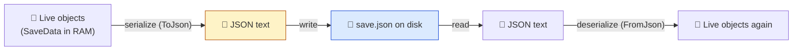
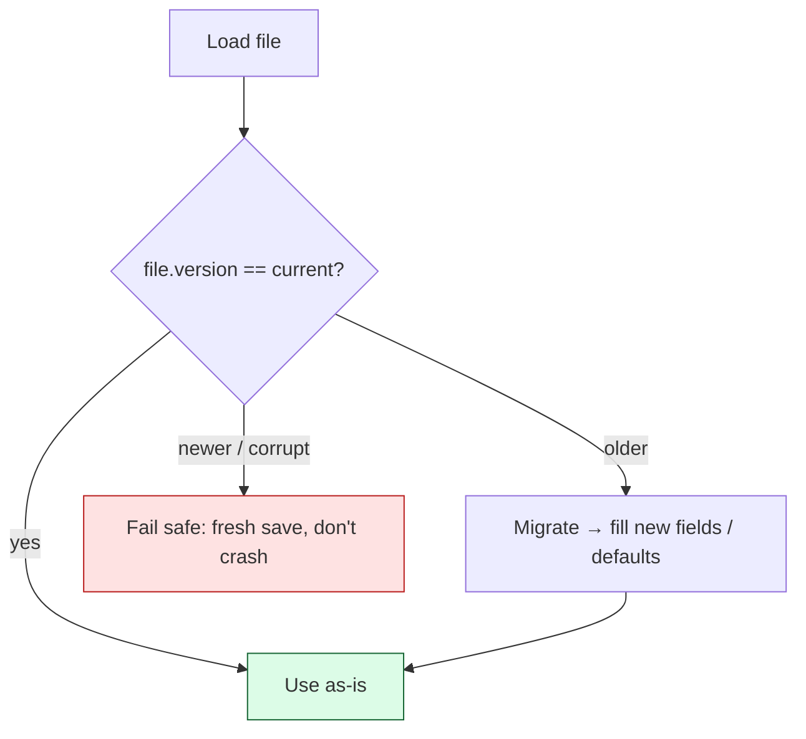

# Level 5 — Saving & Loading

| | |
|---|---|
| 🎚️ **Difficulty** | 🟡 Medium |
| ⏱️ **Estimated time** | 33 minutes |
| ⭐ **XP reward** | 100 (Quest) + 25 (Quiz) |

[← Prev](04-camera-systems.md) · [↑ Phase Home](../README.md) · [→ Next](../boss-battle.md)

---

## 📖 Story

> *"Last lesson of the world, and it's the one that makes a game feel real: when you quit and come back, the world remembers you. Theo wants to demo Ashfall to a publisher next week, and 'restart from scratch every time' is not a vibe. So today: **saving**. The core trick is **serialization** — turning live objects in memory into plain text we can write to disk, then reading that text back into objects later. We'll use JSON. Two rules I'll hammer on: save to the **right folder** (not next to the .exe — that's read-only on real installs), and **version** your saves from day one, because the moment you ship, save files become a contract you can't casually break. — Kenji"*

---

## 🎯 Goal

- Understand **serialization**: live objects ↔ a flat, storable representation
- Use **JSON** via Unity's **`JsonUtility`** to serialize/deserialize save data
- Know **where** save files belong: `Application.persistentDataPath`
- Decide **what** to persist (state, not engine objects) and what to recompute
- **Version** your saves so future changes don't corrupt old files
- Build Ashfall's **`SaveSystem`** persisting player position + an inventory stub

---

## 🧠 Concepts

### Serialization: memory ↔ disk

Your game state lives as objects in RAM — gone the instant the process exits. To **save**, you **serialize**: flatten those objects into a sequence of bytes/text (JSON, binary, XML) that can sit on disk. To **load**, you **deserialize**: read that text back and rebuild the objects.



JSON is the sweet spot for game saves: human-readable (you can debug it in a text editor), portable, and built into the engine.

### What to save (and what NOT to)

Save the **minimal source-of-truth state** — the facts you can't recompute:
- ✅ player position, HP, inventory contents, current level, unlocked doors, score.
- ❌ don't save GameObjects, Transforms, or scene references — those are engine runtime objects. Save the *data* (a position `Vector3`), then *apply* it to the rebuilt scene on load.

A good save is a **plain data class** with only serializable fields (numbers, strings, bools, and arrays/lists of those).

### Where saves go: `persistentDataPath`

Never write next to the executable — on real installs that folder is read-only or wiped on update. Every platform has a per-user writable location, and Unity hands it to you cross-platform as **`Application.persistentDataPath`** (e.g. `%userprofile%/AppData/...` on Windows, `~/Library/...` on macOS, the app sandbox on mobile). Always build paths with `Path.Combine` so they're correct on every OS.

### Versioning: a contract from day one

The day you ship, every player's save file is a contract. Next patch you add a field, rename one, change a meaning — and old saves must still load. Put a **`version`** number in the data *now*. On load, if the file's version is older, run a small **migration** (fill defaults, rename fields) instead of crashing.



### Why this exists

Persistence is the difference between a toy and a game — and the principles are **engine-agnostic**: serialize state to a writable per-user location, keep saves data-only, and version them. Unity gives `JsonUtility` + `persistentDataPath`; Unreal has `USaveGame` + `SaveGameToSlot`; Godot has `FileAccess` + `var_to_str`/JSON; every custom engine reinvents the same trio. The two disciplines — *right folder* and *versioning* — are the ones that bite real shipped games hardest (saves that won't write on a locked-down PC, or a patch that bricks everyone's progress). Build them in from the first save and World 9's bigger serialization (and any cloud-save later) is a straight extension of this. This is also the seam World 4's procedural worlds will plug their seeds into.

---

## 🛠️ Hands-on Lab

> 💻 `JsonUtility` serializes **public fields** (or `[SerializeField]` private ones) on classes marked `[System.Serializable]`. It does **not** serialize properties or `Dictionary` — use lists.

### Step 1 — A plain, versioned data class

```csharp
using System;
using System.Collections.Generic;
using UnityEngine;

[Serializable]
public class SaveData
{
    public int version = 1;          // bump when the shape changes; migrate on load
    public Vector3 playerPosition;   // state, not the Transform itself
    public float playerHp = 100f;
    public List<string> inventory = new List<string>(); // stub for World 5
}
```

### Step 2 — The `SaveSystem` (write + read JSON to persistentDataPath)

```csharp
using System.IO;
using UnityEngine;

public static class SaveSystem
{
    // Built once, correct on every OS:
    private static string Path =>
        System.IO.Path.Combine(Application.persistentDataPath, "ashfall_save.json");

    public static void Save(SaveData data)
    {
        string json = JsonUtility.ToJson(data, prettyPrint: true); // object → text
        File.WriteAllText(Path, json);                             // text → disk
        Debug.Log($"Saved to {Path}");
    }

    public static bool TryLoad(out SaveData data)
    {
        data = null;
        if (!File.Exists(Path)) return false;        // no save yet → caller starts fresh
        string json = File.ReadAllText(Path);        // disk → text
        data = JsonUtility.FromJson<SaveData>(json);  // text → object
        data = Migrate(data);                         // bring old files up to date
        return true;
    }

    // Versioning in action: upgrade older saves instead of crashing on them.
    private static SaveData Migrate(SaveData data)
    {
        if (data.version < 1) { data.version = 1; } // e.g. fill defaults for new fields
        // future: if (data.version < 2) { ...add new field defaults...; data.version = 2; }
        return data;
    }

    public static void Delete()
    {
        if (File.Exists(Path)) File.Delete(Path);
    }
}
```

### Step 3 — Collect state and save

```csharp
using UnityEngine;

public class GameSaver : MonoBehaviour
{
    [SerializeField] private Transform player;
    [SerializeField] private Health playerHealth;   // your IDamageable stub from Level 3

    public void SaveGame()
    {
        var data = new SaveData
        {
            playerPosition = player.position,
            playerHp       = playerHealth.Current,
            // inventory stays a stub until World 5 fills it
        };
        SaveSystem.Save(data);
    }
}
```

### Step 4 — Load and *apply* state to the rebuilt scene

```csharp
    public void LoadGame()
    {
        if (!SaveSystem.TryLoad(out SaveData data))
        {
            Debug.Log("No save found — starting fresh.");
            return;
        }
        // Apply DATA back onto live engine objects:
        player.position    = data.playerPosition;
        playerHealth.Current = data.playerHp;
        Debug.Log($"Loaded: pos {data.playerPosition}, hp {data.playerHp}, v{data.version}");
    }
```

> 💡 Test the round-trip: move the player, `SaveGame()`, quit Play mode, re-enter, `LoadGame()` — the player should reappear exactly where you left them. Open the `.json` in a text editor to *see* your state.

---

## 🎮 Mini Challenge

A teammate's save works in the Editor but throws *"access denied"* on a packaged build, and players report it "doesn't remember anything." Their path is `Application.dataPath + "/save.json"`. What's wrong?

<details>
<summary>💡 Reveal answer</summary>

`Application.dataPath` points at the **installed game files** folder, which is read-only (or wiped on update) on real installs — hence access denied. Save to **`Application.persistentDataPath`**, the per-user writable location the OS guarantees, built with `Path.Combine`:

```csharp
Path.Combine(Application.persistentDataPath, "save.json");
```
</details>

---

## 📦 Project Mission

Give Ashfall a save file that survives a restart — the capstone before the boss.

1. Create `Assets/Scripts/Save/SaveData.cs` (versioned) and `Assets/Scripts/Save/SaveSystem.cs` (Steps 1–2), writing to `Application.persistentDataPath`.
2. Add a `GameSaver` (Steps 3–4) that captures **player position + HP** (inventory left as a `List<string>` stub for World 5).
3. Wire a quick save/load (e.g. F5 / F9 keys, or buttons) and prove the round-trip: move, save, restart Play mode, load → player returns to the saved position & HP.
4. Open the generated `ashfall_save.json` in a text editor and confirm a `version` field is present.
5. Test the empty case: delete the save, load → "starting fresh" with no crash.
6. Commit:
   ```bash
   cd ~/projects/ashfall
   git switch -c feature/save-system
   git add Assets/Scripts/Save
   git commit -m "feat: JSON SaveSystem (persistentDataPath, versioned) — saves player pos + HP"
   git switch main && git merge feature/save-system && git push
   ```

🎯 **Mission complete when:** Ashfall writes a versioned JSON save to `persistentDataPath`, reloads player position + HP correctly across a restart, has an inventory stub ready for World 5, and handles a missing save without crashing.

---

## ⚠️ Common Mistakes

| Mistake | What happens | Fix |
|--------|--------------|-----|
| Saving to `dataPath` / next to the .exe | Access denied / wiped on update | Use `Application.persistentDataPath` |
| Trying to serialize GameObjects/Transforms | Garbage or errors | Save plain data; apply it on load |
| Using a `Dictionary` with `JsonUtility` | Field silently doesn't serialize | Use `List<>` (or a serializable wrapper) |
| Properties instead of fields | `JsonUtility` skips them | Use public fields / `[SerializeField]` |
| No `version` field | Future patches corrupt old saves | Add `version` + a migrate step now |
| Crashing when no save exists | First launch errors out | `File.Exists` check → start fresh |

---

## 🤔 Reflection Questions

1. Why save *data* (a position value) rather than the Transform/GameObject itself? What goes wrong if you try the latter?
2. Why is `Application.persistentDataPath` the right place, and what breaks if you save beside the executable?
3. You ship v1, then v2 adds a `stamina` field. With a `version` number in the save, how do old v1 files still load without crashing?

---

## 📝 Quiz

1. **Serialization is…**
   - a) compressing textures
   - b) turning live objects into a storable representation (and back)
   - c) drawing the scene
2. **Save files should be written to…**
   - a) `Application.dataPath` (next to the game)
   - b) `Application.persistentDataPath` (per-user writable)
   - c) the project's `Assets` folder
3. **Adding a `version` field to your save data mainly enables…**
   - a) faster saving
   - b) loading/migrating older saves after the format changes
   - c) smaller files

<details>
<summary>✅ Answers</summary>

1: **b** · 2: **b** · 3: **b**
</details>

---

## ✅ Completion Checklist

- [ ] I can explain serialization and the save/load round-trip
- [ ] I use `JsonUtility` with plain, serializable data (fields/lists, not Dictionaries)
- [ ] I save to `Application.persistentDataPath` via `Path.Combine`
- [ ] My save data has a `version` field and a migrate step
- [ ] Ashfall reloads player position + HP across a restart; inventory stub ready for W5
- [ ] I passed the quiz
- [ ] Added **+125 XP** to [PROGRESS.md](../../../PROGRESS.md)

---

[← Prev](04-camera-systems.md) · [↑ Phase Home](../README.md) · [→ Next](../boss-battle.md)
